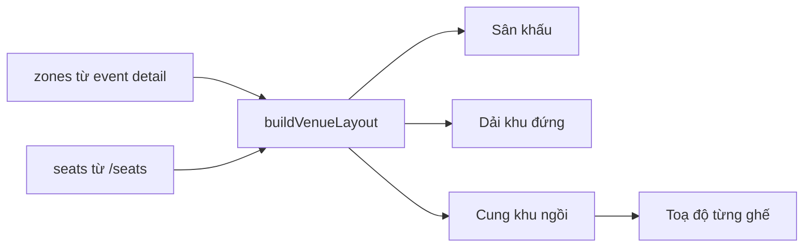
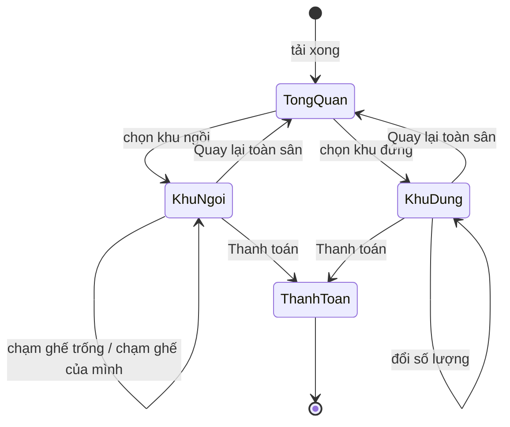
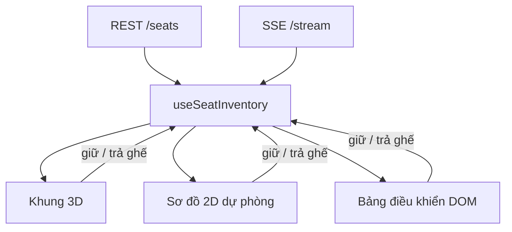

# Trải nghiệm chọn vé 3D

Thiết kế khung 3D cho bước chọn vé, theo hướng **B — Đêm diễn** trong [`CREATIVE_DIRECTION.md`](CREATIVE_DIRECTION.md).
Bản nháp chờ duyệt.

## 1. Phạm vi

- 3D chỉ có ở trang chọn vé, dự kiến là route `/events/:id/tickets`.
- Trang chủ, khám phá, chi tiết sự kiện, thanh toán và xác nhận không dùng Three.js.
- Sơ đồ ghế 2D trong `SeatMap.tsx` được giữ lại làm phương án dự phòng.
  Hiện sơ đồ này nằm ở trang chi tiết và trong hộp thoại ở trang thanh toán.
  Cả hai chỗ sẽ chuyển sang trang chọn vé.

## 2. Dữ liệu

### 2.1 Dữ liệu có sẵn

| Nguồn | Trường | Dùng cho |
|---|---|---|
| `GET /api/events/{slug}` | `zones[].zoneId`, `zoneCode`, `zoneName` | Danh sách khu |
| | `zones[].capacity` | Sức chứa khu |
| | `zones[].basePrice`, `floorPrice`, `ceilingPrice` | Bậc giá, thứ tự khu |
| | `zones[].floor` | Tầng; dữ liệu mẫu đang để trống |
| | `maxTicketsPerUser` | Giới hạn vé |
| `GET /api/events/{id}/seats` | `seatId`, `label`, `row`, `number` | Ghế và mã vị trí |
| | `x`, `y` | Chỉ dùng để sắp thứ tự (xem 2.2) |
| | `status`, `isMyHold` | Trạng thái ghế |
| | `currentPrice` | Giá từng ghế |
| | `zoneId`, `zoneCode`, `zoneName` | Ghế thuộc khu nào |
| `GET /api/events/{id}/stream` | SSE `update`: `type`, `seatId`, `status` | Cập nhật trực tiếp |
| `POST /api/holds` | `eventId`, `seatId` → `expiresAt` | Giữ một ghế |
| `DELETE /api/holds/{seatId}` | | Trả ghế |

Nguồn: `backend/internal/service/event_service.go`, `seat_service.go`, `backend/internal/httpapi/router.go`.

### 2.2 Dữ liệu còn thiếu

| Thiếu | Hệ quả |
|---|---|
| Vị trí sân khấu | Sân khấu luôn đặt ở một đầu sơ đồ |
| Đường biên, vị trí khu | Khu được xếp theo bậc giá (mục 4) |
| Toạ độ ghế thật | `x = số ghế`, `y = hạng khu × 3 + hàng` chỉ là lưới tổng hợp |
| Loại khu (ngồi hay đứng) | Suy ra từ tên khu (mục 3) |
| Màu khu | Tô theo bậc giá |
| Ảnh góc nhìn thật | Góc nhìn chỉ là ước lượng từ sơ đồ (mục 9) |

Kết luận: không dựng được bản sao đúng của sân Mỹ Đình hay Ocean Park.
Khung 3D là **sơ đồ minh hoạ** sinh từ danh sách khu và bậc giá.
Khung luôn hiện dòng chữ:

> Sơ đồ minh hoạ theo hạng vé. Vị trí thật của các khu theo công bố của Ban Tổ chức.

## 3. Khu ngồi và khu đứng

### 3.1 Nhận diện

Backend chưa có trường loại khu.
Frontend coi một khu là **khu đứng** khi `zoneName` chứa chữ "đứng", không phân biệt hoa thường.

Dữ liệu mẫu có 14 khu đứng trên 54 khu, ví dụ:

- `GA 1 (đứng)`
- `CAT 1 (khu đứng)`
- `Đứng - Mứt Gừng 1, 2`

Quy tắc này dễ vỡ.
Hàm nhận diện nằm riêng một chỗ, để đổi sang trường từ backend khi có.

### 3.2 Khu ngồi

- Hiện từng ghế.
- Người dùng chọn ghế cụ thể.
- Mỗi ghế có mã `label`, trạng thái và giá riêng.

### 3.3 Khu đứng

Backend vẫn chia khu đứng thành 24 "ghế" A1–B12.
Hiện các mã này cho người dùng là sai: không có chỗ đứng cố định tên A1.

Cách làm:

1. Khu đứng hiện như một mặt sàn, không có ghế.
   Rê chuột hoặc chọn khu thì bảng thông tin hiện tên khu, giá và số vé còn lại.
2. Người dùng chọn **số lượng**, trong giới hạn:
   - số vé còn được mua theo `maxTicketsPerUser`;
   - số "ghế" còn `available` trong khu.
3. Frontend gọi `POST /api/holds` lần lượt cho từng "ghế" còn trống trong khu.
   - Gặp xung đột (người khác vừa giữ) thì thử ghế trống kế tiếp.
   - Không đủ số lượng thì giữ phần đã được, rồi báo rõ: "Chỉ giữ được 2 trên 3 vé. Khu GA 1 vừa hết chỗ."
4. Vé, giỏ và trang thanh toán hiện `GA 1 · Vé đứng`, không hiện mã "ghế".

Không cần API mới.
Mọi lời gọi vẫn dùng hợp đồng hiện có.

## 4. Dựng sơ đồ

### 4.1 Quy tắc xếp khu

Hàm thuần `buildVenueLayout(zones, seats)` trả về hình học của sơ đồ.
Cùng đầu vào thì luôn cùng đầu ra.

1. Sân khấu là một khối chữ nhật ở đầu sơ đồ (phía −Z).
2. Sắp các khu theo `basePrice` giảm dần.
   Cùng giá thì giữ thứ tự API trả về.
3. Khu đứng nằm trên mặt sàn, ngay trước sân khấu.
   Mỗi khu là một dải chữ nhật, khu đắt hơn gần sân khấu hơn.
4. Khu ngồi xếp thành các cung tròn quanh sân khấu, theo hình móng ngựa.
   - Khu đắt hơn nằm ở cung trong và thấp hơn.
   - Mỗi cung tối đa 3 khu, chia đều góc 150°.
5. Trong một khu ngồi:
   - `row` quyết định độ sâu và độ cao, mỗi hàng nâng 0,4 đơn vị như khán đài có độ dốc;
   - `number` quyết định vị trí dọc theo cung;
   - `x` và `y` từ API chỉ dùng để sắp thứ tự khi `row` hoặc `number` trống.



### 4.2 Hình khối

Khung cảnh là một mô hình kiến trúc cách điệu, tông xanh navy gần đen.
Màu chỉ nằm ở mặt khu (theo bậc giá) và vài đường đèn mảnh.

| Thành phần | Hình học | Vật liệu |
|---|---|---|
| Sân khấu | Bệ, mặt sàn bóng, viền đèn xanh điện phía khán giả | Kim loại tối |
| Màn LED | Một màn sau sân khấu, hai màn nghiêng hai bên | Texture canvas lưới điểm, xanh sang tím hồng |
| Giàn đèn | Bốn cột, khung trên đầu, loa treo hai bên | Một `InstancedMesh` hộp dùng chung |
| Đèn và chùm sáng | Đèn trên giàn, chùm nón cộng sáng xanh, tím, hồng | `InstancedMesh`, độ mờ thấp |
| Khu đứng | Sàn nâng, rào chắn quanh khu và trước sân khấu | Màu bậc giá trên mặt sàn |
| Khu ngồi | Mỗi hàng một bậc khán đài đặc tới đất, lan can sau | Một geometry gộp cho mỗi khu, màu theo đỉnh |
| Viền khu | Dải đèn mảnh ở mép trước mỗi khu | Gộp chung một mesh, màu đổi theo trạng thái |
| Vỏ sân | Tường thấp sau khán đài; mái và cột chỉ ở hai bên | Mái trong mờ, không che khán đài khi xoay camera |
| Ghế | Ghế có mặt ngồi, tựa lưng, chân; bốn `InstancedMesh` theo trạng thái | Mỗi trạng thái một vật liệu |
| Vòng của bạn | Một `InstancedMesh` hình vòng nằm phẳng | Màu `spot` |

- Mặt bậc nhận màu khu, mặt đứng giữ màu bê tông, và mọi khối tối dần về phía đất.
  Đây là cách giả lập ambient occlusion bằng màu đỉnh, không cần hậu kỳ.
- Đèn chính đổ bóng mềm (shadow map 2048) trên máy tính; điện thoại tắt bóng đổ.
- Đèn viền tím hồng từ sau sân khấu và hai đèn rọi ấm trên giàn.
- Mỗi sự kiện mẫu có 168–288 ghế, nên mỗi trạng thái chỉ tốn một lần vẽ.
- Không có ảnh texture; mọi texture là canvas sinh lúc chạy.

## 5. Tương tác

### 5.1 Luồng



### 5.2 Toàn sân

- Camera nhìn ba phần tư từ phía sau, lệch trái, thấy rõ độ cao sân khấu và độ dốc khán đài.
  Khung dọc (điện thoại) nhìn thẳng hơn và lùi xa hơn để thấy trọn sân.
- Không có chữ nằm trên mô hình.
  Rê chuột lên một khu thì khu sáng lên và bảng thông tin ở góc trên hiện tên, loại khu, giá, số chỗ còn, số vé bạn đang giữ.
- Khu hết vé chuyển màu xám, viền xám, bảng ghi "Hết vé".
- Khu đang chọn có viền màu `spot`, đèn dõi chiếu xuống; các khu khác tối đi.
- Nút "Chú thích" mở bảng màu theo giá và quy ước trạng thái ghế.
- Kéo để xoay không bao giờ chọn khu: nhả chuột sau khi kéo quá 6 px không tính là bấm.
- Bảng điều khiển bên cạnh (dưới đáy trên điện thoại) liệt kê cùng các khu đó.

### 5.3 Trong một khu ngồi

- Camera bay đến khu, thời lượng `scene` 700 ms.
- Chạm ghế trống thì gọi `POST /api/holds`.
- Chạm ghế của mình thì gọi `DELETE /api/holds/{seatId}`.
- Chạm ghế không chọn được thì hiện thông báo.
  Ghế không vào giỏ (mục 4.1, bước 7 của thiết kế gốc).
- Đạt giới hạn thì hiện "Đã đạt giới hạn số vé cho sự kiện này".

### 5.4 Camera

Dùng `CameraControls` của Drei, có giới hạn:

- góc ngẩng từ 15° đến 70°, không chui xuống dưới sàn;
- góc xoay ngang ±80° quanh trục sân khấu, không nhìn từ sau sân khấu;
- khoảng cách bị giới hạn để toàn sân luôn còn trong khung.

Nút "Quay lại toàn sân" luôn hiện khi đang ở trong một khu.

## 6. Đồng bộ trạng thái

Hiện `SeatMap.tsx` tự giữ trạng thái ghế.
Trang chọn vé tách phần này thành hook `useSeatInventory(eventId)`.

Hook này lo các việc:

- tải `/seats` lần đầu;
- nghe SSE `/stream` và cập nhật từng ghế;
- gọi `POST /api/holds` và `DELETE /api/holds/{seatId}`;
- lưu `expiresAt` của từng ghế đang giữ;
- tính số vé còn được mua, dùng `ticketLimitOf(event)` và `ticketsBookedFor(eventId)` đã có.

Khung 3D, sơ đồ 2D dự phòng và bảng điều khiển DOM cùng đọc một nguồn này.
Ba nơi không bao giờ lệch nhau.



## 7. Hiệu năng

### 7.1 Tải lười

- Trang chọn vé tải khung 3D qua `React.lazy(() => import('./venue3d/VenueScene'))`.
- Các trang khác không chứa mã Three.js.
  Kiểm tra bằng cách xem các chunk sinh ra sau `vite build`.
- Trong lúc tải, bảng điều khiển DOM đã dùng được.
  Người dùng có thể chọn khu trước khi khung 3D hiện ra.

### 7.2 Ngân sách

| Chỉ số | Mục tiêu |
|---|---|
| Chunk 3D sau gzip | ≤ 250 KB (đo được 259 KB, vượt 9 KB) |
| Draw call ở toàn sân | ≤ 45 khi có kiến trúc (ước tính khoảng 40, chưa kể lượt vẽ bóng) |
| Khung hình khi xoay, Android tầm trung | ≥ 50 fps |
| Bộ nhớ GPU | ≤ 64 MB |

### 7.3 Cách tiết kiệm GPU

- `frameloop="demand"`: chỉ vẽ lại khi camera di chuyển hoặc dữ liệu đổi.
- `dpr={[1, 1.75]}`, điện thoại `[1, 1.5]`.
- Một đèn đổ bóng duy nhất; điện thoại tắt bóng đổ. Không bloom, không SSAO.
- Chùm sáng và đèn dõi là mặt nón cộng sáng, không phải `SpotLight` đổ bóng.
- Hộp kiến trúc, cột, đèn và chùm sáng đều là `InstancedMesh`; viền khu gộp một mesh.
- Tab bị ẩn thì dừng vẽ.
- Rời trang thì giải phóng geometry và material.

## 8. Dự phòng

| Tình huống | Xử lý |
|---|---|
| Đang tải chunk 3D | Bảng điều khiển DOM dùng được; khung 3D hiện khung xương tĩnh |
| Trình duyệt không có WebGL | Hiện sơ đồ 2D, kèm một dòng giải thích |
| Mất WebGL context | Hiện sơ đồ 2D; nút "Thử lại khung 3D" |
| Người dùng chọn "Sơ đồ 2D" | Hiện sơ đồ 2D; nhớ lựa chọn trong `localStorage` |
| Lỗi tải `/seats` | Báo lỗi và có nút tải lại; không vẽ sơ đồ rỗng |

## 9. Sơ đồ 2D và góc nhìn từ chỗ ngồi

### 9.1 Sơ đồ 2D

- Sơ đồ 2D là hình chiếu từ trên xuống của chính `VenueLayout` mà khung 3D dùng.
  Trục X giữ nguyên, trục Z thành trục dọc; sân khấu ở trên, khán giả ở dưới.
- Cùng mã khu, cùng màu bậc giá, cùng toạ độ ghế với khung 3D.
- Khu ngồi là hình cung, khu đứng là ô có chấm; khu hết vé màu xám.
- Chữ nằm ở một lớp riêng theo điểm ảnh màn hình, đặt ở lối đi sau mỗi khán đài.
  Khung nhỏ (điện thoại) thu chữ còn 9 px và ẩn giá; danh sách hạng vé bên cạnh vẫn có giá.
- Phóng to, thu nhỏ bằng con lăn, chụm hai ngón hoặc nút; kéo để dời. Chọn khu thì sơ đồ phóng tới khu đó.

### 9.2 Một trạng thái chọn cho cả 2D và 3D

- Khu đang chọn (`activeZoneId`) và ghế đang giữ (`useSeatInventory`) nằm ở trang, không nằm trong từng chế độ.
- Khung 3D được giữ lại sau lần tải đầu và chỉ bị ẩn khi xem 2D (`frameloop="never"`), nên chuyển qua lại không mất camera hay lựa chọn.
- Không có WebGL hoặc 3D lỗi thì trang chỉ hiện sơ đồ 2D, vẫn chọn và giữ vé được.

### 9.3 Xem từ chỗ ngồi

- Nút "Xem từ chỗ ngồi" ("Xem từ khu đứng" với khu đứng) nằm ở bảng điều khiển khi đã chọn một khu.
- Vị trí xem, theo thứ tự ưu tiên:
  - ghế bạn đang giữ trong khu, theo vị trí của ghế đó trên sơ đồ minh hoạ;
  - nếu chưa giữ ghế: hàng giữa, chính giữa khu;
  - khu đứng: giữa sàn, tầm mắt người đứng.
- Mọi góc nhìn đều là ước lượng, vì toạ độ ghế là toạ độ sinh ra cho sơ đồ minh hoạ, không phải toạ độ thật.
  Khung luôn ghi rõ góc nhìn lấy từ đâu và "không phải ảnh chụp thật".
- Camera dùng chính `CameraControls` của khung 3D ở chế độ góc nhìn thứ nhất:
  - kéo để nhìn quanh, giới hạn ±70° ngang, −28°/+22° dọc so với hướng sân khấu;
  - không thu phóng; góc nhìn rộng hơn (58°) cho giống mắt người;
  - "Đặt lại góc nhìn" quay về hướng sân khấu;
  - "Thoát góc nhìn" đưa camera về đúng vị trí trước đó.
- Trong góc nhìn này không chọn hay giữ ghế được, để tránh bấm nhầm.
- Chuyển sang 2D hoặc chọn khu khác thì tự thoát góc nhìn.

## 10. Điện thoại

- Khung 3D chiếm 55% chiều cao màn hình (`55svh`).
- Bảng điều khiển nằm ngay dưới khung 3D, không phải sheet kéo.
  Khi đang giữ vé, một thanh cố định ở đáy màn hình luôn hiện tổng tiền, đồng hồ và nút "Thanh toán".
- Bảng thông tin khu ở góc trên; câu "sơ đồ minh hoạ" rút gọn nằm ngay trên nút "Chú thích".
- Chạm một ngón để xoay, hai ngón để thu phóng.
  Không dùng kéo một ngón để dời camera, tránh tranh với cuộn trang.
- Chạm vào ghế thuộc khu khác thì chỉ chọn khu đó, không giữ ghế.
  Chọn ghế cụ thể qua lưới ghế trong bảng điều khiển; mỗi ô rộng tối thiểu 36 px, lưới cuộn ngang khi thiếu chỗ.

## 11. Tiếp cận và giảm chuyển động

- `<canvas>` có `aria-hidden="true"`.
- Mọi thao tác có bản tương đương trong bảng điều khiển DOM:
  - danh sách khu là nhóm radio;
  - ghế là lưới nút, có `aria-label` dạng "Ghế A5, khu VIP, 9.800.000 ₫, còn trống".
- Chọn trong DOM thì camera 3D đi theo.
  Chọn trong 3D thì focus DOM đi theo.
- Thay đổi từ SSE ảnh hưởng đến ghế của bạn thì đọc qua `aria-live="polite"`.
  Ví dụ: ghế bạn đang giữ đã hết giờ.
- Khi `prefers-reduced-motion: reduce`:
  - camera chuyển cảnh tức thì;
  - không có hiệu ứng đèn khán phòng tắt.

## 12. Cấu trúc component

```text
TicketSelectionPage                    route /events/:id/tickets
├── useSeatInventory(eventId)          REST + SSE + giữ/trả ghế
├── useVenueLayout(zones, seats)       gọi buildVenueLayout, có memo
├── ZonePanel                          DOM: khu, giá, số còn
├── SelectionTray                      DOM: ghế đã giữ, đồng hồ, tổng, "Thanh toán"
├── Suspense
│   └── VenueScene (lazy)              Canvas của R3F
│       ├── Lighting                   đèn chính đổ bóng, đèn viền, hai đèn rọi
│       ├── Architecture               sân khấu, LED, giàn đèn, vỏ sân
│       ├── ZoneMesh × n               một mesh mỗi khu, rê chuột và bấm
│       ├── ZoneStrips                 viền khu, một mesh
│       ├── SeatLayer                  ghế instanced và vòng của bạn
│       ├── CameraRig                  CameraControls của Drei
│       └── VenueOverlay               DOM: bảng thông tin, chú thích, quay lại
├── FloorPlan2D                        SVG nhìn từ trên xuống, cùng VenueLayout
└── VenueOverlay                       DOM: bảng thông tin và chú thích, dùng chung cho 2D và 3D
```

## 13. Thư viện

Đã cài ở giai đoạn 4 (xem [`IMPLEMENTATION_ROADMAP.md`](IMPLEMENTATION_ROADMAP.md)).

| Gói | Lý do | Ghi chú |
|---|---|---|
| `three` | Lõi 3D | |
| `@react-three/fiber` | Dùng Three.js trong React | Cần bản 9.x để chạy với React 19 |
| `@react-three/drei` | `CameraControls` | Import từng phần để tree-shake |
| `@types/three` | Kiểu TypeScript | `devDependencies` |

Chốt phiên bản cụ thể lúc cài.
Không cần GSAP hay Framer Motion riêng: gói `motion` đã có sẵn.

## 14. Đề nghị gửi backend

Đây là đề nghị, frontend không tự làm.
Thiếu các trường này thì frontend vẫn chạy được theo các mục ở trên.

1. Trường loại khu trong `venue_zones`, ví dụ `kind`: `SEATED` hoặc `STANDING`.
   Thay cho cách đoán theo tên ở mục 3.1.
2. Trường màu và thứ tự hiển thị của khu.
   Thiết kế gốc mục 4.2 đã nói khu có "mã, tên, màu", nhưng bảng chưa có cột màu.
3. Hình học địa điểm: vị trí sân khấu, đa giác từng khu.
   Có dữ liệu này thì bỏ được chữ "minh hoạ".
4. API giữ chỗ theo số lượng cho khu đứng.
   Thay cho việc frontend giữ từng "ghế".
5. API đơn hàng và thanh toán.
   Hiện trang thanh toán chỉ mô phỏng và lưu vào `localStorage`.

## 15. Rủi ro

| Rủi ro | Giảm thiểu |
|---|---|
| Người dùng tưởng sơ đồ là vị trí thật | Dòng chữ "minh hoạ" luôn hiện; bảng thông tin dùng đúng tên khu của Ban Tổ chức |
| Đoán sai khu đứng | Hàm nhận diện nằm một chỗ, có kiểm thử theo dữ liệu mẫu |
| Giữ nhiều ghế khu đứng bị xung đột | Thử ghế kế tiếp; báo rõ số đã giữ được |
| Máy yếu bị giật | `frameloop="demand"`, giới hạn DPR, chuyển sang 2D nếu fps thấp kéo dài |
| Ba nơi hiển thị lệch nhau | Một nguồn trạng thái duy nhất, `useSeatInventory` |
