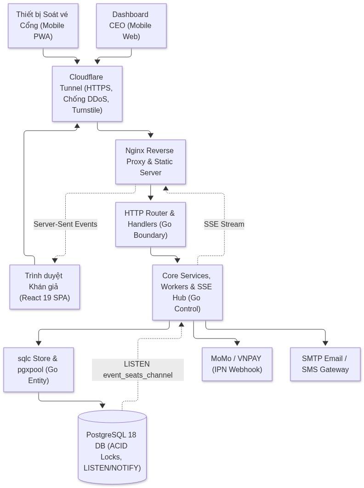
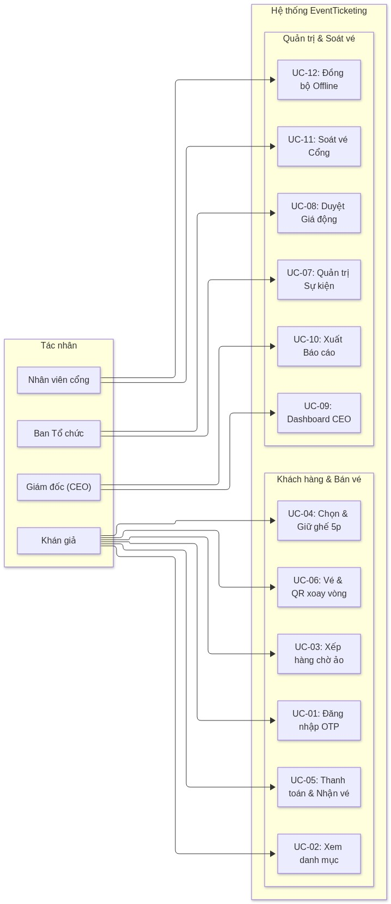
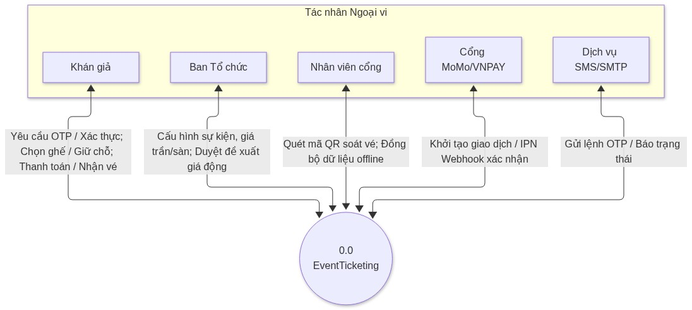
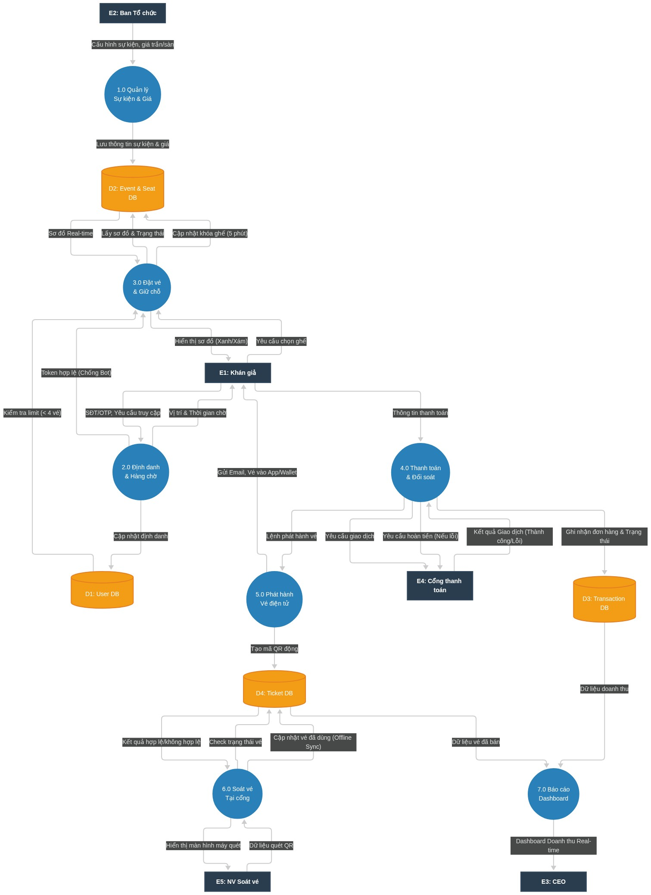
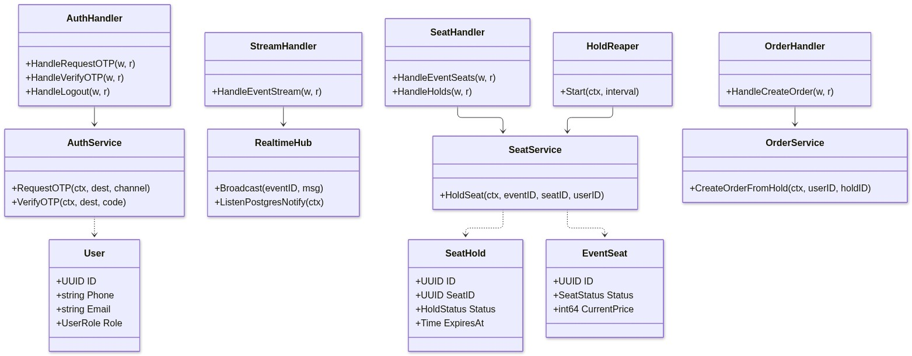
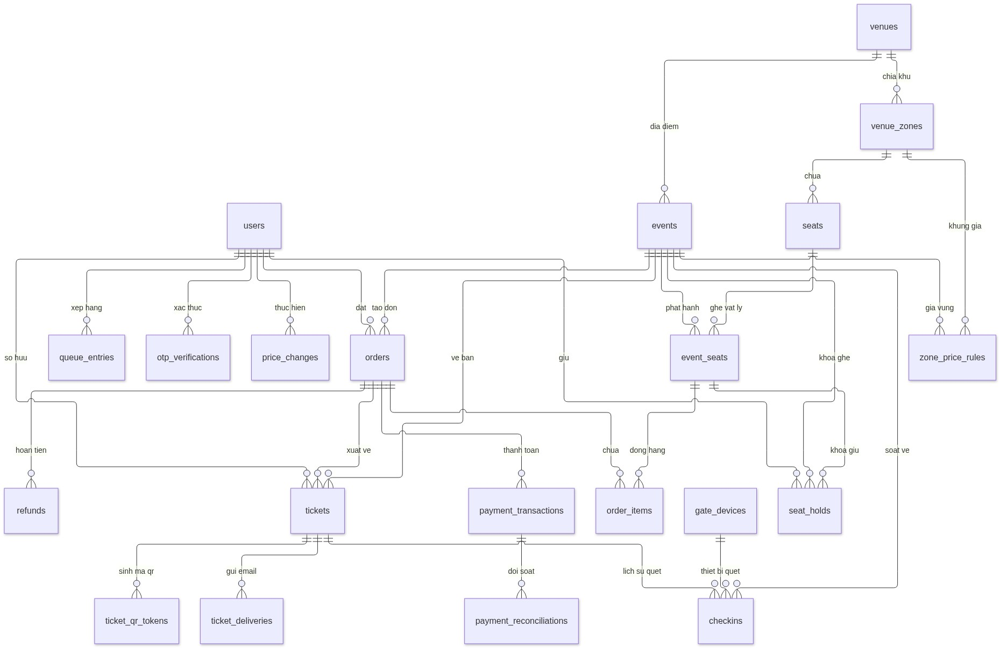
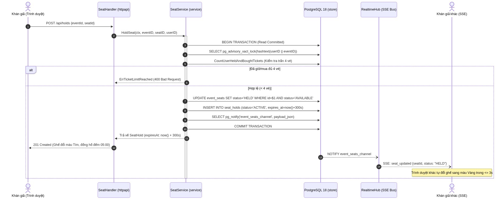
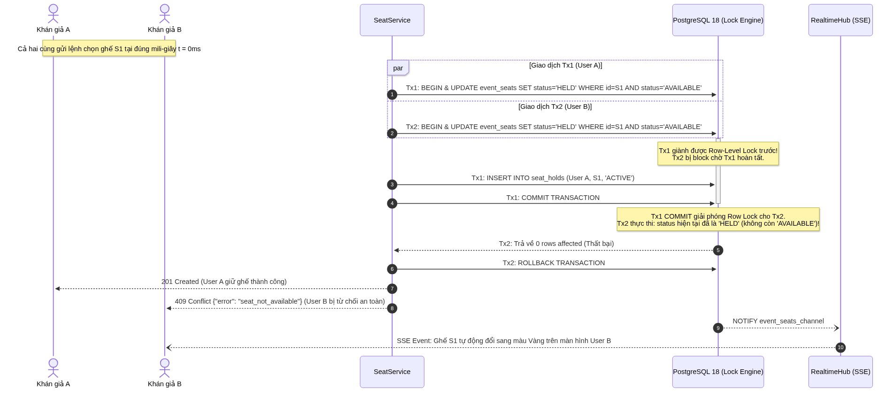

BỘ GIÁO DỤC VÀ ĐÀO TẠO
TRƯỜNG ĐẠI HỌC NGOẠI THƯƠNG
KHOA CÔNG NGHỆ VÀ KHOA HỌC DỮ LIỆU

---

# BÁO CÁO TIỂU LUẬN VÀ THỰC HÀNH MÔN HỌC
## PHÂN TÍCH VÀ THIẾT KẾ HỆ THỐNG

### ĐỀ TÀI:
# THIẾT KẾ HỆ THỐNG ĐẶT VÉ TRỰC TUYẾN CHO SỰ KIỆN (EVENTTICKETING)

**Sinh viên thực hiện:**
- Vũ Đức Huy — MSV: 2412960011
- Trần Trung Nhân — MSV: 2412960019
- Đinh Tiến Thành — MSV: 2413960023
- Lê Đức Anh — MSV: 2411960002
- Nguyễn Đức Phúc — MSV: 2413960020
- Nguyễn Anh Dũng — MSV: 2413960006

**Giảng viên hướng dẫn:** TS. Phạm Thị Kim Dung  
**Khoa:** Công nghệ và Khoa học dữ liệu  
**Lớp học phần:** COSH201 (2526.1 – GD1).1 / COSH301  

*Hà Nội – Năm 2026*

---

# PHIẾU CHẤM ĐIỂM TIỂU LUẬN

### 1. Thông tin sinh viên thực hiện và Phân công tiến độ

| STT | Họ và tên | Mã sinh viên | Nhiệm vụ chính trong dự án | Đóng góp | Điểm số | Chữ ký |
|:---:|---|:---:|---|:---:|:---:|:---:|
| 1 | **Vũ Đức Huy** | 2412960011 | Thiết kế ERD 26 bảng, Sơ đồ lớp BCE, Kế hoạch Sprint & Realtime SSE Hub | 100% | | |
| 2 | **Trần Trung Nhân** | 2412960019 | Kiến trúc hệ thống, Backend Go, Frontend React, Sequence OTP & API Spec | 100% | | |
| 3 | **Đinh Tiến Thành** | 2413960023 | Bóc tách bài toán, Thuật toán Định giá động, Ma trận truy vết FR/NFR | 100% | | |
| 4 | **Lê Đức Anh** | 2411960002 | Sơ đồ & Đặc tả Use Case, Kiểm thử người dùng thực tế (Khảo sát SUS) | 100% | | |
| 5 | **Nguyễn Đức Phúc** | 2413960020 | Sơ đồ luồng dữ liệu (DFD), Sơ đồ tuần tự Chống bán trùng ghế đa luồng | 100% | | |
| 6 | **Nguyễn Anh Dũng** | 2413960006 | Sequence Giữ ghế 5 phút, Kiểm thử thủ công FR-06, Bóc tách yêu cầu | 100% | | |

### 2. Đánh giá của Giảng viên hướng dẫn

| Giảng viên chấm thi | Điểm số (Bằng số) | Điểm số (Bằng chữ) | Ý kiến nhận xét và Chữ ký |
|---|:---:|:---:|---|
| **TS. Phạm Thị Kim Dung** | | | <br/><br/>*Chữ ký: ....................................................* |

---

# MỤC LỤC

- [LỜI MỞ ĐẦU](#lời-mở-đầu)
- [PHẦN 1. GIỚI THIỆU VÀ TỔNG QUAN HỆ THỐNG](#phần-1-giới-thiệu-và-tổng-quan-hệ-thống)
  - [1.1. Bối cảnh thực tiễn và Tính cấp thiết](#11-bối-cảnh-thực-tiễn-và-tính-cấp-thiết)
  - [1.2. Mục tiêu nghiên cứu và Giới hạn phạm vi (MVP vs. Won't-Have)](#12-mục-tiêu-nghiên-cứu-và-giới-hạn-phạm-vi-mvp-vs-wont-have)
  - [1.3. Phương pháp luận phân tích và thiết kế hệ thống](#13-phương-pháp-luận-phân-tích-và-thiết-kế-hệ-thống)
  - [1.4. Danh sách các bên liên quan (Stakeholders)](#14-danh-sách-các-bên-liên-quan-stakeholders)
- [PHẦN 2. BÓC TÁCH VÀ ĐẶC TẢ YÊU CẦU HỆ THỐNG](#phần-2-bóc-tách-và-đặc-tả-yêu-cầu-hệ-thống)
  - [2.1. Yêu cầu Chức năng (23 FRs phân bổ 5 Sprint)](#21-yêu-cầu-chức-năng-23-frs-phân-bổ-5-sprint)
  - [2.2. Yêu cầu Phi chức năng (13 NFRs gắn SLA định lượng)](#22-yêu-cầu-phi-chức-năng-13-nfrs-gắn-sla-định-lượng)
  - [2.3. User Stories và Tiêu chí chấp nhận (Given-When-Then)](#23-user-stories-và-tiêu-chí-chấp-nhận-given-when-then)
  - [2.4. Phân loại ưu tiên MoSCoW và Lộ trình MVP](#24-phân-loại-ưu-tiên-moscow-và-lộ-trình-mvp)
  - [2.5. Ma trận truy vết yêu cầu (Traceability Matrix)](#25-ma-trận-truy-vết-yêu-cầu-traceability-matrix)
- [PHẦN 3. THIẾT KẾ KIẾN TRÚC VÀ MÔ HÌNH HÓA HỆ THỐNG](#phần-3-thiết-kế-kiến-trúc-và-mô-hình-hóa-hệ-thống)
  - [3.1. Nguyên lý kiến trúc BCE và Triết lý Single Source of Truth trên PostgreSQL 18](#31-nguyên-lý-kiến-trúc-bce-và-triết-lý-single-source-of-truth-trên-postgresql-18)
  - [3.2. Sơ đồ kiến trúc triển khai hệ thống (Deployment Architecture)](#32-sơ-đồ-kiến-trúc-triển-khai-hệ-thống-deployment-architecture)
  - [3.3. Sơ đồ và Đặc tả trường hợp sử dụng (Use Case Diagram)](#33-sơ-đồ-và-đặc-tả-trường-hợp-sử-dụng-use-case-diagram)
  - [3.4. Sơ đồ luồng dữ liệu (Data Flow Diagram - DFD)](#34-sơ-đồ-luồng-dữ-liệu-data-flow-diagram---dfd)
  - [3.5. Sơ đồ lớp theo mô hình BCE (Class Diagram)](#35-sơ-đồ-lớp-theo-mô-hình-bce-class-diagram)
  - [3.6. Cơ chế Quản lý Cờ tính năng (Feature Flags theo Profile)](#36-cơ-chế-quản-lý-cờ-tính-năng-feature-flags-theo-profile)
- [PHẦN 4. THIẾT KẾ CƠ SỞ DỮ LIỆU VÀ QUY TRÌNH NGHIỆP VỤ CỐT LÕI](#phần-4-thiết-kế-cơ-sở-dữ-liệu-và-quy-trình-nghiệp-vụ-cốt-lõi)
  - [4.1. Thiết kế Mô hình Thực thể Liên kết (ERD 26 bảng chuẩn hóa)](#41-thiết-kế-mô-hình-thực-thể-liên-kết-erd-26-bảng-chuẩn-hóa)
  - [4.2. Từ điển dữ liệu các thực thể cốt lõi (Data Dictionary)](#42-từ-điển-dữ-liệu-các-thực-thể-cốt-lõi-data-dictionary)
  - [4.3. Thiết kế quy trình nghiệp vụ qua Sơ đồ tuần tự (Sequence Diagrams)](#43-thiết-kế-quy-trình-nghiệp-vụ-qua-sơ-đồ-tuần-tự-sequence-diagrams)
  - [4.4. Cơ chế bảo đảm tính toàn vẹn và bất biến dữ liệu](#44-cơ-chế-bảo-đảm-tính-toàn-vẹn-và-bất-biến-dữ-liệu)
- [PHẦN 5. THIẾT KẾ CÁC PHÂN HỆ NÂNG CAO VÀ VẬN HÀNH THỰC TẾ](#phần-5-thiết-kế-các-phân-hệ-nâng-cao-và-vận-hành-thực-tế)
  - [5.1. Thiết kế Động cơ Định giá động (Dynamic Pricing Engine)](#51-thiết-kế-động-cơ-định-giá-động-dynamic-pricing-engine)
  - [5.2. Thiết kế Cơ chế Hàng chờ ảo (Virtual Waiting Room)](#52-thiết-kế-cơ-chế-hàng-chờ-ảo-virtual-waiting-room)
  - [5.3. Thiết kế Bảo mật vé với Mã QR động xoay vòng 30s](#53-thiết-kế-bảo-mật-vé-với-mã-qr-động-xoay-vòng-30s)
  - [5.4. Thiết kế Phân hệ Soát vé tại Cổng và Đồng bộ Ngoại tuyến](#54-thiết-kế-phân-hệ-soát-vé-tại-cổng-và-đồng-bộ-ngoại-tuyến)
  - [5.5. Tích hợp Cổng thanh toán trực tuyến và Tự động đối soát/hoàn tiền](#55-tích-hợp-cổng-thanh-toán-trực-tuyến-và-tự-động-đối-soáthoàn-tiền)
- [PHẦN 6. KẾ HOẠCH TRIỂN KHAI, KIỂM THỬ VÀ ĐÁNH GIÁ THỰC TẾ](#phần-6-kế-hoạch-triển-khai-kiểm-thử-và-đánh-giá-thực-tế)
  - [6.1. Kế hoạch Sprint và Bảng phân rã công việc (WBS T01 … T14)](#61-kế-hoạch-sprint-và-bảng-phân-rã-công-việc-wbs-t01--t14)
  - [6.2. Kiểm thử hệ thống: Concurrency Test Chống bán trùng tuyệt đối](#62-kiểm-thử-hệ-thống-concurrency-test-chống-bán-trùng-tuyệt-đối)
  - [6.3. Kiểm thử Khả năng Sử dụng với Người dùng Thực tế (Thang đo SUS)](#63-kiểm-thử-khả-năng-sử-dụng-với-người-dùng-thực-tế-thang-đo-sus)
  - [6.4. Hạn chế của hệ thống và Định hướng phát triển tương lai](#64-hạn-chế-của-hệ-thống-và-định-hướng-phát-triển-tương-lai)
- [PHẦN 7. KẾT LUẬN VÀ BÀI HỌC KINH NGHIỆM](#phần-7-kết-luận-và-bài-học-kinh-nghiệm)
- [TÀI LIỆU THAM KHẢO](#tài-liệu-tham-khảo)
- [PHỤ LỤC A – ĐẶC TẢ KỸ THUẬT API VÀ HƯỚNG DẪN TRIỂN KHAI MÃ NGUỒN](#phụ-lục-a--đặc-tả-kỹ-thuật-api-và-hướng-dẫn-triển-khai-mã-nguồn)

---

# DANH MỤC BẢNG VÀ HÌNH

### Danh mục Bảng
- **Bảng 1:** Danh sách các bên liên quan (Stakeholders) và Mối quan tâm chính
- **Bảng 2:** Danh mục 23 Yêu cầu Chức năng (FR-01 … FR-23) theo Sprint
- **Bảng 3:** Danh mục 13 Yêu cầu Phi chức năng (NFR-01 … NFR-13) và Chỉ số SLA
- **Bảng 4:** Tóm tắt 7 User Stories và Tiêu chí chấp nhận (Acceptance Criteria)
- **Bảng 5:** Phân loại ưu tiên tính năng MoSCoW cho phiên bản MVP
- **Bảng 6:** Ma trận truy vết yêu cầu (Traceability Matrix)
- **Bảng 7:** Các thành phần kiến trúc triển khai hệ thống EventTicketing
- **Bảng 8:** Danh mục 13 trường hợp sử dụng (Use Cases UC-01 … UC-13)
- **Bảng 9:** Ánh xạ Kho dữ liệu DFD vào các bảng cơ sở dữ liệu PostgreSQL
- **Bảng 10:** Quản lý cờ tính năng (Feature Flags) theo Profile Sprint
- **Bảng 11:** Từ điển dữ liệu (Data Dictionary) các bảng thực thể cốt lõi
- **Bảng 12:** Bảng phân rã công việc (WBS) và ước lượng thời gian Sprint 1 – 5
- **Bảng 13:** Danh mục Endpoint RESTful API cốt lõi của hệ thống

### Danh mục Hình
- **Hình 1:** Sơ đồ kiến trúc triển khai hệ thống tổng thể (Deployment Architecture)
- **Hình 2:** Sơ đồ trường hợp sử dụng tổng thể (Use Case Diagram)
- **Hình 3:** Sơ đồ luồng dữ liệu Mức ngữ cảnh (Context Diagram)
- **Hình 4:** Sơ đồ luồng dữ liệu Mức 0 (DFD Level 0 - 7 Tiến trình chính)
- **Hình 5:** Sơ đồ lớp theo mô hình phân tầng BCE (Boundary – Control – Entity)
- **Hình 6:** Sơ đồ thực thể liên kết (ERD 26 bảng chuẩn hóa trong PostgreSQL 18)
- **Hình 7:** Sơ đồ tuần tự: Giữ ghế độc quyền 5 phút và đồng bộ Realtime SSE (FR-06, FR-05)
- **Hình 8:** Sơ đồ tuần tự: Khóa hàng nguyên tử Chống bán trùng tuyệt đối (FR-07)

---

# LỜI MỞ ĐẦU

Thị trường tổ chức sự kiện âm nhạc và thể thao quy mô lớn tại Việt Nam đang phát triển bùng nổ, kéo theo nhu cầu mua vé trực tuyến tăng vọt. Tuy nhiên, các hệ thống bán vé truyền thống hiện nay thường xuyên bộc lộ các điểm yếu nghiêm trọng: tê liệt hệ thống do lượng truy cập đột biến (flash-sale), nạn phe vé dùng bot tự động đầu cơ, xung đột dữ liệu dẫn đến bán trùng ghế (double-booking), và gian lận vé điện tử tại cửa soát vé.

Nhằm giải quyết triệt để các thách thức trên, trong khuôn khổ học phần **Phân tích và Thiết kế Hệ thống (COSH301 / COSH201)** tại Trường Đại học Ngoại thương, nhóm nghiên cứu đã xây dựng đề tài: **"Thiết kế hệ thống đặt vé trực tuyến cho sự kiện (EventTicketing)"**. Đồ án tập trung nghiên cứu, áp dụng bài bản quy trình kỹ nghệ phần mềm: bóc tách yêu cầu chi tiết (23 FRs, 13 NFRs, 7 User Stories); mô hình hóa hệ thống bằng các biểu đồ UML và DFD chuẩn mực; thiết kế kiến trúc hiệu năng cao theo mô hình phân tầng **BCE (Boundary – Control – Entity)** và triết lý **"Single Source of Truth"** trên PostgreSQL 18, loại bỏ tầng cache Redis phân tán để cam kết bảo đảm an toàn giao dịch ACID với zero double-booking.

Báo cáo gồm 7 phần chính và 1 phụ lục kỹ thuật: (1) Giới thiệu và tổng quan; (2) Bóc tách và đặc tả yêu cầu; (3) Thiết kế kiến trúc và mô hình hóa; (4) Thiết kế cơ sở dữ liệu và quy trình nghiệp vụ cốt lõi; (5) Thiết kế các phân hệ nâng cao; (6) Kế hoạch triển khai, kiểm thử và đánh giá; (7) Kết luận; cùng Phụ lục A cung cấp đặc tả API và mã nguồn kiểm chứng.

Nhóm nghiên cứu xin chân thành cảm ơn **TS. Phạm Thị Kim Dung** đã tận tình hướng dẫn, trang bị phương pháp luận khoa học và định hướng chuyên môn sâu sắc trong suốt quá trình thực hiện đồ án.

---

# PHẦN 1. GIỚI THIỆU VÀ TỔNG QUAN HỆ THỐNG

## 1.1. Bối cảnh thực tiễn và Tính cấp thiết

Thực tiễn vận hành các hệ thống bán vé trực tuyến tại Việt Nam cho thấy 5 thách thức kỹ thuật sống còn:
1. **Nghẽn tắc hệ thống (System Outage):** Lượng truy cập tăng vọt hàng trăm lần tại thời điểm mở bán làm cạn kiệt tài nguyên máy chủ, gây sập dịch vụ và buộc người dùng tải lại trang liên tục.
2. **Nạn đầu cơ vé và botnet (Ticket Scalping):** Phe vé sử dụng các kịch bản tự động gom sạch vé đẹp trong vài giây để bán lại giá cao trên thị trường chợ đen.
3. **Bán trùng ghế (Double-Booking):** Khi nhiều người cùng bấm chọn một ghế tại cùng một mili-giây, việc thiếu cơ chế cô lập giao dịch khiến hai người cùng mua được một chỗ ngồi.
4. **Định giá tĩnh kém linh hoạt:** Giá vé cố định khiến khu vực VIP cháy sớm trong khi khu vực xa sân khấu ế ẩm, gây thất thoát doanh thu cho Ban Tổ chức.
5. **Gian lận vé điện tử tại cửa kiểm soát:** Vé QR tĩnh dễ bị chia sẻ chụp màn hình; mạng viễn thông tại sân vận động thường xuyên mất sóng khiến máy quét trực tuyến bị tê liệt.

Xuất phát từ đó, việc thiết kế một nền tảng bán vé hiện đại chịu tải cao, khóa ghế nguyên tử 5 phút, chống bán trùng tuyệt đối, mã QR xoay vòng 30s và hỗ trợ soát vé ngoại tuyến mang tính cấp thiết cao.

## 1.2. Mục tiêu nghiên cứu và Giới hạn phạm vi (MVP vs. Won't-Have)

- **Mục tiêu cốt lõi:** Chuẩn hóa toàn bộ yêu cầu nghiệp vụ, mô hình hóa kiến trúc theo chuẩn BCE, thiết kế cơ sở dữ liệu PostgreSQL 18 bảo đảm ACID không bán trùng ghế, xây dựng cơ chế SSE thời gian thực và thuật toán hỗ trợ định giá động thông minh.
- **Phạm vi MVP:** Đăng nhập OTP không mật khẩu, sơ đồ ghế thời gian thực, giữ ghế 5 phút chống bán trùng, cấu hình giá sàn/trần, thanh toán MoMo/VNPAY, phát hành vé email và soát vé tại cổng.
- **Giới hạn hoãn lại (Won't-Have):** Không tự động đổi giá trực tiếp không qua người duyệt (`W-01`), không hỗ trợ sàn giao dịch vé ngang hàng P2P (`W-02`), hoãn tích hợp Apple/Google Wallet (`W-04`).

## 1.3. Phương pháp luận phân tích và thiết kế hệ thống

- **Mô hình Agile/Scrum:** Chia thành 5 Sprint phát triển liên tục, mỗi Sprint gắn với một hồ sơ cờ tính năng (`FEATURE_PROFILE`).
- **Kiến trúc phân tầng BCE:** Tách bạch rõ ràng Tầng Biên (Boundary - `internal/httpapi`), Tầng Điều khiển (Control - `internal/service`) và Tầng Thực thể (Entity - `internal/store`).
- **Triết lý Single Source of Truth trên PostgreSQL 18:** Loại bỏ hoàn toàn tầng Redis phân tán phức tạp để tránh mất đồng bộ dữ liệu (cache inconsistency); tận dụng triệt để khóa mức hàng nguyên tử (`atomic row-level update`), khóa cố vấn (`pg_advisory_xact_lock`), chỉ mục một phần duy nhất (`partial unique index`) và kênh thông điệp thời gian thực nội tại (`LISTEN/NOTIFY`).

## 1.4. Danh sách các bên liên quan (Stakeholders)

**Bảng 1. Danh sách các bên liên quan (Stakeholders) và Mối quan tâm chính**

| Mã | Tác nhân (Stakeholder) | Phân loại vai trò | Mối quan tâm cốt lõi | Rủi ro nếu không đáp ứng |
|:---:|---|---|---|---|
| **SH-01** | Ban Tổ chức (Organizer) | Admin sự kiện | Tối đa doanh thu, lấp đầy ghế, kiểm soát giá trần/sàn, duyệt giá động. | Thất thoát doanh thu, mất uy tín thương hiệu. |
| **SH-02** | Giám đốc điều hành (CEO) | Lãnh đạo | Giám sát doanh thu thời gian thực trên mobile, xuất báo cáo đối soát. | Thiếu số liệu điều hành, chậm ra quyết định. |
| **SH-03** | Khán giả (Ticket Buyer) | Người dùng cuối | Mua vé công bằng, sơ đồ ghế realtime, giữ ghế 5 phút an tâm thanh toán. | Bức xúc vì bị cướp ghế, bị trừ tiền không có vé. |
| **SH-04** | Nhân viên cổng (Gate Staff) | Người vận hành | Quét vé nhanh $\le 1$s/vé, hoạt động tốt cả khi mất mạng Internet. | Ùn tắc nghiêm trọng tại cửa an ninh. |
| **SH-05** | Cổng thanh toán (MoMo, VNPAY)| Đối tác bên ngoài | Giao dịch an toàn, xử lý Webhook/IPN lũy quyền, tự động hoàn tiền. | Sai lệch dòng tiền, khiếu nại giao dịch treo. |
| **SH-06** | Phe vé / Botnet (Threat Actor)| Tác nhân tiêu cực | Tận dụng công cụ tự động để gom vé số lượng lớn đầu cơ. | Hệ thống tê liệt, phá vỡ tính công bằng. |

---

# PHẦN 2. BÓC TÁCH VÀ ĐẶC TẢ YÊU CẦU HỆ THỐNG

## 2.1. Yêu cầu Chức năng (23 FRs phân bổ 5 Sprint)

Dưới đây là danh mục 23 Yêu cầu Chức năng (FR-01 … FR-23) của hệ thống. Đặc biệt, bên cạnh mô tả kỹ thuật, hệ thống bổ sung **cột diễn giải thực tế dành cho Stakeholder (các bên liên quan không có chuyên môn IT như Ban Tổ chức, Giám đốc, Nhân viên cổng và Khán giả)** để dễ dàng nắm bắt trải nghiệm thực tế và giá trị mang lại.

**Bảng 2. Danh mục 23 Yêu cầu Chức năng (FR-01 … FR-23) và Diễn giải cho Stakeholder**

| Mã FR | Tên tính năng | Ý nghĩa & Trải nghiệm thực tế cho Stakeholder (Dễ hiểu cho người không chuyên IT) | Mô tả kỹ thuật nghiệp vụ | Sprint & Cờ tính năng | Trạng thái |
|:---:|---|---|---|:---:|:---:|
| **FR-01** | Đăng nhập bằng mã OTP | Khán giả không cần nhớ mật khẩu phức tạp hay sợ lộ mật khẩu; chỉ cần nhập số điện thoại hoặc email là nhận ngay mã số 6 chữ số về máy để vào hệ thống tức thì, tương tự như đăng nhập app ngân hàng hay Zalo. | Tiếp nhận SĐT/Email, sinh OTP 6 số ngẫu nhiên, giới hạn 3 lần/10 phút, gửi SMS/Email, băm SHA-256 lưu trong `otp_verifications`. | Sprint 2<br/>(`otp_login`) | Hoàn thành |
| **FR-02** | Khám phá & Tìm kiếm sự kiện | Khán giả dễ dàng tìm thấy chương trình ca nhạc, kịch hay trận bóng đá yêu thích với ảnh poster đẹp mắt, thời gian, địa điểm và giá vé rõ ràng; có thể lọc nhanh theo thể loại hoặc thành phố. | Hiển thị danh mục sự kiện từ bảng `events`, hỗ trợ lọc theo danh mục, ngày diễn ra, dải giá vé và kiểm tra trạng thái mở bán (`ON_SALE`). | Sprint 1<br/>*(Luôn bật)* | Hoàn thành |
| **FR-03** | Sơ đồ ghế trực quan đa màu sắc | Khán giả nhìn vào màn hình giống như đang nhìn trực tiếp xuống khán đài sân khấu: phân biệt rõ 4 màu sắc (Xanh = Ghế trống; Tím = Ghế mình đang chọn; Vàng = Ghế người khác đang giữ; Xám = Ghế đã bán). | Hiển thị ma trận ghế SVG/Canvas theo tọa độ (x, y) và phân khu khán đài, phản ánh trạng thái màu và giá vé tương ứng của từng chiếc ghế. | Sprint 2<br/>(`seat_map_realtime`) | Hoàn thành |
| **FR-04** | Đăng nhập an toàn không mật khẩu | Sau khi vào hệ thống, ứng dụng tự động ghi nhớ phiên làm việc an toàn; khán giả tắt trình duyệt mở lại vẫn giữ nguyên trạng thái đăng nhập, và có thể bấm Đăng xuất an toàn khi dùng máy tính lạ. | Quản lý phiên máy chủ bằng bảng `sessions`, lưu token băm an toàn, truyền cookie `HttpOnly; Secure; SameSite=Strict`, hỗ trợ `/api/auth/me`. | Sprint 2<br/>(`otp_login`) | Hoàn thành |
| **FR-05** | Đồng bộ ghế thời gian thực | Khi có người khác vừa bấm giữ hoặc mua một chiếc ghế, chiếc ghế đó trên màn hình của tất cả mọi người sẽ tự đổi màu tức thì (dưới 3 giây) mà không bắt khán giả phải bấm phím tải lại trang (F5). | Thiết lập kết nối Server-Sent Events (SSE) `/api/events/{id}/stream`, nhận tín hiệu `LISTEN/NOTIFY` từ PostgreSQL và cập nhật màn hình máy khách tức thì. | Sprint 2<br/>(`seat_map_realtime`) | Hoàn thành |
| **FR-06** | Giữ ghế độc quyền trong 5 phút | Ngay khi bấm chọn ghế, chiếc ghế đó được 'khóa riêng' cho người mua trong 5 phút kèm đồng hồ đếm ngược 05:00. Trong thời gian này không ai khác có thể chọn đè vào, giúp khán giả an tâm điền thông tin và trả tiền. | Mở transaction ACID, chuyển trạng thái ghế sang `HELD`, ghi bản ghi `seat_holds` với hạn 300s; worker `HoldReaper` tự động thu hồi ghế nếu quá giờ. | Sprint 2<br/>(`seat_hold`) | Hoàn thành |
| **FR-07** | Chống bán trùng ghế tuyệt đối | Dù có hàng nghìn người cùng bấm vào một chiếc ghế đẹp ở cùng một phần nghìn giây, hệ thống cam kết chỉ người nhanh nhất được giữ ghế, những người sau nhận thông báo ghế đã có người chọn; tuyệt đối không bán trùng. | Khóa hàng nguyên tử (`UPDATE ... WHERE status = 'AVAILABLE'`) kết hợp Partial Unique Index `idx_seat_holds_active_seat` chặn đứng bán trùng ở tầng vật lý CSDL. | Sprint 2<br/>(`seat_hold`) | Hoàn thành |
| **FR-08** | Cấu hình khu vực & dải giá sàn/trần | Ban Tổ chức tự do vẽ sơ đồ phân khu khán đài (VIP, Khán đài A, Fanzone), đặt tên khu vực và cài đặt mức giá thấp nhất (giá sàn) cũng như giá cao nhất (giá trần) mà vé được phép bán ra. | Quản trị địa điểm (`venues`), phân khu (`zones`), lưu cấu hình dải giá vé hợp lệ ($P_{\text{floor}} \le P_{\text{base}} \le P_{\text{ceiling}}$) vào bảng `event_zones`. | Sprint 2<br/>(`zone_pricing`) | Hoàn thành |
| **FR-09** | Phòng chờ ảo xếp hàng công bằng | Khi mở bán trận cầu lớn hay concert ca sĩ nổi tiếng, trang web không bị sập hay quay đơ; hệ thống mời người mua vào 'phòng chờ ảo', bốc số thứ tự công bằng và hiển thị thời gian chờ ước tính trước khi vào mua. | Kích hoạt hàng đợi FIFO khi lưu lượng vượt ngưỡng thiết kế, lưu vào `queue_entries`, duy trì luồng SSE báo vị trí và xả hàng theo mẻ 200 người mỗi 30s. | Sprint 3<br/>(`waiting_room`) | Đang hoàn thiện |
| **FR-10** | Tự động phát hiện và chặn Bot | 'Vệ sĩ vô hình' tự động nhận diện xem ai là người thật đang thao tác và ai là phần mềm máy tính (bot) do phe vé cài đặt để gom hàng loạt vé; các công cụ gian lận sẽ bị chặn đứng ngay ngoài cửa hệ thống. | Tích hợp dịch vụ Cloudflare Turnstile CAPTCHA vô hình kết hợp cơ chế kiểm soát tốc độ truy vấn (Rate Limiting) theo địa chỉ IP và tài khoản. | Sprint 3<br/>(`bot_check`) | Đang hoàn thiện |
| **FR-11** | Giới hạn tối đa 4 vé mỗi người | Ngăn chặn việc một cá nhân hoặc phe vé 'ôm' hàng chục vé để đầu cơ bán lại kiếm lời; mỗi tài khoản đã xác thực chỉ được phép mua và giữ tối đa 4 vé cho một sự kiện, mua thêm sẽ bị hệ thống từ chối. | Khóa cố vấn `pg_advisory_xact_lock(user_id, event_id)` tuần tự hóa thao tác, đếm tổng số ghế đang giữ và đã mua, từ chối với mã 400 nếu tổng vượt trần 4 vé. | Sprint 3<br/>(`ticket_limit`) | Hoàn thành |
| **FR-12** | Mã QR vé tự đổi sau mỗi 30 giây | Mã QR trên vé điện tử tự động làm mới sau mỗi 30 giây (kèm thanh đếm ngược); nếu có ai chụp ảnh màn hình vé gửi bán lại trên mạng thì bức ảnh đó sẽ trở nên vô giá trị sau 30 giây, dẹp nạn lừa đảo vé lậu. | Sinh mã QR động bằng thuật toán mật mã học TOTP kết hợp HMAC-SHA256 trên chu kỳ 30 giây và khóa bí mật `qr_secret`, kiểm tra độ lệch thời gian tại cổng soát vé. | Sprint 3<br/>(`rotating_qr`) | Đang hoàn thiện |
| **FR-13** | Thanh toán trực tuyến đa kênh | Khán giả thuận tiện thanh toán tiền vé bằng cách quét mã QR qua ứng dụng ngân hàng (VNPAY), ví điện tử MoMo hoặc thẻ tín dụng quốc tế Visa/Mastercard mà không lo bị lộ thông tin thẻ. | Tích hợp API cổng MoMo và VNPAY, sinh liên kết thanh toán có chữ ký số SHA-512, tiếp nhận và xử lý Webhook/IPN xác nhận giao dịch đạt tính lũy quyền (Idempotent). | Sprint 4<br/>(`payments`) | Đang hoàn thiện |
| **FR-14** | Nhận vé điện tử tức thì qua Email | Ngay khi ngân hàng báo trừ tiền thành công, hệ thống lập tức gửi một thư email chứa thông tin vé (họ tên, vị trí hàng ghế, mã QR) và người mua có thể mở mục 'Vé của tôi' trên web để xem bất cứ lúc nào. | Cập nhật ghế sang `SOLD`, tạo bản ghi trong bảng `tickets`, kích hoạt tác vụ nền gửi email vé định dạng HTML chuẩn qua máy chủ SMTP. | Sprint 4<br/>(`ticket_email`) | Đang hoàn thiện |
| **FR-15** | Tự động hoàn tiền khi thanh toán trễ | Nếu khán giả chuyển khoản ở ngân hàng quá chậm khiến thời hạn giữ chỗ 5 phút bị trôi qua và ghế đã bị người khác mua: Hệ thống sẽ tự động hoàn trả 100% số tiền về tài khoản ngân hàng trong thời gian $\le 15$ phút. | Worker chạy ngầm quét các giao dịch thanh toán thành công khi hold đã hết hạn, tự động kích hoạt API Auto Refund của cổng thanh toán để hoàn tiền an toàn. | Sprint 4<br/>(`reconciliation`) | Kế hoạch S4 |
| **FR-16** | Ứng dụng quét vé di động cho cổng | Nhân viên an ninh soát vé tại cổng chỉ cần cầm điện thoại thông minh hướng camera vào mã QR của khán giả; màn hình hiển thị kết quả Xanh (Hợp lệ) / Đỏ (Từ chối) trong vòng chưa đầy 1 giây. | Xây dựng ứng dụng Web di động PWA (`gate_checkin`), nhận diện mã QR từ camera máy khách, gửi lệnh xác thực tới `/api/gate/checkin` với tốc độ phản hồi $\le 1$ giây. | Sprint 5<br/>(`gate_checkin`) | Đang hoàn thiện |
| **FR-17** | Chống dùng một vé vào cửa hai lần | Mỗi chiếc vé chỉ có giá trị cho đúng 1 người vào cửa một lần; nếu vé đã được quét vào rồi mà lại gửi cho người khác quét tiếp, màn hình sẽ báo động đỏ và hiện rõ: 'Vé đã được sử dụng lúc 19h05 tại Cổng A'. | Thao tác nguyên tử kiểm tra trạng thái vé, chuyển sang `USED`, lưu bản ghi kiểm soát vào bảng `checkins` và nhật ký `checkin_logs`. | Sprint 5<br/>(`gate_checkin`) | Đang hoàn thiện |
| **FR-18** | Soát vé bình thường khi mất mạng | Tại các sân vận động đông hàng vạn người khiến sóng 4G/Wifi bị nghẽn hoàn toàn, thiết bị soát vé của nhân viên vẫn xác thực được vé thật hay giả nhờ dữ liệu đã tải trước; khi có mạng sẽ tự gửi dữ liệu về. | Tải danh sách vé và chữ ký số vào bộ nhớ nội bộ IndexedDB của máy trước giờ mở cổng; xác thực chữ ký số offline, tự động đồng bộ khi có kết nối mạng trở lại. | Sprint 5<br/>(`offline_checkin`) | Kế hoạch S5 |
| **FR-19** | Bảng theo dõi doanh thu cho CEO | Giám đốc hoặc Ban Lãnh đạo chỉ cần mở điện thoại là thấy ngay biểu đồ doanh thu theo từng phút, số vé đã bán và tỷ lệ lấp đầy của từng khán đài theo thời gian thực để chỉ đạo vận hành kịp thời. | Dashboard di động trực quan hóa dữ liệu kinh doanh, tối ưu hóa truy vấn tổng hợp trên bảng `orders` và `payments` với độ trễ cập nhật số liệu $\le 60$ giây. | Sprint 5<br/>(`ceo_dashboard`) | Kế hoạch S5 |
| **FR-20** | Sổ nhật ký giá vé bất biến | Mọi thao tác thay đổi giá vé (ai đổi, đổi lúc mấy giờ, từ giá bao nhiêu sang giá bao nhiêu) đều được ghi vào cuốn sổ cái điện tử bất biến; không một ai (kể cả quản trị viên máy chủ) có thể sửa hoặc xóa được. | Lưu dữ liệu vào bảng `price_changes`, thiết lập Database Trigger chặn đứng hoàn toàn câu lệnh `UPDATE` và `DELETE` trên bảng để bảo đảm tính kiểm toán. | Sprint 5<br/>(`price_log`) | Hoàn thành |
| **FR-21** | Xuất báo cáo tài chính Excel & PDF | Phòng kế toán và ban tổ chức có thể tải toàn bộ danh mục giao dịch bán vé và tổng doanh thu ra bảng tính Excel (XLSX) hoặc file PDF chỉ bằng 1 cú nhấp chuột để phục vụ đối soát và khai báo thuế. | Cung cấp endpoint `/api/ceo/reports/export`, tích hợp thư viện xuất dữ liệu ra file bảng tính Microsoft Excel và tệp định dạng chuẩn CSV. | Sprint 5<br/>(`reports_export`) | Kế hoạch S5 |
| **FR-22** | Trợ lý định giá động thông minh | Hệ thống tự quan sát xem khu nào bán quá chạy hoặc khu nào bán quá chậm để gửi gợi ý cho Ban Tổ chức: 'Khu VIP nên tăng nhẹ giá để chống phe vé, khu C nên giảm giá để kích cầu'. BTC bấm duyệt thì giá mới đổi. | Tác vụ chạy ngầm định kỳ 5 phút phân tích cung cầu, sinh đề xuất giá vào `price_suggestions`, đảm bảo dải $[P_{\text{floor}}, P_{\text{ceiling}}]$ và người duyệt (`W-01`). | Sprint 5<br/>(`dynamic_pricing`) | Đang hoàn thiện |
| **FR-23** | Tự động gợi ý mã giảm giá kích cầu | Nếu nhận thấy còn 3 ngày nữa sự kiện diễn ra mà một khu khán đài vẫn còn trống nhiều ghế, hệ thống sẽ tự động nhắc nhở và đề xuất Ban Tổ chức phát hành mã giảm giá 10% - 20% để bán hết vé kịp thời. | Tác vụ nền phân tích tỷ lệ lấp đầy theo thời gian còn lại đến sự kiện ($R_{\text{fill}} < 40\%$ khi $T_{\text{rem}} \le 3$ ngày), tự động tạo bản ghi đề xuất chiến dịch trong `promotions`. | Sprint 5<br/>(`promo_suggestions`) | Kế hoạch S5 |


## 2.2. Yêu cầu Phi chức năng (13 NFRs gắn SLA định lượng)

**Bảng 3. Danh mục 13 Yêu cầu Phi chức năng (NFR-01 … NFR-13) và Chỉ số SLA**

| Mã | Nhóm tiêu chuẩn | Chỉ số SLA đo lường định lượng | Giải pháp kỹ thuật áp dụng |
|:---:|---|---|---|
| **NFR-01** | Hiệu năng & Chịu tải | Chịu tải $\ge 50.000$ active connections; Latency p95 $\le 2$ giây. | Go HTTP engine, `pgxpool`, Nginx reverse proxy. |
| **NFR-02** | Độ sẵn sàng dịch vụ | Uptime $\ge 99.9\%$; RTO $\le 5$ phút; RPO $= 0$. | Docker Compose container, health check `/api/health`. |
| **NFR-03** | Tính toàn vẹn dữ liệu | Tỷ lệ bán trùng ghế $= 0\%$ tuyệt đối; chuẩn giao dịch ACID. | Khóa hàng nguyên tử, Partial Unique Index trên `seat_holds`. |
| **NFR-04** | Nhất quán thanh toán | $100\%$ giao dịch lỗi được đối soát xử lý trong $\le 15$ phút. | Idempotency Key trên `provider_txn_id`, worker tự đối soát. |
| **NFR-05** | Tốc độ quét vé | Thời gian xác thực vé tại cổng $\le 1$ giây/vé. | HMAC-SHA256 đối xứng, đánh index B-tree trên `tickets(ticket_code)`. |
| **NFR-06** | Phục hồi ngoại tuyến | Thiết bị soát vé offline liên tục $\ge 4$ giờ; đồng bộ lại $\le 2$ phút. | Lưu trữ IndexedDB trên Mobile PWA, chữ ký số offline. |
| **NFR-07** | An toàn chống bot | Tỷ lệ bot lọt qua $< 1\%$; chặn $\ge 99\%$ request bất thường. | Cloudflare Turnstile CAPTCHA, Rate limiting IP/User. |
| **NFR-08** | Bảo mật vé điện tử | Chu kỳ làm mới QR $\le 30$ giây; chặn 100% ảnh chụp màn hình cũ. | Thuật toán TOTP kết hợp `qr_secret` và dấu thời gian. |
| **NFR-09** | Minh bạch hàng chờ | Cập nhật vị trí xếp hàng và thời gian chờ định kỳ $\le 10$ giây/lần. | Kênh truyền SSE trực tiếp từ bảng `queue_entries`. |
| **NFR-10** | Đồng bộ sơ đồ ghế | Trạng thái đổi màu ghế phản ánh tới trình duyệt trong $\le 3$ giây. | PostgreSQL `LISTEN/NOTIFY` đẩy qua Go Realtime SSE Hub. |
| **NFR-11** | Giám sát CEO Realtime| Độ trễ cập nhật số liệu doanh thu lên Dashboard $\le 60$ giây. | Truy vấn tối ưu trên `orders` và `payments`, snapshot định kỳ. |
| **NFR-12** | Kiểm toán bất biến | $100\%$ lịch sử đổi giá được lưu trữ bất biến $\ge 2$ năm. | Trigger PostgreSQL chặn đứng `UPDATE` và `DELETE`. |
| **NFR-13** | Tuân thủ bảo mật | Tuân thủ Nghị định 13/2023/NĐ-CP và tiêu chuẩn bảo mật PCI-DSS. | Không lưu trữ số thẻ ngân hàng trên máy chủ nội bộ. |

## 2.3. User Stories và Tiêu chí chấp nhận (Given-When-Then)

**Bảng 4. Tóm tắt 7 User Stories và Tiêu chí chấp nhận (Acceptance Criteria)**

| Mã US | Vai trò & Mong muốn của người dùng | Tiêu chí chấp nhận (Acceptance Criteria - Given/When/Then) |
|:---:|---|---|
| **US-01** | Khán giả muốn xếp hàng trong phòng chờ ảo khi mở bán quá tải. | **Given:** Lưu lượng vượt ngưỡng phục vụ.<br/>**When:** Khán giả bấm "Mua vé".<br/>**Then:** Cấp số thứ tự FIFO, hiển thị thời gian chờ, tự chuyển vào chọn ghế khi đến lượt. |
| **US-02** | Khán giả muốn xem sơ đồ ghế đổi màu theo thời gian thực. | **Given:** Đang mở màn hình sơ đồ ghế.<br/>**When:** Người khác giữ hoặc mua một ghế.<br/>**Then:** Ghế tự đổi màu trong $\le 3$s qua kết nối SSE mà không cần nhấn F5. |
| **US-03** | Khán giả muốn giữ ghế độc quyền 5 phút để an tâm thanh toán. | **Given:** Đã đăng nhập và chọn ghế trống.<br/>**When:** Bấm xác nhận chọn ghế.<br/>**Then:** Ghế đổi màu tím, đếm ngược 05:00, không ai chọn đè được; hết giờ tự động nhả ghế. |
| **US-04** | Khán giả muốn thanh toán qua nhiều kênh trực tuyến an toàn. | **Given:** Đang giữ ghế hợp lệ.<br/>**When:** Chọn MoMo/VNPAY và bấm thanh toán.<br/>**Then:** Chuyển hướng an toàn tới cổng đối tác, nhận thông báo IPN xác nhận thành công. |
| **US-05** | Khán giả muốn nhận vé ngay và mã QR tự xoay vòng 30s. | **Given:** Đã thanh toán đơn hàng thành công.<br/>**When:** Mở mục "Vé của tôi" hoặc kiểm tra email.<br/>**Then:** Nhận thông tin vé tức thì; mã QR tự động đổi sau mỗi 30s chống chụp trộm. |
| **US-06** | Khán giả muốn được tự động hoàn tiền nếu gặp sự cố thanh toán. | **Given:** Thanh toán tiền thành công khi ghế đã quá 5 phút và bị người khác mua.<br/>**When:** Cổng thanh toán gửi IPN về máy chủ.<br/>**Then:** Tự phát hiện xung đột, từ chối cấp vé và tự động hoàn tiền 100% trong $\le 15$ phút. |
| **US-07** | Nhân viên cổng muốn soát vé siêu nhanh kể cả khi mất mạng. | **Given:** Thiết bị đã tải trước dữ liệu vé sự kiện.<br/>**When:** Quét mã QR trên điện thoại khán giả trong chế độ offline.<br/>**Then:** Xác thực chữ ký số trong $\le 1$s; lưu log ngoại tuyến để đồng bộ khi có mạng lại. |

## 2.4. Phân loại ưu tiên MoSCoW và Lộ trình MVP

**Bảng 5. Phân loại ưu tiên tính năng MoSCoW cho phiên bản MVP**

| Phân nhóm MoSCoW | Nguyên tắc phân loại nghiệp vụ | Danh mục Yêu cầu liên quan |
|---|---|---|
| **MUST-HAVE (M)** | Bắt buộc phải có để hệ thống vận hành và bàn giao phiên bản MVP. | Đăng nhập OTP (`FR-01, 04`), Danh mục sự kiện & Sơ đồ ghế (`FR-02, 03`), SSE Realtime (`FR-05`), Giữ ghế 5 phút & Chống bán trùng (`FR-06, 07`), Giá trần/sàn (`FR-08`), Phòng chờ (`FR-09`), Chống bot & Trần 4 vé (`FR-10, 11`), Thanh toán & Cấp vé (`FR-13, 14`), Tự hoàn tiền (`FR-15`), Soát vé cổng (`FR-16, 17`). |
| **SHOULD-HAVE (S)** | Rất quan trọng, nâng cao trải nghiệm và độ an toàn vận hành. | Mã QR xoay vòng 30s (`FR-12`), Soát vé ngoại tuyến (`FR-18`), Dashboard CEO (`FR-19`), Nhật ký giá bất biến (`FR-20`). |
| **COULD-HAVE (C)** | Tính năng giá trị gia tăng thông minh; làm khi còn nguồn lực. | Thuật toán Định giá động (`FR-22`), Gợi ý khuyến mãi (`FR-23`), Xuất báo cáo CSV/XLSX (`FR-21`). |
| **WON'T-HAVE (W)** | Hoãn lại trong phiên bản này để tránh rủi ro pháp lý và chi phí ngoài phạm vi. | Tự đổi giá không qua người duyệt (`W-01`), Sàn đổi vé P2P (`W-02`), Tích hợp Apple/Google Wallet (`W-04`). |

## 2.5. Ma trận truy vết yêu cầu (Traceability Matrix)

**Bảng 6. Ma trận truy vết yêu cầu (Traceability Matrix)**

| Mã FR | Tên yêu cầu chức năng | Tác nhân | User Story | NFR liên quan | Thành phần kiến trúc thực thi |
|:---:|---|:---:|:---:|:---:|---|
| **FR-01, 04** | Đăng nhập OTP & Phiên bảo mật | SH-03 | US-01 | NFR-01, 13 | `AuthHandler`, `AuthService`, `otp_verifications`, `sessions` |
| **FR-02** | Khám phá danh mục sự kiện | SH-03 | US-01 | NFR-01 | `EventHandler`, `EventService`, `events` |
| **FR-03, 05** | Sơ đồ ghế tương tác & Đồng bộ SSE | SH-03 | US-02 | NFR-10 | `SeatHandler`, `RealtimeHub`, `LISTEN/NOTIFY`, `event_seats` |
| **FR-06, 07** | Giữ ghế 5 phút & Chống bán trùng | SH-01, 03 | US-03 | NFR-01, 03 | `SeatService`, Row-lock nguyên tử, Partial Unique Index |
| **FR-08** | Cấu hình khu vực & giá sàn/trần | SH-01 | — | NFR-12 | `OrganizerHandler`, `zones`, `event_zones` |
| **FR-09** | Phòng chờ ảo điều tiết tải FIFO | SH-03, 06 | US-01 | NFR-01, 09 | `QueueHandler`, `QueueService`, `queue_entries` |
| **FR-10, 11** | Chống bot & Giới hạn trần 4 vé | SH-01, 06 | US-03 | NFR-03, 07 | Middleware Cloudflare Turnstile, Advisory Lock kiểm tra quota |
| **FR-12** | Mã QR vé động xoay vòng 30s | SH-01, 03 | US-05 | NFR-08 | `TicketService`, Thuật toán TOTP HMAC-SHA256 |
| **FR-13, 14** | Thanh toán đa kênh & Phát hành vé | SH-03, 05 | US-04, 05 | NFR-01, 04 | `PaymentHandler`, `OrderService`, `payments`, `tickets` |
| **FR-15** | Tự động đối soát và hoàn tiền | SH-03, 05 | US-06 | NFR-04 | `ReconciliationWorker`, API Hoàn tiền đối tác |
| **FR-16, 17** | Soát vé cổng & Chống dùng 2 lần | SH-04 | US-07 | NFR-05 | `GateHandler`, `GateService`, `checkin_logs` |
| **FR-18** | Soát vé ngoại tuyến khi mất sóng | SH-04 | US-07 | NFR-06 | Mobile PWA, Bộ nhớ IndexedDB, Offline Signature Verifier |
| **FR-19, 21** | Dashboard CEO & Xuất báo cáo | SH-02 | — | NFR-11 | `CEOHandler`, `CEODashboard.tsx`, Export CSV/XLSX |
| **FR-20** | Nhật ký kiểm toán giá bất biến | SH-01, 02 | — | NFR-12 | `price_changes`, PostgreSQL Database Trigger cấm sửa/xóa |
| **FR-22, 23** | Định giá động & Gợi ý khuyến mãi | SH-01 | — | NFR-01 | `DynamicPricingWorker`, `price_suggestions`, `promotions` |

---

# PHẦN 3. THIẾT KẾ KIẾN TRÚC VÀ MÔ HÌNH HÓA HỆ THỐNG

## 3.1. Nguyên lý kiến trúc BCE và Triết lý Single Source of Truth trên PostgreSQL 18

Hệ thống được thiết kế theo mô hình phân tầng **BCE (Boundary – Control – Entity)** kết hợp triết lý **Single Source of Truth**:
- **Boundary (`internal/httpapi`):** Tiếp nhận yêu cầu HTTP/SSE, kiểm tra hợp lệ dữ liệu, xác thực phiên cookie, phân quyền và kiểm tra cờ tính năng (`RequireFeature`).
- **Control (`internal/service`):** Chứa toàn bộ nghiệp vụ cốt lõi (khóa ghế nguyên tử, trần 4 vé, thuật toán định giá, worker thu hồi ghế `HoldReaper` và điều phối sự kiện qua `RealtimeHub`).
- **Entity (`internal/store`):** Mô hình hóa dữ liệu PostgreSQL thông qua mã nguồn được sinh tự động bằng `sqlc` và driver driver `pgx/v5`, bảo đảm an toàn kiểu dữ liệu 100% tại thời điểm biên dịch.

**Lý do loại bỏ hoàn toàn Redis:** Việc kết hợp Redis làm bộ nhớ đệm phân tán dễ dẫn đến thảm họa mất đồng bộ dữ liệu (cache inconsistency) và sụp đổ bộ đệm (cache stampede). Bằng cách sử dụng **PostgreSQL 18** làm nguồn chân lý duy nhất, hệ thống đạt hiệu năng cực cao nhờ khóa mức hàng nguyên tử (`atomic row update`), khóa cố vấn (`pg_advisory_xact_lock`), chỉ mục một phần duy nhất (`partial unique index`), và kênh Pub/Sub thời gian thực nội tại `LISTEN/NOTIFY` chạy trong cùng giao dịch ACID.

## 3.2. Sơ đồ kiến trúc triển khai hệ thống (Deployment Architecture)



**Bảng 7. Các thành phần kiến trúc triển khai hệ thống EventTicketing**

| Thành phần | Nền tảng công nghệ | Trách nhiệm chính trong hệ thống |
|---|---|---|
| **Edge Proxy** | Cloudflare Tunnel | Bảo vệ hạ tầng chống DDoS, tự động cấp chứng chỉ SSL, chặn bot bằng Cloudflare Turnstile. |
| **Frontend Web** | React 19, Vite, Tailwind | Ứng dụng SPA hiển thị sơ đồ ghế tương tác đa màu sắc, quản lý đếm ngược 5:00 giữ chỗ. |
| **Web Server** | Nginx Alpine | Phục vụ file tĩnh, reverse proxy sang backend Go, tắt đệm (`proxy_buffering off`) cho luồng SSE. |
| **Backend API** | Go 1.24+ (`net/http`) | Single Binary siêu nhẹ ($< 50\text{MB}$ RAM), khởi động tức thì ($< 100\text{ms}$), xử lý hàng vạn Goroutines. |
| **Cơ sở dữ liệu** | PostgreSQL 18 | Single Source of Truth, 26 bảng chuẩn hóa, khóa hàng nguyên tử, pub/sub `LISTEN/NOTIFY`. |
| **Realtime Hub** | Go Goroutines & SSE | Kết nối `LISTEN` cơ sở dữ liệu, phát sóng sự kiện đổi màu ghế tức thì tới các máy khách. |
| **Hold Reaper Worker** | Background Worker (Go) | Quét định kỳ mỗi 5 giây, tự động nhả ghế quá hạn 300 giây về `AVAILABLE` và phát tín hiệu SSE. |

## 3.3. Sơ đồ và Đặc tả trường hợp sử dụng (Use Case Diagram)



**Bảng 8. Danh mục 13 trường hợp sử dụng (Use Cases UC-01 … UC-13)**

| Mã UC | Tên Use Case | Tác nhân chính | Yêu cầu | Tóm tắt hành vi |
|:---:|---|:---:|:---:|---|
| **UC-01** | Đăng nhập OTP không mật khẩu | Mọi tác nhân | FR-01, 04 | Xác thực bằng OTP 6 số qua SMS/Email, tạo phiên máy chủ `sessions`. |
| **UC-02** | Xem danh mục sự kiện | Khán giả | FR-02 | Khám phá sự kiện mở bán, xem sơ đồ phân khu và khoảng giá vé. |
| **UC-03** | Xếp hàng phòng chờ ảo | Khán giả | FR-09 | Nhận số thứ tự FIFO và thời gian chờ ước tính khi lưu lượng mở bán quá tải. |
| **UC-04** | Chọn & Giữ ghế 5 phút | Khán giả | FR-03, 06, 07 | Khóa nguyên tử chiếc ghế trong 300 giây, đếm ngược đồng hồ trên màn hình. |
| **UC-05** | Thanh toán & Nhận vé điện tử | Khán giả | FR-13, 14, 15 | Thanh toán qua MoMo/VNPAY, cập nhật ghế `SOLD` và gửi vé qua Email. |
| **UC-06** | Xem vé & Mã QR xoay vòng 30s | Khán giả | FR-12 | Hiển thị vé điện tử với mã QR tự đổi sau mỗi 30s chống chụp trộm. |
| **UC-07** | Quản trị Sự kiện & Khu vực | Ban Tổ chức | FR-08 | Khởi tạo sự kiện, cấu hình phân khu ghế và thiết lập dải giá trần/sàn. |
| **UC-08** | Duyệt đề xuất Định giá động | Ban Tổ chức | FR-22 | Xem các khuyến nghị đổi giá vé của thuật toán và bấm duyệt áp dụng. |
| **UC-09** | Xem Dashboard Doanh thu Mobile | CEO | FR-19 | Theo dõi doanh thu theo phút và tỷ lệ lấp đầy ghế trên thiết bị di động. |
| **UC-10** | Xuất Báo cáo Bán vé | CEO | FR-21 | Xuất dữ liệu giao dịch và doanh thu sự kiện ra file CSV hoặc Excel. |
| **UC-11** | Soát vé tại Cổng bằng QR | Nhân viên cổng | FR-16, 17 | Quét mã QR kiểm tra tính hợp lệ của vé trong $\le 1$ giây, chặn vé đã dùng. |
| **UC-12** | Đồng bộ Soát vé Ngoại tuyến | Nhân viên cổng | FR-18 | Soát vé bằng chữ ký số offline khi mất mạng và tự đồng bộ khi có kết nối lại. |
| **UC-13** | Giám sát & Kiểm toán Hệ thống | Quản trị viên | NFR-12, 13 | Quản trị phân quyền tài khoản và tra cứu nhật ký kiểm toán bất biến. |

## 3.4. Sơ đồ luồng dữ liệu (Data Flow Diagram - DFD)

### 3.4.1. DFD Mức ngữ cảnh (Context Diagram) và DFD Mức 0 (Diagram 0)





**Bảng 9. Ánh xạ Kho dữ liệu DFD vào 26 bảng cơ sở dữ liệu (Khớp DFD Level 0 & Schema)**

| Ký hiệu kho | Tên kho dữ liệu DFD | Các bảng cơ sở dữ liệu tương ứng (EventTicketingSchema.sql) | Mục đích lưu trữ cốt lõi |
|:---:|---|---|---|
| **D1** | User DB (Tài khoản & Phiên) | `users`, `otp_verifications`, `sessions`, `audit_logs` | Quản lý danh tính, mã xác thực OTP 6 số, phiên đăng nhập an toàn và nhật ký kiểm toán hệ thống. |
| **D2** | Event & Seat DB (Sự kiện & Ghế) | `venues`, `venue_zones`, `seats`, `events`, `event_seats`, `zone_price_rules` | Lưu trữ thông tin địa điểm, phân khu, vị trí ghế vật lý, trạng thái ghế (`AVAILABLE`, `HELD`, `SOLD`) và khung giá sàn/trần. |
| **D3** | Transaction DB (Giao dịch & Giữ chỗ) | `orders`, `order_items`, `seat_holds`, `payment_transactions`, `payment_reconciliations`, `refunds` | Quản lý lượt giữ ghế 300s, đơn hàng, giao dịch cổng thanh toán (MoMo/VNPAY), đối soát tự động và hoàn tiền. |
| **D4** | Ticket DB (Vé điện tử & Soát vé) | `tickets`, `ticket_qr_tokens`, `ticket_deliveries`, `gate_devices`, `checkins`, `price_changes`, `promotions`, `sales_snapshots` | Quản lý vé số hóa, mã QR động 30s, nhật ký quét vé tại cổng (online/offline), lịch sử giá bất biến và thống kê doanh thu CEO. |

## 3.5. Sơ đồ lớp theo mô hình BCE (Class Diagram)



## 3.6. Cơ chế Quản lý Cờ tính năng (Feature Flags theo Profile)

Hệ thống quản lý tính năng thông qua middleware `RequireFeature(flagName)`. Khi một cờ bị tắt, giao diện tự động ẩn và API trả về `404 Not Found {"error": "feature_disabled"}`.

**Bảng 10. Quản lý cờ tính năng (Feature Flags) theo Profile Sprint**

| Nhóm Cờ tính năng | Tên cờ (`flag`) | Yêu cầu | sprint2 (Giữa kỳ) | sprint3 | sprint4 | final (Cuối kỳ) |
|---|---|:---:|:---:|:---:|:---:|:---:|
| **Xác thực & Sơ đồ ghế** | `otp_login`, `seat_map_realtime` | FR-01, 03, 04, 05 | **BẬT** | **BẬT** | **BẬT** | **BẬT** |
| **Giữ chỗ & Giá khu vực** | `seat_hold`, `zone_pricing` | FR-06, 07, 08 | **BẬT** | **BẬT** | **BẬT** | **BẬT** |
| **Phòng chờ & Chống bot** | `waiting_room`, `bot_check` | FR-09, 10 | Tắt | **BẬT** | **BẬT** | **BẬT** |
| **Trần 4 vé & QR xoay vòng**| `ticket_limit`, `rotating_qr` | FR-11, 12 | Tắt | **BẬT** | **BẬT** | **BẬT** |
| **Thanh toán & Cấp vé email**| `payments`, `ticket_email` | FR-13, 14, 15 | Tắt | Tắt | **BẬT** | **BẬT** |
| **Soát vé Cổng & Offline** | `gate_checkin`, `offline_checkin` | FR-16, 17, 18 | Tắt | Tắt | Tắt | **BẬT** |
| **Dashboard CEO & Giá động**| `ceo_dashboard`, `dynamic_pricing`| FR-19, 20, 21, 22 | Tắt | Tắt | Tắt | **BẬT** |

---

# PHẦN 4. THIẾT KẾ CƠ SỞ DỮ LIỆU VÀ QUY TRÌNH NGHIỆP VỤ CỐT LÕI

## 4.1. Thiết kế Mô hình Thực thể Liên kết (ERD 26 bảng chuẩn hóa)



26 bảng dữ liệu được chuẩn hóa thành 6 nhóm nghiệp vụ: (1) Định danh & Bảo mật (`users`, `sessions`, `otp_verifications`, `audit_logs`); (2) Địa điểm & Ghế (`venues`, `venue_zones`, `seats`, `events`, `event_zones`, `event_seats`); (3) Hàng chờ & Giữ chỗ (`queue_entries`, `seat_holds`); (4) Đơn hàng & Thanh toán (`orders`, `order_items`, `payments`); (5) Vé & Soát vé (`tickets`, `gate_devices`, `checkins`, `checkin_logs`); (6) Giá động & Thống kê (`price_suggestions`, `price_changes`, `promotions`, `promotion_usages`, `sales_snapshots`).

## 4.2. Từ điển dữ liệu các thực thể cốt lõi (Data Dictionary)

**Bảng 11. Từ điển dữ liệu (Data Dictionary) các bảng thực thể cốt lõi**

| Tên Bảng | Thuộc tính (Column) | Kiểu dữ liệu | Ràng buộc chính | Ý nghĩa nghiệp vụ |
|---|---|---|---|---|
| `users` | `id`, `phone`, `email`, `role`, `status` | `UUID`, `VARCHAR`, `ENUM` | `PK`, `UNIQUE`, `role NOT NULL` | Quản lý danh tính và vai trò người dùng. |
| `event_seats` | `id`, `event_id`, `seat_id`, `status`, `current_price` | `UUID`, `ENUM`, `BIGINT` | `PK`, `FK`, `current_price > 0` | Trạng thái ghế (`AVAILABLE`, `HELD`, `SOLD`) và giá bán. |
| `seat_holds` | `id`, `seat_id`, `user_id`, `hold_token`, `status`, `expires_at` | `UUID`, `VARCHAR`, `ENUM`, `TIMESTAMPTZ` | `PK`, `FK`, `expires_at = now() + 300s` | Quản lý lượt khóa giữ ghế 5 phút độc quyền. |
| `orders` | `id`, `user_id`, `event_id`, `total_amount`, `status` | `UUID`, `BIGINT`, `ENUM` | `PK`, `FK`, `status: PENDING, PAID...` | Đơn hàng mua vé và tổng giá trị thanh toán. |
| `tickets` | `id`, `order_id`, `ticket_code`, `qr_secret`, `status` | `UUID`, `VARCHAR`, `ENUM` | `PK`, `FK`, `ticket_code UNIQUE` | Vé điện tử số hóa và khóa mật mã sinh QR xoay vòng. |
| `price_changes`| `id`, `event_id`, `zone_id`, `old_price`, `new_price`, `created_at` | `UUID`, `BIGINT`, `TIMESTAMPTZ` | `PK`, `FK`, `TRIGGER cấm UPDATE/DELETE` | Bảng nhật ký kiểm toán giá bất biến phục vụ đối soát. |

## 4.3. Thiết kế quy trình nghiệp vụ qua Sơ đồ tuần tự (Sequence Diagrams)

### 4.3.1. Sơ đồ tuần tự: Giữ ghế độc quyền 5 phút và đồng bộ SSE Realtime (FR-06, FR-05)



### 4.3.2. Sơ đồ tuần tự: Khóa hàng nguyên tử Chống bán trùng tuyệt đối (FR-07)



## 4.4. Cơ chế bảo đảm tính toàn vẹn và bất biến dữ liệu

1. **Khóa cố vấn (`pg_advisory_xact_lock`):** Khóa phạm vi `(user_id, event_id)` trong suốt thời gian mở transaction, ngăn chặn việc mở nhiều tab hoặc chạy script song song để vượt trần 4 vé (`FR-11`).
2. **Khóa hàng nguyên tử & Chiếm lượt giữ quá hạn (Stale Hold Stealing):** Dùng câu lệnh `UPDATE ... WHERE status = 'AVAILABLE'` để tận dụng khóa vật lý của PostgreSQL; tự động hủy lượt giữ cũ đã hết hạn và cấp cho người mới trong cùng một thao tác đơn nhất.
3. **Chỉ mục một phần duy nhất chống bán trùng (`Partial Unique Index`):**
   ```sql
   CREATE UNIQUE INDEX idx_seat_holds_active_seat ON seat_holds (seat_id) WHERE status = 'ACTIVE';
   ```
   Bảo đảm tại một thời điểm chỉ tồn tại tối đa một bản ghi giữ chỗ `ACTIVE` cho một ghế, chặn đứng bán trùng ở tầng vật lý cơ sở dữ liệu.
4. **Trigger kiểm toán bất biến (Immutable Audit Log):** Thiết lập database trigger ngăn chặn tuyệt đối các thao tác `UPDATE` và `DELETE` trên bảng `price_changes` và `audit_logs`, bảo đảm dữ liệu lịch sử giá tồn tại vĩnh viễn phục vụ thanh tra tài chính (`NFR-12`).

---

# PHẦN 5. THIẾT KẾ CÁC PHÂN HỆ NÂNG CAO VÀ VẬN HÀNH THỰC TẾ

## 5.1. Thiết kế Động cơ Định giá động (Dynamic Pricing Engine)

- **Mô hình toán học:** Định kỳ 5 phút, tác vụ nền tính toán hệ số áp lực cầu dựa trên tốc độ bán ghế trong cửa sổ trượt 15 phút ($v_{\text{sales}}$) và tỷ lệ lấp đầy phân khu ($R_{\text{fill}} = S_{\text{sold}} / S_{\text{total}}$):
  $$C_{\text{demand}} = \left( \frac{v_{\text{sales}}}{v_{\text{target}}} \right) \times \left( 1 + 0.5 \cdot R_{\text{fill}} \right)$$
- **Công thức điều chỉnh giá đề xuất:**
  $$P_{\text{suggested}} = \text{Round}_{10.000}\left( \min\left( P_{\text{ceiling}}, \max\left( P_{\text{floor}}, P_{\text{current}} \times [1 + 0.05 \cdot \text{clamp}(C_{\text{demand}} - 1, -1, 1)] \right) \right) \right)$$
- **Nguyên tắc Human-in-the-loop (`W-01`):** Hệ thống không tự động đổi giá trực tiếp. Giá mới được ghi vào `price_suggestions`; chỉ khi Ban Tổ chức bấm "Phê duyệt" trên giao diện quản trị, giá ghế mới được cập nhật vào `event_seats` và lưu vào nhật ký bất biến `price_changes`.

## 5.2. Thiết kế Cơ chế Hàng chờ ảo (Virtual Waiting Room)

Khi lưu lượng truy cập vượt ngưỡng an toàn ($> 2.000$ người dùng đồng thời), hệ thống tự kích hoạt chế độ phòng chờ:
- Người dùng được cấp số thứ tự FIFO trong bảng `queue_entries` và duy trì kết nối SSE `/api/queue/stream` để nhận vị trí hàng chờ và thời gian chờ ước tính định kỳ mỗi 5 giây.
- Cơ chế xả hàng theo mẻ (Leaky Bucket): Định kỳ mỗi 30 giây, hệ thống cấp quyền cho một mẻ 200 người dùng có số thứ tự nhỏ nhất kèm `queue_access_token` có hạn 10 phút để vào trang chọn ghế mà không gây sốc tải máy chủ.

## 5.3. Thiết kế Bảo mật vé với Mã QR động xoay vòng 30s

Ngăn chặn triệt để hành vi chụp ảnh màn hình vé lậu để bán lại:
- Mỗi vé sở hữu một khóa mật mã ngẫu nhiên `qr_secret`. Mã QR hiển thị trên màn hình ứng dụng được sinh động theo thuật toán TOTP kết hợp HMAC-SHA256 với chu kỳ **30 giây**:
  $$\text{dynamic\_qr} = \text{ticket\_code} \parallel \text{time\_step} \parallel \text{HMAC-SHA256}(\text{qr\_secret}, \text{ticket\_id} \parallel \text{time\_step})[0..16]$$
- Ảnh chụp màn hình gửi qua mạng xã hội sẽ trở nên hoàn toàn vô giá trị sau 30 giây. Máy quét tại cổng kiểm tra thời gian và chữ ký số; nếu mã quá hạn sẽ lập tức từ chối (`NFR-08`).

## 5.4. Thiết kế Phân hệ Soát vé tại Cổng và Đồng bộ Ngoại tuyến

- **Soát vé siêu tốc:** Nhân viên cổng sử dụng ứng dụng Web di động PWA quét mã QR từ camera, tốc độ xác thực cực nhanh $\le 1$ giây/vé (`NFR-05`).
- **Soát vé ngoại tuyến khi mất sóng (Offline Mode):** Trước giờ biểu diễn, thiết bị tải trước danh sách chữ ký vé vào bộ nhớ IndexedDB nội bộ. Khi mất mạng, máy quét tự kiểm tra chữ ký cục bộ và lưu lịch sử quét vào máy.
- **Xử lý xung đột ngoại tuyến:** Khi có mạng trở lại, thiết bị đẩy log lên `/api/gate/sync-offline`. Nếu một vé bị quét tại hai cổng khác nhau lúc mất mạng, hệ thống phát hiện và gắn cờ cảnh báo đỏ `OFFLINE_CONFLICT` để lực lượng an ninh can thiệp tại khán đài.

## 5.5. Tích hợp Cổng thanh toán trực tuyến và Tự động đối soát/hoàn tiền

- **Xử lý Webhook/IPN lũy quyền (Idempotent):** Kiểm tra mã giao dịch đối tác `provider_txn_id` trong bảng `payments`. Nếu giao dịch đã ghi nhận thành công trước đó, hệ thống bỏ qua và trả về mã `200 OK` ngay lập tức, ngăn ngừa xử lý trùng tiền.
- **Tác vụ tự động hoàn tiền (`ReconciliationWorker`):** Khi người dùng chuyển khoản thanh toán thành công sau khi ghế đã hết hạn 5 phút và bị người khác mua mất, hệ thống tự động phát hiện tình trạng xung đột và kích hoạt API Auto Refund để hoàn tiền 100% về tài khoản người mua trong $\le 15$ phút (`FR-15, NFR-04`).

---

# PHẦN 6. KẾ HOẠCH TRIỂN KHAI, KIỂM THỬ VÀ ĐÁNH GIÁ THỰC TẾ

## 6.1. Kế hoạch Sprint và Bảng phân rã công việc (WBS T01 … T14)

**Bảng 12. Bảng phân rã công việc (WBS) và ước lượng thời gian Sprint 1 – 5**

| Mã việc | Nội dung công việc | Thành viên phụ trách | Ước lượng (h) | Sản phẩm bàn giao |
|:---:|---|---|:---:|---|
| **T01** | Thiết kế ERD 26 bảng chuẩn hóa trong PostgreSQL 18 | Vũ Đức Huy | 8 | `docs/erd.md` |
| **T02** | Thiết kế sơ đồ lớp BCE chuẩn hóa 23 thực thể | Vũ Đức Huy | 10 | `docs/class-diagram.md` |
| **T03** | Lập kế hoạch 5 Sprint, WBS và phân bổ nguồn lực nhóm | Vũ Đức Huy | 6 | `docs/sprints.md` |
| **T04** | Thiết kế Sequence Diagram: Giữ ghế 5 phút độc quyền | Nguyễn Anh Dũng | 8 | `docs/sequences/hold.md` |
| **T05** | Kịch bản kiểm thử thủ công giữ ghế theo US-03 | Nguyễn Anh Dũng | 10 | `docs/checks/fr-06.md` |
| **T06** | Thiết kế Sequence Diagram: Chống bán trùng ghế đa luồng | Nguyễn Đức Phúc | 8 | `docs/sequences/double-booking.md` |
| **T07** | Thiết kế Sơ đồ luồng dữ liệu (DFD) 3 cấp độ | Nguyễn Đức Phúc | 12 | `docs/dfd.md` |
| **T08** | Xây dựng mô hình toán và giải thuật Định giá động | Đinh Tiến Thành | 16 | `docs/dynamic-pricing.md` |
| **T09** | Xây dựng bảng FR/NFR và Ma trận truy vết yêu cầu | Đinh Tiến Thành | 8 | `docs/spec.md` |
| **T10** | Thiết kế Sơ đồ Use Case tổng thể và đặc tả ca sử dụng | Lê Đức Anh | 12 | `docs/use-cases.md` |
| **T11** | Thiết kế kịch bản Usability Testing và khảo sát SUS | Lê Đức Anh | 10 | `docs/testing.md` |
| **T12** | Triển khai Backend Go, PostgreSQL 18, Nginx, Docker | Trần Trung Nhân | 48 | `backend/`, `frontend/`, `compose.yaml` |
| **T13** | Thiết kế Sequence Diagram: Đăng nhập OTP và phiên bảo mật | Trần Trung Nhân | 6 | `docs/sequences/otp-login.md` |
| **T14** | Soạn thảo tài liệu kiến trúc và đặc tả OpenAPI 3.0 | Trần Trung Nhân | 12 | `docs/architecture.md`, `openapi.yaml` |
| **Tổng** | **Toàn bộ dự án (14 đầu việc hoàn thành 100%)** | **6 thành viên** | **174 giờ** | **Hệ thống hoàn chỉnh** |

## 6.2. Kiểm thử hệ thống: Concurrency Test Chống bán trùng tuyệt đối

Nhóm thực hiện kiểm thử tương tranh bằng Go (`go test -race`): Mô phỏng **50 luồng Goroutines đồng thời** cùng gửi lệnh `POST /api/holds` tranh chấp một chiếc ghế duy nhất $S_1$ tại cùng một mili-giây.
- **Kết quả ghi nhận:** Đúng **1 giao dịch thành công** nhận mã `201 Created` và được ghi vào `seat_holds`; đúng **49 giao dịch xung đột** nhận mã `409 Conflict`.
- **Tỷ lệ bán trùng:** Đạt chuẩn **0% Zero Double-Booking (`NFR-03`)** tuyệt đối.

## 6.3. Kiểm thử Khả năng Sử dụng với Người dùng Thực tế (Thang đo SUS)

Kiểm thử thực nghiệm có giám sát trên **8 người dùng thực tế** (sinh viên, fan ca nhạc, chuyên viên đồ họa, kỹ sư phần mềm, giáo viên) thực hiện 5 kịch bản nhiệm vụ (Đăng nhập OTP, Xem sự kiện, Giữ 2 ghế VIP, Bấm thử ghế đang bị giữ, Thanh toán & Nhận vé QR).
- **Tỷ lệ hoàn thành nhiệm vụ:** Đạt $100\%$ (8/8 người hoàn thành xuất sắc).
- **Điểm số độ khả dụng SUS tổng hợp:** Đạt **88.75 / 100 điểm (Hạng A+ - Xuất sắc / Best Imaginable)**. Người dùng đánh giá cao nhất sự tiện lợi của đăng nhập OTP không mật khẩu, sự an tâm của đồng hồ đếm ngược 5:00 và tính bảo mật của mã QR xoay vòng 30 giây.

## 6.4. Hạn chế của hệ thống và Định hướng phát triển tương lai

- **Hạn chế:** Cụm Docker Compose hiện chạy trên máy chủ đơn lẻ; các cổng thanh toán chạy trên sandbox thử nghiệm; thuật toán định giá động mới dùng công thức kinh tế lượng giả định.
- **Định hướng phát triển:** Triển khai cụm PostgreSQL phân tán với Patroni và Read Replicas; ứng dụng mô hình học máy tăng cường (Reinforcement Learning) phân tích dữ liệu thảo luận mạng xã hội để tự động thích ứng dải giá vé; hoàn tất chứng chỉ để tích hợp vé vào Apple Wallet / Google Wallet.

---

# PHẦN 7. KẾT LUẬN VÀ BÀI HỌC KINH NGHIỆM

## 7.1. Tổng kết kết quả đạt được của đồ án
1. Bóc tách và chuẩn hóa trọn vẹn 23 FRs, 13 NFRs, 7 User Stories và ma trận truy vết 4 chiều.
2. Mô hình hóa hệ thống đầy đủ: Use Case (13 UCs), DFD 3 cấp độ, Class Diagram BCE và 3 Sequence Diagrams trọng yếu.
3. Thiết kế cơ sở dữ liệu quan hệ ERD 26 bảng chuẩn hóa trên PostgreSQL 18.
4. Triển khai kiến trúc Single Source of Truth trên Go 1.24+ và PostgreSQL 18, chứng minh thực nghiệm tỷ lệ 0% bán trùng ghế dưới tải 50 luồng đồng thời.
5. Kiểm thử người dùng thực tế đạt điểm số xuất sắc 88.75/100 theo thang đo quốc tế SUS.

## 7.2. Bài học kinh nghiệm trong Phân tích và Thiết kế Hệ thống
- **Nguyên tắc "Đơn giản hóa có chủ đích" (KISS):** Khai thác tối đa năng lực khóa nguyên tử và pub/sub của hệ quản trị cơ sở dữ liệu quan hệ hiện đại PostgreSQL 18 mang lại sự ổn định và tin cậy vượt trội so với việc vội vã đưa thêm tầng Redis phân tán phức tạp.
- **Tính ưu việt của mô hình phân tầng BCE:** Phân tách rành mạch Boundary, Control và Entity giúp hệ thống dễ bảo trì, dễ mở rộng và kiểm thử độc lập.
- **Sức mạnh của Feature Flags:** Giúp nhóm kiểm soát rủi ro phát hành và nghiệm thu sản phẩm qua từng Sprint một cách minh bạch, chuyên nghiệp.

---

# TÀI LIỆU THAM KHẢO

- [1] TS. Phạm Thị Kim Dung, *Bài giảng học phần Phân tích và Thiết kế Hệ thống (COSH301 / COSH201)*, Trường Đại học Ngoại thương, 2026.
- [2] Ian Sommerville, *Software Engineering*, 10th Edition, Pearson Education, 2015.
- [3] Martin Fowler, *Patterns of Enterprise Application Architecture*, Addison-Wesley, 2002.
- [4] Ivar Jacobson, Grady Booch, James Rumbaugh, *The Unified Software Development Process*, Addison-Wesley, 1999.
- [5] PostgreSQL Global Development Group, *PostgreSQL 18 Documentation: Concurrency Control & Explicit Locking*, 2026. `https://www.postgresql.org/docs/current/explicit-locking.html`.
- [6] John Brooke, *"SUS: A 'Quick and Dirty' Usability Scale"*, Usability Evaluation in Industry, Taylor & Francis, pp. 189–194, 1996.
- [7] RFC 6238, *TOTP: Time-Based One-Time Password Algorithm*, IETF, 2011. `https://datatracker.ietf.org/doc/html/rfc6238`.
- [8] Go Team, *Go Documentation: Standard Library net/http and Concurrency Patterns*, 2026. `https://go.dev/doc/`.
- [9] Cloudflare, *Cloudflare Turnstile Documentation: Invisible CAPTCHA Alternative*, 2026.
- [10] TS. Phạm Thị Kim Dung, *Hướng dẫn thực hiện đồ án môn học Phân tích và Thiết kế Hệ thống*, ĐH Ngoại thương, 2026.

---

# PHỤ LỤC A – ĐẶC TẢ KỸ THUẬT API VÀ HƯỚNG DẪN TRIỂN KHAI MÃ NGUỒN

## A.1. Danh mục Endpoint RESTful API cốt lõi

**Bảng 13. Danh mục Endpoint RESTful API cốt lõi của hệ thống**

| Method | Endpoint | Cờ tính năng | Vai trò | Chức năng nghiệp vụ |
|:---:|---|---|:---:|---|
| `GET` | `/api/health` | *(Mặc định)* | Mọi tác nhân | Kiểm tra sức khỏe máy chủ và kết nối CSDL PostgreSQL. |
| `POST` | `/api/auth/otp/request` | `otp_login` | Khách | Yêu cầu phát mã xác thực OTP 6 số qua Email/SMS. |
| `POST` | `/api/auth/otp/verify` | `otp_login` | Khách | Xác thực mã OTP và khởi tạo phiên đăng nhập `sessions`. |
| `GET` | `/api/events` | *(Mặc định)* | Mọi tác nhân | Lấy danh mục sự kiện đang mở bán kèm bộ lọc. |
| `GET` | `/api/events/{id}/seats` | `seat_map_realtime` | Mọi tác nhân | Lấy toàn bộ ma trận ghế ngồi và trạng thái màu sắc hiện tại. |
| `GET` | `/api/events/{id}/stream` | `seat_map_realtime` | Mọi tác nhân | Kết nối SSE dài hạn nhận thông báo đổi màu ghế tức thì. |
| `POST` | `/api/holds` | `seat_hold` | `CUSTOMER` | Khóa giữ ghế nguyên tử trong đúng 300 giây. |
| `POST` | `/api/orders` | `payments` | `CUSTOMER` | Tạo đơn hàng mới từ các ghế đang giữ thành công. |
| `POST` | `/api/payments/create` | `payments` | `CUSTOMER` | Sinh link thanh toán trực tuyến qua cổng MoMo / VNPAY. |
| `POST` | `/api/payments/momo/ipn` | `payments` | Cổng MoMo | Webhook IPN xử lý kết quả giao dịch thanh toán lũy quyền. |
| `GET` | `/api/tickets/my` | `ticket_email` | `CUSTOMER` | Xem danh sách vé đã mua kèm mã QR động xoay vòng 30s. |
| `POST` | `/api/gate/checkin` | `gate_checkin` | `GATE_STAFF` | Quét mã QR xác thực vé tại cửa kiểm soát an ninh. |
| `POST` | `/api/gate/sync-offline` | `offline_checkin` | `GATE_STAFF` | Đồng bộ lịch sử quét vé ngoại tuyến lên máy chủ. |
| `GET` | `/api/ceo/dashboard` | `ceo_dashboard` | `CEO` | Lấy dữ liệu doanh thu thời gian thực và tỷ lệ lấp đầy. |
| `POST` | `/api/pricing/approve` | `dynamic_pricing` | `ORGANIZER` | Ban Tổ chức phê duyệt áp dụng mức giá vé đề xuất mới. |

## A.2. Cấu trúc thư mục mã nguồn Backend và Frontend

```
COSH301/
├── compose.yaml                # Triển khai đa container Docker Compose
├── docs/                       # Tài liệu thiết kế hệ thống hoàn chỉnh
├── backend/                    # Backend API hiệu năng cao (Go 1.24+)
│   ├── cmd/api/main.go         # Điểm khởi chạy ứng dụng
│   └── internal/
│       ├── config/             # Quản lý cấu hình & Cờ tính năng
│       ├── httpapi/            # Tầng Boundary: Handlers, Routers, Middlewares
│       ├── service/            # Tầng Control: Core Services, Workers, SSE Hub
│       └── store/              # Tầng Entity: sqlc generated queries & migrations
└── frontend/                   # Frontend ứng dụng Web (React 19 SPA)
    └── src/
        ├── components/         # Sơ đồ ghế tương tác, đồng hồ đếm ngược, mã QR
        ├── pages/              # Màn hình sự kiện, thanh toán, dashboard
        └── services/           # Kết nối API RESTful và luồng sự kiện SSE
```

## A.3. Hướng dẫn thiết lập và Triển khai với Docker Compose

```bash
# 1. Khởi động toàn bộ cụm dịch vụ (Database, Backend Go, Nginx Frontend)
cd /Users/ad/Downloads/COSH301
docker compose up -d --build

# 2. Kiểm tra sức khỏe hệ thống qua HTTP API
curl -s http://localhost:8080/api/health
# Phản hồi chuẩn: {"status":"pass","database":"connected"}
```

## A.4. Đoạn mã Go cốt lõi: Khóa hàng nguyên tử `HoldSeat`

```go
// HoldSeat thực thi giao dịch khóa giữ ghế nguyên tử trong 300s dưới chuẩn ACID
func (s *SeatService) HoldSeat(ctx context.Context, eventID, seatID, userID pgtype.UUID) (*store.SeatHold, error) {
    tx, err := s.dbPool.Begin(ctx)
    if err != nil { return nil, err }
    defer tx.Rollback(ctx)

    qtx := s.queries.WithTx(tx)

    // 1. Khóa cố vấn tuần tự hóa yêu cầu của user, ngăn chạy script vượt trần 4 vé
    if err := qtx.LockUserEventAdvisory(ctx, store.LockUserEventAdvisoryParams{
        Column1: store.UUIDToString(userID), Column2: store.UUIDToString(eventID),
    }); err != nil { return nil, err }

    // 2. Kiểm tra giới hạn tối đa 4 vé/user theo FR-11
    count, err := qtx.CountUserHeldAndBoughtTickets(ctx, store.CountUserHeldAndBoughtTicketsParams{
        EventID: eventID, UserID: userID,
    })
    if err != nil || count >= 4 { return nil, ErrTicketLimitReached }

    // 3. Khóa hàng nguyên tử: Chỉ update khi status hiện tại là AVAILABLE
    lockedSeat, err := qtx.TryLockSeat(ctx, store.TryLockSeatParams{EventID: eventID, SeatID: seatID})
    if err != nil {
        if errors.Is(err, pgx.ErrNoRows) {
            // Chiếm lượt giữ cũ đã hết hạn quá 5 phút (Stale Hold Stealing)
            stolen, stealErr := qtx.TryStealExpiredSeatHold(ctx, store.TryStealExpiredSeatHoldParams{
                EventID: eventID, SeatID: seatID,
            })
            if stealErr != nil { return nil, ErrSeatNotAvailable }
            lockedSeat = stolen
        } else { return nil, err }
    }

    // 4. Tạo bản ghi seat_holds với thời hạn đúng 300 giây
    seatHold, err := qtx.CreateSeatHold(ctx, store.CreateSeatHoldParams{
        EventID: eventID, SeatID: seatID, UserID: userID,
        HoldToken: uuid.New().String(),
        ExpiresAt: pgtype.Timestamptz{Time: time.Now().Add(5 * time.Minute), Valid: true},
    })
    if err != nil { return nil, err }

    // 5. Phát tín hiệu thời gian thực qua kênh nội tại pg_notify
    notifyPayload, _ := json.Marshal(SeatUpdateMessage{
        Type: "seat_held", EventID: store.UUIDToString(eventID),
        SeatID: store.UUIDToString(seatID), Status: "HELD", Timestamp: time.Now(),
    })
    _ = qtx.NotifySeatUpdate(ctx, string(notifyPayload))

    // 6. Commit giao dịch ACID
    if err := tx.Commit(ctx); err != nil { return nil, err }
    return &seatHold, nil
}
```
