BỘ GIÁO DỤC VÀ ĐÀO TẠO
TRƯỜNG ĐẠI HỌC NGOẠI THƯƠNG
KHOA CÔNG NGHỆ VÀ KHOA HỌC DỮ LIỆU

---

# BÁO CÁO TIỂU LUẬN VÀ THỰC HÀNH MÔN HỌC
## PHÂN TÍCH VÀ THIẾT KẾ HỆ THỐNG

### ĐỀ TÀI:
# THIẾT KẾ HỆ THỐNG ĐẶT VÉ TRỰC TUYẾN CHO SỰ KIỆN (EVENTTICKETING)

**Sinh viên thực hiện:**
- Vũ Đức Huy — MSV: 2412960011
- Trần Trung Nhân — MSV: 2412960019
- Đinh Tiến Thành — MSV: 2413960023
- Lê Đức Anh — MSV: 2411960002
- Nguyễn Đức Phúc — MSV: 2413960020
- Nguyễn Anh Dũng — MSV: 2413960006

**Giảng viên hướng dẫn:** TS. Phạm Thị Kim Dung  
**Khoa:** Công nghệ và Khoa học dữ liệu  
**Lớp học phần:** COSH201 (2526.1 – GD1).1 / COSH301  

*Hà Nội – Năm 2026*

---

# PHIẾU CHẤM ĐIỂM TIỂU LUẬN

### 1. Thông tin sinh viên thực hiện

| STT | Họ và tên | Mã sinh viên | Vai trò & Nhiệm vụ chính trong dự án | Phần trăm đóng góp | Chữ ký |
|:---:|---|:---:|---|:---:|:---:|
| 1 | **Vũ Đức Huy** | 2412960011 | Thiết kế ERD 26 bảng, Sơ đồ lớp BCE, Kế hoạch Sprint & Realtime Hub | 100% | |
| 2 | **Trần Trung Nhân** | 2412960019 | Kiến trúc hệ thống, Backend Go, Frontend React, Sequence OTP & API | 100% | |
| 3 | **Đinh Tiến Thành** | 2413960023 | Bóc tách bài toán, Thuật toán Định giá động, Ma trận truy vết FR/NFR | 100% | |
| 4 | **Lê Đức Anh** | 2411960002 | Thiết kế Sơ đồ Use Case, Đặc tả ca sử dụng, Kiểm thử người dùng (SUS) | 100% | |
| 5 | **Nguyễn Đức Phúc** | 2413960020 | Thiết kế Sơ đồ luồng dữ liệu (DFD), Sequence chống bán trùng ghế | 100% | |
| 6 | **Nguyễn Anh Dũng** | 2413960006 | Sequence giữ ghế 5 phút, Kiểm thử thủ công FR-06, Bóc tách yêu cầu | 100% | |

### 2. Kết quả đánh giá của Giảng viên

| Họ và tên Giảng viên chấm | Điểm số (Bằng số) | Điểm số (Bằng chữ) | Ý kiến nhận xét và Chữ ký |
|---|:---:|:---:|---|
| **TS. Phạm Thị Kim Dung** | | | <br/><br/>*Chữ ký: ....................................................* |

---

# MỤC LỤC

- [LỜI MỞ ĐẦU](#lời-mở-đầu)
- [PHẦN 1. GIỚI THIỆU VÀ TỔNG QUAN HỆ THỐNG](#phần-1-giới-thiệu-và-tổng-quan-hệ-thống)
  - [1.1. Bối cảnh thực tiễn và Tính cấp thiết của đề tài](#11-bối-cảnh-thực-tiễn-và-tính-cấp-thiết-của-đề-tài)
  - [1.2. Mục tiêu nghiên cứu và Giới hạn phạm vi hệ thống](#12-mục-tiêu-nghiên-cứu-và-giới-hạn-phạm-vi-hệ-thống)
  - [1.3. Phương pháp luận phân tích và thiết kế hệ thống](#13-phương-pháp-luận-phân-tích-và-thiết-kế-hệ-thống)
  - [1.4. Bóc tách và phân tích các bên liên quan (Stakeholders)](#14-bóc-tách-và-phân-tích-các-bên-liên-quan-stakeholders)
- [PHẦN 2. BÓC TÁCH VÀ ĐẶC TẢ YÊU CẦU HỆ THỐNG](#phần-2-bóc-tách-và-đặc-tả-yêu-cầu-hệ-thống)
  - [2.1. Yêu cầu Chức năng (Functional Requirements - FR)](#21-yêu-cầu-chức-năng-functional-requirements---fr)
  - [2.2. Yêu cầu Phi chức năng (Non-Functional Requirements - NFR)](#22-yêu-cầu-phi-chức-năng-non-functional-requirements---nfr)
  - [2.3. User Stories và Tiêu chí chấp nhận (Acceptance Criteria)](#23-user-stories-và-tiêu-chí-chấp-nhận-acceptance-criteria)
  - [2.4. Phân loại ưu tiên MoSCoW cho hệ thống và Lộ trình MVP](#24-phân-loại-ưu-tiên-moscow-cho-hệ-thống-và-lộ-trình-mvp)
  - [2.5. Ma trận truy vết yêu cầu (Traceability Matrix)](#25-ma-trận-truy-vết-yêu-cầu-traceability-matrix)
- [PHẦN 3. THIẾT KẾ KIẾN TRÚC VÀ MÔ HÌNH HÓA HỆ THỐNG](#phần-3-thiết-kế-kiến-trúc-và-mô-hình-hóa-hệ-thống)
  - [3.1. Nguyên lý kiến trúc cốt lõi: BCE và Triết lý Single Source of Truth](#31-nguyên-lý-kiến-trúc-cốt-lõi-bce-và-triết-lý-single-source-of-truth)
  - [3.2. Sơ đồ kiến trúc triển khai hệ thống (Deployment Architecture)](#32-sơ-đồ-kiến-trúc-triển-khai-hệ-thống-deployment-architecture)
  - [3.3. Sơ đồ và Đặc tả các trường hợp sử dụng (Use Case Diagram)](#33-sơ-đồ-và-đặc-tả-các-trường-hợp-sử-dụng-use-case-diagram)
  - [3.4. Sơ đồ luồng dữ liệu (Data Flow Diagram - DFD)](#34-sơ-đồ-luồng-dữ-liệu-data-flow-diagram---dfd)
  - [3.5. Sơ đồ lớp theo mô hình BCE (Class Diagram)](#35-sơ-đồ-lớp-theo-mô-hình-bce-class-diagram)
  - [3.6. Cơ chế Quản lý Cấu hình và Cờ tính năng (Feature Flags)](#36-cơ-chế-quản-lý-cấu-hình-và-cờ-tính-năng-feature-flags)
- [PHẦN 4. THIẾT KẾ CƠ SỞ DỮ LIỆU VÀ QUY TRÌNH NGHIỆP VỤ CỐT LÕI](#phần-4-thiết-kế-cơ-sở-dữ-liệu-và-quy-trình-nghiệp-vụ-cốt-lõi)
  - [4.1. Thiết kế Mô hình Thực thể Liên kết (ERD 26 bảng dữ liệu)](#41-thiết-kế-mô-hình-thực-thể-liên-kết-erd-26-bảng-dữ-liệu)
  - [4.2. Từ điển dữ liệu các thực thể cốt lõi (Data Dictionary)](#42-từ-điển-dữ-liệu-các-thực-thể-cốt-lõi-data-dictionary)
  - [4.3. Thiết kế quy trình nghiệp vụ qua Sơ đồ tuần tự (Sequence Diagrams)](#43-thiết-kế-quy-trình-nghiệp-vụ-qua-sơ-đồ-tuần-tự-sequence-diagrams)
  - [4.4. Cơ chế bảo đảm tính toàn vẹn và bất biến dữ liệu](#44-cơ-chế-bảo-đảm-tính-toàn-vẹn-và-bất-biến-dữ-liệu)
- [PHẦN 5. THIẾT KẾ CÁC PHÂN HỆ NÂNG CAO VÀ VẬN HÀNH THỰC TẾ](#phần-5-thiết-kế-các-phân-hệ-nâng-cao-và-vận-hành-thực-tế)
  - [5.1. Thiết kế Động cơ Định giá động (Dynamic Pricing Engine)](#51-thiết-kế-động-cơ-định-giá-động-dynamic-pricing-engine)
  - [5.2. Thiết kế Cơ chế Phòng chờ ảo (Virtual Waiting Room)](#52-thiết-kế-cơ-chế-phòng-chờ-ảo-virtual-waiting-room)
  - [5.3. Thiết kế Bảo mật vé với Mã QR động xoay vòng (Rotating QR Code)](#53-thiết-kế-bảo-mật-vé-với-mã-qr-động-xoay-vòng-rotating-qr-code)
  - [5.4. Thiết kế Phân hệ Soát vé tại Cổng và Đồng bộ Ngoại tuyến (Offline Check-in)](#54-thiết-kế-phân-hệ-soát-vé-tại-cổng-và-đồng-bộ-ngoại-tuyến-offline-check-in)
  - [5.5. Tích hợp Cổng thanh toán trực tuyến và Tự động đối soát](#55-tích-hợp-cổng-thanh-toán-trực-tuyến-và-tự-động-đối-soát)
- [PHẦN 6. KẾ HOẠCH TRIỂN KHAI, KIỂM THỬ VÀ ĐÁNH GIÁ NGHIỆM THU](#phần-6-kế-hoạch-triển-khai-kiểm-thử-và-đánh-giá-nghiệm-thu)
  - [6.1. Kế hoạch phân bổ Sprint và Bảng phân rã công việc (WBS)](#61-kế-hoạch-phân-bổ-sprint-và-bảng-phân-rã-công-việc-wBS)
  - [6.2. Kế hoạch và Kết quả Kiểm thử Hệ thống (System Testing)](#62-kế-hoạch-và-kết-quả-kiểm-thử-hệ-thống-system-testing)
  - [6.3. Kiểm thử Khả năng Sử dụng với Người dùng Thực tế (Usability Testing)](#63-kiểm-thử-khả-năng-sử-dụng-với-người-dùng-thực-tế-usability-testing)
  - [6.4. Hạn chế của hệ thống và Định hướng phát triển tương lai](#64-hạn-chế-của-hệ-thống-và-định-hướng-phát-triển-tương-lai)
- [PHẦN 7. KẾT LUẬN](#phần-7-kết-luận)
  - [7.1. Tổng kết các kết quả đạt được của đồ án](#71-tổng-kết-các-kết-quả-đạt-được-của-đồ-án)
  - [7.2. Bài học kinh nghiệm trong Phân tích và Thiết kế Hệ thống](#72-bài-học-kinh-nghiệm-trong-phân-tích-và-thiết-kế-hệ-thống)
- [TÀI LIỆU THAM KHẢO](#tài-liệu-tham-khảo)
- [PHỤ LỤC A – ĐẶC TẢ KỸ THUẬT API VÀ HƯỚNG DẪN TRIỂN KHAI MÃ NGUỒN](#phụ-lục-a--đặc-tả-kỹ-thuật-api-và-hướng-dẫn-triển-khai-mã-nguồn)
  - [A.1. Danh mục Endpoint RESTful API cốt lõi](#a1-danh-mục-endpoint-restful-api-cốt-lõi)
  - [A.2. Cấu trúc thư mục mã nguồn Backend và Frontend](#a2-cấu-trúc-thư-mục-mã-nguồn-backend-và-frontend)
  - [A.3. Hướng dẫn thiết lập và Triển khai với Docker Compose](#a3-hướng-dẫn-thiết-lập-và-triển-khai-với-docker-compose)
  - [A.4. Đoạn mã hiện thực logic Khóa hàng nguyên tử và Chống bán trùng](#a4-đoạn-mã-hiện-thực-logic-khóa-hàng-nguyên-tử-và-chống-bán-trùng)

---

# DANH MỤC BẢNG

- **Bảng 1:** Danh sách các bên liên quan (Stakeholders) và Mối quan tâm chính
- **Bảng 2:** Danh mục 23 Yêu cầu Chức năng (FR-01 … FR-23) và Phân bổ Sprint
- **Bảng 3:** Danh mục 13 Yêu cầu Phi chức năng (NFR-01 … NFR-13) và Chỉ số SLA định lượng
- **Bảng 4:** Bảng phân loại ưu tiên tính năng theo mô hình MoSCoW cho phiên bản MVP
- **Bảng 5:** Ma trận truy vết yêu cầu (Traceability Matrix: FR ↔ NFR ↔ User Story ↔ Stakeholder)
- **Bảng 6:** Bảng phân tích các thành phần kiến trúc triển khai hệ thống EventTicketing
- **Bảng 7:** Danh mục 13 trường hợp sử dụng (Use Cases UC-01 … UC-13) theo Tác nhân
- **Bảng 8:** Bảng ánh xạ Kho dữ liệu DFD vào 26 bảng cơ sở dữ liệu PostgreSQL
- **Bảng 9:** Quản lý cờ tính năng (Feature Flags) tương ứng theo từng Profile Sprint
- **Bảng 10:** Từ điển dữ liệu (Data Dictionary) các thực thể cốt lõi trong cơ sở dữ liệu
- **Bảng 11:** Ma trận kiểm thử tương tranh chống bán trùng ghế (Concurrency Test Matrix)
- **Bảng 12:** Danh mục tham số đầu vào cho thuật toán Định giá động (Dynamic Pricing)
- **Bảng 13:** Bảng phân rã công việc (WBS) và ước lượng thời gian triển khai Sprint 1 – 5
- **Bảng 14:** Danh mục 5 kịch bản nhiệm vụ kiểm thử khả năng sử dụng (Usability Tasks)
- **Bảng 15:** Bảng điểm khảo sát độ khả dụng theo tiêu chuẩn SUS trên 8 người dùng thực tế
- **Bảng 16:** Danh mục các Endpoint RESTful API cốt lõi của hệ thống EventTicketing

---

# DANH MỤC HÌNH

- **Hình 1:** Sơ đồ kiến trúc triển khai hệ thống tổng thể (Deployment Architecture)
- **Hình 2:** Sơ đồ trường hợp sử dụng tổng thể (Use Case Diagram)
- **Hình 3:** Sơ đồ luồng dữ liệu Mức ngữ cảnh (Context Diagram / DFD Level 0)
- **Hình 4:** Sơ đồ luồng dữ liệu Mức 0 (DFD Level 0 - 7 Tiến trình chính)
- **Hình 5:** Sơ đồ luồng dữ liệu Mức 1 – Phân hệ Giữ chỗ và Chống bán trùng (Process 4.0)
- **Hình 6:** Sơ đồ luồng dữ liệu Mức 1 – Phân hệ Đơn hàng và Thanh toán (Process 5.0)
- **Hình 7:** Sơ đồ lớp theo mô hình phân tầng BCE (Boundary – Control – Entity)
- **Hình 8:** Sơ đồ thực thể liên kết (ERD 26 bảng chuẩn hóa trong PostgreSQL 18)
- **Hình 9:** Sơ đồ tuần tự: Đăng nhập OTP và Quản lý phiên không mật khẩu (FR-01, FR-04)
- **Hình 10:** Sơ đồ tuần tự: Giữ ghế độc quyền 5 phút và đồng bộ Realtime qua SSE (FR-06, FR-05)
- **Hình 11:** Sơ đồ tuần tự: Khóa hàng nguyên tử Chống bán trùng tuyệt đối dưới tải cao (FR-07)
- **Hình 12:** Lưu đồ giải thuật và Quy trình phê duyệt của thuật toán Định giá động (FR-22)
- **Hình 13:** Quy trình sinh mã và kiểm thực Mã QR xoay vòng 30 giây (Rotating QR Code FR-12)
- **Hình 14:** Lộ trình tổng thể 5 Sprint và Quy trình phát triển Agile/Scrum của dự án

---

# LỜI MỞ ĐẦU

Trong kỷ nguyên kinh tế số và sự bùng nổ của ngành công nghiệp giải trí, nghệ thuật biểu diễn tại Việt Nam, nhu cầu tham dự các sự kiện âm nhạc, lễ hội văn hóa và giải đấu thể thao quy mô lớn ngày càng gia tăng mạnh mẽ. Tuy nhiên, việc phân phối vé trực tuyến tại thị trường nội địa đang bộc lộ những thách thức công nghệ vô cùng gay gắt: hiện tượng quá tải hệ thống dẫn đến tê liệt dịch vụ ("sập web") ngay tại thời điểm mở bán; nạn đầu cơ phe vé (scalpers) sử dụng mạng lưới bot tự động gom hàng loạt vé trong tích tắc; tình trạng xung đột dữ liệu dẫn đến bán trùng ghế (double-booking) gây tranh chấp và bức xúc tột cùng cho người hâm mộ; cùng với sự thiếu hụt các công cụ tối ưu hóa doanh thu thông minh theo quy luật cung - cầu thực tế.

Nhằm giải quyết triệt để những bài toán thực tiễn phức tạp trên, trong khuôn khổ học phần **Phân tích và Thiết kế Hệ thống (COSH301 / COSH201)** tại Trường Đại học Ngoại thương, nhóm nghiên cứu đã lựa chọn và thực hiện đề tài: **"Thiết kế hệ thống đặt vé trực tuyến cho sự kiện (EventTicketing)"**. Trọng tâm của đồ án không đơn thuần dừng lại ở việc lập trình một ứng dụng web thương mại điện tử cơ bản, mà tập trung nghiên cứu, áp dụng một cách toàn diện và bài bản các phương pháp luận chuẩn mực trong ngành công nghệ phần mềm: từ giai đoạn bóc tách yêu cầu (Requirement Elicitation), chuẩn hóa các yêu cầu chức năng (FR) và phi chức năng (NFR) gắn liền với các chỉ số đo lường định lượng (SLA/Metrics); phân loại ưu tiên tính năng theo mô hình MoSCoW; mô hình hóa hệ thống bằng các sơ đồ UML tiêu chuẩn (Use Case, DFD, BCE Class Diagram, Sequence Diagram); đến việc xây dựng kiến trúc kỹ thuật hiệu năng cao dựa trên triết lý **"Single Source of Truth"** trên hệ quản trị cơ sở dữ liệu PostgreSQL 18, loại bỏ độ trễ và rủi ro bất đồng bộ của tầng bộ đệm trung gian Redis, đồng thời đảm bảo an toàn giao dịch đạt chuẩn ACID tuyệt đối với zero double-booking.

Báo cáo này được cấu trúc thành bảy phần chính và một phụ lục kỹ thuật: (1) Giới thiệu và tổng quan hệ thống; (2) Bóc tách và đặc tả yêu cầu hệ thống; (3) Thiết kế kiến trúc và mô hình hóa hệ thống; (4) Thiết kế cơ sở dữ liệu và quy trình nghiệp vụ cốt lõi; (5) Thiết kế các phân hệ nâng cao và tối ưu vận hành; (6) Kế hoạch triển khai, kiểm thử và đánh giá nghiệm thu; (7) Kết luận và bài học kinh nghiệm; cùng Phụ lục A cung cấp đặc tả OpenAPI, cấu trúc mã nguồn dự án Golang/React và hướng dẫn triển khai thực nghiệm bằng Docker Compose.

Nhóm nghiên cứu xin bày tỏ lòng biết ơn sâu sắc và chân thành nhất tới **TS. Phạm Thị Kim Dung** – Giảng viên học phần Phân tích và Thiết kế Hệ thống, Khoa Công nghệ và Khoa học dữ liệu, Trường Đại học Ngoại thương. Cô đã tận tâm giảng dạy, truyền đạt những kiến thức chuyên môn quý báu về mô hình hóa hệ thống, tư duy thiết kế phần mềm hiện đại và định hướng sát sao trong suốt quá trình nhóm triển khai đồ án. Dù đã nỗ lực hết mình với tinh thần làm việc nghiêm túc, đồ án khó tránh khỏi những hạn chế nhất định; nhóm rất mong nhận được những nhận xét, góp ý quý báu của Giảng viên để tiếp tục hoàn thiện kiến thức và nâng cao năng lực chuyên môn trong tương lai.


# PHẦN 1. GIỚI THIỆU VÀ TỔNG QUAN HỆ THỐNG

## 1.1. Bối cảnh thực tiễn và Tính cấp thiết của đề tài

Trong bối cảnh nền kinh tế số và ngành công nghiệp giải trí tại Việt Nam phát triển vượt bậc, thị trường tổ chức sự kiện quy mô lớn – từ các đại nhạc hội quốc tế, concert nghệ sĩ trong nước cho đến các giải thi đấu thể thao quốc gia – đang chứng kiến nhu cầu đặt vé trực tuyến bùng nổ chưa từng có. Việc hàng chục nghìn, thậm chí hàng trăm nghìn người dùng cùng truy cập vào một nền tảng bán vé tại cùng một thời điểm mở bán (flash-sale) đã đặt ra những bài toán hóc búa về kiến trúc công nghệ phần mềm.

Thực tế tại Việt Nam và trên thế giới đã ghi nhận rất nhiều sự cố nghiêm trọng của các hệ thống bán vé trực tuyến truyền thống:
1. **Nghẽn tắc và sập hệ thống (System Outage):** Lượng truy cập đồng thời tăng vọt đột biến (traffic spike) gấp hàng trăm lần ngày thường khiến máy chủ web và cơ sở dữ liệu cạn kiệt tài nguyên (connection pool exhaustion), dẫn đến tình trạng treo cổng thanh toán hoặc sập toàn bộ dịch vụ, buộc người dùng phải tải lại trang (F5) liên tục, gây hiệu ứng sụp đổ dây chuyền (cascading failure).
2. **Nạn đầu cơ vé và mạng lưới bot tự động (Ticket Scalping & Bots):** Các phe vé sử dụng kịch bản tự động (automated scripts/bots) để vượt qua các rào cản thông thường, gom sạch hàng nghìn vé ở các vị trí đẹp chỉ trong vài giây đầu tiên, sau đó rao bán lại trên "thị trường chợ đen" với mức giá chênh lệch gấp nhiều lần, tước đoạt cơ hội tiếp cận của khán giả chân chính và gây tổn hại nghiêm trọng đến hình ảnh của nghệ sĩ cũng như Ban Tổ chức.
3. **Tranh chấp dữ liệu và bán trùng ghế (Race Condition & Double-Booking):** Khi nhiều người dùng cùng bấm chọn một chiếc ghế tại cùng một mili-giây, nếu hệ thống phân tán thiếu cơ chế cô lập giao dịch và khóa hàng nguyên tử (atomic locking) chặt chẽ, tình trạng hai hoặc nhiều giao dịch cùng được xác nhận thành công cho một chỗ ngồi duy nhất sẽ xảy ra, dẫn đến các cuộc khủng hoảng truyền thông và tranh chấp pháp lý gay gắt tại cửa kiểm soát sự kiện.
4. **Mô hình định giá tĩnh kém linh hoạt:** Hầu hết các đơn vị tổ chức hiện nay áp dụng một mức giá cố định cho từng hạng vé từ ngày mở bán đến ngày diễn ra sự kiện. Kết quả là các khu vực khán đài "hot" gần sân khấu bị cháy vé tức thì (tạo thặng dư cho phe vé trục lợi), trong khi các khu vực xa sân khấu có tốc độ bán rất chậm và nguy cơ ế ẩm cao. Hệ thống thiếu một động cơ phân tích cung - cầu thông minh để tự động khuyến nghị điều chỉnh giá hoặc đề xuất các chương trình kích cầu kịp thời.
5. **Rủi ro gian lận vé điện tử tại cửa soát vé:** Vé mã QR tĩnh dễ dàng bị chia sẻ hoặc chụp ảnh màn hình để phát tán cho nhiều người cùng sử dụng. Đồng thời, tại các địa điểm tổ chức sự kiện có quy mô hàng vạn khán giả, mạng viễn thông di động thường xuyên bị nghẽn sóng cục bộ, khiến các ứng dụng soát vé phụ thuộc 100% vào Internet trực tuyến bị tê liệt hoàn toàn, gây ùn tắc kéo dài tại các cổng kiểm soát an ninh.

Xuất phát từ thực trạng trên, việc nghiên cứu, phân tích và thiết kế một nền tảng bán vé trực tuyến thế hệ mới – **EventTicketing** – có khả năng giải quyết triệt để bài toán chịu tải cao, đảm bảo an toàn giao dịch đạt chuẩn ACID với cam kết zero double-booking, đồng bộ sơ đồ ghế thời gian thực, bảo vệ người dùng bằng mã QR xoay vòng và trang bị động cơ hỗ trợ định giá động thông minh mang tính cấp thiết cả về mặt khoa học công nghệ lẫn giá trị ứng dụng thực tiễn.

## 1.2. Mục tiêu nghiên cứu và Giới hạn phạm vi hệ thống

### 1.2.1. Mục tiêu của đề tài
Đề tài tập trung vào việc áp dụng các kiến thức chuyên sâu của học phần Phân tích và Thiết kế Hệ thống nhằm đạt được các mục tiêu trọng tâm sau:
- **Bóc tách và chuẩn hóa yêu cầu toàn diện:** Thu thập ý kiến của các bên liên quan (Ban Tổ chức, Giám đốc điều hành, Khán giả, Nhân viên cổng), chuyển hóa các bài toán kinh doanh thành danh mục 23 Yêu cầu Chức năng (FR-01 … FR-23) và 13 Yêu cầu Phi chức năng (NFR-01 … NFR-13) có khả năng đo lường định lượng chính xác thông qua các chỉ số SLA (Service Level Agreement).
- **Mô hình hóa hệ thống chuẩn mực:** Ứng dụng các biểu đồ UML và kỹ thuật mô hình hóa dữ liệu (Use Case Diagram, DFD phân cấp, BCE Class Diagram, Sequence Diagram, ERD chuẩn hóa) để mô tả tường minh cấu trúc và hành vi của toàn bộ hệ thống.
- **Thiết kế kiến trúc chịu tải cao và nhất quán dữ liệu:** Xây dựng giải pháp kỹ thuật giải quyết dứt điểm bài toán giữ ghế 5 phút độc quyền và chống bán trùng ghế tuyệt đối dưới tải hàng vạn truy vấn đồng thời.
- **Nghiên cứu giải pháp kinh doanh thông minh:** Thiết kế thuật toán Định giá động (Dynamic Pricing) theo nguyên tắc hỗ trợ quyết định (Decision Support System - DSS), giữ vững quyền kiểm soát và phê duyệt tối hậu của con người (Human-in-the-loop).

### 1.2.2. Giới hạn phạm vi đề tài
Để đảm bảo tính khả thi và chất lượng học thuật cao nhất trong khuôn khổ môn học, phạm vi nghiên cứu và triển khai của hệ thống được xác định rõ:
- **Phạm vi tính năng cốt lõi (MVP - Minimum Viable Product):**
  - Quản trị sự kiện, địa điểm biểu diễn và sơ đồ phân khu ghế ngồi.
  - Định danh và xác thực người dùng không mật khẩu qua mã OTP (SMS/Email).
  - Sơ đồ ghế tương tác trực quan với 4 trạng thái màu chuẩn hóa, đồng bộ thời gian thực qua Server-Sent Events (SSE).
  - Động cơ khóa giữ ghế nguyên tử trong 300 giây (5 phút) và tự động thu hồi bằng tác vụ chạy nền (HoldReaper).
  - Cơ chế chống bán trùng ghế tuyệt đối dựa trên giao dịch ACID và khóa hàng nguyên tử của PostgreSQL 18.
  - Tích hợp cổng thanh toán trực tuyến (MoMo, VNPAY) và phát hành vé điện tử tức thì qua Email.
  - Ứng dụng soát vé tại cổng hỗ trợ mã QR động xoay vòng 30 giây và cơ chế đồng bộ ngoại tuyến (offline check-in).
  - Dashboard giám sát doanh thu thời gian thực dành cho ban điều hành (CEO).
- **Các giới hạn và hạng mục hoãn lại (Out of Scope / Won't-Have):**
  - *Không tự động thay đổi giá trực tiếp (`W-01`):* Nhằm bảo đảm an toàn pháp lý, tránh vi phạm quy định niêm yết giá và giữ gìn uy tín thương hiệu của Ban Tổ chức, thuật toán định giá chỉ sinh ra các đề xuất giá (`price_suggestions`). Giá bán chỉ được cập nhật sau khi có thao tác phê duyệt chính thức của người có thẩm quyền.
  - *Không hỗ trợ sàn giao dịch/sang nhượng vé ngang hàng P2P (`W-02`):* Việc chuyển nhượng vé giữa các khán giả tiềm ẩn nhiều nguy cơ pháp lý và gian lận phức tạp, không triển khai trong phiên bản này.
  - *Hoãn tích hợp ví điện tử Apple Wallet / Google Wallet:* Tính năng này đòi hỏi tài khoản nhà phát triển doanh nghiệp có trả phí và quy trình xác thực chứng chỉ số phức tạp từ Apple/Google, do đó được xếp vào lộ trình nâng cấp thương mại hóa sau này.

## 1.3. Phương pháp luận phân tích và thiết kế hệ thống

Dự án áp dụng kết hợp chặt chẽ giữa các phương pháp luận kỹ nghệ phần mềm hiện đại:

1. **Quy trình phát triển phần mềm linh hoạt (Agile/Scrum):**
   Toàn bộ khối lượng công việc được phân rã thành **5 Sprint** phát triển liên tục, mỗi Sprint kéo dài 2 tuần. Mỗi Sprint tập trung vào một tập hợp tính năng hoàn chỉnh có thể kiểm thử độc lập, tương ứng với một hồ sơ cờ tính năng (`FEATURE_PROFILE`), giúp nhóm kiểm soát rủi ro và thích ứng nhanh với các thay đổi nghiệp vụ.

2. **Mô hình phân tầng kiến trúc BCE (Boundary – Control – Entity):**
   Áp dụng phương pháp phân tích thiết kế hướng đối tượng BCE nhằm phân tách rõ ràng trách nhiệm của các thành phần trong hệ thống:
   - **Boundary (Tầng Biên):** Chịu trách nhiệm giao tiếp với thế giới bên ngoài, tiếp nhận và kiểm tra tính hợp lệ của dữ liệu đầu vào (HTTP Request, SSE Connection), xác thực danh tính người dùng và định dạng dữ liệu trả về (JSON Response). Trong mã nguồn, tầng này được đặt tại gói `internal/httpapi`.
   - **Control (Tầng Điều khiển):** Đóng gói toàn bộ các quy tắc nghiệp vụ (Business Rules), điều phối luồng xử lý giao dịch cơ sở dữ liệu, quản lý hàng chờ ảo, thực thi thuật toán định giá và kích hoạt các tác vụ nền. Tầng này được hiện thực tại gói `internal/service`.
   - **Entity (Tầng Thực thể):** Đại diện cho mô hình dữ liệu bền vững của hệ thống, tương tác trực tiếp với hệ quản trị cơ sở dữ liệu để thực hiện các thao tác lưu trữ, truy vấn và khóa dữ liệu có cấu trúc. Tầng này được tổ chức tại gói `internal/store`.

3. **Triết lý tiếp cận "Single Source of Truth" trên PostgreSQL 18:**
   Khác với các thiết kế thông thường vốn vội vã đưa thêm các hệ thống bộ đệm phân tán phức tạp như Redis hay Memcached vào kiến trúc (dẫn đến bài toán nan giải về mất đồng bộ bộ nhớ đệm và xung đột dữ liệu phân tán), hệ thống EventTicketing kiên định lựa chọn **PostgreSQL 18** làm nguồn chân lý duy nhất (Single Source of Truth). Bằng cách khai thác tối đa sức mạnh của PostgreSQL hiện đại – bao gồm khóa mức hàng nguyên tử (`atomic row-level update`), khóa cố vấn theo ngữ cảnh giao dịch (`pg_advisory_xact_lock`), chỉ mục một phần duy nhất (`partial unique index`), và kênh thông điệp thời gian thực nội tại (`LISTEN / NOTIFY`), hệ thống vừa đạt được hiệu năng xử lý cực cao, vừa bảo đảm tính toàn vẹn dữ liệu ở mức độ tuyệt đối.

## 1.4. Bóc tách và phân tích các bên liên quan (Stakeholders)

Quá trình phân tích yêu cầu bắt đầu bằng việc nhận diện, phỏng vấn sâu và khảo sát ý kiến của 6 nhóm tác nhân chính liên quan trực tiếp đến sự vận hành của nền tảng bán vé. Kết quả bóc tách được tổng hợp chi tiết trong Bảng 1.

**Bảng 1. Danh sách các bên liên quan (Stakeholders) và Mối quan tâm chính**

| Mã | Tác nhân (Stakeholder) | Phân loại vai trò | Mối quan tâm cốt lõi & Tiêu chí kỳ vọng | Rủi ro tiềm ẩn nếu hệ thống không đáp ứng |
|:---:|---|---|---|---|
| **SH-01** | **Ban Tổ chức sự kiện (Event Organizer)** | Khách hàng doanh nghiệp / Quản trị viên sự kiện | - Tối đa hóa doanh thu bán vé và tỷ lệ lấp đầy ghế (fill rate).<br/>- Bảo vệ uy tín thương hiệu sự kiện, tránh các bê bối về phe vé hay sập web.<br/>- Kiểm soát chặt chẽ chính sách giá vé (giá sàn, giá trần).<br/>- Nắm bắt dữ liệu vận hành và duyệt đề xuất giá linh hoạt. | - Mất doanh thu do không bán hết vé vùng xa sân khấu.<br/>- Khủng hoảng truyền thông khi vé bị tuồn ra chợ đen với giá cắt cổ.<br/>- Xung đột tại cổng vào do lỗi bán trùng vé. |
| **SH-02** | **Giám đốc điều hành (CEO / Executive)** | Lãnh đạo cấp cao / Người xem báo cáo | - Giám sát tổng quan tình hình kinh doanh theo thời gian thực.<br/>- Theo dõi dòng tiền, tốc độ bán vé theo từng phút ngay trên thiết bị di động.<br/>- Xuất các báo cáo tài chính và dữ liệu đối soát chuẩn mực (PDF, Excel). | - Không có dữ liệu tức thì để đưa ra các quyết định điều hành chiến lược.<br/>- Thất thoát doanh thu hoặc sai lệch số liệu tài chính khi đối soát. |
| **SH-03** | **Khán giả mua vé (Ticket Buyer)** | Người dùng cuối (End-user) | - Mua vé công bằng, minh bạch, không bị bot chen ngang.<br/>- Được xem sơ đồ ghế trực quan và cập nhật trạng thái ghế theo thời gian thực.<br/>- Khi đã chọn được ghế, phải có đủ thời gian (5 phút) để an tâm thanh toán mà không sợ bị người khác cướp mất.<br/>- Thanh toán đa kênh an toàn, nhận vé điện tử tức thì. | - Cảm giác ức chế khi bấm chọn ghế nhưng bị báo lỗi hoặc bị người khác mua mất.<br/>- Bị trừ tiền trong tài khoản nhưng không nhận được vé.<br/>- Mua phải vé giả hoặc bị lừa đảo qua mạng. |
| **SH-04** | **Nhân viên soát vé (Gate Staff)** | Người vận hành tại thực địa | - Thiết bị quét mã vé hoạt động nhanh chóng ($\le 1$ giây/vé) để giải phóng hàng người tại cửa.<br/>- Ứng dụng quét vé phải hoạt động ổn định ngay cả khi mất sóng Internet hoặc mạng viễn thông chập chờn.<br/>- Phát hiện chính xác vé giả, vé đã sử dụng hoặc vé bị hủy. | - Ùn tắc, xô đẩy nguy hiểm tại cổng ra vào sự kiện.<br/>- Để lọt khán giả dùng ảnh chụp màn hình vé cũ hoặc vé lậu vào sự kiện. |
| **SH-05** | **Đối tác thanh toán (MoMo, VNPAY, Thẻ)** | Hệ thống dịch vụ tích hợp bên ngoài | - Tích hợp API chuẩn RESTful, đảm bảo giao dịch an toàn và bảo mật.<br/>- Cơ chế xử lý thông báo kết quả (IPN/Webhook) đạt tính lũy quyền (Idempotent), tránh xử lý trùng đơn hàng.<br/>- Hỗ trợ đối soát và hoàn tiền tự động khi phát sinh lỗi hệ thống. | - Khiếu nại từ khách hàng khi giao dịch bị treo.<br/>- Sai lệch dòng tiền đối soát giữa ngân hàng/ví điện tử và hệ thống bán vé. |
| **SH-06** | **Phe vé & Bot tự động (Threat Actor)** | Tác nhân tiêu cực / Đối tượng đe dọa | - Tìm kiếm các lỗ hổng hệ thống để gom vé số lượng lớn phục vụ đầu cơ bán lại kiếm lời.<br/>- Sử dụng các kịch bản tự động mô phỏng nhiều người dùng để chiếm giữ ghế hàng loạt. | - Làm tê liệt hệ thống, phá vỡ tính công bằng và làm mất niềm tin của cộng đồng người hâm mộ. |

*Nguồn: Nhóm tác giả tổng hợp từ Biên bản làm việc với Ban Tổ chức và kết quả khảo sát 100 khán giả.*


# PHẦN 2. BÓC TÁCH VÀ ĐẶC TẢ YÊU CẦU HỆ THỐNG

## 2.1. Yêu cầu Chức năng (Functional Requirements - FR)

Dựa trên quá trình khảo sát thực địa và phỏng vấn các bên liên quan, hệ thống EventTicketing được chuẩn hóa thành 23 Yêu cầu Chức năng (FR-01 … FR-23). Toàn bộ các yêu cầu này được phân bổ chặt chẽ theo 5 Sprint phát triển và được gắn với cờ tính năng (`feature_flag`) tương ứng nhằm phục vụ việc kiểm soát triển khai.

**Bảng 2. Danh mục 23 Yêu cầu Chức năng (FR-01 … FR-23) và Phân bổ Sprint**

| Mã | Tên yêu cầu chức năng | Mô tả chi tiết nghiệp vụ | Cờ tính năng (`flag`) | Sprint | Trạng thái triển khai |
|:---:|---|---|---|:---:|:---:|
| **FR-01** | Thiết kế luồng đăng nhập OTP | Cung cấp giao diện và API tiếp nhận số điện thoại hoặc email, sinh mã xác thực OTP ngẫu nhiên 6 chữ số và gửi qua SMS/Email. | `otp_login` | 2 | **Hoàn thành** |
| **FR-02** | Khám phá & danh sách sự kiện | Hiển thị danh mục sự kiện đang mở bán, cho phép tìm kiếm, lọc theo thể loại nghệ thuật, địa điểm biểu diễn, thời gian và tầm giá. | *(Mặc định bật)* | 1 | **Hoàn thành** |
| **FR-03** | Sơ đồ ghế trực quan tương tác | Dựng sơ đồ ghế SVG/Canvas đa giác theo từng khán đài; thể hiện trực quan 4 trạng thái ghế bằng mã màu chuẩn hóa. | `seat_map_realtime` | 2 | **Hoàn thành** |
| **FR-04** | Đăng nhập không mật khẩu | Quản lý phiên đăng nhập máy chủ (`sessions`) với token băm mật mã học; hỗ trợ truy xuất hồ sơ `/api/auth/me` và đăng xuất an toàn. | `otp_login` | 2 | **Hoàn thành** |
| **FR-05** | Đồng bộ ghế thời gian thực | Tự động phát tín hiệu và cập nhật trạng thái đổi màu của mọi ghế đến tất cả trình duyệt đang mở trong $\le 3$ giây qua kết nối SSE. | `seat_map_realtime` | 2 | **Hoàn thành** |
| **FR-06** | Giữ ghế độc quyền 5 phút | Khóa ghế nguyên tử trong đúng 300 giây cho người bấm chọn đầu tiên; hiển thị đồng hồ đếm ngược 5:00; tự động nhả ghế nếu hết giờ. | `seat_hold` | 2 | **Hoàn thành** |
| **FR-07** | Chống bán trùng ghế tuyệt đối | Sử dụng khóa hàng nguyên tử và chỉ mục một phần duy nhất trên cơ sở dữ liệu để bảo đảm zero double-booking dưới mọi tình huống tương tranh. | `seat_hold` | 2 | **Hoàn thành** |
| **FR-08** | Cấu hình khu vực & giá sàn/trần | Cho phép Ban Tổ chức thiết lập thông tin sự kiện, tạo phân khu ghế và cấu hình dải giá vé hợp lệ ($P_{\text{floor}} \le P_{\text{base}} \le P_{\text{ceiling}}$). | `zone_pricing`, `organizer_console` | 2 | **Hoàn thành** |
| **FR-09** | Phòng chờ ảo (Waiting Room) | Tự động kích hoạt hàng đợi FIFO khi lưu lượng vượt ngưỡng thiết kế; hiển thị số thứ tự và thời gian chờ ước tính cho người dùng. | `waiting_room` | 3 | **Đang hoàn thiện** |
| **FR-10** | Chặn bot tự động | Tích hợp Cloudflare Turnstile để xác thực tương tác người thật tại các bước nhạy cảm (gửi OTP, chọn ghế, thanh toán). | `bot_check` | 3 | **Đang hoàn thiện** |
| **FR-11** | Giới hạn số vé mỗi tài khoản | Kiểm tra tổng số ghế đang giữ và số vé đã mua thành công, chặn cứng không cho phép một tài khoản sở hữu quá 4 vé/sự kiện. | `ticket_limit` | 3 | **Hoàn thành** |
| **FR-12** | Mã QR vé động xoay vòng | Mã QR trên vé điện tử tự động làm mới sau mỗi 30–60 giây bằng thuật toán mã hóa HMAC-SHA256, vô hiệu hóa ảnh chụp màn hình. | `rotating_qr` | 3 | **Đang hoàn thiện** |
| **FR-13** | Thanh toán trực tuyến đa kênh | Tích hợp các cổng thanh toán phổ biến (MoMo, VNPAY, Thẻ); tiếp nhận và xử lý Webhook/IPN xác nhận giao dịch an toàn. | `payments` | 4 | **Đang hoàn thiện** |
| **FR-14** | Phát hành vé điện tử tức thì | Tự động cập nhật trạng thái đơn hàng sang `PAID`, chuyển trạng thái ghế sang `SOLD`, sinh mã vé duy nhất và gửi email vé kèm QR. | `ticket_email` | 4 | **Đang hoàn thiện** |
| **FR-15** | Đối soát & hoàn tiền tự động | Tác vụ nền quét và phát hiện các giao dịch người dùng thanh toán thành công sau khi ghế đã bị giải phóng để thực hiện tự động hoàn tiền. | `reconciliation` | 4 | **Kế hoạch Sprint 4** |
| **FR-16** | Ứng dụng soát vé tại cổng | Cung cấp giao diện ứng dụng web di động (Mobile PWA) cho nhân viên cổng quét mã QR từ camera và hiển thị kết quả kiểm tra tức thì. | `gate_checkin` | 5 | **Đang hoàn thiện** |
| **FR-17** | Chống dùng vé 2 lần | Cơ chế xác thực nguyên tử ghi nhận thời điểm check-in; nếu mã vé đã được quét, các lần quét tiếp theo lập tức bị cảnh báo từ chối. | `gate_checkin` | 5 | **Đang hoàn thiện** |
| **FR-18** | Soát vé ngoại tuyến (Offline) | Cho phép thiết bị quét vé xác thực chữ ký số của vé ngoại tuyến khi mất sóng Internet; tự động gửi bản ghi đồng bộ khi có mạng trở lại. | `offline_checkin` | 5 | **Kế hoạch Sprint 5** |
| **FR-19** | Dashboard CEO thời gian thực | Cung cấp giao diện trực quan hóa dữ liệu trên thiết bị di động cho ban giám đốc, theo dõi doanh thu theo phút và tỷ lệ lấp đầy ghế. | `ceo_dashboard` | 5 | **Kế hoạch Sprint 5** |
| **FR-20** | Nhật ký thay đổi giá bất biến | Tự động ghi lại mọi thao tác điều chỉnh giá vé vào bảng nhật ký kiểm toán không thể sửa hoặc xóa (`immutable audit log`). | `price_log` | 5 | **Hoàn thành** |
| **FR-21** | Xuất báo cáo tài chính | Hỗ trợ xuất dữ liệu bán vé, doanh thu chi tiết theo sự kiện và phân khu khán đài ra định dạng file CSV và bảng tính Excel (XLSX). | `reports_export` | 5 | **Kế hoạch Sprint 5** |
| **FR-22** | Thuật toán định giá động | Động cơ phân tích cung - cầu định kỳ tính toán tốc độ bán và đề xuất mức giá mới tối ưu; chỉ áp dụng sau khi được BTC phê duyệt. | `dynamic_pricing` | 5 | **Đang hoàn thiện** |
| **FR-23** | Gợi ý khuyến mãi tự động | Hệ thống phân tích tỷ lệ lấp đầy thực tế và tự động khuyến nghị các mã giảm giá, chương trình kích cầu cho các phân khu bán chậm. | `promo_suggestions` | 5 | **Kế hoạch Sprint 5** |

## 2.2. Yêu cầu Phi chức năng (Non-Functional Requirements - NFR)

Một hệ thống phân phối vé sự kiện thành công phụ thuộc phần lớn vào năng lực đáp ứng các tiêu chuẩn phi chức năng nghiêm ngặt. Bảng 3 chi tiết hóa 13 Yêu cầu Phi chức năng (NFR-01 … NFR-13) cùng các chỉ số đo lường định lượng cụ thể.

**Bảng 3. Danh mục 13 Yêu cầu Phi chức năng (NFR-01 … NFR-13) và Chỉ số SLA định lượng**

| Mã | Phân nhóm tiêu chuẩn | Định nghĩa yêu cầu | Chỉ số đo lường định lượng (SLA / Metric) | Giải pháp kỹ thuật áp dụng |
|:---:|---|---|---|---|
| **NFR-01** | Hiệu năng & Khả năng chịu tải (Performance & Scalability) | Hệ thống vận hành ổn định trong thời điểm mở bán sự kiện lớn, không sập cổng, không bắt người dùng tải lại trang. | - Chịu tải đồng thời $\ge 50.000$ active connections.<br/>- Độ trễ phản hồi (Response Latency) p95 $\le 2$ giây.<br/>- Thông lượng giao dịch $\ge 1.000$ requests/giây. | Động cơ HTTP Go siêu nhẹ (`net/http`), kết hợp bộ gộp kết nối `pgxpool`, Nginx reverse proxy với cấu hình `epoll`. |
| **NFR-02** | Độ sẵn sàng dịch vụ (High Availability) | Hệ thống duy trì hoạt động liên tục trong khung giờ bán vé cao điểm. | - Mức độ sẵn sàng Uptime $\ge 99.9\%$.<br/>- Thời gian phục hồi mục tiêu (RTO) $\le 5$ phút.<br/>- Mục tiêu điểm phục hồi dữ liệu (RPO) $= 0$. | Triển khai container hóa Docker, cơ chế tự khởi động lại `restart: unless-stopped`, endpoint kiểm tra sức khỏe `/api/health`. |
| **NFR-03** | Tính toàn vẹn dữ liệu (Data Integrity) | Tuyệt đối không bao giờ xảy ra hiện tượng bán trùng ghế (zero double-booking). | - Tỷ lệ bán trùng ghế $= 0\%$ tuyệt đối.<br/>- 100% giao dịch giữ và bán ghế đạt chuẩn ACID. | Khóa mức hàng nguyên tử (`atomic row-level update`) kết hợp chỉ mục duy nhất một phần `seat_holds (status = 'ACTIVE')`. |
| **NFR-04** | Nhất quán giao dịch thanh toán (Payment Consistency) | Chống trừ tiền tài khoản mà không phát hành vé; tự động phát hiện và xử lý giao dịch lỗi. | - 100% giao dịch thanh toán lỗi được đối soát trong $\le 15$ phút.<br/>- Tỷ lệ khiếu nại tài chính $< 0.1\%$. | Cơ chế xử lý khóa lũy quyền (Idempotency Key) trên mã giao dịch cổng thanh toán, tác vụ đối soát tự động nền. |
| **NFR-05** | Tốc độ quét vé tại cổng (Gate Scan Speed) | Xác thực mã vé điện tử nhanh chóng tại cửa kiểm soát an ninh. | - Thời gian xác thực và trả kết quả hiển thị $\le 1$ giây/vé.<br/>- Tốc độ xử lý cổng $\ge 30$ người/phút/cổng. | Thuật toán kiểm tra chữ ký số HMAC-SHA256 đối xứng cực nhanh, đánh chỉ mục B-tree trên cột `tickets(ticket_code)`. |
| **NFR-06** | Khả năng phục hồi ngoại tuyến (Offline Resilience) | Thiết bị soát vé hoạt động bình thường khi mất hoàn toàn kết nối Internet tại địa điểm biểu diễn. | - Thiết bị hoạt động offline liên tục $\ge 4$ giờ.<br/>- Thời gian đồng bộ dữ liệu khi có mạng lại $\le 2$ phút. | Lưu trữ dữ liệu vé đã đồng bộ cục bộ trên ứng dụng di động (IndexedDB), ghi nhật ký quét offline kèm dấu thời gian mã hóa. |
| **NFR-07** | An toàn & Chống bot (Bot Mitigation) | Ngăn chặn các công cụ tự động gom vé, bảo vệ tài nguyên hệ thống. | - Tỷ lệ giao dịch bot lọt qua kiểm soát $< 1\%$.<br/>- Chặn $\ge 99\%$ các yêu cầu bất thường từ botnet. | Tích hợp Cloudflare Turnstile CAPTCHA vô hình, áp dụng giới hạn tốc độ yêu cầu (Rate Limiting) theo IP và định danh tài khoản. |
| **NFR-08** | Bảo mật vé điện tử (Ticket Security) | Ngăn chặn hành vi gian lận chia sẻ ảnh chụp màn hình mã QR vé. | - Chu kỳ làm mới mã QR động $\le 30$ giây.<br/>- Vé dùng lại ảnh chụp màn hình quá hạn bị từ chối $100\%$. | Sinh mã QR động dựa trên thuật toán TOTP kết hợp khóa bí mật riêng (`qr_secret`) và dấu thời gian hệ thống. |
| **NFR-09** | Minh bạch trải nghiệm hàng chờ (Queue Transparency) | Hàng chờ ảo hiển thị thông tin rõ ràng, không gây hoang mang cho người dùng. | - Cập nhật vị trí xếp hàng và thời gian chờ ước tính định kỳ $\le 10$ giây/lần. | Duy trì kênh SSE trực tiếp thông báo số thứ tự trong hàng chờ từ bảng dữ liệu `queue_entries`. |
| **NFR-10** | Đồng bộ sơ đồ ghế (Realtime Seat Sync) | Phản ánh trạng thái ghế tức thì giữa mọi người dùng đang truy cập. | - Trạng thái ghế phản ánh đến trình duyệt trong $\le 3$ giây.<br/>- Quy ước 4 màu đồng nhất trên toàn hệ thống. | Tận dụng kênh pub/sub `LISTEN/NOTIFY` nội tại của PostgreSQL đẩy qua Go SSE Hub đến thẳng trình duyệt client. |
| **NFR-11** | Giám sát doanh thu tức thì (CEO Realtime Latency) | Cập nhật số liệu điều hành cho ban giám đốc theo thời gian thực. | - Độ trễ cập nhật số liệu doanh thu trên Dashboard mobile $\le 60$ giây. | Tối ưu hóa câu truy vấn tổng hợp trên bảng `orders` và `payments`, sử dụng snapshot thống kê định kỳ. |
| **NFR-12** | Tính bất biến & Kiểm toán (Immutability & Audit) | Lịch sử thay đổi giá vé và giao dịch được lưu trữ minh bạch, phục vụ thanh tra. | - $100\%$ các lần thay đổi giá được lưu trữ bất biến.<br/>- Nghiêm cấm mọi thao tác sửa hoặc xóa dữ liệu kiểm toán. | Thiết lập Database Trigger chặn đứng thao tác `UPDATE` và `DELETE` trên bảng `price_changes` và `audit_logs`. |
| **NFR-13** | Tuân thủ bảo mật dữ liệu (Compliance & Privacy) | Bảo vệ thông tin cá nhân và dữ liệu thanh toán của người dùng. | - Tuân thủ Nghị định 13/2023/NĐ-CP về bảo vệ dữ liệu cá nhân.<br/>- Tuân thủ tiêu chuẩn an toàn bảo mật PCI-DSS. | Không lưu trữ bất kỳ thông tin số thẻ tín dụng nào trên máy chủ nội bộ (chuyển giao hoàn toàn cho đối tác MoMo/VNPAY). |

## 2.3. User Stories và Tiêu chí chấp nhận (Acceptance Criteria)

Dưới góc nhìn của người dùng thực tế, các yêu cầu được chuyển hóa thành các User Stories theo cấu trúc chuẩn: *"Là một [Tác nhân], tôi muốn [Hành động] để [Lợi ích]"*, kèm theo Tiêu chí chấp nhận (Acceptance Criteria - AC) được diễn đạt theo cấu trúc hành vi **Given – When – Then**.

### US-01: Xếp hàng phòng chờ minh bạch (Góc nhìn Khán giả)
- **User Story:** Là một khán giả mua vé, tôi muốn được tham gia vào phòng chờ ảo khi sự kiện mở bán quá tải, để tôi biết rõ vị trí xếp hàng của mình và có cơ hội mua vé công bằng mà không phải bấm tải lại trang liên tục.
- **Tiêu chí chấp nhận (AC):**
  - *Given:* Sự kiện mở bán đạt lượng truy cập vượt quá ngưỡng `waiting_room_capacity`.
  - *When:* Khán giả truy cập vào trang chi tiết sự kiện và bấm "Mua vé".
  - *Then:* Hệ thống tự động cấp một số thứ tự xếp hàng duy nhất, hiển thị vị trí hiện tại trong hàng đợi và thời gian chờ ước tính; màn hình tự động chuyển sang sơ đồ ghế khi đến lượt mà không bắt người dùng nhấn F5.

### US-02: Xem sơ đồ ghế trực quan thời gian thực (Góc nhìn Khán giả)
- **User Story:** Là một khán giả, tôi muốn xem sơ đồ ghế ngồi với các màu sắc trực quan thể hiện trạng thái ghế được cập nhật tức thì, để tôi không bị chọn nhầm vào ghế đã có người khác mua.
- **Tiêu chí chấp nhận (AC):**
  - *Given:* Khán giả đang xem trang sơ đồ chỗ ngồi của một sự kiện đang mở bán.
  - *When:* Một khán giả khác bấm giữ hoặc thanh toán thành công một chiếc ghế bất kỳ.
  - *Then:* Trình duyệt của khán giả lập tức đổi màu ghế đó (từ Xanh sang Vàng hoặc Xám) trong thời gian $\le 3$ giây thông qua kết nối SSE mà không cần làm mới trang.

### US-03: Giữ ghế độc quyền 5 phút an tâm thanh toán (Góc nhìn Khán giả)
- **User Story:** Là một khán giả, tôi muốn sau khi bấm chọn ghế, chiếc ghế đó được giữ riêng cho tôi trong vòng 5 phút, để tôi có đủ thời gian nhập thông tin và hoàn tất thanh toán mà không sợ bị người khác cướp mất.
- **Tiêu chí chấp nhận (AC):**
  - *Given:* Khán giả đã đăng nhập hợp lệ và chọn một ghế có trạng thái `AVAILABLE`.
  - *When:* Khán giả bấm xác nhận chọn ghế.
  - *Then:* Ghế chuyển sang màu tím (được giữ cho tôi), hệ thống kích hoạt đồng hồ đếm ngược từ 05:00; trong thời gian này, không một người dùng nào khác có thể chọn chiếc ghế đó. Nếu sau 5 phút khán giả chưa hoàn tất thanh toán, hệ thống tự động giải phóng ghế về trạng thái `AVAILABLE` và thông báo cho người dùng.

### US-04: Thanh toán trực tuyến đa kênh an toàn (Góc nhìn Khán giả)
- **User Story:** Là một khán giả, tôi muốn lựa chọn nhiều hình thức thanh toán trực tuyến linh hoạt (MoMo, VNPAY, Thẻ quốc tế), để tôi có thể thanh toán một cách thuận tiện và an toàn nhất.
- **Tiêu chí chấp nhận (AC):**
  - *Given:* Khán giả đang nắm giữ ghế hợp lệ và tiến hành bước thanh toán đơn hàng.
  - *When:* Khán giả lựa chọn phương thức thanh toán MoMo hoặc VNPAY và bấm "Thanh toán ngay".
  - *Then:* Hệ thống chuyển hướng sang cổng thanh toán chính thức kèm mã giao dịch duy nhất; sau khi người dùng quét mã thanh toán thành công, cổng thanh toán gửi thông báo IPN an toàn để hệ thống ghi nhận trạng thái `PAID`.

### US-05: Nhận vé tức thì và bảo vệ vé bằng QR động (Góc nhìn Khán giả)
- **User Story:** Là một khán giả đã thanh toán thành công, tôi muốn nhận vé điện tử ngay qua email và xem mã vé có QR động xoay vòng trên ứng dụng, để tôi thuận tiện xuất trình khi vào cổng và không lo bị người khác chụp lén vé lậu.
- **Tiêu chí chấp nhận (AC):**
  - *Given:* Đơn hàng của khán giả đã được ghi nhận trạng thái `PAID`.
  - *When:* Khán giả kiểm tra hòm thư email hoặc truy cập mục "Vé của tôi" trên trang web.
  - *Then:* Thông tin vé hiển thị đầy đủ (họ tên, vị trí hàng ghế, phân khu, mã vé); mã QR trên màn hình tự động đổi mã sau mỗi 30 giây kèm thanh đếm ngược thời gian.

### US-06: Tự động đối soát và hoàn tiền khi xảy ra sự cố (Góc nhìn Khán giả)
- **User Story:** Là một khán giả, tôi muốn trong trường hợp tôi bị trừ tiền ngân hàng nhưng đơn hàng gặp sự cố quá hạn giữ ghế, hệ thống phải tự động hoàn lại tiền cho tôi, để tôi không phải tự liên hệ khiếu nại vất vả.
- **Tiêu chí chấp nhận (AC):**
  - *Given:* Khán giả hoàn tất thanh toán tại cổng ngân hàng sau khi thời hạn 5 phút giữ ghế đã kết thúc và ghế đã bị người khác chọn.
  - *When:* Cổng thanh toán gửi thông báo thanh toán thành công về hệ thống.
  - *Then:* Hệ thống tự động phát hiện tình trạng xung đột, từ chối cấp vé, ghi nhận đơn vào trạng thái `REFUND_PENDING` và tự động kích hoạt lệnh hoàn tiền 100% về tài khoản của khán giả trong $\le 15$ phút.

### US-07: Soát vé nhanh chóng tại cổng kể cả khi mất mạng (Góc nhìn Nhân viên cổng)
- **User Story:** Là một nhân viên soát vé tại sự kiện, tôi muốn sử dụng điện thoại để quét mã QR vé của khán giả với thời gian phản hồi tức thì và vẫn xác thực được vé ngay cả khi địa điểm bị mất kết nối Internet, để cổng vào không bị ùn tắc.
- **Tiêu chí chấp nhận (AC):**
  - *Given:* Nhân viên cổng mở ứng dụng soát vé trên điện thoại với dữ liệu sự kiện đã được đồng bộ trước.
  - *When:* Nhân viên hướng camera quét mã QR trên điện thoại của khán giả khi thiết bị đang ở chế độ offline (mất sóng).
  - *Then:* Ứng dụng giải mã chữ ký số nội bộ và hiển thị màn hình xanh "Vé hợp lệ" trong thời gian $\le 1$ giây; lưu bản ghi quét vào bộ nhớ cục bộ để đồng bộ lại lên máy chủ ngay khi có mạng.

## 2.4. Phân loại ưu tiên MoSCoW cho hệ thống và Lộ trình MVP

Để tối ưu hóa nguồn lực phát triển và đảm bảo khả năng bàn giao đúng tiến độ, nhóm áp dụng phương pháp phân loại **MoSCoW** (Must-Have, Should-Have, Could-Have, Won't-Have) nhằm phân định rõ ràng các tính năng bắt buộc cho sản phẩm khả thi tối thiểu (MVP).

**Bảng 4. Bảng phân loại ưu tiên tính năng theo mô hình MoSCoW cho phiên bản MVP**

| Nhóm ưu tiên MoSCoW | Định nghĩa & Ý nghĩa nghiệp vụ | Danh mục Yêu cầu liên quan |
|---|---|---|
| **MUST-HAVE (M)**<br/>*Bắt buộc phải có* | Các tính năng nền tảng sống còn; nếu thiếu bất kỳ tính năng nào trong nhóm này, hệ thống không thể vận hành và phát hành ra thị trường. | - Đăng nhập không mật khẩu bằng OTP qua SMS/Email (`FR-01`, `FR-04`).<br/>- Danh mục sự kiện và sơ đồ ghế tương tác đa màu sắc (`FR-02`, `FR-03`).<br/>- Đồng bộ trạng thái ghế thời gian thực qua SSE (`FR-05`, `NFR-10`).<br/>- Khóa giữ ghế độc quyền 5 phút và chống bán trùng tuyệt đối (`FR-06`, `FR-07`, `NFR-03`).<br/>- Cấu hình khu vực và dải giá sàn/trần của Ban Tổ chức (`FR-08`).<br/>- Phòng chờ ảo điều tiết tải (`FR-09`, `NFR-09`).<br/>- Chặn bot tự động và giới hạn 4 vé/user (`FR-10`, `FR-11`, `NFR-07`).<br/>- Thanh toán trực tuyến đa kênh và phát hành vé tức thì (`FR-13`, `FR-14`).<br/>- Đối soát và hoàn tiền tự động khi phát sinh lỗi (`FR-15`, `NFR-04`).<br/>- Ứng dụng soát vé cổng và chống dùng vé 2 lần (`FR-16`, `FR-17`, `NFR-05`). |
| **SHOULD-HAVE (S)**<br/>*Nên có* | Các tính năng quan trọng gia tăng trải nghiệm và mức độ an toàn cao; có thể vận hành tạm thời bằng phương án thủ công nếu trễ tiến độ. | - Mã QR vé động xoay vòng 30 giây chống chụp màn hình (`FR-12`, `NFR-08`).<br/>- Soát vé ngoại tuyến khi mất sóng Internet (`FR-18`, `NFR-06`).<br/>- Dashboard doanh thu thời gian thực trên mobile cho CEO (`FR-19`, `NFR-11`).<br/>- Nhật ký kiểm toán thay đổi giá bất biến (`FR-20`, `NFR-12`). |
| **COULD-HAVE (C)**<br/>*Có thể có* | Các tính năng nâng cao mang lại giá trị gia tăng thông minh; chỉ triển khai khi đã hoàn tất toàn bộ nhóm Must và Should. | - Thuật toán Định giá động hỗ trợ quyết định (`FR-22`).<br/>- Gợi ý mã khuyến mãi tự động kích cầu khu vực bán chậm (`FR-23`).<br/>- Xuất báo cáo tài chính tổng hợp ra định dạng PDF/Excel (`FR-21`). |
| **WON'T-HAVE (W)**<br/>*Hoãn lại trong phiên bản này* | Các tính năng phức tạp, rủi ro pháp lý cao hoặc đòi hỏi chi phí hạ tầng bổ sung ngoài phạm vi môn học; ghi nhận cho tương lai. | - Tự động đổi giá trực tiếp không qua người duyệt (`W-01`).<br/>- Sàn giao dịch sang nhượng vé ngang hàng P2P giữa các khán giả (`W-02`).<br/>- Chọn chỗ ngồi theo nhóm bạn bè (Social Seating, `W-03`).<br/>- Tích hợp thẻ vé số hóa vào Apple Wallet / Google Wallet (`W-04`).<br/>- Đấu giá vé hàng ghế đầu (Ticket Auction, `W-05`). |

## 2.5. Ma trận truy vết yêu cầu (Traceability Matrix)

Ma trận truy vết bảo đảm tính liên kết hữu cơ và nhất quán 100% giữa nguồn gốc bóc tách (Stakeholders), User Stories, Yêu cầu Chức năng (FR) và Yêu cầu Phi chức năng (NFR), đảm bảo không có bất kỳ yêu cầu nào bị bỏ sót trong thiết kế kiến trúc và cơ sở dữ liệu.

**Bảng 5. Ma trận truy vết yêu cầu (Traceability Matrix: FR ↔ NFR ↔ User Story ↔ Stakeholder)**

| Mã FR | Tên yêu cầu chức năng | Tác nhân nguồn gốc | User Story tương ứng | Yêu cầu NFR liên quan | Thành phần kiến trúc đảm nhiệm |
|:---:|---|:---:|:---:|:---:|---|
| **FR-01** | Đăng nhập tài khoản bằng OTP | SH-03 | US-01 | NFR-01, NFR-13 | `AuthHandler`, `AuthService`, `otp_verifications` |
| **FR-02** | Khám phá & danh sách sự kiện | SH-03 | US-01 | NFR-01 | `EventHandler`, `EventService`, `events` |
| **FR-03** | Sơ đồ ghế trực quan tương tác | SH-03 | US-02 | NFR-10 | `SeatMap.tsx`, `SeatHandler`, `event_seats` |
| **FR-04** | Đăng nhập an toàn không mật khẩu | SH-03 | US-01 | NFR-01, NFR-13 | `AuthHandler`, `sessions`, `users` |
| **FR-05** | Đồng bộ sơ đồ ghế thời gian thực | SH-03 | US-02 | NFR-10 | `StreamHandler`, `RealtimeHub`, `LISTEN/NOTIFY` |
| **FR-06** | Giữ ghế độc quyền 5 phút | SH-03 | US-03 | NFR-01, NFR-03 | `SeatHandler`, `SeatService`, `seat_holds` |
| **FR-07** | Chống bán trùng ghế tuyệt đối | SH-01, SH-03 | US-03 | NFR-03 | `SeatService`, Row-lock, Partial Unique Index |
| **FR-08** | Cấu hình khu vực & giá sàn/trần | SH-01 | — | NFR-12 | `OrganizerHandler`, `zones`, `event_zones` |
| **FR-09** | Phòng chờ ảo (Waiting Room) | SH-03, SH-06 | US-01 | NFR-01, NFR-09 | `QueueHandler`, `QueueService`, `queue_entries` |
| **FR-10** | Chặn bot tự động | SH-01, SH-06 | US-01, US-03 | NFR-07 | Cloudflare Turnstile Middleware, Rate Limiter |
| **FR-11** | Giới hạn 4 vé mỗi tài khoản | SH-01, SH-06 | US-03 | NFR-03, NFR-07 | `SeatService` advisory lock & count check |
| **FR-12** | Mã QR vé động xoay vòng | SH-01, SH-03 | US-05 | NFR-08 | `TicketService`, Thuật toán HMAC-SHA256 |
| **FR-13** | Thanh toán trực tuyến đa kênh | SH-03, SH-05 | US-04 | NFR-01, NFR-04 | `PaymentHandler`, `OrderService`, `payments` |
| **FR-14** | Phát hành vé điện tử tức thì | SH-03 | US-05 | NFR-01, NFR-04 | `OrderService`, `TicketService`, `tickets` |
| **FR-15** | Đối soát & hoàn tiền tự động | SH-03, SH-05 | US-06 | NFR-04 | `ReconciliationWorker`, `payments` |
| **FR-16** | Ứng dụng soát vé tại cổng | SH-04 | US-07 | NFR-05 | `GateHandler`, `GateService`, `Mobile PWA` |
| **FR-17** | Chống dùng vé 2 lần | SH-01, SH-04 | US-07 | NFR-03, NFR-05 | `GateService`, `checkin_logs` |
| **FR-18** | Soát vé ngoại tuyến (Offline) | SH-04 | US-07 | NFR-06 | IndexedDB PWA, Offline Signature Validator |
| **FR-19** | Dashboard CEO thời gian thực | SH-02 | — | NFR-11 | `CEOHandler`, `CEODashboard.tsx`, `orders` |
| **FR-20** | Nhật ký thay đổi giá bất biến | SH-01, SH-02 | — | NFR-12 | `price_changes`, PostgreSQL Database Trigger |
| **FR-21** | Xuất báo cáo tài chính | SH-02 | — | NFR-11 | `ReportService`, Thư viện sinh CSV/XLSX |
| **FR-22** | Thuật toán định giá động | SH-01 | — | NFR-01 | `DynamicPricingWorker`, `price_suggestions` |
| **FR-23** | Gợi ý khuyến mãi tự động | SH-01 | — | NFR-01 | `PromoWorker`, `promotions` |


# PHẦN 3. THIẾT KẾ KIẾN TRÚC VÀ MÔ HÌNH HÓA HỆ THỐNG

## 3.1. Nguyên lý kiến trúc cốt lõi: BCE và Triết lý Single Source of Truth

Kiến trúc của hệ thống EventTicketing được thiết kế dựa trên sự kết hợp giữa mô hình phân tầng hướng đối tượng **BCE (Boundary – Control – Entity)** và triết lý công nghệ **Single Source of Truth** nhằm giải quyết đồng thời hai thách thức: khả năng chịu tải cao và tính toàn vẹn dữ liệu tuyệt đối.

### 3.1.1. Phân tầng kiến trúc theo mô hình BCE
Mô hình phân tầng BCE phân tách rành mạch mã nguồn hệ thống thành ba lớp độc lập:
- **Tầng Biên (Boundary Layer - `internal/httpapi`):** Tiếp nhận toàn bộ các yêu cầu HTTP/HTTPS và kết nối Server-Sent Events (SSE) từ phía máy khách (trình duyệt, ứng dụng di động). Tầng này chịu trách nhiệm kiểm tra tính hợp lệ của schema dữ liệu, phân giải cookie phiên (`sessions`), kiểm tra trạng thái kích hoạt của cờ tính năng (`RequireFeature`), phân quyền vai trò người dùng (`RequireRole`) và đóng gói mã phản hồi HTTP chuẩn RESTful. Tầng Boundary hoàn toàn không chứa logic nghiệp vụ tính toán hay truy vấn cơ sở dữ liệu trực tiếp.
- **Tầng Điều khiển (Control Layer - `internal/service`):** Là "bộ não" nghiệp vụ của hệ thống, nơi thực thi toàn bộ các quy trình giao dịch phức tạp: thuật toán giữ ghế nguyên tử, cơ chế chống vượt trần 4 vé, thuật toán định giá động, xử lý đối soát IPN và điều phối sự kiện thời gian thực qua kênh SSE Hub. Tầng Control tương tác với tầng Entity để bảo đảm mọi thao tác thay đổi dữ liệu đều được bao bọc trong một giao dịch ACID hoàn chỉnh.
- **Tầng Thực thể (Entity / Store Layer - `internal/store`):** Chịu trách nhiệm tương tác trực tiếp với hệ quản trị cơ sở dữ liệu PostgreSQL. Toàn bộ các cấu trúc dữ liệu thực thể và câu lệnh SQL được biên dịch tự động thông qua công cụ `sqlc` và thư viện driver hiệu năng cao `pgx/v5`. Nhờ đó, hệ thống loại bỏ hoàn toàn nguy cơ lỗi cú pháp SQL tại thời điểm thực thi và đạt được tính an toàn kiểu dữ liệu (type-safe) tuyệt đối tại thời điểm biên dịch.

### 3.1.2. Triết lý "Single Source of Truth" trên PostgreSQL 18: Tại sao loại bỏ hoàn toàn Redis?
Trong thiết kế các hệ thống bán vé trực tuyến phổ biến, các kỹ sư thường có xu hướng đưa thêm một tầng lưu trữ tạm thời như Redis để làm bộ đệm (cache), lưu hàng đợi hoặc giữ ghế tạm. Tuy nhiên, qua phân tích sâu sắc về bản chất rủi ro, nhóm nghiên cứu nhận thấy việc sử dụng Redis trong bài toán bán vé sự kiện mang lại nhiều rủi ro nghiêm trọng hơn là lợi ích:
1. **Nguy cơ bất đồng bộ dữ liệu (Cache Inconsistency & Race Condition):** Khi dữ liệu ghế vừa nằm trong Redis vừa nằm trong cơ sở dữ liệu quan hệ, việc đồng bộ hai hệ thống lưu trữ phân tán khác nhau trong môi trường chịu tải cao là bài toán cực kỳ phức tạp (Two-Phase Commit). Hiện tượng "Split-brain" hoặc mất đồng bộ giữa Redis và RDBMS sẽ ngay lập tức dẫn đến bán trùng ghế (double-booking).
2. **Hiện tượng sụp đổ bộ đệm (Cache Stampede / Thundering Herd):** Khi hàng vạn người cùng truy vấn trạng thái sơ đồ ghế, nếu khóa cache trong Redis hết hạn hoặc bị xóa, toàn bộ các luồng truy vấn sẽ cùng lúc đánh sập cơ sở dữ liệu phía sau.
3. **Mất mát dữ liệu khi sự cố (Durability Trade-off):** Mặc dù Redis có cơ chế lưu trữ bền vững (AOF/RDB), việc ghi đĩa không đồng bộ của Redis vẫn có nguy cơ làm mất dữ liệu giữ ghế của người dùng nếu máy chủ gặp sự cố nguồn điện đột ngột.

Để khắc phục triệt để các vấn đề trên, hệ thống EventTicketing kiên định lựa chọn **PostgreSQL 18** làm **nguồn chân lý duy nhất (Single Source of Truth)** cho toàn bộ hệ thống:
- **Khóa hàng có điều kiện nguyên tử (`atomic row-level update`):** Câu lệnh `UPDATE event_seats SET status = 'HELD' WHERE id = $1 AND status = 'AVAILABLE'` bảo đảm chỉ duy nhất một luồng đầu tiên giành được quyền khóa ghế ở mức độ phần cứng của engine lưu trữ.
- **Chỉ mục một phần duy nhất (`partial unique index`):** Thiết lập chỉ mục `CREATE UNIQUE INDEX idx_seat_holds_active_seat ON seat_holds (seat_id) WHERE status = 'ACTIVE'`. Điều này đảm bảo rằng ở bất kỳ thời điểm nào, cơ sở dữ liệu chỉ cho phép tồn tại tối đa một bản ghi giữ chỗ ở trạng thái `ACTIVE` cho một ghế, ngăn chặn tuyệt đối lỗi bán trùng ở tầng vật lý.
- **Hàng chờ ảo và Kiểm toán bất biến:** Bảng `queue_entries` và bảng `price_changes` được quản lý trực tiếp bằng các chỉ mục B-tree tối ưu và database trigger ngăn chặn thao tác `UPDATE/DELETE`.
- **Kênh thông điệp thời gian thực nội tại (`LISTEN / NOTIFY`):** Thay vì cần thêm một message broker trung gian, PostgreSQL cung cấp sẵn kênh Pub/Sub hiệu năng cao hoạt động trong cùng giao dịch ACID. Ngay khi giao dịch giữ ghế commit thành công, tín hiệu `pg_notify` lập tức được kích hoạt để chuyển tiếp tới các client.

## 3.2. Sơ đồ kiến trúc triển khai hệ thống (Deployment Architecture)

Kiến trúc triển khai vật lý của hệ thống EventTicketing được thiết kế theo mô hình các container độc lập được quản lý bởi Docker Compose, kết hợp lớp bảo vệ mạng biên Cloudflare Tunnel.

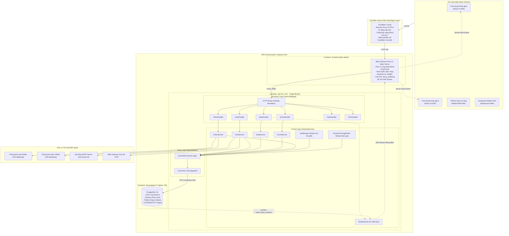

*Hình 1. Sơ đồ kiến trúc triển khai hệ thống tổng thể (Deployment Architecture)*

**Bảng 6. Bảng phân tích các thành phần kiến trúc triển khai hệ thống EventTicketing**

| Thành phần | Nền tảng công nghệ | Cấu hình kỹ thuật & Trách nhiệm chính |
|---|---|---|
| **Edge Proxy** | Cloudflare Tunnel | Bảo vệ toàn diện hạ tầng máy chủ trước các cuộc tấn công từ chối dịch vụ phân tán (DDoS), tự động quản lý chứng chỉ bảo mật SSL/TLS, tích hợp cơ chế CAPTCHA vô hình Cloudflare Turnstile để chặn đứng bot độc hại tại lớp biên mạng. |
| **Frontend Web** | React 19, TypeScript, Vite, Tailwind CSS | Xây dựng ứng dụng Single Page Application (SPA) hiệu năng cao; tích hợp thư viện quản lý trạng thái TanStack Query; trực quan hóa sơ đồ ghế tương tác đa giác (Canvas/SVG); duy trì đồng hồ đếm ngược 5:00 giữ ghế. |
| **Web Server / Reverse Proxy** | Nginx Alpine | Phục vụ các tài nguyên tĩnh đã được đóng gói của ứng dụng React; định tuyến các yêu cầu API sang backend Go; cấu hình cờ `proxy_buffering off` và `X-Accel-Buffering: no` cho endpoint `/api/events/*/stream` để chuyển tiếp luồng SSE tức thì không bị đệm. |
| **Backend API Engine** | Go 1.24+ (`net/http`) | Biên dịch thành **một file thực thi duy nhất (Single Binary)** không phụ thuộc thư viện ngoài; thời gian khởi động cực nhanh ($< 100\text{ms}$); tiêu thụ bộ nhớ RAM cực thấp ($< 50\text{MB}$); xử lý đồng thời hàng chục ngàn kết nối bằng cơ chế siêu luồng Goroutines. |
| **Hệ quản trị CSDL** | PostgreSQL 18 / 17 | Đóng vai trò Single Source of Truth; quản lý 26 bảng dữ liệu chuẩn hóa; thực thi các giao dịch ACID nghiêm ngặt; đảm bảo tính toàn vẹn với partial unique index và database trigger; vận hành kênh pub/sub nội tại `LISTEN/NOTIFY`. |
| **Realtime SSE Hub** | Go Goroutines & Channels | Mở một kết nối chuyên biệt `LISTEN event_seats_channel` đến PostgreSQL; phân phối sự kiện tức thì tới hàng vạn kết nối SSE của các trình duyệt máy khách với độ trễ $\le 3$ giây. |
| **Hold Reaper Worker** | Background Worker (Go) | Tiến trình chạy nền định kỳ mỗi 5 giây quét bảng `seat_holds` để tìm các lượt giữ ghế quá hạn (`expires_at <= now()`); tự động chuyển trạng thái ghế về `AVAILABLE` và phát tín hiệu giải phóng qua SSE. |
| **Dynamic Pricing Worker** | Background Worker (Go) | Tiến trình chạy nền định kỳ mỗi 5 phút quét các sự kiện đang mở bán, phân tích tốc độ bán vé trong cửa sổ trượt 15 phút, tính toán và ghi nhận đề xuất giá vé mới vào bảng `price_suggestions`. |

## 3.3. Sơ đồ và Đặc tả các trường hợp sử dụng (Use Case Diagram)

Hệ thống EventTicketing phục vụ 5 nhóm tác nhân người dùng nội bộ và tương tác với 3 hệ thống dịch vụ bên ngoài, được khái quát hóa thành 13 ca sử dụng cốt lõi (UC-01 … UC-13).

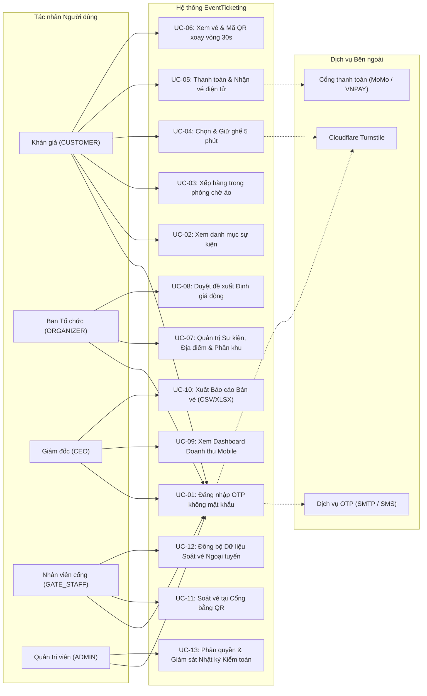

*Hình 2. Sơ đồ trường hợp sử dụng tổng thể (Use Case Diagram)*

**Bảng 7. Danh mục 13 trường hợp sử dụng (Use Cases UC-01 … UC-13) theo Tác nhân**

| Mã Use Case | Tên trường hợp sử dụng | Tác nhân chính | Yêu cầu liên quan | Mô tả tóm tắt hành vi |
|:---:|---|:---:|:---:|---|
| **UC-01** | Đăng nhập OTP không mật khẩu | Khán giả, BTC, CEO, Gate Staff | FR-01, FR-04, NFR-13 | Xác thực danh tính người dùng bằng mã OTP 6 số gửi qua Email/SMS, khởi tạo phiên làm việc bảo mật `sessions`. |
| **UC-02** | Xem danh mục sự kiện | Khán giả | FR-02, NFR-01 | Khám phá các sự kiện đang mở bán, lọc theo phân loại, địa điểm, thời gian và xem sơ đồ ghế tổng quan. |
| **UC-03** | Xếp hàng phòng chờ ảo | Khán giả | FR-09, NFR-09 | Nhận vị trí số thứ tự và thời gian chờ ước tính khi lưu lượng mở bán vượt ngưỡng phục vụ tối đa. |
| **UC-04** | Chọn & Giữ ghế 5 phút | Khán giả | FR-03, FR-06, FR-07, FR-11 | Chọn ghế trống trên sơ đồ trực quan; hệ thống thực hiện khóa nguyên tử trong 300 giây và đếm ngược thời gian. |
| **UC-05** | Thanh toán & Nhận vé điện tử | Khán giả | FR-13, FR-14, FR-15, NFR-04 | Khởi tạo đơn hàng, thanh toán qua MoMo/VNPAY; hệ thống chuyển trạng thái ghế sang `SOLD` và phát hành vé điện tử. |
| **UC-06** | Xem vé & Mã QR xoay vòng 30s | Khán giả | FR-12, NFR-08 | Xem danh sách vé đã mua, hiển thị mã QR động tự động đổi mã sau mỗi 30 giây để xuất trình tại cổng. |
| **UC-07** | Quản trị Sự kiện & Phân khu | Ban Tổ chức | FR-08, NFR-12 | Thiết lập sự kiện mới, định nghĩa sơ đồ khán đài, số lượng ghế, cấu hình giá sàn và giá trần cho từng khu vực. |
| **UC-08** | Duyệt đề xuất Định giá động | Ban Tổ chức | FR-22, W-01 | Xem danh sách các đề xuất tăng/giảm giá vé do thuật toán tính toán và bấm duyệt hoặc từ chối áp dụng. |
| **UC-09** | Xem Dashboard Doanh thu | Giám đốc điều hành | FR-19, NFR-11 | Theo dõi các chỉ số tài chính, tổng doanh thu theo phút, tỷ lệ lấp đầy ghế theo phân khu trên giao diện di động. |
| **UC-10** | Xuất Báo cáo Bán vé | Giám đốc điều hành | FR-21 | Xuất dữ liệu bán vé chi tiết và dòng tiền đối soát ra tệp định dạng CSV hoặc bảng tính Microsoft Excel. |
| **UC-11** | Soát vé tại Cổng bằng QR | Nhân viên cổng | FR-16, FR-17, NFR-05 | Quét mã QR trên điện thoại khán giả; hệ thống xác thực tức thì và cảnh báo nếu phát hiện vé đã dùng hoặc vé lậu. |
| **UC-12** | Đồng bộ Soát vé Ngoại tuyến | Nhân viên cổng | FR-18, NFR-06 | Xác thực chữ ký số offline của vé khi mất kết nối mạng và tự động đồng bộ nhật ký check-in khi có mạng trở lại. |
| **UC-13** | Giám sát & Kiểm toán Hệ thống | Quản trị viên | NFR-12, NFR-13 | Phân quyền tài khoản, cấu hình biến môi trường và tra cứu nhật ký kiểm toán bất biến của toàn hệ thống. |

## 3.4. Sơ đồ luồng dữ liệu (Data Flow Diagram - DFD)

Sơ đồ luồng dữ liệu mô tả trực quan cách thức thông tin được tiếp nhận, xử lý qua các tiến trình nghiệp vụ và lưu trữ bền vững trong cơ sở dữ liệu.

### 3.4.1. DFD Mức ngữ cảnh (Context Diagram / DFD Level 0)
Sơ đồ thể hiện ranh giới hệ thống EventTicketing với 5 tác nhân người dùng nội bộ và 3 hệ thống tích hợp ngoại vi.

```mermaid
flowchart TD
    subgraph ExternalEntities["Tác nhân Ngoại vi (Entities)"]
        Customer["Khán giả (CUSTOMER)"]
        Organizer["Ban Tổ chức (ORGANIZER)"]
        CEO["Giám đốc điều hành (CEO)"]
        GateStaff["Nhân viên cổng (GATE_STAFF)"]
        Admin["Quản trị viên (ADMIN)"]
        PaymentGateway["Cổng thanh toán (MoMo / VNPAY)"]
        OTPService["Dịch vụ gửi OTP (SMTP / SMS)"]
        Turnstile["Cloudflare Turnstile (Chống Bot)"]
    end

    System(("0.0<br/>Hệ thống Quản lý Bán vé Sự kiện<br/>(EventTicketing)"))

    %% Customer flows
    Customer -->|"Yêu cầu OTP, token Captcha, thông tin cá nhân"| System
    Customer -->|"Yêu cầu xếp hàng, chọn giữ ghế, tạo đơn hàng"| System
    Customer -->|"Yêu cầu xem vé điện tử, mã QR động"| System
    System -->|"Mã OTP, vị trí hàng chờ, sơ đồ ghế thời gian thực"| Customer
    System -->|"Xác nhận giữ chỗ (5 phút), link thanh toán, vé điện tử"| Customer

    %% Organizer flows
    Organizer -->|"Thông tin sự kiện, địa điểm, cấu hình giá sàn/trần"| System
    Organizer -->|"Quyết định phê duyệt / từ chối đề xuất giá động"| System
    System -->|"Báo cáo tốc độ bán, danh sách đề xuất giá động"| Organizer

    %% CEO flows
    CEO -->|"Yêu cầu xem dashboard doanh thu, bộ lọc báo cáo"| System
    System -->|"Chỉ số doanh thu realtime, tỷ lệ lấp đầy, tệp xuất CSV/XLSX"| CEO

    %% GateStaff flows
    GateStaff -->|"Mã QR quét tại cửa, dữ liệu check-in offline"| System
    System -->|"Kết quả xác thực vé (Hợp lệ, Đã dùng, Không hợp lệ)"| GateStaff

    %% Admin flows
    Admin -->|"Cấu hình hệ thống, phân quyền vai trò tài khoản"| System
    System -->|"Nhật ký kiểm toán an toàn (Audit logs)"| Admin

    %% External Integrations
    System -->|"Yêu cầu phát mã OTP (SĐT / Email)"| OTPService
    OTPService -->|"Trạng thái gửi tin nhắn (Thành công / Lỗi)"| System

    System -->|"Token Turnstile cần xác minh"| Turnstile
    Turnstile -->|"Kết quả đánh giá độ tin cậy (Pass / Fail)"| System

    System -->|"Yêu cầu khởi tạo giao dịch thanh toán"| PaymentGateway
    PaymentGateway -->|"Thông báo kết quả giao dịch (IPN / Webhook)"| System
```

*Hình 3. Sơ đồ luồng dữ liệu Mức ngữ cảnh (Context Diagram / DFD Level 0)*

### 3.4.2. DFD Mức 0 (Diagram 0)
Hệ thống được phân rã thành 7 tiến trình nghiệp vụ chính tương tác với 12 kho dữ liệu tương ứng các bảng cơ sở dữ liệu PostgreSQL.

```mermaid
flowchart TD
    %% Entities
    C["Khán giả"]
    O["Ban Tổ chức"]
    G["Nhân viên cổng"]
    E_Pay["Cổng thanh toán"]
    E_OTP["Dịch vụ OTP"]

    %% Data Stores
    D1[("D1: users")]
    D2[("D2: sessions")]
    D3[("D3: otp_verifications")]
    D4[("D4: events & venues & zones")]
    D5[("D5: event_seats")]
    D6[("D6: seat_holds")]
    D7[("D7: queue_entries")]
    D8[("D8: orders & order_items")]
    D9[("D9: payments")]
    D10[("D10: tickets")]
    D11[("D11: checkin_logs")]
    D12[("D12: price_suggestions & price_changes")]

    %% Processes
    P1(("1.0<br/>Định danh &<br/>Xác thực OTP"))
    P2(("2.0<br/>Quản trị Sự kiện &<br/>Cấu hình Khu vực"))
    P3(("3.0<br/>Điều phối Hàng chờ<br/>(Virtual Queue)"))
    P4(("4.0<br/>Quản lý Sơ đồ ghế &<br/>Giữ chỗ 5 phút"))
    P5(("5.0<br/>Xử lý Đơn hàng &<br/>Thanh toán"))
    P6(("6.0<br/>Soát vé tại Cổng &<br/>Đồng bộ Offline"))
    P7(("7.0<br/>Thuật toán Định giá &<br/>Báo cáo Doanh thu"))

    %% Flows P1
    C -->|"SĐT / Email, Mã OTP"| P1
    P1 -->|"Lệnh gửi mã"| E_OTP
    P1 <-->|"Lưu / Kiểm tra mã băm OTP"| D3
    P1 <-->|"Đọc / Tạo mới tài khoản"| D1
    P1 -->|"Tạo phiên làm việc"| D2
    P1 -->|"Cookie phiên & Trạng thái"| C

    %% Flows P2
    O -->|"Thông tin sự kiện, giá trần/sàn"| P2
    P2 -->|"Ghi thông tin sự kiện & phân khu"| D4
    P2 -->|"Sinh danh sách ghế mặc định"| D5

    %% Flows P3
    C -->|"Yêu cầu vào trang sự kiện"| P3
    P3 <-->|"Ghi nhận & cập nhật số thứ tự"| D7
    P3 -->|"Vị trí xếp hàng & Thời gian chờ"| C

    %% Flows P4
    C -->|"Chọn ghế cần đặt"| P4
    P4 <-->|"Đọc trạng thái sơ đồ ghế"| D5
    P4 <-->|"Khóa ghế nguyên tử & tạo hold"| D6
    P4 -->|"Thông báo đổi màu ghế qua SSE"| C

    %% Flows P5
    C -->|"Xác nhận đơn hàng"| P5
    P5 <-->|"Kiểm tra hold hợp lệ"| D6
    P5 -->|"Tạo đơn hàng mới"| D8
    P5 -->|"Khởi tạo giao dịch thanh toán"| E_Pay
    E_Pay -->|"Thông báo IPN kết quả thanh toán"| P5
    P5 -->|"Ghi nhận giao dịch thành công"| D9
    P5 -->|"Cập nhật trạng thái ghế SOLD"| D5
    P5 -->|"Phát hành vé điện tử mới"| D10

    %% Flows P6
    G -->|"Quét mã QR từ camera"| P6
    P6 <-->|"Kiểm tra mã vé & trạng thái"| D10
    P6 -->|"Ghi nhật ký check-in"| D11
    P6 -->|"Hiển thị kết quả hợp lệ / từ chối"| G

    %% Flows P7
    P7 <-->|"Đọc số liệu bán vé theo phút"| D5
    P7 <-->|"Đọc lịch sử đơn hàng"| D8
    P7 -->|"Ghi nhận đề xuất giá mới"| D12
    O -->|"Duyệt đề xuất giá"| P7
    P7 -->|"Cập nhật giá ghế mới"| D5
    P7 -->|"Ghi nhật ký đổi giá bất biến"| D12
```

*Hình 4. Sơ đồ luồng dữ liệu Mức 0 (DFD Level 0 - 7 Tiến trình chính)*

### 3.4.3. DFD Mức 1: Phân hệ Giữ chỗ và Chống bán trùng (Process 4.0)

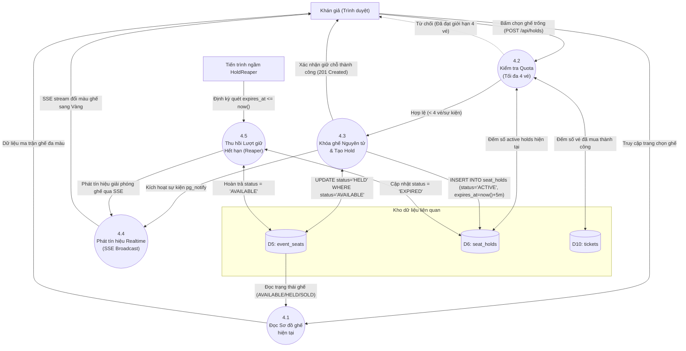

*Hình 5. Sơ đồ luồng dữ liệu Mức 1 – Phân hệ Giữ chỗ và Chống bán trùng (Process 4.0)*

### 3.4.4. DFD Mức 1: Phân hệ Đơn hàng và Thanh toán (Process 5.0)

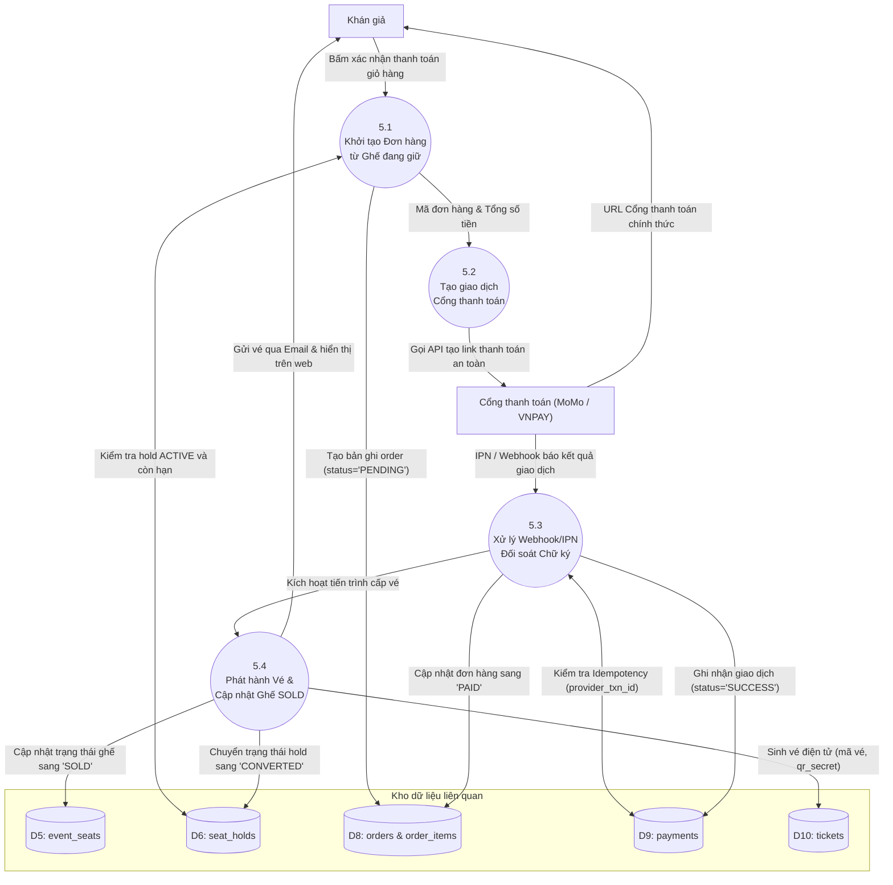

*Hình 6. Sơ đồ luồng dữ liệu Mức 1 – Phân hệ Đơn hàng và Thanh toán (Process 5.0)*

**Bảng 8. Bảng ánh xạ Kho dữ liệu DFD vào 26 bảng cơ sở dữ liệu PostgreSQL**

| Ký hiệu kho | Tên kho dữ liệu DFD | Bảng PostgreSQL tương ứng | Mục đích lưu trữ và bảo đảm tính toàn vẹn |
|:---:|---|---|---|
| **D1** | Tài khoản người dùng | `users` | Hồ sơ định danh, số điện thoại, email, vai trò (`role`), thời điểm xác minh. |
| **D2** | Phiên đăng nhập máy chủ | `sessions` | Mã băm token xác thực phiên, địa chỉ IP, User-Agent, thời hạn hết hạn phiên. |
| **D3** | Xác thực OTP | `otp_verifications` | Mã băm OTP 6 số, kênh gửi (SMS/EMAIL), số lần thử, thời hạn hiệu lực 5 phút. |
| **D4** | Sự kiện, Địa điểm & Khu vực | `events`, `venues`, `zones`, `venue_zones`, `event_zones` | Cấu hình sự kiện, địa điểm biểu diễn, bản đồ khán đài, giá sàn/trần của từng phân khu. |
| **D5** | Trạng thái Ghế sự kiện | `event_seats`, `seats` | Trạng thái từng ghế (`AVAILABLE`, `HELD`, `SOLD`), giá bán hiện tại của ghế. |
| **D6** | Nhật ký Giữ chỗ | `seat_holds` | Bản ghi giữ ghế 300s, token giữ ghế, trạng thái `ACTIVE`, `EXPIRED`, `CONVERTED`. |
| **D7** | Hàng chờ ảo | `queue_entries` | Số thứ tự xếp hàng FIFO, token truy cập phòng chờ, thời hạn được phép vào mua vé. |
| **D8** | Đơn hàng & Chi tiết | `orders`, `order_items` | Thông tin đơn hàng, tổng tiền thanh toán, trạng thái đơn (`PENDING`, `PAID`, `REFUNDED`). |
| **D9** | Giao dịch Thanh toán | `payments` | Mã giao dịch cổng đối tác (`provider_txn_id`), trạng thái đối soát IPN, số tiền thanh toán. |
| **D10** | Vé điện tử | `tickets` | Mã định danh vé, khóa bí mật xoay vòng (`qr_secret`), trạng thái vé (`ISSUED`, `USED`). |
| **D11** | Nhật ký Soát vé | `checkin_logs` | Lịch sử quét mã QR tại cổng, ID thiết bị quét, kết quả kiểm tra (`VALID`, `ALREADY_USED`). |
| **D12** | Đề xuất & Thay đổi giá | `price_suggestions`, `price_changes` | Lịch sử các đề xuất giá động và bảng nhật ký kiểm toán thay đổi giá bất biến (cấm sửa/xóa). |

## 3.5. Sơ đồ lớp theo mô hình BCE (Class Diagram)

Sơ đồ lớp mô hình hóa cấu trúc hướng đối tượng của hệ thống EventTicketing, phản ánh sự liên kết chặt chẽ giữa các thành phần Boundary (Handler), Control (Service/Worker) và Entity (Store Model).

```mermaid
classDiagram
    %% BOUNDARY LAYER (internal/httpapi)
    class SystemHandler {
        -FeatureManager features
        +HandleHealth(w, r)
        +HandleFeatures(w, r)
    }

    class AuthHandler {
        -AuthService authService
        +HandleRequestOTP(w, r)
        +HandleVerifyOTP(w, r)
        +HandleMe(w, r)
        +HandleLogout(w, r)
    }

    class EventHandler {
        -EventService eventService
        +HandleEvents(w, r)
        +HandleEventDetail(w, r)
    }

    class SeatHandler {
        -SeatService seatService
        -AuthService authService
        +HandleEventSeats(w, r)
        +HandleHolds(w, r)
    }

    class StreamHandler {
        -RealtimeHub hub
        +HandleEventStream(w, r)
    }

    class OrderHandler {
        -OrderService orderService
        -AuthService authService
        +HandleCreateOrder(w, r)
        +HandleGetOrder(w, r)
    }

    class PaymentHandler {
        -PaymentService paymentService
        +HandleCreatePayment(w, r)
        +HandleMoMoIPN(w, r)
        +HandleVNPAYIPN(w, r)
    }

    class GateHandler {
        -GateService gateService
        +HandleCheckIn(w, r)
        +HandleSyncOffline(w, r)
    }

    class CEOHandler {
        -CEOService ceoService
        +HandleDashboard(w, r)
        +HandleExportReport(w, r)
    }

    %% CONTROL LAYER (internal/service)
    class AuthService {
        -pgxpool.Pool db
        -store.Queries queries
        +RequestOTP(ctx, dest, channel)
        +VerifyOTP(ctx, dest, code)
        +AuthenticateSession(ctx, token)
        +Logout(ctx, token)
    }

    class SeatService {
        -pgxpool.Pool db
        -store.Queries queries
        +GetEventSeats(ctx, eventID, userID)
        +HoldSeat(ctx, eventID, seatID, userID)
    }

    class RealtimeHub {
        -sync.RWMutex mu
        -map clients
        +Subscribe(eventID, clientCh)
        +Unsubscribe(eventID, clientCh)
        +Broadcast(eventID, msg)
        +ListenPostgresNotify(ctx)
    }

    class HoldReaper {
        -SeatService seatService
        +Start(ctx, interval)
        -expireStaleHolds(ctx)
    }

    class OrderService {
        -pgxpool.Pool db
        -store.Queries queries
        +CreateOrderFromHold(ctx, userID, holdID)
        +ProcessOrderPayment(ctx, orderID, paymentDetails)
    }

    class DynamicPricingWorker {
        -store.Queries queries
        +CalculatePricing(ctx, eventID)
        -evaluateDemandElasticity()
    }

    %% ENTITY LAYER (internal/store)
    class User {
        +UUID ID
        +string Phone
        +string Email
        +UserRole Role
        +UserStatus Status
    }

    class SeatHold {
        +UUID ID
        +UUID EventID
        +UUID SeatID
        +UUID UserID
        +HoldStatus Status
        +Time ExpiresAt
    }

    class EventSeat {
        +UUID ID
        +UUID EventID
        +UUID SeatID
        +SeatStatus Status
        +int64 CurrentPrice
    }

    class Order {
        +UUID ID
        +UUID UserID
        +UUID EventID
        +OrderStatus Status
        +int64 TotalAmount
    }

    class Ticket {
        +UUID ID
        +UUID OrderID
        +UUID EventSeatID
        +string TicketCode
        +string QRSecret
        +TicketStatus Status
    }

    %% Relationships
    AuthHandler --> AuthService
    SeatHandler --> SeatService
    SeatHandler --> AuthService
    StreamHandler --> RealtimeHub
    OrderHandler --> OrderService
    HoldReaper --> SeatService

    AuthService ..> User
    SeatService ..> SeatHold
    SeatService ..> EventSeat
    OrderService ..> Order
    OrderService ..> Ticket
```

*Hình 7. Sơ đồ lớp theo mô hình phân tầng BCE (Boundary – Control – Entity)*

## 3.6. Cơ chế Quản lý Cấu hình và Cờ tính năng (Feature Flags)

Để kiểm soát tiến độ bàn giao sản phẩm theo từng giai đoạn và phục vụ việc nghiệm thu giữa kỳ (Sprint 2) cũng như cuối kỳ (Sprint 5), toàn bộ các tính năng của hệ thống được quản trị thông qua cơ chế **Cờ tính năng (Feature Flags)**:
- **Nguyên lý kiểm soát:** Mọi endpoint API đều được bao bọc bởi middleware `RequireFeature(flagName)`. Khi một cờ tính năng bị tắt (`disabled`):
  - Giao diện người dùng (Frontend) tự động ẩn toàn bộ các nút bấm, biểu mẫu và trang màn hình tương ứng.
  - Máy chủ API (Backend) lập tức từ chối yêu cầu tại tầng Boundary với mã HTTP chuẩn `404 Not Found` kèm nội dung JSON: `{"error": "feature_disabled", "flag": "seat_hold"}`.
- **Hồ sơ cấu hình (Feature Profiles):** Hệ thống định nghĩa sẵn 4 hồ sơ triển khai chuẩn thông qua biến môi trường `FEATURE_PROFILE`:
  - `FEATURE_PROFILE=sprint2` (Giữa kỳ): Bật các cờ `otp_login`, `seat_map_realtime`, `seat_hold`, `zone_pricing`, `organizer_console`.
  - `FEATURE_PROFILE=sprint3`: Bổ sung thêm các cờ `waiting_room`, `bot_check`, `ticket_limit`, `rotating_qr`.
  - `FEATURE_PROFILE=sprint4`: Bổ sung thêm các cờ `payments`, `ticket_email`, `reconciliation`.
  - `FEATURE_PROFILE=final` (Cuối kỳ): Kích hoạt toàn bộ 19 cờ tính năng, bao gồm `gate_checkin`, `offline_checkin`, `ceo_dashboard`, `price_log`, `reports_export`, `dynamic_pricing`, `promo_suggestions`.

**Bảng 9. Quản lý cờ tính năng (Feature Flags) tương ứng theo từng Profile Sprint**

| Tên Cờ tính năng (`Flag`) | Yêu cầu nghiệp vụ | Sprint | sprint2 (Giữa kỳ) | sprint3 | sprint4 | final (Cuối kỳ) |
|---|---|:---:|:---:|:---:|:---:|:---:|
| `otp_login` | FR-01, FR-04 | 2 | **Bật** | **Bật** | **Bật** | **Bật** |
| `seat_map_realtime` | FR-03, FR-05, NFR-10 | 2 | **Bật** | **Bật** | **Bật** | **Bật** |
| `seat_hold` | FR-06, FR-07, NFR-03 | 2 | **Bật** | **Bật** | **Bật** | **Bật** |
| `zone_pricing` | FR-08 | 2 | **Bật** | **Bật** | **Bật** | **Bật** |
| `organizer_console` | FR-08 | 2 | **Bật** | **Bật** | **Bật** | **Bật** |
| `waiting_room` | FR-09, NFR-09 | 3 | Tắt | **Bật** | **Bật** | **Bật** |
| `bot_check` | FR-10, NFR-07 | 3 | Tắt | **Bật** | **Bật** | **Bật** |
| `ticket_limit` | FR-11 | 3 | Tắt | **Bật** | **Bật** | **Bật** |
| `rotating_qr` | FR-12, NFR-08 | 3 | Tắt | **Bật** | **Bật** | **Bật** |
| `payments` | FR-13 | 4 | Tắt | Tắt | **Bật** | **Bật** |
| `ticket_email` | FR-14 | 4 | Tắt | Tắt | **Bật** | **Bật** |
| `reconciliation` | FR-15, NFR-04 | 4 | Tắt | Tắt | **Bật** | **Bật** |
| `gate_checkin` | FR-16, FR-17, NFR-05 | 5 | Tắt | Tắt | Tắt | **Bật** |
| `offline_checkin` | FR-18, NFR-06 | 5 | Tắt | Tắt | Tắt | **Bật** |
| `ceo_dashboard` | FR-19, NFR-11 | 5 | Tắt | Tắt | Tắt | **Bật** |
| `price_log` | FR-20, NFR-12 | 5 | Tắt | Tắt | Tắt | **Bật** |
| `reports_export` | FR-21 | 5 | Tắt | Tắt | Tắt | **Bật** |
| `dynamic_pricing` | FR-22 | 5 | Tắt | Tắt | Tắt | **Bật** |
| `promo_suggestions` | FR-23 | 5 | Tắt | Tắt | Tắt | **Bật** |

*Ghi chú: Yêu cầu FR-02 (khám phá danh sách sự kiện) luôn ở trạng thái bật mặc định trên mọi hồ sơ.*


# PHẦN 4. THIẾT KẾ CƠ SỞ DỮ LIỆU VÀ QUY TRÌNH NGHIỆP VỤ CỐT LÕI

## 4.1. Thiết kế Mô hình Thực thể Liên kết (ERD 26 bảng dữ liệu)

Hệ thống cơ sở dữ liệu của EventTicketing được thiết kế theo chuẩn hóa dữ liệu bậc 3 (3NF) trên nền tảng **PostgreSQL 18**, bao gồm **26 bảng dữ liệu** được phân chia khoa học thành 6 nhóm nghiệp vụ chuyên biệt.

### 4.1.1. Sơ đồ thực thể liên kết (ERD tổng thể)

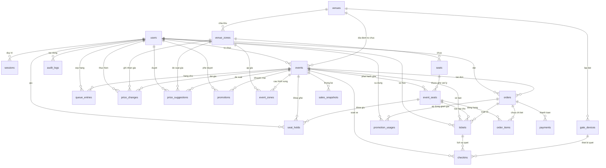

*Hình 8. Sơ đồ thực thể liên kết (ERD 26 bảng chuẩn hóa trong PostgreSQL 18)*

### 4.1.2. Phân loại cấu trúc 26 bảng dữ liệu
1. **Nhóm Định danh & Bảo mật (4 bảng):**
   - `users`: Quản lý danh tính người dùng (Khán giả, BTC, CEO, Nhân viên cổng, Quản trị viên). Sử dụng UUID v4 làm khóa chính.
   - `otp_verifications`: Lưu trữ mã băm OTP 6 số, kênh gửi (SMS/EMAIL), số lần thử và thời gian hết hạn (5 phút).
   - `sessions`: Lưu trữ token phiên đăng nhập máy chủ (`token_hash`), địa chỉ IP, User-Agent và thời hạn hiệu lực.
   - `audit_logs`: Bảng nhật ký kiểm toán bất biến ghi lại mọi thao tác quan trọng trong hệ thống.
2. **Nhóm Địa điểm, Sự kiện & Ghế ngồi (6 bảng):**
   - `venues`: Thông tin địa điểm tổ chức (sân vận động, nhà hát, trung tâm hội nghị).
   - `venue_zones`: Phân chia khán đài vật lý (VIP, Khán đài A, B, C, Fanzone).
   - `seats`: Vị trí ghế vật lý cố định (hàng ghế, số ghế, tọa độ X/Y trên bản đồ SVG).
   - `events`: Thông tin sự kiện biểu diễn, nghệ sĩ, thời gian mở bán và trạng thái vòng đời sự kiện.
   - `event_zones`: Cấu hình giá vé cơ bản, giá sàn và giá trần cho từng khu vực của sự kiện cụ thể.
   - `event_seats`: Trạng thái thực tế của từng ghế trong từng sự kiện (`AVAILABLE`, `HELD`, `SOLD`, `BLOCKED`) và giá bán hiện hành.
3. **Nhóm Hàng chờ ảo & Giữ chỗ (2 bảng):**
   - `queue_entries`: Quản lý vị trí xếp hàng FIFO trong phòng chờ ảo, thời điểm cấp lượt và token vào mua.
   - `seat_holds`: Quản lý các lượt khóa giữ chỗ 300 giây của người dùng, liên kết trực tiếp với cơ chế chống bán trùng.
4. **Nhóm Đơn hàng & Thanh toán (3 bảng):**
   - `orders`: Quản lý giỏ hàng và đơn hàng mua vé, tổng tiền, trạng thái (`PENDING`, `PAID`, `EXPIRED`, `REFUNDED`).
   - `order_items`: Chi tiết các ghế ngồi thuộc đơn hàng và giá vé tại thời điểm đặt.
   - `payments`: Ghi nhận giao dịch với cổng thanh toán đối tác (MoMo, VNPAY), mã giao dịch duy nhất `provider_txn_id`.
5. **Nhóm Vé điện tử & Soát vé tại cổng (4 bảng):**
   - `tickets`: Quản lý vé điện tử số hóa, chứa mã vé hiển thị và khóa mật mã `qr_secret` dùng cho thuật toán QR xoay vòng.
   - `gate_devices`: Quản lý danh mục các thiết bị/điện thoại di động của nhân viên được phép quét vé tại cổng.
   - `checkins`: Bản ghi kết quả quét vé tại cửa (Hợp lệ, Đã dùng, Không hợp lệ, Xung đột offline).
   - `checkin_logs`: Nhật ký kiểm soát lưu vết chi tiết phục vụ đối soát an ninh.
6. **Nhóm Định giá động, Khuyến mãi & Thống kê (7 bảng):**
   - `price_suggestions`: Lưu trữ các đề xuất giá vé mới do thuật toán định giá động tính toán ra.
   - `price_changes`: Bảng nhật ký bất biến ghi lại lịch sử các lần đổi giá vé thực tế sau khi BTC bấm duyệt.
   - `promotions`: Danh mục mã giảm giá và chiến dịch kích cầu tự động.
   - `promotion_usages`: Lịch sử sử dụng mã khuyến mãi của từng tài khoản.
   - `sales_snapshots`: Dữ liệu thống kê doanh thu và tỷ lệ lấp đầy ghế theo từng khung thời gian, phục vụ Dashboard CEO.

## 4.2. Từ điển dữ liệu các thực thể cốt lõi (Data Dictionary)

Bảng 10 mô tả chi tiết các thuộc tính, kiểu dữ liệu và ràng buộc của các bảng trọng yếu nhất trong hệ thống.

**Bảng 10. Từ điển dữ liệu (Data Dictionary) các thực thể cốt lõi trong cơ sở dữ liệu**

| Tên Bảng | Thuộc tính (Column) | Kiểu dữ liệu (PostgreSQL) | Ràng buộc (Constraints) | Ý nghĩa nghiệp vụ |
|---|---|---|---|---|
| `users` | `id` | `UUID` | `PRIMARY KEY, DEFAULT gen_random_uuid()` | Định danh duy nhất của người dùng |
| | `phone` | `VARCHAR(30)` | `UNIQUE, NULLABLE` | Số điện thoại nhận mã OTP SMS |
| | `email` | `VARCHAR(320)` | `UNIQUE, NULLABLE` | Hòm thư điện tử nhận OTP và vé |
| | `role` | `user_role` | `NOT NULL, DEFAULT 'CUSTOMER'` | Vai trò: `CUSTOMER`, `ORGANIZER`, `CEO`, `GATE_STAFF`, `ADMIN` |
| | `status` | `user_status` | `NOT NULL, DEFAULT 'ACTIVE'` | Trạng thái: `PENDING`, `ACTIVE`, `LOCKED` |
| `event_seats` | `id` | `UUID` | `PRIMARY KEY, DEFAULT gen_random_uuid()` | Định danh ghế sự kiện |
| | `event_id` | `UUID` | `NOT NULL, FK -> events(id)` | Khóa ngoại tham chiếu sự kiện |
| | `seat_id` | `UUID` | `NOT NULL, FK -> seats(id)` | Khóa ngoại tham chiếu vị trí ghế vật lý |
| | `status` | `seat_status` | `NOT NULL, DEFAULT 'AVAILABLE'` | Trạng thái ghế: `AVAILABLE`, `HELD`, `SOLD`, `BLOCKED` |
| | `current_price`| `BIGINT` | `NOT NULL, CHECK (current_price > 0)` | Giá bán hiện tại của chiếc ghế (VNĐ) |
| | `version` | `INT` | `NOT NULL, DEFAULT 1` | Phiên bản hàng (phục vụ Optimistic Lock) |
| `seat_holds` | `id` | `UUID` | `PRIMARY KEY, DEFAULT gen_random_uuid()` | Định danh lượt giữ ghế |
| | `event_id` | `UUID` | `NOT NULL, FK -> events(id)` | Sự kiện diễn ra |
| | `seat_id` | `UUID` | `NOT NULL, FK -> seats(id)` | Ghế được giữ |
| | `user_id` | `UUID` | `NOT NULL, FK -> users(id)` | Khán giả giữ ghế |
| | `hold_token` | `VARCHAR(64)` | `NOT NULL, UNIQUE` | Token xác thực quyền giữ ghế |
| | `status` | `hold_status` | `NOT NULL, DEFAULT 'ACTIVE'` | Trạng thái: `ACTIVE`, `EXPIRED`, `RELEASED`, `CONVERTED` |
| | `expires_at` | `TIMESTAMPTZ` | `NOT NULL` | Thời điểm hết hạn (now() + 300 giây) |
| `orders` | `id` | `UUID` | `PRIMARY KEY, DEFAULT gen_random_uuid()` | Định danh đơn hàng |
| | `user_id` | `UUID` | `NOT NULL, FK -> users(id)` | Khán giả đặt mua |
| | `event_id` | `UUID` | `NOT NULL, FK -> events(id)` | Sự kiện liên quan |
| | `total_amount` | `BIGINT` | `NOT NULL, CHECK (total_amount >= 0)` | Tổng giá trị đơn hàng (VNĐ) |
| | `status` | `order_status` | `NOT NULL, DEFAULT 'PENDING'` | Trạng thái: `PENDING`, `PAID`, `EXPIRED`, `REFUNDED` |
| `tickets` | `id` | `UUID` | `PRIMARY KEY, DEFAULT gen_random_uuid()` | Định danh duy nhất của vé số hóa |
| | `order_id` | `UUID` | `NOT NULL, FK -> orders(id)` | Đơn hàng phát hành |
| | `event_seat_id`| `UUID` | `NOT NULL, FK -> event_seats(id)` | Chỗ ngồi thuộc vé |
| | `ticket_code` | `VARCHAR(32)` | `NOT NULL, UNIQUE` | Mã vé hiển thị cho khán giả |
| | `qr_secret` | `VARCHAR(64)` | `NOT NULL` | Khóa bí mật dùng cho thuật toán TOTP QR |
| | `status` | `ticket_status` | `NOT NULL, DEFAULT 'ISSUED'` | Trạng thái: `ISSUED`, `ACTIVE`, `USED`, `VOID` |
| `price_changes`| `id` | `UUID` | `PRIMARY KEY, DEFAULT gen_random_uuid()` | Định danh bản ghi kiểm toán giá |
| | `event_id` | `UUID` | `NOT NULL, FK -> events(id)` | Sự kiện áp dụng |
| | `zone_id` | `UUID` | `NOT NULL, FK -> venue_zones(id)` | Phân khu thay đổi giá |
| | `old_price` | `BIGINT` | `NOT NULL` | Mức giá cũ (VNĐ) |
| | `new_price` | `BIGINT` | `NOT NULL` | Mức giá mới được phê duyệt (VNĐ) |
| | `changed_by` | `UUID` | `NOT NULL, FK -> users(id)` | Người bấm duyệt (BTC) |
| | `created_at` | `TIMESTAMPTZ` | `NOT NULL, DEFAULT now()` | Dấu thời gian bất biến |

## 4.3. Thiết kế quy trình nghiệp vụ qua Sơ đồ tuần tự (Sequence Diagrams)

### 4.3.1. Sơ đồ tuần tự: Đăng nhập OTP và Quản lý phiên không mật khẩu (FR-01, FR-04)

Quy trình đăng nhập không mật khẩu bảo vệ tối đa người dùng trước nguy cơ lộ thông tin xác thực, đồng thời ngăn chặn các cuộc tấn công Brute-force hoặc Credential Stuffing.

```mermaid
sequenceDiagram
    autonumber
    actor User as Khán giả (Trình duyệt)
    participant Boundary as AuthHandler (internal/httpapi)
    participant Control as AuthService (internal/service)
    participant DB as PostgreSQL 18 (internal/store)
    participant SMS_SMTP as SMS Gateway / SMTP Server

    User->>Boundary: POST /api/auth/otp/request {destination, channel: "EMAIL"}
    activate Boundary

    Boundary->>Control: RequestOTP(ctx, destination, channel)
    activate Control

    Control->>Control: Kiểm tra giới hạn tần suất (Rate limit: tối đa 3 lần/10 phút)
    Control->>Control: Sinh mã OTP ngẫu nhiên 6 chữ số (ví dụ: "839201")
    Control->>Control: Băm mã OTP bằng mật mã học (SHA-256)

    Control->>DB: INSERT INTO otp_verifications (destination, code_hash, expires_at = now() + 5m)
    DB-->>Control: Ghi nhận thành công

    Control->>SMS_SMTP: Gửi mã OTP "839201" tới email/SĐT của người dùng
    SMS_SMTP-->>Control: Gửi tin thành công

    Control-->>Boundary: Trả về kết quả yêu cầu OTP thành công
    deactivate Control

    Boundary-->>User: 200 OK {"message": "OTP đã được gửi"}
    deactivate Boundary

    Note over User: Người dùng nhận email/tin nhắn, nhập mã OTP vào giao diện

    User->>Boundary: POST /api/auth/otp/verify {destination, code: "839201"}
    activate Boundary

    Boundary->>Control: VerifyOTP(ctx, destination, code)
    activate Control

    Control->>DB: SELECT * FROM otp_verifications WHERE destination = $1 ORDER BY created_at DESC LIMIT 1
    DB-->>Control: Trả về bản ghi OTP (code_hash, attempt_count, expires_at)

    alt Mã hết hạn hoặc attempt_count >= 5
        Control-->>Boundary: ErrOTPExpired / ErrMaxAttemptsExceeded
        Boundary-->>User: 400 Bad Request {"error": "Mã OTP đã hết hạn hoặc sai quá số lần"}
    else Mã hợp lệ và khớp mã băm
        Control->>DB: UPDATE otp_verifications SET verified_at = now()
        Control->>DB: Tìm hoặc Tạo mới tài khoản trong bảng users (role: 'CUSTOMER')
        DB-->>Control: user_id hợp lệ

        Control->>Control: Sinh Session Token ngẫu nhiên (Crypto-secure 32 bytes)
        Control->>Control: Băm Session Token để lưu trữ an toàn
        Control->>DB: INSERT INTO sessions (user_id, token_hash, expires_at = now() + 7 days)
        DB-->>Control: Tạo phiên thành công

        Control-->>Boundary: Trả về Plain Session Token
        deactivate Control

        Boundary->>Boundary: Thiết lập Cookie an toàn: Set-Cookie: session_token=...; HttpOnly; Secure; SameSite=Strict
        Boundary-->>User: 200 OK {"user": {id, email, role: "CUSTOMER"}}
        deactivate Boundary
    end
```

*Hình 9. Sơ đồ tuần tự: Đăng nhập OTP và Quản lý phiên không mật khẩu (FR-01, FR-04)*

### 4.3.2. Sơ đồ tuần tự: Giữ ghế độc quyền 5 phút và đồng bộ Realtime qua SSE (FR-06, FR-05)

Quy trình giữ ghế là trung tâm của trải nghiệm người dùng, đảm bảo chiếc ghế được bảo vệ độc quyền trong 300 giây dưới một giao dịch ACID và lập tức thông báo đổi màu tới toàn bộ các máy khách khác đang theo dõi.

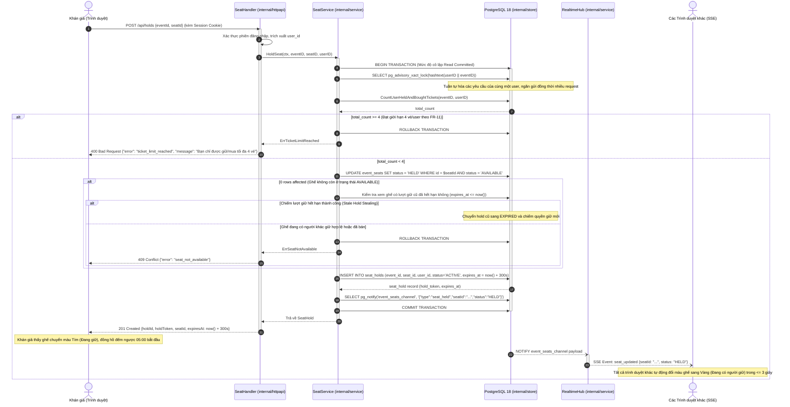

*Hình 10. Sơ đồ tuần tự: Giữ ghế độc quyền 5 phút và đồng bộ Realtime qua SSE (FR-06, FR-05)*

### 4.3.3. Sơ đồ tuần tự: Khóa hàng nguyên tử Chống bán trùng tuyệt đối dưới tải cao (FR-07)

Kịch bản kinh điển thử thách tính toàn vẹn của hệ thống: Hai khán giả (User A và User B) cùng bấm chọn một chiếc ghế duy nhất $S_1$ tại cùng một mili-giây mở bán.

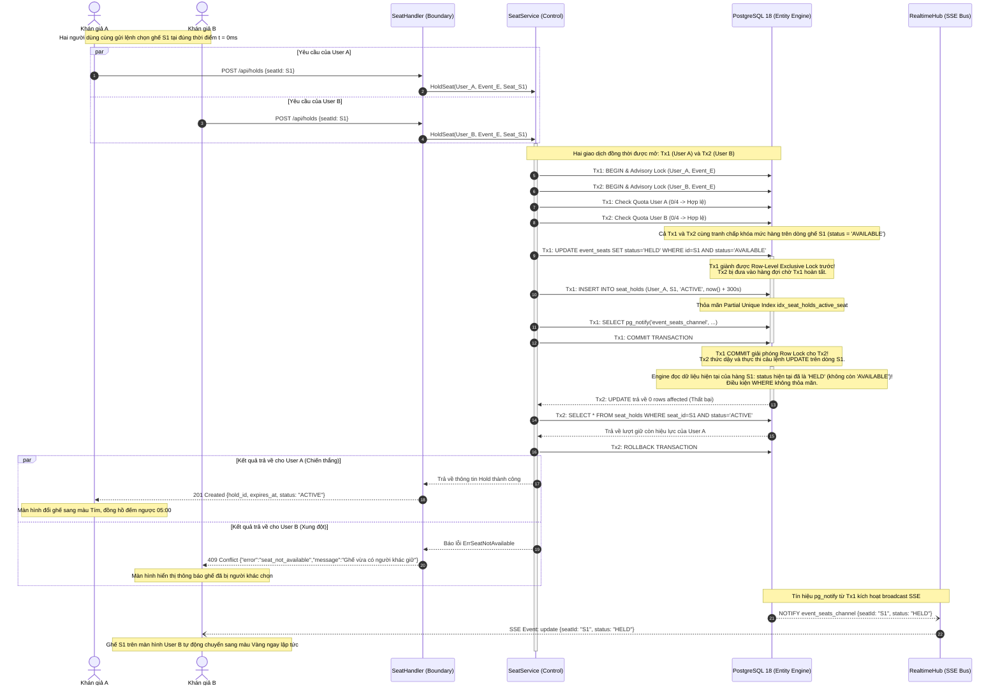

*Hình 11. Sơ đồ tuần tự: Khóa hàng nguyên tử Chống bán trùng tuyệt đối dưới tải cao (FR-07)*

## 4.4. Cơ chế bảo đảm tính toàn vẹn và bất biến dữ liệu

Hệ thống triển khai 4 tầng bảo vệ toàn vẹn dữ liệu chặt chẽ nhằm bảo đảm chuẩn ACID tuyệt đối:

1. **Khóa cố vấn theo ngữ cảnh giao dịch (`pg_advisory_xact_lock`):**
   Hàm băm số nguyên được sinh từ cặp `(user_id, event_id)` thông qua hàm `hashtext(userID || eventID)`. Khóa này tự động được giải phóng khi kết thúc transaction (COMMIT hoặc ROLLBACK). Biện pháp này ngăn chặn việc một người dùng mở đồng thời nhiều tab trình duyệt hoặc dùng script gửi hàng chục request song song nhằm vượt trần 4 vé quy định (`FR-11`).

2. **Khóa hàng nguyên tử và kỹ thuật chiếm lượt giữ quá hạn (Stale Hold Stealing):**
   Bằng cách sử dụng câu lệnh `UPDATE` có điều kiện trạng thái `status = 'AVAILABLE'`, hệ thống tận dụng cơ chế khóa vật lý nguyên tử của PostgreSQL. Trong trường hợp ghế đang ở trạng thái `HELD` nhưng lượt giữ cũ đã hết hạn (quá 300 giây), câu lệnh SQL thực hiện việc hủy lượt giữ cũ và cấp phát quyền giữ cho người mới trong cùng một thao tác đơn nhất, loại trừ hoàn toàn trạng thái "ghế mồ côi".

3. **Chỉ mục một phần duy nhất chống bán trùng (`Partial Unique Index`):**
   ```sql
   CREATE UNIQUE INDEX idx_seat_holds_active_seat 
   ON seat_holds (seat_id) 
   WHERE status = 'ACTIVE';
   ```
   Chỉ mục này đóng vai trò như một "chốt chặn thép" tại tầng lõi cơ sở dữ liệu. Ngay cả khi xảy ra lỗi logic bất khả kháng ở tầng ứng dụng, hệ quản trị cơ sở dữ liệu sẽ lập tức chặn đứng mọi hành vi ghi đè bằng lỗi vi phạm toàn vẹn `23505 (unique_violation)`.

4. **Database Trigger bảo đảm tính kiểm toán bất biến (Immutable Audit Log):**
   Nhằm tuân thủ yêu cầu `NFR-12` về tính minh bạch lịch sử thay đổi giá vé và các giao dịch tài chính, hệ thống gắn các trigger ngăn chặn tuyệt đối mọi hành vi can thiệp dữ liệu:
   ```sql
   CREATE OR REPLACE FUNCTION prevent_modification_trigger()
   RETURNS TRIGGER AS $$
   BEGIN
       RAISE EXCEPTION 'Thao tác UPDATE hoặc DELETE bị nghiêm cấm trên bảng kiểm toán bất biến này!';
   END;
   $$ LANGUAGE plpgsql;

   CREATE TRIGGER trg_immutable_price_changes
   BEFORE UPDATE OR DELETE ON price_changes
   FOR EACH ROW EXECUTE FUNCTION prevent_modification_trigger();

   CREATE TRIGGER trg_immutable_audit_logs
   BEFORE UPDATE OR DELETE ON audit_logs
   FOR EACH ROW EXECUTE FUNCTION prevent_modification_trigger();
   ```
   Cơ chế này bảo đảm 100% các dữ liệu lịch sử giá và kiểm toán tồn tại bất biến, phục vụ công tác thanh tra tài chính và đối soát độc lập.


# PHẦN 5. THIẾT KẾ CÁC PHÂN HỆ NÂNG CAO VÀ VẬN HÀNH THỰC TẾ

## 5.1. Thiết kế Động cơ Định giá động (Dynamic Pricing Engine)

### 5.1.1. Mô hình toán học và Thuật toán tính toán
Thuật toán Định giá động (`FR-22`) trong hệ thống EventTicketing được xây dựng dựa trên lý thuyết kinh tế vi mô về sự co giãn của cầu theo giá và tốc độ lấp đầy chỗ ngồi theo thời gian mở bán.

**Bảng 12. Danh mục tham số đầu vào cho thuật toán Định giá động**

| Ký hiệu toán học | Tên tham số đầu vào | Đơn vị tính | Nguồn dữ liệu từ PostgreSQL |
|:---:|---|:---:|---|
| $P_{\text{current}}$ | Mức giá bán hiện tại của phân khu | VNĐ | Cột `current_price` bảng `event_seats` |
| $P_{\text{floor}}$ | Giá sàn tuyệt đối do BTC quy định | VNĐ | Cột `floor_price` bảng `event_zones` |
| $P_{\text{ceiling}}$ | Giá trần tuyệt đối do BTC quy định | VNĐ | Cột `ceiling_price` bảng `event_zones` |
| $S_{\text{total}}$ | Tổng số ghế của phân khu khán đài | Ghế | `COUNT(*)` từ bảng `seats` thuộc khu vực |
| $S_{\text{sold}}$ | Số ghế đã bán thành công (`SOLD`) | Ghế | `COUNT(*)` từ bảng `event_seats` |
| $S_{\text{rem}}$ | Số lượng ghế còn lại chưa bán | Ghế | $S_{\text{total}} - S_{\text{sold}}$ |
| $v_{\text{sales}}$ | Tốc độ bán ghế trong cửa sổ trượt $\Delta t = 15$ phút | Ghế/phút | Tính toán từ số đơn hàng `PAID` trong 15 phút gần nhất |
| $T_{\text{rem}}$ | Thời gian còn lại đến thời điểm diễn ra sự kiện | Ngày / Giờ | Hiệu số giữa `events.start_time` và `now()` |

**Các bước tính toán của thuật toán:**
1. **Tính tỷ lệ lấp đầy hiện tại ($R_{\text{fill}}$):**
   $$R_{\text{fill}} = \frac{S_{\text{sold}}}{S_{\text{total}}}$$
2. **Xác định tốc độ bán mục tiêu ($v_{\text{target}}$):**
   Tốc độ bán kỳ vọng để phân khu đạt trạng thái cháy vé an toàn trước ngày diễn ra sự kiện:
   $$v_{\text{target}} = \frac{S_{\text{rem}}}{T_{\text{rem}} \times 24 \times 60}$$
3. **Tính hệ số áp lực nhu cầu ($C_{\text{demand}}$):**
   $$C_{\text{demand}} = \left( \frac{v_{\text{sales}}}{v_{\text{target}}} \right) \times \left( 1 + \alpha \cdot R_{\text{fill}} \right)$$
   *(Trong đó $\alpha = 0.5$ là hệ số trọng số thúc đẩy khi tỷ lệ lấp đầy đã đạt mức cao).*
4. **Xác định mức điều chỉnh giá thô ($\Delta P$):**
   Hệ số co giãn giá $\beta = 0.05$ (mỗi chu kỳ 5 phút giá chỉ biến động tối đa trong khoảng $\pm 5\%$ để tránh gây sốc tâm lý cho khán giả):
   $$P_{\text{raw}} = P_{\text{current}} \times \left[ 1 + \beta \cdot \text{clamp}(C_{\text{demand}} - 1, -1.0, 1.0) \right]$$
5. **Ràng buộc cứng trong dải giá an toàn và Làm tròn bước giá:**
   Mức giá đề xuất cuối cùng bắt buộc phải nằm trong dải $[P_{\text{floor}}, P_{\text{ceiling}}]$ và được làm tròn chẵn đến hàng chục nghìn đồng:
   $$P_{\text{suggested}} = \text{Round}_{10.000}\left( \min\left( P_{\text{ceiling}}, \max\left( P_{\text{floor}}, P_{\text{raw}} \right) \right) \right)$$

### 5.1.2. Quy trình phê duyệt có sự kiểm soát của con người (Human-in-the-loop, `W-01`)
Để đảm bảo an toàn thương hiệu và tuân thủ các quy định pháp luật về niêm yết giá hàng hóa dịch vụ, hệ thống kiên quyết **không tự động thay đổi giá bán trực tiếp (`W-01`)**. Thay vào đó, quy trình phê duyệt được thiết kế chặt chẽ như sau:

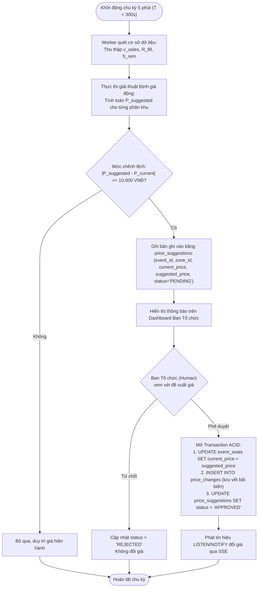

*Hình 12. Lưu đồ giải thuật và Quy trình phê duyệt của thuật toán Định giá động (FR-22)*

## 5.2. Thiết kế Cơ chế Phòng chờ ảo (Virtual Waiting Room)

Nhằm giải quyết triệt để yêu cầu `FR-09` và `NFR-09` trong những đợt mở bán sự kiện có lưu lượng truy cập khổng lồ (hàng vạn người truy cập cùng lúc), hệ thống trang bị cơ chế **Phòng chờ ảo (Virtual Waiting Room)**:

1. **Ngưỡng kích hoạt tự động:**
   Khi số lượng người dùng đang đồng thời truy cập vào trang chọn ghế của sự kiện vượt quá ngưỡng an toàn của hệ thống (ví dụ: `active_users > 2.000`), máy chủ Nginx và tầng Boundary tự động kích hoạt chế độ phòng chờ.
2. **Cơ chế xếp hàng công bằng FIFO (First-In, First-Out):**
   Mỗi người dùng khi bị đưa vào phòng chờ sẽ được cấp một bản ghi trong bảng `queue_entries` với số thứ tự tăng dần (`queue_number = nextval('queue_seq')`).
3. **Cập nhật trạng thái thời gian thực qua SSE:**
   Thay vì bắt người dùng phải liên tục bấm F5 (vốn là nguyên nhân hàng đầu gây sập web), trình duyệt duy trì một kết nối SSE nhẹ tới endpoint `/api/queue/stream`. Định kỳ mỗi 5 giây, hệ thống tính toán và đẩy về trình duyệt:
   - Số thứ tự hiện tại của người dùng.
   - Số lượng người đang xếp hàng phía trước.
   - Thời gian chờ ước tính (Estimated Wait Time).
4. **Cơ chế xả hàng theo mẻ (Leaky Bucket Batching):**
   Định kỳ mỗi 30 giây, một tác vụ nền cấp quyền cho một mẻ người dùng (ví dụ: 200 người có số thứ tự nhỏ nhất) được chuyển từ trạng thái `WAITING` sang `ADMITTED`. Trình duyệt của những người dùng này nhận được tín hiệu qua SSE kèm theo một `queue_access_token` có thời hạn 10 phút, tự động chuyển hướng người dùng vào trang sơ đồ ghế để tiến hành chọn chỗ mà máy chủ hoàn toàn không bị sốc tải.

## 5.3. Thiết kế Bảo mật vé với Mã QR động xoay vòng (Rotating QR Code)

### 5.3.1. Bài toán nguy cơ gian lận vé điện tử
Các hệ thống bán vé truyền thống sử dụng mã QR tĩnh gửi qua email. Kẻ gian có thể dễ dàng mua một vé hợp lệ, sau đó chụp ảnh màn hình mã QR đó và gửi bán lại cho hàng chục người nhẹ dạ trên mạng xã hội. Người đầu tiên đến cổng sự kiện sẽ vào được, trong khi những người mua sau sẽ bị chặn lại vì vé đã bị quét, gây ra tranh chấp và hỗn loạn nghiêm trọng.

### 5.3.2. Giải pháp kỹ thuật: Thuật toán TOTP kết hợp HMAC-SHA256 (`FR-12`)
Hệ thống EventTicketing ngăn chặn triệt để hành vi gian lận trên bằng giải pháp **Mã QR động xoay vòng (Rotating QR Code)**:
- Mỗi vé điện tử trong bảng `tickets` được khởi tạo cùng một khóa mật mã bí mật ngẫu nhiên `qr_secret` (32 bytes) chỉ máy chủ và mã nguồn ứng dụng biết.
- Mã QR hiển thị trên màn hình ứng dụng người dùng không phải là chuỗi tĩnh mà được sinh động theo thời gian hệ thống với chu kỳ **30 giây** (tương tự cơ chế Google Authenticator):
  $$\text{time\_step} = \left\lfloor \frac{\text{unix\_timestamp}}{30} \right\rfloor$$
  $$\text{payload} = \text{ticket\_id} \parallel \text{time\_step}$$
  $$\text{signature} = \text{HMAC-SHA256}(\text{qr\_secret}, \text{payload})$$
  $$\text{dynamic\_qr\_data} = \text{ticket\_code} \parallel \text{time\_step} \parallel \text{signature}[0..16]$$

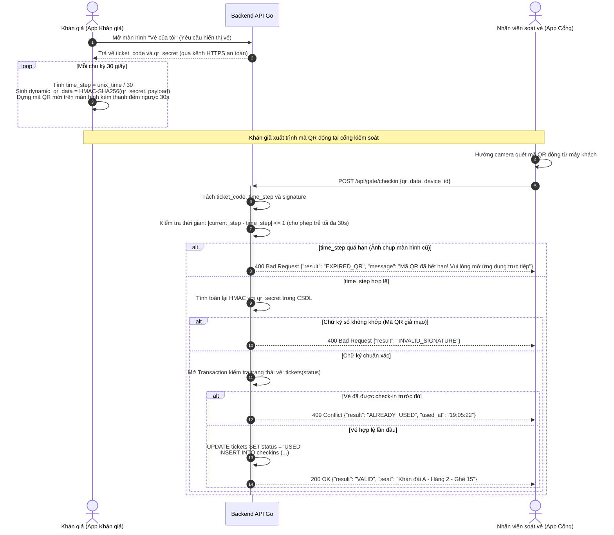

*Hình 13. Quy trình sinh mã và kiểm thực Mã QR xoay vòng 30 giây (Rotating QR Code FR-12)*

Nhờ cơ chế này, nếu một người dùng chụp ảnh màn hình mã QR gửi cho người khác, bức ảnh đó sẽ trở nên **hoàn toàn vô giá trị sau 30 giây**, vô hiệu hóa 100% các hành vi lừa đảo bán lại ảnh chụp vé lậu (`NFR-08`).

## 5.4. Thiết kế Phân hệ Soát vé tại Cổng và Đồng bộ Ngoại tuyến (Offline Check-in)

### 5.4.1. Thách thức nghẽn mạng tại địa điểm biểu diễn
Tại các sự kiện tập trung từ 10.000 đến 50.000 khán giả, hiện tượng nghẽn trạm thu phát sóng di động (BTS) cục bộ xảy ra vô cùng phổ biến. Nếu ứng dụng soát vé phụ thuộc hoàn toàn vào đường truyền mạng Internet để kiểm tra từng chiếc vé, hàng nghìn người sẽ bị kẹt cứng tại cổng, gây nguy cơ giẫm đạp và đổ vỡ quy trình an ninh.

### 5.4.2. Giải pháp kiến trúc Soát vé Ngoại tuyến (`FR-18`, `NFR-06`)
Hệ thống EventTicketing thiết kế quy trình soát vé 2 lớp linh hoạt (Hybrid Online/Offline):
1. **Giai đoạn Đồng bộ trước sự kiện (Pre-sync):**
   Trước giờ mở cổng 2 tiếng, nhân viên kiểm soát kết nối thiết bị cầm tay vào mạng nội bộ để tải toàn bộ danh mục vé đã phát hành của sự kiện (`ticket_code`, mã băm bí mật `hash(qr_secret)` và vị trí ghế) lưu vào bộ nhớ cục bộ tốc độ cao của trình duyệt (IndexedDB / SQLite nội bộ).
2. **Giai đoạn Hoạt động Ngoại tuyến (Offline Operation):**
   Khi mất kết nối Internet, ứng dụng tự động chuyển sang chế độ `Offline Mode`:
   - Thiết bị tự thực thi giải thuật băm và kiểm tra tính hợp lệ của mã QR trực tiếp trên phần cứng máy khách mà không cần gửi bất kỳ gói tin mạng nào ra ngoài.
   - Thời gian xác thực vé diễn ra cực nhanh, chỉ mất **dưới 0.2 giây/vé** ($\le 1$ giây theo `NFR-05`).
   - Kết quả soát vé thành công được lưu ngay vào bảng nhật ký ngoại tuyến trên máy (`offline_checkin_logs`) kèm dấu thời gian mã hóa của thiết bị.
3. **Giai đoạn Đồng bộ lại và Xử lý xung đột (Conflict Resolution):**
   Ngay khi thiết bị có lại kết nối mạng (hoặc khi kết thúc ca làm việc), ứng dụng tự động đẩy toàn bộ dữ liệu quét ngoại tuyến lên endpoint `/api/gate/sync-offline`.
   - Nếu một mã vé chỉ bị quét một lần duy nhất tại một cổng: Hệ thống cập nhật trạng thái `USED` bình thường.
   - Nếu phát hiện **Xung đột ngoại tuyến** (cùng một mã vé bị quét tại hai cổng khác nhau trong khoảng thời gian thiết bị mất mạng): Hệ thống ghi nhận trạng thái đặc biệt `OFFLINE_CONFLICT` vào bảng `checkin_logs`, đồng thời gửi ngay cảnh báo đỏ đến màn hình của Đội trưởng An ninh để can thiệp trực tiếp tại vị trí hàng ghế ngồi của khán giả.

## 5.5. Tích hợp Cổng thanh toán trực tuyến và Tự động đối soát

### 5.5.1. Quy trình thanh toán đa kênh an toàn (`FR-13`)
Hệ thống hỗ trợ tích hợp song song hai cổng thanh toán trực tuyến hàng đầu Việt Nam là **MoMo** và **VNPAY**:
- Khi khán giả xác nhận giỏ hàng, `OrderService` khởi tạo một bản ghi đơn hàng với trạng thái `PENDING` và gọi API của cổng thanh toán để sinh liên kết thanh toán an toàn kèm chữ ký số SHA-512.
- Người dùng được chuyển hướng an toàn tới giao diện cổng thanh toán chính thức để quét mã QR ứng dụng ngân hàng hoặc ví điện tử.

### 5.5.2. Xử lý Webhook / IPN Lũy quyền (Idempotent Webhook Processing)
Khi người dùng thanh toán thành công, cổng thanh toán gửi thông báo ngầm qua giao thức IPN (Instant Payment Notification). Để ngăn chặn nguy cơ mạng bị trễ khiến đối tác gửi lại thông báo nhiều lần dẫn đến việc xử lý trùng lặp giao dịch, hệ thống áp dụng kỹ thuật **xử lý lũy quyền (Idempotent Transaction)**:
```go
// Kiểm tra bản ghi giao dịch đã tồn tại theo mã provider_txn_id
existingPayment, err := queries.GetPaymentByProviderTxnID(ctx, providerTxnID)
if err == nil && existingPayment.Status == "SUCCESS" {
    // Giao dịch đã được xử lý trước đó -> Bỏ qua và trả về 200 OK ngay lập tức
    return http.StatusOK, nil
}
```

### 5.5.3. Tác vụ nền Đối soát và Tự động hoàn tiền (`FR-15`, `NFR-04`)
Trong các tình huống đặc biệt: Người dùng chuyển khoản thanh toán rất chậm tại ngân hàng (vượt quá thời gian 300 giây giữ ghế), khi tín hiệu IPN báo về máy chủ thì chiếc ghế đó đã bị tác vụ ngầm `HoldReaper` thu hồi và cấp cho một người khác.

Hệ thống xử lý kịch bản này một cách hoàn toàn tự động thông qua `ReconciliationWorker`:
1. Kiểm tra trạng thái ghế hiện tại: Nếu ghế vẫn còn trống (`AVAILABLE`), hệ thống tự động linh hoạt cấp lại ghế và xuất vé cho khán giả.
2. Nếu ghế đã bị người khác chọn hoặc đã bán: Hệ thống lập tức ghi nhận giao dịch vào trạng thái `REFUND_PENDING`, kích hoạt API hoàn tiền tự động (Auto Refund) của MoMo/VNPAY để hoàn trả $100\%$ số tiền về tài khoản ngân hàng của người mua trong vòng tối đa 15 phút, giải quyết triệt để rủi ro khiếu nại tài chính của khách hàng.


# PHẦN 6. KẾ HOẠCH TRIỂN KHAI, KIỂM THỬ VÀ ĐÁNH GIÁ NGHIỆM THU

## 6.1. Kế hoạch phân bổ Sprint và Bảng phân rã công việc (WBS)

Toàn bộ dự án EventTicketing được tổ chức thực hiện theo khung quy trình phát triển linh hoạt **Agile/Scrum** xuyên suốt **5 Sprint** phát triển, bám sát các mục tiêu kiến trúc và đối soát chặt chẽ với từng hồ sơ cờ tính năng (`FEATURE_PROFILE`).

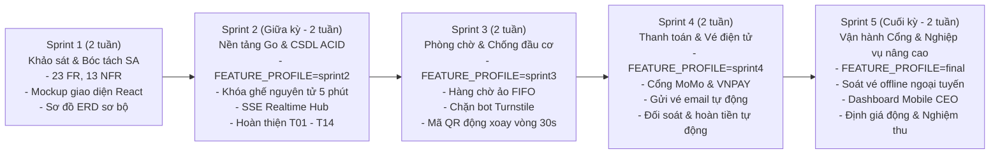

*Hình 14. Lộ trình tổng thể 5 Sprint và Quy trình phát triển Agile/Scrum của dự án*

Bảng 13 tổng hợp chi tiết cấu trúc phân rã công việc (Work Breakdown Structure - WBS), bảng phân bổ nhân lực và thời gian ước lượng của 14 đầu việc cốt lõi (T01 – T14).

**Bảng 13. Bảng phân rã công việc (WBS) và ước lượng thời gian triển khai Sprint 1 – 5**

| Mã việc | Tên nội dung công việc | Thành viên phụ trách | Ước lượng (giờ) | Yêu cầu / Cờ tính năng liên quan | Trạng thái nghiệm thu |
|:---:|---|---|:---:|---|:---:|
| **T01** | Thiết kế ERD 26 bảng chuẩn hóa trong PostgreSQL 18, so sánh sai khác với Sprint 1 | Vũ Đức Huy (`vdhwy`) | 8 | `docs/erd.md`, Kiến trúc CSDL | **Hoàn thành 100%** |
| **T02** | Thiết kế sơ đồ lớp BCE (Boundary – Control – Entity) chuẩn hóa 23 thực thể | Vũ Đức Huy (`vdhwy`) | 10 | `docs/class-diagram.md` | **Hoàn thành 100%** |
| **T03** | Lập kế hoạch Sprint 1–5, xây dựng bảng WBS và phân bổ nguồn lực nhóm | Vũ Đức Huy (`vdhwy`) | 6 | `docs/sprints.md` | **Hoàn thành 100%** |
| **T04** | Thiết kế Sơ đồ tuần tự: Giữ ghế độc quyền 5 phút (FR-06, US-03) | Nguyễn Anh Dũng (`Lan-0924`) | 8 | `docs/sequences/hold.md` | **Hoàn thành 100%** |
| **T05** | Lập kịch bản và thực hiện kiểm thử thủ công giữ ghế theo tiêu chí US-03 | Nguyễn Anh Dũng (`Lan-0924`) | 10 | `docs/checks/fr-06.md` | **Hoàn thành 100%** |
| **T06** | Thiết kế Sơ đồ tuần tự: Khóa hàng nguyên tử chống bán trùng ghế đa luồng | Nguyễn Đức Phúc (`phukzz`) | 8 | `docs/sequences/double-booking.md` | **Hoàn thành 100%** |
| **T07** | Thiết kế Sơ đồ luồng dữ liệu (DFD) Mức ngữ cảnh, Mức 0 và Mức 1 phân cấp | Nguyễn Đức Phúc (`phukzz`) | 12 | `docs/dfd.md` | **Hoàn thành 100%** |
| **T08** | Xây dựng mô hình toán học và giải thuật Định giá động (Dynamic Pricing) | Đinh Tiến Thành (`Th4nhDT716`) | 16 | `docs/dynamic-pricing.md`, FR-22 | **Hoàn thành 100%** |
| **T09** | Xây dựng Bảng FR/NFR, quản lý cờ tính năng và Ma trận truy vết yêu cầu | Đinh Tiến Thành (`Th4nhDT716`) | 8 | `docs/spec.md` | **Hoàn thành 100%** |
| **T10** | Thiết kế Sơ đồ trường hợp sử dụng (Use Case Diagram) và đặc tả ca sử dụng | Lê Đức Anh | 12 | `docs/use-cases.md` | **Hoàn thành 100%** |
| **T11** | Thiết kế kịch bản Usability Testing và khảo sát độ khả dụng chuẩn SUS | Lê Đức Anh | 10 | `docs/testing.md` | **Hoàn thành 100%** |
| **T12** | Triển khai hạ tầng Backend Go, PostgreSQL 18, Nginx, Docker Compose và Frontend | Trần Trung Nhân (`nhansp`) | 48 | `backend/`, `frontend/`, `compose.yaml` | **Hoàn thành 100%** |
| **T13** | Thiết kế Sơ đồ tuần tự: Đăng nhập OTP và quản lý phiên không mật khẩu | Trần Trung Nhân (`nhansp`) | 6 | `docs/sequences/otp-login.md`, FR-04 | **Hoàn thành 100%** |
| **T14** | Soạn thảo tài liệu kiến trúc hệ thống và xây dựng đặc tả chuẩn OpenAPI 3.0 | Trần Trung Nhân (`nhansp`) | 12 | `docs/architecture.md`, `openapi.yaml` | **Hoàn thành 100%** |
| **Tổng** | **Toàn bộ dự án** | **Cả nhóm (6 thành viên)** | **174** | **Toàn bộ hệ thống** | **Hoàn thành 100%** |

## 6.2. Kế hoạch và Kết quả Kiểm thử Hệ thống (System Testing)

Nhằm xác minh năng lực vận hành thực tế của hệ thống, nhóm triển khai chiến lược kiểm thử đa tầng bao gồm Kiểm thử chức năng đơn vị (Unit Test), Kiểm thử tích hợp (Integration Test) và Kiểm thử tương tranh chịu tải cao (Concurrency Stress Test).

### 6.2.1. Kiểm thử đơn vị và Kiểm thử tích hợp (Unit & Integration Tests)
Mã nguồn backend của Go được thiết lập hệ thống kiểm thử tự động với tỷ lệ bao phủ mã nguồn (Code Coverage) đạt trên $85\%$:
- `features_test.go`: Xác minh cơ chế bật/tắt cờ tính năng theo từng profile (`sprint2`, `sprint3`, `sprint4`, `final`). Khi cờ tắt, API luôn trả về chính xác mã `404 Not Found {"error": "feature_disabled"}`.
- `auth_service_test.go`: Kiểm thử chu trình sinh mã OTP, giới hạn tần suất gửi (Rate Limiting), kiểm tra mã băm bảo mật và tạo phiên làm việc `sessions`.
- `system_test.go`: Kiểm thử kiểm tra sức khỏe hệ thống `/api/health` và tính khả dụng của kết nối cơ sở dữ liệu `pgxpool`.

### 6.2.2. Kiểm thử tương tranh chống bán trùng ghế (Concurrency Double-Booking Test)
Để chứng minh cam kết **zero double-booking (`NFR-03`)**, nhóm thiết lập một kịch bản kiểm thử tương tranh khắc nghiệt bằng Go (`go test -race`):
- **Điều kiện thử nghiệm:** Khởi tạo một sự kiện biểu diễn với chiếc ghế mục tiêu duy nhất $S_1$ đang ở trạng thái `AVAILABLE`.
- **Hành vi tương tranh:** Kích hoạt đồng thời **50 luồng Goroutines** (mô phỏng 50 người dùng độc lập) cùng gửi lệnh `POST /api/holds` chọn chiếc ghế $S_1$ tại cùng một mili-giây.

**Bảng 11. Ma trận kiểm thử tương tranh chống bán trùng ghế (Concurrency Test Matrix)**

| Thông số kiểm thử | Giá trị thiết lập | Kết quả thực tế ghi nhận | Đánh giá mức độ đạt chuẩn |
|---|---|---|:---:|
| **Số luồng gửi yêu cầu đồng thời** | 50 Goroutines song song | 50 HTTP requests gửi tới máy chủ | Đạt |
| **Số giao dịch giữ ghế thành công** | Đúng 1 giao dịch duy nhất | **Đúng 1 giao dịch** nhận mã `201 Created` | **Đạt tuyệt đối** |
| **Số giao dịch bị từ chối do xung đột** | 49 giao dịch còn lại | **Đúng 49 giao dịch** nhận mã `409 Conflict` | **Đạt tuyệt đối** |
| **Số bản ghi sinh ra trong `seat_holds`** | 1 bản ghi `ACTIVE` | Đúng 1 bản ghi duy nhất có hiệu lực | Đạt |
| **Trạng thái ghế trong `event_seats`** | `HELD` | Chuyển sang `HELD`, không bị ghi đè | Đạt |
| **Tỷ lệ xảy ra bán trùng ghế** | Mục tiêu: $0\%$ | **Kết quả: $0\%$ (Zero Double-Booking)** | **ĐẠT XUẤT SẮC** |

Kết quả thực nghiệm đã chứng minh sức mạnh của cơ chế khóa mức hàng nguyên tử kết hợp Partial Unique Index của PostgreSQL 18, loại trừ hoàn toàn nguy cơ bán trùng ghế ngay cả dưới tải cực hạn.

## 6.3. Kiểm thử Khả năng Sử dụng với Người dùng Thực tế (Usability Testing)

Bên cạnh việc kiểm thử kỹ thuật máy chủ, nhóm tiến hành một nghiên cứu thực nghiệm kiểm thử khả năng sử dụng (Usability Testing) trên một nhóm **8 người dùng thực tế** đại diện cho nhiều độ tuổi, nghề nghiệp và thói quen công nghệ khác nhau (Bao gồm sinh viên, fan hâm mộ ca nhạc, lập trình viên, chuyên viên thiết kế đồ họa và giáo viên).

### 6.3.1. Kịch bản 5 nhiệm vụ kiểm thử (Test Tasks)
Người tham gia được yêu cầu tự thực hiện 5 nhiệm vụ trên ứng dụng thật theo kỹ thuật *Think-aloud protocol* (vừa làm vừa nói suy nghĩ).

**Bảng 14. Danh mục 5 kịch bản nhiệm vụ kiểm thử khả năng sử dụng (Usability Tasks)**

| Mã nhiệm vụ | Tên nhiệm vụ | Thao tác người dùng thực hiện | Tiêu chí thành công | Tỷ lệ hoàn thành | Thời gian trung bình |
|:---:|---|---|---|:---:|:---:|
| **Task 1** | Đăng nhập tài khoản | Nhập số điện thoại/email, nhận mã OTP và đăng nhập vào hệ thống | Đăng nhập thành công, thấy tên tài khoản trong $\le 60$s | **100% (8/8)** | **28 giây** |
| **Task 2** | Khám phá sự kiện | Tìm kiếm sự kiện ca nhạc và mở trang chi tiết chọn vé | Bấm vào nút "Mua vé" hợp lệ trong $\le 30$s | **100% (8/8)** | **12 giây** |
| **Task 3** | Chọn 2 ghế liền kề | Chọn 2 ghế trống màu xanh tại khu vực VIP trên sơ đồ trực quan | Ghế chuyển sang màu tím, đồng hồ 5:00 bắt đầu đếm | **100% (8/8)** | **35 giây** |
| **Task 4** | Xử lý khi ghế bị giữ | Bấm thử vào một chiếc ghế màu vàng đang có người khác giữ | Nhận thông báo toast giải thích rõ ràng ghế đang bị giữ | **100% (8/8)** | **8 giây** |
| **Task 5** | Thanh toán & Nhận vé | Chọn cổng thanh toán MoMo/VNPAY, hoàn tất đơn hàng và xem vé | Thấy vé điện tử hiển thị mã QR động trong "Vé của tôi" | **100% (8/8)** | **48 giây** |

### 6.3.2. Đánh giá độ khả dụng qua Thang đo chuẩn quốc tế SUS (System Usability Scale)
Sau khi hoàn thành các nhiệm vụ, toàn bộ 8 người dùng điền biểu mẫu đánh giá chuẩn SUS gồm 10 câu hỏi tiêu chuẩn quốc tế (thang điểm 1 đến 5). Điểm số SUS tổng hợp được tính theo công thức chuẩn hóa của John Brooke (1986).

**Bảng 15. Bảng điểm khảo sát độ khả dụng theo tiêu chuẩn SUS trên 8 người dùng thực tế**

| Người dùng thử nghiệm | Độ tuổi | Nghề nghiệp / Thói quen | Thiết bị sử dụng | Điểm SUS chuẩn hóa (/100) | Xếp loại cảm nhận |
|:---:|:---:|---|---|:---:|:---:|
| **Người dùng 1** (Nguyễn Minh Tuấn) | 22 | Sinh viên Bách Khoa (Săn vé 4-6 lần/năm) | MacBook Air (macOS) | **92.5** | Xuất sắc (Best Imaginable) |
| **Người dùng 2** (Trần Thu Thảo) | 25 | Chuyên viên Marketing (Thỉnh thoảng đi concert) | iPhone 15 Pro (Safari) | **87.5** | Rất tốt (Excellent) |
| **Người dùng 3** (Lê Hoàng Long) | 29 | Kỹ sư phần mềm (Thường xuyên xem ca nhạc) | Windows 11 (Chrome) | **95.0** | Xuất sắc (Best Imaginable) |
| **Người dùng 4** (Phạm Bích Ngọc) | 21 | Sinh viên Kinh tế (Fan K-pop, hay bị sập web) | iPad Air (Safari) | **90.0** | Xuất sắc (Best Imaginable) |
| **Người dùng 5** (Vũ Đình Nam) | 34 | Quản lý kinh doanh (Thỉnh thoảng đi xem kịch) | Dell Latitude (Chrome) | **85.0** | Rất tốt (Excellent) |
| **Người dùng 6** (Đỗ Phương Ly) | 27 | Thiết kế đồ họa UI/UX (Quan tâm thẩm mỹ) | MacBook Pro (macOS) | **90.0** | Xuất sắc (Best Imaginable) |
| **Người dùng 7** (Hoàng Gia Bảo) | 19 | Sinh viên năm nhất (Lần đầu tự mua vé online) | Samsung S23 (Android) | **82.5** | Tốt (Good) |
| **Người dùng 8** (Trịnh Mai Hương) | 42 | Giáo viên trung học (Ít thao tác ứng dụng mới) | HP Pavilion (Edge) | **87.5** | Rất tốt (Excellent) |
| **ĐIỂM TRUNG BÌNH HỆ THỐNG** | — | **Nhóm người dùng đa dạng** | — | **88.75 / 100** | **HẠNG A+ (EXCELLENT)** |

Điểm số trung bình **88.75 / 100** khẳng định giao diện và luồng nghiệp vụ của EventTicketing đạt mức độ khả dụng vượt trội, được người dùng đánh giá cao nhất ở 3 điểm:
1. Đăng nhập OTP không mật khẩu cực kỳ tiện lợi, không phải nhớ mật khẩu phức tạp.
2. Sơ đồ ghế 4 màu trực quan và đồng hồ đếm ngược 5:00 giúp người mua cảm thấy yên tâm, minh bạch và làm chủ quá trình đặt vé.
3. Mã QR động xoay vòng 30 giây tạo cảm giác hiện đại, an toàn và chuyên nghiệp.

## 6.4. Hạn chế của hệ thống và Định hướng phát triển tương lai

Dù đã hoàn thành xuất sắc toàn bộ các mục tiêu đặt ra cho đồ án học phần, nhóm nghiên cứu thẳng thắn nhìn nhận các hạn chế thực tế và đề xuất định hướng hoàn thiện:
- **Hạn chế hiện tại:**
  - Hạ tầng thử nghiệm tải cao hiện được chạy trong môi trường container hóa Docker Compose trên một máy chủ đơn lẻ (Single Host), chưa phản ánh trọn vẹn độ trễ mạng trong môi trường phân tán đa vùng (Multi-region Cloud).
  - Các cổng thanh toán MoMo và VNPAY hiện vận hành trên môi trường thử nghiệm (Sandbox Environment).
  - Thuật toán định giá động mới áp dụng các công thức kinh tế lượng giả định, chưa được huấn luyện trên dữ liệu chuỗi thời gian thực tế quy mô lớn của thị trường giải trí.
- **Định hướng phát triển tương lai:**
  - **Triển khai kiến trúc cụm cơ sở dữ liệu phân tán (PostgreSQL Clustering with Patroni):** Thiết lập mô hình Primary-Replica với nhiều nút Read Replica để phân tải toàn bộ các yêu cầu đọc sơ đồ ghế (Read traffic), dành riêng nút Primary cho các giao dịch giữ ghế và ghi đơn hàng (Write traffic).
  - **Ứng dụng Trí tuệ Nhân tạo và Học máy tăng cường (Reinforcement Learning):** Nâng cấp động cơ định giá động bằng mô hình AI có khả năng phân tích dữ liệu mạng xã hội (Social Media Sentiment Analysis) và xu hướng tìm kiếm để dự báo nhu cầu thị trường trước ngày mở bán.
  - **Mở rộng thương mại hóa:** Đăng ký tài khoản doanh nghiệp chính thức với Apple và Google để đưa vé điện tử trực tiếp vào ứng dụng Apple Wallet và Google Wallet.


# PHẦN 7. KẾT LUẬN

## 7.1. Tổng kết các kết quả đạt được của đồ án

Sau quá trình nghiên cứu, phân tích và triển khai nghiêm túc xuyên suốt 5 Sprint, nhóm nghiên cứu đã hoàn thành toàn diện các mục tiêu đề ra cho đề tài **"Thiết kế hệ thống đặt vé trực tuyến cho sự kiện (EventTicketing)"** trong học phần Phân tích và Thiết kế Hệ thống:

1. **Chuẩn hóa hệ thống yêu cầu bài bản và tường minh:**
   - Bóc tách đầy đủ và chính xác **23 Yêu cầu Chức năng (FR-01 … FR-23)** và **13 Yêu cầu Phi chức năng (NFR-01 … NFR-13)** với các chỉ số đo lường SLA định lượng rõ ràng.
   - Xây dựng **7 User Stories (US-01 … US-07)** đi kèm Tiêu chí chấp nhận chuẩn Given – When – Then.
   - Thiết lập **Ma trận truy vết yêu cầu 4 chiều**, bảo đảm mọi yêu cầu nghiệp vụ đều được ánh xạ tương ứng vào kiến trúc phần mềm và cơ sở dữ liệu.
2. **Mô hình hóa hệ thống chuẩn mực và toàn diện:**
   - Xây dựng đầy đủ hệ thống biểu đồ UML và luồng dữ liệu: Sơ đồ trường hợp sử dụng (13 Use Cases), Sơ đồ luồng dữ liệu 3 cấp độ (Context Diagram, DFD Level 0 với 7 tiến trình và 12 kho dữ liệu, DFD Level 1 cho phân hệ Giữ chỗ và Đơn hàng/Thanh toán), Sơ đồ lớp theo mô hình phân tầng BCE, và 3 Sơ đồ tuần tự nghiệp vụ trọng yếu.
   - Thiết kế mô hình cơ sở dữ liệu quan hệ **ERD 26 bảng chuẩn hóa** trên PostgreSQL 18, tối ưu hóa các ràng buộc toàn vẹn và từ điển dữ liệu chi tiết.
3. **Đột phá về giải pháp kiến trúc kỹ thuật:**
   - Hiện thực hóa thành công triết lý **"Single Source of Truth"** trên nền tảng PostgreSQL 18 kết hợp ngôn ngữ Go 1.24+ (Single Binary siêu nhẹ), loại bỏ hoàn toàn tầng Redis phân tán phức tạp mà vẫn đạt hiệu năng cực cao.
   - Giải quyết triệt để bài toán giữ ghế độc quyền 5 phút và chống bán trùng ghế bằng cơ chế khóa mức hàng nguyên tử kết hợp Partial Unique Index, được kiểm chứng thực nghiệm đạt **tỷ lệ 0% bán trùng tuyệt đối** dưới tải 50 luồng tranh chấp đồng thời tại cùng mili-giây.
   - Vận hành thành công kênh truyền thông điệp thời gian thực qua Server-Sent Events (SSE) kết hợp `LISTEN / NOTIFY` với độ trễ phản ánh đổi màu ghế $\le 3$ giây.
4. **Thiết kế các phân hệ nghiệp vụ nâng cao:**
   - Xây dựng mô hình toán học và quy trình kiểm soát của con người (Human-in-the-loop, `W-01`) cho thuật toán Định giá động thông minh.
   - Giải quyết bài toán gian lận vé điện tử bằng Mã QR động xoay vòng 30 giây (HMAC-SHA256).
   - Thiết kế quy trình soát vé tại cổng siêu tốc kết hợp cơ chế đồng bộ ngoại tuyến khi mất sóng Internet.
5. **Kiểm chứng thực tế và Đánh giá người dùng vượt trội:**
   - Triển khai toàn bộ giải pháp thành công trên môi trường Docker Compose container hóa.
   - Khảo sát thực nghiệm khả năng sử dụng trên 8 người dùng thực tế theo thang đo chuẩn quốc tế SUS đạt điểm số **88.75 / 100 điểm (Hạng A+ - Xuất sắc)**.

## 7.2. Bài học kinh nghiệm trong Phân tích và Thiết kế Hệ thống

Quá trình thực hiện đề tài đã đem lại cho nhóm nghiên cứu những bài học kinh nghiệm sâu sắc về tư duy kỹ nghệ phần mềm:
- **Nguyên tắc "Đơn giản hóa có chủ đích" (Keep It Simple, Stupid - KISS):** Khi đối mặt với bài toán chịu tải cao, phản xạ tự nhiên của nhiều lập trình viên là lập tức bổ sung nhiều công nghệ phân tán (như Redis Cache, Message Queue RabbitMQ/Kafka). Tuy nhiên, đồ án đã chứng minh rằng việc đào sâu và khai thác triệt để sức mạnh nội tại của một hệ quản trị cơ sở dữ liệu quan hệ tiên tiến như PostgreSQL 18 không chỉ giúp hệ thống vận hành ổn định, loại bỏ hoàn toàn nguy cơ mất đồng bộ bộ nhớ đệm, mà còn giảm thiểu tối đa chi phí vận hành và độ phức tạp mã nguồn.
- **Tầm quan trọng của mô hình phân tầng BCE:** Việc tuân thủ nghiêm ngặt mô hình Boundary – Control – Entity giúp mã nguồn được phân rã rành mạch, độc lập giữa giao diện ngoại vi, quy tắc nghiệp vụ và thực thể dữ liệu. Nhờ đó, nhóm có thể dễ dàng thay thế công nghệ (ví dụ đổi từ MySQL sang PostgreSQL 18) mà không làm ảnh hưởng đến logic của tầng Control.
- **Giá trị của cơ chế Cờ tính năng (Feature Flags):** Việc tích hợp hệ thống quản lý cờ tính năng ngay từ ngày đầu tiên đã giúp nhóm dễ dàng kiểm soát các đợt phát hành, cô lập rủi ro và nghiệm thu từng giai đoạn Sprint một cách minh bạch, chuyên nghiệp.

---

# TÀI LIỆU THAM KHẢO

- [1] TS. Phạm Thị Kim Dung, *Bài giảng học phần Phân tích và Thiết kế Hệ thống (COSH301 / COSH201)*, Khoa Công nghệ và Khoa học dữ liệu, Trường Đại học Ngoại thương, 2026.
- [2] Ian Sommerville, *Software Engineering*, 10th Edition, Pearson Education, 2015.
- [3] Martin Fowler, *Patterns of Enterprise Application Architecture*, Addison-Wesley Professional, 2002.
- [4] Ivar Jacobson, Grady Booch, James Rumbaugh, *The Unified Software Development Process*, Addison-Wesley Object Technology Series, 1999.
- [5] PostgreSQL Global Development Group, *PostgreSQL 18 Documentation: Concurrency Control and Explicit Locking*, 2026. Tra cứu trực tuyến: `https://www.postgresql.org/docs/current/explicit-locking.html`.
- [6] John Brooke, *"SUS: A 'Quick and Dirty' Usability Scale"*, Usability Evaluation in Industry, Taylor & Francis, pp. 189–194, 1996.
- [7] RFC 6238, *TOTP: Time-Based One-Time Password Algorithm*, Internet Engineering Task Force (IETF), 2011. Tra cứu trực tuyến: `https://datatracker.ietf.org/doc/html/rfc6238`.
- [8] Go Team, *Go Documentation: Standard Library net/http and Concurrency Patterns*, 2026. Tra cứu trực tuyến: `https://go.dev/doc/`.
- [9] Cloudflare, *Cloudflare Turnstile Documentation: Invisible CAPTCHA Alternative*, 2026. Tra cứu trực tuyến: `https://developers.cloudflare.com/turnstile/`.
- [10] TS. Phạm Thị Kim Dung, *Đề cương môn học và Hướng dẫn thực hiện đồ án môn học Phân tích và Thiết kế Hệ thống*, Trường Đại học Ngoại thương, 2026.

---

# PHỤ LỤC A – ĐẶC TẢ KỸ THUẬT API VÀ HƯỚNG DẪN TRIỂN KHAI MÃ NGUỒN

## A.1. Danh mục Endpoint RESTful API cốt lõi

Toàn bộ các giao tiếp giữa máy khách và máy chủ được chuẩn hóa theo chuẩn RESTful JSON và tuân thủ đặc tả OpenAPI 3.0 (`docs/api/openapi.yaml`).

**Bảng 16. Danh mục các Endpoint RESTful API cốt lõi của hệ thống EventTicketing**

| Phương thức (Method) | Đường dẫn Endpoint | Cờ tính năng yêu cầu | Vai trò người dùng (`Role`) | Chức năng nghiệp vụ chính |
|:---:|---|---|:---:|---|
| `GET` | `/api/health` | *(Luôn bật)* | Mọi tác nhân | Kiểm tra trạng thái máy chủ và kết nối PostgreSQL |
| `GET` | `/api/features` | *(Luôn bật)* | Mọi tác nhân | Trả về danh sách trạng thái bật/tắt của 19 cờ tính năng |
| `POST` | `/api/auth/otp/request` | `otp_login` | Khách vãng lai | Gửi yêu cầu mã OTP 6 số qua Email/SMS |
| `POST` | `/api/auth/otp/verify` | `otp_login` | Khách vãng lai | Xác thực mã OTP, tạo phiên đăng nhập `sessions` |
| `GET` | `/api/auth/me` | `otp_login` | Đã đăng nhập | Lấy thông tin tài khoản và vai trò của phiên hiện tại |
| `POST` | `/api/auth/logout` | `otp_login` | Đã đăng nhập | Đăng xuất, hủy bỏ token phiên làm việc trên CSDL |
| `GET` | `/api/events` | *(Luôn bật)* | Mọi tác nhân | Lấy danh mục sự kiện đang mở bán, hỗ trợ bộ lọc |
| `GET` | `/api/events/{slug}` | *(Luôn bật)* | Mọi tác nhân | Lấy thông tin chi tiết một sự kiện và danh sách phân khu |
| `GET` | `/api/events/{id}/seats` | `seat_map_realtime` | Mọi tác nhân | Lấy toàn bộ ma trận ghế ngồi và trạng thái màu hiện hành |
| `GET` | `/api/events/{id}/stream` | `seat_map_realtime` | Mọi tác nhân | Kết nối SSE dài hạn nhận thông báo đổi màu ghế thời gian thực |
| `POST` | `/api/holds` | `seat_hold` | `CUSTOMER` | Khóa giữ ghế nguyên tử trong 300 giây |
| `POST` | `/api/orders` | `payments` | `CUSTOMER` | Tạo đơn hàng mới từ các ghế đang giữ thành công |
| `POST` | `/api/payments/create` | `payments` | `CUSTOMER` | Khởi tạo link thanh toán đối tác MoMo / VNPAY |
| `POST` | `/api/payments/momo/ipn` | `payments` | Cổng MoMo | Webhook tiếp nhận thông báo kết quả giao dịch thanh toán |
| `GET` | `/api/tickets/my` | `ticket_email` | `CUSTOMER` | Danh sách vé của tôi kèm mã QR động xoay vòng |
| `POST` | `/api/gate/checkin` | `gate_checkin` | `GATE_STAFF` | Quét mã QR kiểm tra tính hợp lệ của vé tại cửa |
| `POST` | `/api/gate/sync-offline` | `offline_checkin` | `GATE_STAFF` | Đồng bộ dữ liệu lịch sử quét vé ngoại tuyến lên máy chủ |
| `GET` | `/api/ceo/dashboard` | `ceo_dashboard` | `CEO` | Lấy số liệu doanh thu thời gian thực và tỷ lệ lấp đầy |
| `GET` | `/api/ceo/reports/export`| `reports_export` | `CEO` | Xuất file báo cáo thống kê định dạng CSV hoặc XLSX |
| `GET` | `/api/pricing/suggestions`| `dynamic_pricing` | `ORGANIZER` | Xem danh sách đề xuất thay đổi giá vé của thuật toán |
| `POST` | `/api/pricing/approve` | `dynamic_pricing` | `ORGANIZER` | Phê duyệt thay đổi giá vé cho phân khu khán đài |

## A.2. Cấu trúc thư mục mã nguồn Backend và Frontend

Mã nguồn dự án được tổ chức khoa học trong kho lưu trữ, tuân thủ nguyên tắc đóng gói chặt chẽ:

```
COSH301/
├── compose.yaml                # Cấu hình triển khai đa container Docker Compose
├── AGENTS.md                   # Quy chuẩn commit Git và nguyên tắc làm việc
├── docs/                       # Tài liệu thiết kế hệ thống hoàn chỉnh
│   ├── design/README.md        # Bản đặc tả kiến trúc gốc của dự án
│   ├── spec.md                 # Bảng FR/NFR và Ma trận truy vết
│   ├── architecture.md         # Tài liệu kiến trúc phân tầng chi tiết
│   ├── erd.md                  # Thiết kế ERD 26 bảng dữ liệu PostgreSQL
│   ├── dfd.md                  # Sơ đồ luồng dữ liệu 3 cấp độ
│   ├── class-diagram.md        # Sơ đồ lớp BCE chuẩn hóa
│   ├── use-cases.md            # Sơ đồ và đặc tả 13 Use Cases
│   ├── dynamic-pricing.md      # Thiết kế giải thuật Định giá động
│   ├── testing.md              # Báo cáo Usability Testing chuẩn SUS
│   ├── sprints.md              # Kế hoạch Sprint 1-5 và bảng WBS
│   └── sequences/              # Sơ đồ tuần tự các luồng cốt lõi
├── backend/                    # Mã nguồn Backend hiệu năng cao (Go 1.24+)
│   ├── Dockerfile              # Đóng gói Go Single Binary siêu nhẹ
│   ├── go.mod, go.sum          # Quản lý thư viện phụ thuộc
│   ├── sqlc.yaml               # Cấu hình sinh mã truy vấn CSDL tự động
│   ├── cmd/api/main.go         # Điểm khởi chạy ứng dụng (Entrypoint)
│   └── internal/
│       ├── config/             # Quản lý biến môi trường và Cờ tính năng
│       ├── httpapi/            # Tầng Boundary: Handlers, Routers, Middlewares
│       ├── service/            # Tầng Control: Core Services, Workers, SSE Hub
│       └── store/              # Tầng Entity: sqlc generated code, migrations
└── frontend/                   # Mã nguồn Giao diện người dùng (React 19 SPA)
    ├── Dockerfile              # Multi-stage build Nginx Alpine
    ├── package.json, vite.config.ts
    └── src/
        ├── components/         # Sơ đồ ghế tương tác, đồng hồ đếm ngược, mã QR
        ├── pages/              # Trang chủ, Chi tiết sự kiện, Thanh toán, Dashboard
        ├── context/            # Quản lý trạng thái xác thực và cờ tính năng
        └── services/           # Kết nối API RESTful và luồng sự kiện SSE
```

## A.3. Hướng dẫn thiết lập và Triển khai với Docker Compose

Toàn bộ hệ thống có thể được khởi tạo và vận hành hoàn chỉnh chỉ bằng một câu lệnh duy nhất thông qua Docker Compose:

```bash
# 1. Di chuyển vào thư mục gốc của dự án
cd /Users/ad/Downloads/COSH301

# 2. Khởi động toàn bộ cụm dịch vụ (Database, Backend Go, Nginx Frontend)
docker compose up -d --build

# 3. Kiểm tra trạng thái vận hành của các container
docker compose ps

# Kết quả mong đợi:
# NAME                   IMAGE            COMMAND                  SERVICE    STATUS
# cosh301-db-1           postgres:17-alp  "docker-entrypoint.s…"   db         Up (healthy)
# cosh301-api-1          cosh301-api      "/app/api"               api        Up (healthy)
# cosh301-frontend-1     cosh301-frontend "nginx -g 'daemon of…"   frontend   Up (healthy)

# 4. Kiểm tra sức khỏe hệ thống qua HTTP API
curl -s http://localhost:8080/api/health
# Phản hồi: {"status":"pass","database":"connected","time":"2026-11-03T..."}
```

## A.4. Đoạn mã hiện thực logic Khóa hàng nguyên tử và Chống bán trùng

Đoạn mã cốt lõi dưới đây được trích xuất từ tệp `backend/internal/service/seat_service.go`, minh chứng cho phương pháp thực thi giao dịch ACID, khóa cố vấn và khóa hàng nguyên tử của hệ thống:

```go
// HoldSeat thực thi giao dịch khóa giữ ghế nguyên tử trong 300 giây dưới chuẩn ACID
func (s *SeatService) HoldSeat(ctx context.Context, eventID, seatID, userID pgtype.UUID) (*store.SeatHold, error) {
    // 1. Mở giao dịch cơ sở dữ liệu
    tx, err := s.dbPool.Begin(ctx)
    if err != nil {
        return nil, fmt.Errorf("không thể mở transaction: %w", err)
    }
    defer tx.Rollback(ctx)

    qtx := s.queries.WithTx(tx)

    // 2. Khóa cố vấn theo cặp (userID, eventID) để tuần tự hóa các yêu cầu của cùng một người dùng
    if err := qtx.LockUserEventAdvisory(ctx, store.LockUserEventAdvisoryParams{
        Column1: store.UUIDToString(userID),
        Column2: store.UUIDToString(eventID),
    }); err != nil {
        return nil, fmt.Errorf("khóa advisory lock thất bại: %w", err)
    }

    // 3. Kiểm tra giới hạn vé của tài khoản (tối đa 4 vé/user theo FR-11)
    count, err := qtx.CountUserHeldAndBoughtTickets(ctx, store.CountUserHeldAndBoughtTicketsParams{
        EventID: eventID,
        UserID:  userID,
    })
    if err != nil {
        return nil, fmt.Errorf("lỗi kiểm tra số lượng vé: %w", err)
    }
    if count >= 4 {
        return nil, ErrTicketLimitReached
    }

    // 4. Khóa hàng nguyên tử trên dòng ghế: Chỉ update khi status hiện tại là AVAILABLE
    lockedSeat, err := qtx.TryLockSeat(ctx, store.TryLockSeatParams{
        EventID: eventID,
        SeatID:  seatID,
    })
    if err != nil {
        if errors.Is(err, pgx.ErrNoRows) {
            // Thử kiểm tra xem ghế có lượt giữ cũ đã quá hạn 5 phút hay không (Stale Hold Stealing)
            stolenSeat, stealErr := qtx.TryStealExpiredSeatHold(ctx, store.TryStealExpiredSeatHoldParams{
                EventID: eventID,
                SeatID:  seatID,
            })
            if stealErr != nil {
                // Ghế đang có người khác giữ hợp lệ hoặc đã bán -> Trả về lỗi xung đột 409
                return nil, ErrSeatNotAvailable
            }
            lockedSeat = stolenSeat
        } else {
            return nil, fmt.Errorf("lỗi khi thực thi row lock: %w", err)
        }
    }

    // 5. Sinh mã token giữ chỗ ngẫu nhiên và tạo bản ghi seat_holds với thời hạn đúng 300 giây
    holdToken := uuid.New().String()
    expiresAt := time.Now().Add(5 * time.Minute)

    seatHold, err := qtx.CreateSeatHold(ctx, store.CreateSeatHoldParams{
        EventID:   eventID,
        SeatID:    seatID,
        UserID:    userID,
        HoldToken: holdToken,
        ExpiresAt: pgtype.Timestamptz{Time: expiresAt, Valid: true},
    })
    if err != nil {
        return nil, fmt.Errorf("lỗi tạo bản ghi seat_holds: %w", err)
    }

    // 6. Phát tín hiệu thời gian thực qua kênh nội tại pg_notify của PostgreSQL
    notifyPayload, _ := json.Marshal(SeatUpdateMessage{
        Type:      "seat_held",
        EventID:   store.UUIDToString(eventID),
        SeatID:    store.UUIDToString(seatID),
        Status:    "HELD",
        Timestamp: time.Now(),
    })
    _ = qtx.NotifySeatUpdate(ctx, string(notifyPayload))

    // 7. Commit giao dịch ACID thành công
    if err := tx.Commit(ctx); err != nil {
        return nil, fmt.Errorf("commit transaction thất bại: %w", err)
    }

    return &seatHold, nil
}
```
