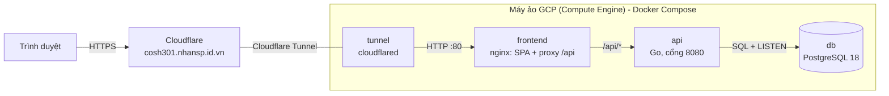
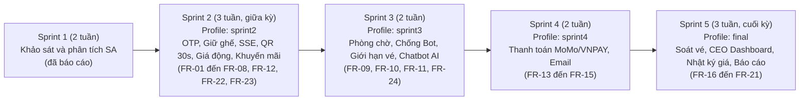

BỘ GIÁO DỤC VÀ ĐÀO TẠO
TRƯỜNG ĐẠI HỌC NGOẠI THƯƠNG
KHOA CÔNG NGHỆ VÀ KHOA HỌC DỮ LIỆU

---

# BÁO CÁO TIỂU LUẬN VÀ THỰC HÀNH MÔN HỌC
## PHÂN TÍCH VÀ THIẾT KẾ HỆ THỐNG

### ĐỀ TÀI:
# THIẾT KẾ HỆ THỐNG ĐẶT VÉ TRỰC TUYẾN CHO SỰ KIỆN (EVENTTICKETING)

**Sinh viên thực hiện:**
- Vũ Đức Huy — MSV: 2412960011
- Trần Trung Nhân — MSV: 2412960019
- Đinh Tiến Thành — MSV: 2413960023
- Lê Đức Anh — MSV: 2411960002
- Nguyễn Đức Phúc — MSV: 2413960020
- Nguyễn Anh Dũng — MSV: 2413960006

**Giảng viên hướng dẫn:** TS. Phạm Thị Kim Dung  
**Khoa:** Công nghệ và Khoa học dữ liệu  
**Lớp học phần:** COSH201 (2526.1 – GD1).1 / COSH301  

*Hà Nội – Năm 2026*

---

# PHIẾU CHẤM ĐIỂM TIỂU LUẬN

### 1. Thông tin sinh viên thực hiện và Phân công tiến độ

| STT | Họ và tên | Mã sinh viên | Nhiệm vụ chính trong dự án | Đóng góp | Điểm số | Chữ ký |
|:---:|---|:---:|---|:---:|:---:|:---:|
| 1 | **Vũ Đức Huy** | 2412960011 | Thiết kế ERD (23 bảng), giữ ghế nguyên tử, Realtime SSE Hub, Trợ lý Chatbot AI | 100% | | |
| 2 | **Trần Trung Nhân** | 2412960019 | Kiến trúc hệ thống, Backend Go, Frontend React, Sequence OTP & API Spec | 100% | | |
| 3 | **Đinh Tiến Thành** | 2413960023 | Bóc tách bài toán nghiệp vụ, Bảng 24 FRs & 13 NFRs, Ma trận truy vết yêu cầu (Traceability Matrix), Kịch bản kiểm thử thủ công FR-06 | 100% | | |
| 4 | **Lê Đức Anh** | 2411960002 | Sơ đồ và Đặc tả Use Case, Kế hoạch kiểm thử người dùng và form khảo sát SUS (chưa thực hiện) | 100% | | |
| 5 | **Nguyễn Đức Phúc** | 2413960020 | Sơ đồ luồng dữ liệu (DFD), Sơ đồ tuần tự Chống bán trùng ghế đa luồng | 100% | | |
| 6 | **Nguyễn Anh Dũng** | 2413960006 | Sơ đồ lớp BCE, Kế hoạch Sprint, Bài toán và thiết kế Định giá động (FR-22), Sequence Giữ ghế 5:00 | 100% | | |

### 2. Đánh giá của Giảng viên hướng dẫn

| Giảng viên chấm thi | Điểm số (Bằng số) | Điểm số (Bằng chữ) | Ý kiến nhận xét và Chữ ký |
|---|:---:|:---:|---|
| **TS. Phạm Thị Kim Dung** | | | <br/><br/>*Chữ ký: ....................................................* |

---

# MỤC LỤC

- [LỜI MỞ ĐẦU](#lời-mở-đầu)
- [PHẦN 1. GIỚI THIỆU VÀ TỔNG QUAN HỆ THỐNG](#phần-1-giới-thiệu-và-tổng-quan-hệ-thống)
  - [1.1. Bối cảnh thực tiễn và Tính cấp thiết](#11-bối-cảnh-thực-tiễn-và-tính-cấp-thiết)
  - [1.2. Mục tiêu nghiên cứu và Giới hạn phạm vi (MVP vs. Won't-Have)](#12-mục-tiêu-nghiên-cứu-và-giới-hạn-phạm-vi-mvp-vs-wont-have)
  - [1.3. Phương pháp luận phân tích và thiết kế hệ thống](#13-phương-pháp-luận-phân-tích-và-thiết-kế-hệ-thống)
  - [1.4. Danh sách các bên liên quan (Stakeholders)](#14-danh-sách-các-bên-liên-quan-stakeholders)
  - [1.5. Trạng thái triển khai](#15-trạng-thái-triển-khai)
- [PHẦN 2. BÓC TÁCH VÀ ĐẶC TẢ YÊU CẦU HỆ THỐNG](#phần-2-bóc-tách-và-đặc-tả-yêu-cầu-hệ-thống)
  - [2.1. Yêu cầu Chức năng (24 FRs phân bổ 5 Sprint)](#21-yêu-cầu-chức-năng-24-frs-phân-bổ-5-sprint)
  - [2.2. Yêu cầu Phi chức năng (13 NFRs gắn SLA định lượng)](#22-yêu-cầu-phi-chức-năng-13-nfrs-gắn-sla-định-lượng)
  - [2.3. User Stories và Tiêu chí chấp nhận (Given-When-Then)](#23-user-stories-và-tiêu-chí-chấp-nhận-given-when-then)
  - [2.4. Phân loại ưu tiên MoSCoW và Lộ trình MVP](#24-phân-loại-ưu-tiên-moscow-và-lộ-trình-mvp)
  - [2.5. Ma trận truy vết yêu cầu (Traceability Matrix)](#25-ma-trận-truy-vết-yêu-cầu-traceability-matrix)
- [PHẦN 3. THIẾT KẾ KIẾN TRÚC VÀ MÔ HÌNH HÓA HỆ THỐNG](#phần-3-thiết-kế-kiến-trúc-và-mô-hình-hóa-hệ-thống)
  - [3.1. Nguyên lý kiến trúc BCE và Triết lý Single Source of Truth trên PostgreSQL 18](#31-nguyên-lý-kiến-trúc-bce-và-triết-lý-single-source-of-truth-trên-postgresql-18)
  - [3.2. Sơ đồ kiến trúc triển khai hệ thống (Deployment Architecture)](#32-sơ-đồ-kiến-trúc-triển-khai-hệ-thống-deployment-architecture)
  - [3.3. Sơ đồ và Đặc tả trường hợp sử dụng (Use Case Diagram)](#33-sơ-đồ-và-đặc-tả-trường-hợp-sử-dụng-use-case-diagram)
  - [3.4. Sơ đồ luồng dữ liệu (Data Flow Diagram - DFD)](#34-sơ-đồ-luồng-dữ-liệu-data-flow-diagram---dfd)
  - [3.5. Sơ đồ lớp theo mô hình BCE (Class Diagram)](#35-sơ-đồ-lớp-theo-mô-hình-bce-class-diagram)
  - [3.6. Cơ chế Quản lý Cờ tính năng (Feature Flags theo Profile)](#36-cơ-chế-quản-lý-cờ-tính-năng-feature-flags-theo-profile)
- [PHẦN 4. THIẾT KẾ CƠ SỞ DỮ LIỆU VÀ QUY TRÌNH NGHIỆP VỤ CỐT LÕI](#phần-4-thiết-kế-cơ-sở-dữ-liệu-và-quy-trình-nghiệp-vụ-cốt-lõi)
  - [4.1. Thiết kế Mô hình Thực thể Liên kết (ERD 23 bảng)](#41-thiết-kế-mô-hình-thực-thể-liên-kết-erd-23-bảng)
  - [4.2. Từ điển dữ liệu các thực thể cốt lõi (Data Dictionary)](#42-từ-điển-dữ-liệu-các-thực-thể-cốt-lõi-data-dictionary)
  - [4.3. Thiết kế quy trình nghiệp vụ qua Sơ đồ tuần tự (Sequence Diagrams)](#43-thiết-kế-quy-trình-nghiệp-vụ-qua-sơ-đồ-tuần-tự-sequence-diagrams)
  - [4.4. Cơ chế bảo đảm tính toàn vẹn và bất biến dữ liệu](#44-cơ-chế-bảo-đảm-tính-toàn-vẹn-và-bất-biến-dữ-liệu)
- [PHẦN 5. THIẾT KẾ CÁC PHÂN HỆ NÂNG CAO VÀ VẬN HÀNH THỰC TẾ](#phần-5-thiết-kế-các-phân-hệ-nâng-cao-và-vận-hành-thực-tế)
  - [5.1. Định giá động (FR-22): bài toán, quy tắc và phản biện](#51-định-giá-động-fr-22-bài-toán-quy-tắc-và-phản-biện)
  - [5.2. Thiết kế Cơ chế Hàng chờ ảo (Virtual Waiting Room)](#52-thiết-kế-cơ-chế-hàng-chờ-ảo-virtual-waiting-room)
  - [5.3. Thiết kế Bảo mật vé với Mã QR động xoay vòng 30s](#53-thiết-kế-bảo-mật-vé-với-mã-qr-động-xoay-vòng-30s)
  - [5.4. Thiết kế Phân hệ Soát vé tại Cổng và Đồng bộ Ngoại tuyến](#54-thiết-kế-phân-hệ-soát-vé-tại-cổng-và-đồng-bộ-ngoại-tuyến)
  - [5.5. Tích hợp Cổng thanh toán trực tuyến và Tự động đối soát/hoàn tiền](#55-tích-hợp-cổng-thanh-toán-trực-tuyến-và-tự-động-đối-soáthoàn-tiền)
- [PHẦN 6. KẾ HOẠCH TRIỂN KHAI, KIỂM THỬ VÀ ĐÁNH GIÁ THỰC TẾ](#phần-6-kế-hoạch-triển-khai-kiểm-thử-và-đánh-giá-thực-tế)
  - [6.1. Phân bổ các Yêu cầu Chức năng (FR) theo 5 Sprint của dự án](#61-phân-bổ-các-yêu-cầu-chức-năng-fr-theo-5-sprint-của-dự-án)
  - [6.2. Trạng thái 24 Yêu cầu Chức năng theo từng Sprint](#62-trạng-thái-24-yêu-cầu-chức-năng-theo-từng-sprint)
  - [6.3. Bảng phân rã công việc (WBS) Sprint 2 (Mốc Giữa kỳ - T01 … T14)](#63-bảng-phân-rã-công-việc-wbs-sprint-2-mốc-giữa-kỳ---t01--t14)
  - [6.4. Tổng hợp phân bổ nguồn lực và giờ công toàn dự án qua 5 Sprint](#64-tổng-hợp-phân-bổ-nguồn-lực-và-giờ-công-toàn-dự-án-qua-5-sprint)
  - [6.5. Kiểm thử hệ thống: Concurrency Test chống bán trùng](#65-kiểm-thử-hệ-thống-concurrency-test-chống-bán-trùng)
  - [6.6. Kiểm thử với người dùng (chưa thực hiện)](#66-kiểm-thử-với-người-dùng-chưa-thực-hiện)
  - [6.7. Hạn chế của hệ thống và Định hướng phát triển tương lai](#67-hạn-chế-của-hệ-thống-và-định-hướng-phát-triển-tương-lai)
- [PHẦN 7. KẾT LUẬN VÀ BÀI HỌC KINH NGHIỆM](#phần-7-kết-luận-và-bài-học-kinh-nghiệm)
- [TÀI LIỆU THAM KHẢO](#tài-liệu-tham-khảo)
- [PHỤ LỤC A – ĐẶC TẢ KỸ THUẬT API VÀ HƯỚNG DẪN TRIỂN KHAI MÃ NGUỒN](#phụ-lục-a--đặc-tả-kỹ-thuật-api-và-hướng-dẫn-triển-khai-mã-nguồn)

---

# DANH MỤC BẢNG VÀ HÌNH

### Danh mục Bảng
- **Bảng 1:** Danh sách các bên liên quan (Stakeholders) và Mối quan tâm chính
- **Bảng 2:** Danh mục 24 Yêu cầu Chức năng (FR-01 … FR-24) và Diễn giải cho Stakeholder
- **Bảng 3:** Danh mục 13 Yêu cầu Phi chức năng (NFR-01 … NFR-13) và Chỉ số SLA
- **Bảng 4:** Tóm tắt 7 User Stories và Tiêu chí chấp nhận (Acceptance Criteria)
- **Bảng 5:** Phân loại ưu tiên tính năng MoSCoW cho phiên bản MVP
- **Bảng 6:** Ma trận truy vết yêu cầu (Traceability Matrix)
- **Bảng 7:** Các thành phần kiến trúc triển khai hệ thống EventTicketing
- **Bảng 8:** Danh mục 17 trường hợp sử dụng (Use Cases UC-01 … UC-17)
- **Bảng 9:** Ánh xạ Kho dữ liệu DFD vào 23 bảng cơ sở dữ liệu PostgreSQL
- **Bảng 10:** Quản lý cờ tính năng (Feature Flags) theo Profile Sprint
- **Bảng 11:** Từ điển dữ liệu (Data Dictionary) các bảng thực thể cốt lõi
- **Bảng 12:** Dữ liệu đầu vào của thuật toán Định giá động (FR-22)
- **Bảng 13:** Phân bổ các Yêu cầu Chức năng (FR) theo 5 Sprint của dự án
- **Bảng 14:** Trạng thái và căn cứ trong code của 24 Yêu cầu Chức năng (FR-01 … FR-24) theo từng Sprint
- **Bảng 15:** Bảng phân rã công việc (WBS) và ước lượng thời gian Sprint 2
- **Bảng 16:** Tổng hợp phân bổ nguồn lực và giờ công toàn dự án qua 5 Sprint
- **Bảng 17:** Endpoint đã có trong router

### Danh mục Hình

Các hình là sơ đồ Mermaid nằm trong `docs/`.
Báo cáo dẫn liên kết tới tài liệu chứa từng sơ đồ, không dùng ảnh xuất.
- **Hình 1:** Sơ đồ kiến trúc triển khai hệ thống tổng thể (Deployment Architecture)
- **Hình 2:** Sơ đồ trường hợp sử dụng tổng thể (Use Case Diagram)
- **Hình 3:** Sơ đồ luồng dữ liệu Mức ngữ cảnh (Context Diagram)
- **Hình 4:** Sơ đồ luồng dữ liệu Mức 0 (DFD Level 0 - 9 tiến trình)
- **Hình 5:** Sơ đồ lớp theo mô hình phân tầng BCE (Boundary – Control – Entity)
- **Hình 6:** Sơ đồ thực thể liên kết (ERD 23 bảng trong PostgreSQL 18)
- **Hình 7:** Sơ đồ tuần tự: Giữ ghế độc quyền 5 phút và đồng bộ Realtime SSE (FR-06, FR-05)
- **Hình 8:** Sơ đồ tuần tự: Khóa hàng nguyên tử Chống bán trùng tuyệt đối (FR-07)

---

# LỜI MỞ ĐẦU

Thị trường tổ chức sự kiện âm nhạc và thể thao quy mô lớn tại Việt Nam đang phát triển bùng nổ, kéo theo nhu cầu mua vé trực tuyến tăng vọt. Tuy nhiên, các hệ thống bán vé truyền thống hiện nay thường xuyên bộc lộ các điểm yếu nghiêm trọng: tê liệt hệ thống do lượng truy cập đột biến (flash-sale), nạn phe vé dùng bot tự động đầu cơ, xung đột dữ liệu dẫn đến bán trùng ghế (double-booking), và gian lận vé điện tử tại cửa soát vé.

Nhằm giải quyết triệt để các thách thức trên, trong khuôn khổ học phần **Phân tích và Thiết kế Hệ thống (COSH301 / COSH201)** tại Trường Đại học Ngoại thương, nhóm nghiên cứu đã xây dựng đề tài: **"Thiết kế hệ thống đặt vé trực tuyến cho sự kiện (EventTicketing)"**. Đồ án tập trung nghiên cứu, áp dụng bài bản quy trình kỹ nghệ phần mềm: bóc tách yêu cầu chi tiết (24 FRs, 13 NFRs, 7 User Stories); mô hình hóa hệ thống bằng các biểu đồ UML và DFD chuẩn mực; thiết kế kiến trúc theo mô hình phân tầng **BCE (Boundary – Control – Entity)** và triết lý **"Single Source of Truth"** trên PostgreSQL 18, loại bỏ tầng cache Redis phân tán để giữ an toàn giao dịch ACID và không bán trùng ghế.

Báo cáo gồm 7 phần chính và 1 phụ lục kỹ thuật: (1) Giới thiệu và tổng quan; (2) Bóc tách và đặc tả yêu cầu; (3) Thiết kế kiến trúc và mô hình hóa; (4) Thiết kế cơ sở dữ liệu và quy trình nghiệp vụ cốt lõi; (5) Thiết kế các phân hệ nâng cao; (6) Kế hoạch triển khai, kiểm thử và đánh giá; (7) Kết luận; cùng Phụ lục A về API và mã nguồn.
Báo cáo ghi rõ phần nào đã chạy trong code và phần nào mới ở mức thiết kế.

Nhóm nghiên cứu xin chân thành cảm ơn **TS. Phạm Thị Kim Dung** đã tận tình hướng dẫn, trang bị phương pháp luận khoa học và định hướng chuyên môn sâu sắc trong suốt quá trình thực hiện đồ án.

---

# PHẦN 1. GIỚI THIỆU VÀ TỔNG QUAN HỆ THỐNG

## 1.1. Bối cảnh thực tiễn và Tính cấp thiết

Thực tiễn vận hành các hệ thống bán vé trực tuyến tại Việt Nam cho thấy 5 thách thức kỹ thuật sống còn:
1. **Nghẽn tắc hệ thống (System Outage):** Lượng truy cập tăng vọt hàng trăm lần tại thời điểm mở bán làm cạn kiệt tài nguyên máy chủ, gây sập dịch vụ và buộc người dùng tải lại trang liên tục.
2. **Nạn đầu cơ vé và botnet (Ticket Scalping):** Phe vé sử dụng các kịch bản tự động gom sạch vé đẹp trong vài giây để bán lại giá cao trên thị trường chợ đen.
3. **Bán trùng ghế (Double-Booking):** Khi nhiều người cùng bấm chọn một ghế tại cùng một mili-giây, việc thiếu cơ chế cô lập giao dịch khiến hai người cùng mua được một chỗ ngồi.
4. **Định giá tĩnh kém linh hoạt:** Giá vé cố định khiến khu vực VIP cháy sớm trong khi khu vực xa sân khấu ế ẩm, gây thất thoát doanh thu cho Ban Tổ chức.
5. **Gian lận vé điện tử tại cửa kiểm soát:** Vé QR tĩnh dễ bị chia sẻ chụp màn hình; mạng viễn thông tại sân vận động thường xuyên mất sóng khiến máy quét trực tuyến bị tê liệt.

Xuất phát từ đó, việc thiết kế một nền tảng bán vé hiện đại chịu tải cao, khóa ghế nguyên tử 5 phút, chống bán trùng tuyệt đối, mã QR xoay vòng 30s và hỗ trợ soát vé ngoại tuyến mang tính cấp thiết cao.

## 1.2. Mục tiêu nghiên cứu và Giới hạn phạm vi (MVP vs. Won't-Have)

- **Mục tiêu cốt lõi:** Chuẩn hóa toàn bộ yêu cầu nghiệp vụ, mô hình hóa kiến trúc theo chuẩn BCE, thiết kế cơ sở dữ liệu PostgreSQL 18 bảo đảm ACID không bán trùng ghế, xây dựng cơ chế SSE thời gian thực và thiết kế thuật toán Định giá động để Ban Tổ chức duyệt (FR-22).
- **Phạm vi thiết kế:** Đăng nhập OTP không mật khẩu, sơ đồ ghế thời gian thực, giữ ghế 5 phút chống bán trùng, cấu hình giá sàn/trần, thanh toán MoMo/VNPAY, phát hành vé email và soát vé tại cổng.
- **Đã chạy trong code (profile `sprint2`):** đăng nhập OTP, danh sách sự kiện, sơ đồ ghế realtime, giữ ghế 5 phút, đặt giá khu vực. Thanh toán, phát vé, soát vé chưa làm.
- **Không làm (Won't-Have):** AI tự đổi giá không cần BTC duyệt (`W-01`), sàn bán lại vé chính thức (`W-02`), eKYC đầy đủ (`W-03`), sơ đồ sân khấu 3D (`W-04`), đa ngôn ngữ và đa tiền tệ (`W-05`). Apple/Google Wallet cũng không làm vì cần tài khoản nhà phát triển trả phí.

## 1.3. Phương pháp luận phân tích và thiết kế hệ thống

- **Mô hình Agile/Scrum:** Chia thành 5 Sprint phát triển liên tục, mỗi Sprint gắn với một hồ sơ cờ tính năng (`FEATURE_PROFILE`).
- **Kiến trúc phân tầng BCE:** Tách bạch rõ ràng Tầng Biên (Boundary - `internal/httpapi`), Tầng Điều khiển (Control - `internal/service`) và Tầng Thực thể (Entity - `internal/store`).
- **Triết lý Single Source of Truth trên PostgreSQL 18:** Loại bỏ hoàn toàn tầng Redis phân tán phức tạp để tránh mất đồng bộ dữ liệu (cache inconsistency); tận dụng triệt để khóa mức hàng nguyên tử (`atomic row-level update`), khóa cố vấn (`pg_advisory_xact_lock`), chỉ mục một phần duy nhất (`partial unique index`) và kênh thông điệp thời gian thực nội tại (`LISTEN/NOTIFY`).

## 1.4. Danh sách các bên liên quan (Stakeholders)

**Bảng 1. Danh sách các bên liên quan (Stakeholders) và Mối quan tâm chính**

| Mã | Tác nhân (Stakeholder) | Phân loại vai trò | Mối quan tâm cốt lõi | Rủi ro nếu không đáp ứng |
|:---:|---|---|---|---|
| **SH-01** | Ban Tổ chức (Organizer) | Admin sự kiện | Tối đa doanh thu, lấp đầy ghế, kiểm soát giá trần/sàn, duyệt giá động. | Thất thoát doanh thu, mất uy tín thương hiệu. |
| **SH-02** | Giám đốc điều hành (CEO) | Lãnh đạo | Giám sát doanh thu thời gian thực trên mobile, xuất báo cáo đối soát. | Thiếu số liệu điều hành, chậm ra quyết định. |
| **SH-03** | Khán giả (Ticket Buyer) | Người dùng cuối | Mua vé công bằng, sơ đồ ghế realtime, giữ ghế 5 phút an tâm thanh toán. | Bức xúc vì bị cướp ghế, bị trừ tiền không có vé. |
| **SH-04** | Nhân viên cổng (Gate Staff) | Người vận hành | Quét vé nhanh $\le 1$s/vé, hoạt động tốt cả khi mất mạng Internet. | Ùn tắc nghiêm trọng tại cửa an ninh. |
| **SH-05** | Cổng thanh toán (MoMo, VNPAY)| Đối tác bên ngoài | Giao dịch an toàn, xử lý Webhook/IPN lũy quyền, tự động hoàn tiền. | Sai lệch dòng tiền, khiếu nại giao dịch treo. |
| **SH-06** | Phe vé / Botnet (Threat Actor)| Tác nhân tiêu cực | Tận dụng công cụ tự động để gom vé số lượng lớn đầu cơ. | Hệ thống tê liệt, phá vỡ tính công bằng. |

## 1.5. Trạng thái triển khai

- **Profile đang chạy:** `sprint2`. Bật: `otp_login`, `seat_map_realtime`, `seat_hold`, `zone_pricing`, `organizer_console`, `rotating_qr`, `dynamic_pricing`, `promo_suggestions`. Hệ thống có 20 cờ tính năng, 12 cờ còn lại đang tắt.
- **Cờ tắt:** giao diện ẩn tính năng, API trả `404 feature_disabled`. Vì vậy `payments` tắt nghĩa là chưa có đơn hàng, thanh toán và phát vé.
- **Cơ sở dữ liệu:** 23 bảng trong migration. ERD Sprint 1 trên MySQL có 26 bảng.
- **Nơi chạy:** một máy ảo GCP (Compute Engine), Docker Compose gồm `db`, `api`, `frontend`, `tunnel` (cloudflared), công bố qua Cloudflare Tunnel tại `https://cosh301.nhansp.id.vn`.
- **Môi trường:** bản trực tuyến chạy `APP_ENV=production`, nên không có `POST /api/auth/demo-login` và `POST /api/tickets/reset-demo`.
- **Trạng thái từng yêu cầu:** xem [`docs/spec.md`](spec.md). Bảng 2 và Bảng 14 của báo cáo dùng cùng trạng thái.

---

# PHẦN 2. BÓC TÁCH VÀ ĐẶC TẢ YÊU CẦU HỆ THỐNG

## 2.1. Yêu cầu Chức năng (24 FRs phân bổ 5 Sprint)

Dưới đây là danh mục 24 Yêu cầu Chức năng (FR-01 … FR-24) của hệ thống. Bên cạnh mô tả kỹ thuật, báo cáo bổ sung **cột diễn giải thực tế dành cho Stakeholder (các bên liên quan không có chuyên môn IT như Ban Tổ chức, Giám đốc, Nhân viên cổng và Khán giả)** để dễ nắm bắt trải nghiệm và giá trị mang lại.
Cột Trạng thái dùng ba mức như [`docs/spec.md`](spec.md): Xong, Đang làm, Chưa làm. Cờ tắt thì không thể là Xong.

**Bảng 2. Danh mục 24 Yêu cầu Chức năng (FR-01 … FR-24) và Diễn giải cho Stakeholder**

| Mã FR | Tên tính năng | Ý nghĩa & Trải nghiệm thực tế cho Stakeholder (Dễ hiểu cho người không chuyên IT) | Mô tả kỹ thuật nghiệp vụ | Sprint & Cờ tính năng | Trạng thái |
|:---:|---|---|---|:---:|:---:|
| **FR-01** | Đăng nhập bằng mã OTP | Khán giả không cần nhớ mật khẩu; chỉ cần nhập số điện thoại hoặc email rồi nhập mã 6 chữ số. Hiện mã hiện trên màn hình (`OTP_DEMO`) hoặc ghi vào log, chưa gửi qua SMS hay email. | Nhận SĐT hoặc email, sinh OTP 6 số, hạn 5 phút, tối đa 5 lần nhập, cách 60 giây giữa hai lần xin mã. Chỉ lưu SHA-256 của mã trong `otp_verifications`. | Sprint 2<br/>(`otp_login`) | Đang làm |
| **FR-02** | Khám phá & Tìm kiếm sự kiện | Khán giả dễ dàng tìm thấy chương trình ca nhạc, kịch hay trận bóng đá yêu thích với ảnh poster đẹp mắt, thời gian, địa điểm và giá vé rõ ràng; có thể lọc nhanh theo thể loại hoặc thành phố. | Hiển thị danh mục sự kiện từ bảng `events`, hỗ trợ lọc theo danh mục, ngày diễn ra, dải giá vé và kiểm tra trạng thái mở bán (`ON_SALE`). | Sprint 2<br/>*(Luôn bật)* | Xong |
| **FR-03** | Sơ đồ ghế trực quan đa màu sắc | Khán giả nhìn sơ đồ khán đài và phân biệt 4 trạng thái: ghế trống, ghế đã bán, ghế người khác đang giữ, ghế mình đang giữ. Mỗi trạng thái có thêm dấu hiệu ngoài màu. | Hiển thị ghế theo tọa độ (x, y) và khu, kèm trạng thái và giá của từng ghế (`GET /api/events/{id}/seats`). | Sprint 2<br/>(`seat_map_realtime`) | Xong |
| **FR-04** | Đăng nhập an toàn không mật khẩu | Sau khi vào hệ thống, ứng dụng tự động ghi nhớ phiên làm việc an toàn; khán giả tắt trình duyệt mở lại vẫn giữ nguyên trạng thái đăng nhập, và có thể bấm Đăng xuất an toàn khi dùng máy tính lạ. | Bảng `sessions` chỉ lưu SHA-256 của token. Cookie `session_token`: `HttpOnly`, `SameSite=Lax`, `Secure` khi `COOKIE_SECURE=true`. Hiệu lực 7 ngày. `GET /api/auth/me`, `POST /api/auth/logout`. | Sprint 2<br/>(`otp_login`) | Xong |
| **FR-05** | Đồng bộ ghế thời gian thực | Khi có người khác vừa bấm giữ hoặc mua một chiếc ghế, chiếc ghế đó trên màn hình của tất cả mọi người sẽ tự đổi màu tức thì (dưới 3 giây) mà không bắt khán giả phải bấm phím tải lại trang (F5). | Thiết lập kết nối Server-Sent Events (SSE) `/api/events/{id}/stream`, nhận tín hiệu `LISTEN/NOTIFY` từ PostgreSQL và cập nhật màn hình máy khách tức thì. | Sprint 2<br/>(`seat_map_realtime`) | Xong |
| **FR-06** | Giữ ghế độc quyền trong 5 phút | Ngay khi bấm chọn ghế, chiếc ghế đó được 'khóa riêng' cho người mua trong 5 phút kèm đồng hồ đếm ngược 05:00. Trong thời gian này không ai khác có thể chọn đè vào, giúp khán giả an tâm điền thông tin và trả tiền. | Mở transaction ACID, chuyển trạng thái ghế sang `HELD`, ghi bản ghi `seat_holds` với hạn 300s; worker `HoldReaper` tự động thu hồi ghế nếu quá giờ. | Sprint 2<br/>(`seat_hold`) | Xong |
| **FR-07** | Chống bán trùng ghế tuyệt đối | Khi nhiều người cùng bấm một ghế cùng lúc, hệ thống chỉ cho người nhanh nhất giữ ghế. Những người còn lại nhận thông báo ghế đã có người chọn. | `UPDATE` có điều kiện (`status = 'AVAILABLE'`) chuyển ghế sang `HELD`, kết hợp unique index một phần `uq_seat_holds_active` trên `seat_holds`. | Sprint 2<br/>(`seat_hold`) | Xong |
| **FR-08** | Cấu hình khu vực & dải giá sàn/trần | Ban Tổ chức xem các sự kiện của mình và đặt giá thấp nhất (giá sàn), giá cơ bản và giá cao nhất (giá trần) cho từng khu. Tạo địa điểm, khu vực và sự kiện mới chưa có. | `PUT /api/organizer/events/{id}/zones/{zoneId}/pricing` lưu `floor_price <= base_price <= ceiling_price` vào `event_zones`, đổi giá ghế `AVAILABLE` và ghi `price_changes`. Khu vực nằm ở `venue_zones`. | Sprint 2<br/>(`zone_pricing`) | Đang làm |
| **FR-09** | Phòng chờ ảo xếp hàng công bằng | Khi mở bán trận cầu lớn hay concert ca sĩ nổi tiếng, trang web không bị sập hay quay đơ; hệ thống mời người mua vào 'phòng chờ ảo', bốc số thứ tự công bằng và hiển thị thời gian chờ ước tính trước khi vào mua. | Hàng đợi FIFO trong `queue_entries`. Số người mua cùng lúc tối đa `waiting_room_capacity`, mỗi lượt vào có hạn 10 phút. Hiện mới có bảng, chưa có API. | Sprint 3<br/>(`waiting_room`) | Chưa làm |
| **FR-10** | Tự động phát hiện và chặn Bot | 'Vệ sĩ vô hình' tự động nhận diện xem ai là người thật đang thao tác và ai là phần mềm máy tính (bot) do phe vé cài đặt để gom hàng loạt vé; các công cụ gian lận sẽ bị chặn đứng ngay ngoài cửa hệ thống. | Cloudflare Turnstile khi xin mã OTP, cộng giới hạn tốc độ theo IP. Hiện mới có giới hạn tốc độ; chưa kiểm tra token Turnstile. | Sprint 3<br/>(`bot_check`) | Chưa làm |
| **FR-11** | Giới hạn số vé mỗi người | Mỗi tài khoản chỉ được giữ và mua tối đa `max_tickets_per_user` vé cho một sự kiện (mặc định 4), mua thêm sẽ bị từ chối. Ngăn một người hoặc phe vé ôm nhiều vé. | Khi cờ `ticket_limit` bật: `pg_advisory_xact_lock` theo (người dùng, sự kiện), đếm ghế đang giữ cộng vé đã mua, vượt giới hạn thì trả `400 ticket_limit_reached`. Cờ đang tắt ở `sprint2`. | Sprint 3<br/>(`ticket_limit`) | Đang làm |
| **FR-12** | Mã QR vé tự đổi sau mỗi 30 giây | Mã QR trên vé điện tử tự động làm mới sau mỗi 30 giây (kèm thanh đếm ngược); nếu có ai chụp ảnh màn hình vé gửi bán lại trên mạng thì bức ảnh đó sẽ trở nên vô giá trị sau 30 giây, dẹp nạn lừa đảo vé lậu. | QR chứa `ticket_code.step.HMAC(qr_secret, step)`, `step` tăng 1 sau mỗi 30 giây. Cổng chấp nhận `step` hiện tại, liền trước và liền sau. Đã có cột `tickets.qr_secret`, chưa có code sinh QR. | Sprint 2<br/>(`rotating_qr`) | Chưa làm |
| **FR-13** | Thanh toán trực tuyến đa kênh | Khán giả thanh toán tiền vé bằng ví MoMo hoặc cổng VNPAY và được chuyển về trang kết quả. | Tích hợp MoMo và VNPAY: tạo liên kết thanh toán có chữ ký, nhận IPN, kiểm tra chữ ký, mỗi `provider_txn_id` chỉ xử lý một lần. | Sprint 4<br/>(`payments`) | Chưa làm |
| **FR-14** | Nhận vé điện tử tức thì qua Email | Ngay khi ngân hàng báo trừ tiền thành công, hệ thống lập tức gửi một thư email chứa thông tin vé (họ tên, vị trí hàng ghế, mã QR) và người mua có thể mở mục 'Vé của tôi' trên web để xem bất cứ lúc nào. | Cập nhật ghế sang `SOLD`, tạo bản ghi trong bảng `tickets`, kích hoạt tác vụ nền gửi email vé định dạng HTML chuẩn qua máy chủ SMTP. | Sprint 4<br/>(`ticket_email`) | Chưa làm |
| **FR-15** | Tự động hoàn tiền khi thanh toán trễ | Nếu khán giả chuyển khoản ở ngân hàng quá chậm khiến thời hạn giữ chỗ 5 phút bị trôi qua và ghế đã bị người khác mua: Hệ thống sẽ tự động hoàn trả 100% số tiền về tài khoản ngân hàng trong thời gian $\le 15$ phút. | Worker chạy ngầm quét các giao dịch thanh toán thành công khi hold đã hết hạn, tự động kích hoạt API Auto Refund của cổng thanh toán để hoàn tiền an toàn. | Sprint 4<br/>(`reconciliation`) | Chưa làm |
| **FR-16** | Ứng dụng quét vé di động cho cổng | Nhân viên an ninh soát vé tại cổng chỉ cần cầm điện thoại thông minh hướng camera vào mã QR của khán giả; màn hình hiển thị kết quả Xanh (Hợp lệ) / Đỏ (Từ chối) trong vòng chưa đầy 1 giây. | Ứng dụng web di động (PWA) quét QR bằng camera, gửi `POST /api/gate/checkins`, phản hồi ≤ 1 giây. | Sprint 5<br/>(`gate_checkin`) | Chưa làm |
| **FR-17** | Chống dùng một vé vào cửa hai lần | Mỗi chiếc vé chỉ có giá trị cho đúng 1 người vào cửa một lần; nếu vé đã được quét vào rồi mà lại gửi cho người khác quét tiếp, màn hình sẽ báo động đỏ và hiện rõ: 'Vé đã được sử dụng lúc 19h05 tại Cổng A'. | Chuyển vé sang `USED` chỉ khi đang `ISSUED` hoặc `ACTIVE`, ghi bản ghi vào bảng `checkins`. | Sprint 5<br/>(`gate_checkin`) | Chưa làm |
| **FR-18** | Soát vé bình thường khi mất mạng | Tại các sân vận động đông hàng vạn người khiến sóng 4G/Wifi bị nghẽn hoàn toàn, thiết bị soát vé của nhân viên vẫn xác thực được vé thật hay giả nhờ dữ liệu đã tải trước; khi có mạng sẽ tự gửi dữ liệu về. | Tải danh sách vé và chữ ký số vào bộ nhớ nội bộ IndexedDB của máy trước giờ mở cổng; xác thực chữ ký số offline, tự động đồng bộ khi có kết nối mạng trở lại. | Sprint 5<br/>(`offline_checkin`) | Chưa làm |
| **FR-19** | Bảng theo dõi doanh thu cho CEO | Giám đốc hoặc Ban Lãnh đạo chỉ cần mở điện thoại là thấy ngay biểu đồ doanh thu theo từng phút, số vé đã bán và tỷ lệ lấp đầy của từng khán đài theo thời gian thực để chỉ đạo vận hành kịp thời. | Dashboard cập nhật qua `GET /api/dashboard/stream` (SSE), số liệu từ `sales_snapshots`, độ trễ ≤ 60 giây. | Sprint 5<br/>(`ceo_dashboard`) | Chưa làm |
| **FR-20** | Sổ nhật ký giá vé bất biến | Mọi lần đổi giá vé (ai đổi, lúc nào, từ giá nào sang giá nào) đều được ghi vào sổ nhật ký. Ứng dụng không sửa hoặc xóa được các dòng này. | Bảng `price_changes` có trigger chặn `UPDATE` và `DELETE`. Mỗi lần BTC đổi giá cơ bản đều ghi một dòng. Chưa có trang xem nhật ký. | Sprint 5<br/>(`price_log`) | Đang làm |
| **FR-21** | Xuất báo cáo CSV và XLSX | Phòng kế toán và Ban Tổ chức tải danh mục giao dịch bán vé và tổng doanh thu ra bảng tính Excel (XLSX) hoặc CSV chỉ bằng một cú nhấp chuột. | `GET /api/reports/sales.csv` và `GET /api/reports/sales.xlsx`. | Sprint 5<br/>(`reports_export`) | Chưa làm |
| **FR-22** | Định giá động (đề xuất giá, BTC duyệt) | Hệ thống tự quan sát xem khu nào bán quá chạy hoặc khu nào bán quá chậm để gửi gợi ý cho Ban Tổ chức: 'Khu VIP nên tăng nhẹ giá để chống phe vé, khu C nên giảm giá để kích cầu'. BTC bấm duyệt thì giá mới đổi. | Tác vụ nền mỗi 5 phút phân tích cung cầu, sinh đề xuất giá vào `price_suggestions`, giữ giá trong `[giá sàn, giá trần]`, chờ BTC duyệt (`W-01`). Cờ `dynamic_pricing` thuộc Sprint 2; mới có bảng, chưa có job và endpoint duyệt. Thiết kế ở [`dynamic-pricing.md`](dynamic-pricing.md). | Sprint 2<br/>(`dynamic_pricing`) | Chưa làm |
| **FR-23** | Tự động gợi ý mã giảm giá kích cầu | Nếu sự kiện đến gần mà một khu khán đài vẫn còn nhiều ghế trống, hệ thống nhắc Ban Tổ chức phát hành mã giảm giá để bán hết vé kịp thời. | Tác vụ nền phân tích tỷ lệ lấp đầy theo thời gian còn lại, tạo gợi ý chiến dịch trong `promotions` để BTC duyệt. | Sprint 2<br/>(`promo_suggestions`) | Chưa làm |
| **FR-24** | Trợ lý Chatbot AI hỗ trợ khán giả và Ban Tổ chức | Khán giả hỏi nhanh lịch diễn, giá vé, hạng ghế còn trống và cách đặt vé ngay trong khung chat; Ban Tổ chức hỏi tóm tắt tình hình bán vé của sự kiện mình mà không cần tra nhiều bảng. | Endpoint `POST /api/assistant/chat` (`AssistantHandler`, `AssistantService`) xác định vai trò từ phiên server, truy vấn dữ liệu thật từ PostgreSQL và tùy chọn diễn giải bằng Ollama/Gemini (fallback xác định khi không có LLM). | Sprint 3<br/>(`chatbot`) | Đang làm |


## 2.2. Yêu cầu Phi chức năng (13 NFRs gắn SLA định lượng)

**Bảng 3. Danh mục 13 Yêu cầu Phi chức năng (NFR-01 … NFR-13) và Chỉ số SLA**

| Mã | Nhóm tiêu chuẩn | Chỉ số SLA đo lường định lượng | Giải pháp kỹ thuật áp dụng |
|:---:|---|---|---|
| **NFR-01** | Hiệu năng & Chịu tải | Chịu tải $\ge 50.000$ active connections; Latency p95 $\le 2$ giây. | Go `net/http`, `pgxpool`, nginx reverse proxy. Chưa đo. |
| **NFR-02** | Độ sẵn sàng dịch vụ | Uptime $\ge 99.9\%$; RTO $\le 5$ phút; RPO $= 0$. | Docker Compose `restart: unless-stopped`, health check `/api/health`. Chưa đo. |
| **NFR-03** | Tính toàn vẹn dữ liệu | Tỷ lệ bán trùng ghế $= 0\%$ tuyệt đối; chuẩn giao dịch ACID. | Khóa hàng nguyên tử, Partial Unique Index trên `seat_holds`. |
| **NFR-04** | Nhất quán thanh toán | $100\%$ giao dịch lỗi được đối soát xử lý trong $\le 15$ phút. | Idempotency Key trên `provider_txn_id`, worker tự đối soát. |
| **NFR-05** | Tốc độ quét vé | Thời gian xác thực vé tại cổng $\le 1$ giây/vé. | HMAC-SHA256 đối xứng, đánh index B-tree trên `tickets(ticket_code)`. |
| **NFR-06** | Phục hồi ngoại tuyến | Thiết bị soát vé offline liên tục $\ge 4$ giờ; đồng bộ lại $\le 2$ phút. | Lưu trữ IndexedDB trên Mobile PWA, chữ ký số offline. |
| **NFR-07** | An toàn chống bot | Tỷ lệ bot lọt qua $< 1\%$; chặn $\ge 99\%$ request bất thường. | Cloudflare Turnstile CAPTCHA, Rate limiting IP/User. |
| **NFR-08** | Bảo mật vé điện tử | Chu kỳ làm mới QR $\le 30$ giây; chặn 100% ảnh chụp màn hình cũ. | Thuật toán TOTP kết hợp `qr_secret` và dấu thời gian. |
| **NFR-09** | Minh bạch hàng chờ | Cập nhật vị trí xếp hàng và thời gian chờ định kỳ $\le 10$ giây/lần. | Kênh truyền SSE trực tiếp từ bảng `queue_entries`. |
| **NFR-10** | Đồng bộ sơ đồ ghế | Trạng thái đổi màu ghế phản ánh tới trình duyệt trong $\le 3$ giây. | PostgreSQL `LISTEN/NOTIFY` đẩy qua Go Realtime SSE Hub. |
| **NFR-11** | Giám sát CEO Realtime| Độ trễ cập nhật số liệu doanh thu lên Dashboard $\le 60$ giây. | Truy vấn tối ưu trên `orders` và `payments`, snapshot định kỳ. |
| **NFR-12** | Kiểm toán bất biến | $100\%$ lịch sử đổi giá được lưu trữ bất biến $\ge 2$ năm. | Trigger PostgreSQL chặn đứng `UPDATE` và `DELETE`. |
| **NFR-13** | Tuân thủ bảo mật | Tuân thủ Nghị định 13/2023/NĐ-CP và tiêu chuẩn bảo mật PCI-DSS. | Không lưu trữ số thẻ ngân hàng trên máy chủ nội bộ. |

Trạng thái từng NFR theo [`docs/spec.md`](spec.md) mục 2:
- Xong: NFR-03, NFR-10.
- Đang làm: NFR-02, NFR-07, NFR-12, NFR-13.
- Chưa làm: các NFR còn lại. Chưa chạy kiểm thử tải k6, nên NFR-01 chưa có số đo.

## 2.3. User Stories và Tiêu chí chấp nhận (Given-When-Then)

**Bảng 4. Tóm tắt 7 User Stories và Tiêu chí chấp nhận (Acceptance Criteria)**

| Mã US | Vai trò & Mong muốn của người dùng | Tiêu chí chấp nhận (Acceptance Criteria - Given/When/Then) |
|:---:|---|---|
| **US-01** | Khán giả muốn xếp hàng trong phòng chờ ảo khi mở bán quá tải. | **Given:** Lưu lượng vượt ngưỡng phục vụ.<br/>**When:** Khán giả bấm "Mua vé".<br/>**Then:** Cấp số thứ tự FIFO, hiển thị thời gian chờ, tự chuyển vào chọn ghế khi đến lượt. |
| **US-02** | Khán giả muốn xem sơ đồ ghế đổi màu theo thời gian thực. | **Given:** Đang mở màn hình sơ đồ ghế.<br/>**When:** Người khác giữ hoặc mua một ghế.<br/>**Then:** Ghế tự đổi màu trong $\le 3$s qua kết nối SSE mà không cần nhấn F5. |
| **US-03** | Khán giả muốn giữ ghế độc quyền 5 phút để an tâm thanh toán. | **Given:** Đã đăng nhập và chọn ghế trống.<br/>**When:** Bấm xác nhận chọn ghế.<br/>**Then:** Ghế đổi màu tím, đếm ngược 05:00, không ai chọn đè được; hết giờ tự động nhả ghế. |
| **US-04** | Khán giả muốn thanh toán qua nhiều kênh trực tuyến an toàn. | **Given:** Đang giữ ghế hợp lệ.<br/>**When:** Chọn MoMo/VNPAY và bấm thanh toán.<br/>**Then:** Chuyển hướng an toàn tới cổng đối tác, nhận thông báo IPN xác nhận thành công. |
| **US-05** | Khán giả muốn nhận vé ngay và mã QR tự xoay vòng 30s. | **Given:** Đã thanh toán đơn hàng thành công.<br/>**When:** Mở mục "Vé của tôi" hoặc kiểm tra email.<br/>**Then:** Nhận thông tin vé tức thì; mã QR tự động đổi sau mỗi 30s chống chụp trộm. |
| **US-06** | Khán giả muốn được tự động hoàn tiền nếu gặp sự cố thanh toán. | **Given:** Thanh toán tiền thành công khi ghế đã quá 5 phút và bị người khác mua.<br/>**When:** Cổng thanh toán gửi IPN về máy chủ.<br/>**Then:** Tự phát hiện xung đột, từ chối cấp vé và tự động hoàn tiền 100% trong $\le 15$ phút. |
| **US-07** | Nhân viên cổng muốn soát vé siêu nhanh kể cả khi mất mạng. | **Given:** Thiết bị đã tải trước dữ liệu vé sự kiện.<br/>**When:** Quét mã QR trên điện thoại khán giả trong chế độ offline.<br/>**Then:** Xác thực chữ ký số trong $\le 1$s; lưu log ngoại tuyến để đồng bộ khi có mạng lại. |

## 2.4. Phân loại ưu tiên MoSCoW và Lộ trình MVP

**Bảng 5. Phân loại ưu tiên tính năng MoSCoW cho phiên bản MVP**

| Phân nhóm MoSCoW | Nguyên tắc phân loại nghiệp vụ | Danh mục Yêu cầu liên quan |
|---|---|---|
| **MUST-HAVE (M)** | Bắt buộc phải có để hệ thống vận hành và bàn giao phiên bản MVP. | Đăng nhập OTP (`FR-01, 04`), Danh mục sự kiện & Sơ đồ ghế (`FR-02, 03`), SSE Realtime (`FR-05`), Giữ ghế 5 phút & Chống bán trùng (`FR-06, 07`), Giá trần/sàn (`FR-08`), Phòng chờ (`FR-09`), Chống bot & Giới hạn vé (`FR-10, 11`), Thanh toán & Cấp vé (`FR-13, 14`), Tự hoàn tiền (`FR-15`), Soát vé cổng (`FR-16, 17`). |
| **SHOULD-HAVE (S)** | Rất quan trọng, nâng cao trải nghiệm và độ an toàn vận hành. | Mã QR xoay vòng 30s (`FR-12`), Soát vé ngoại tuyến (`FR-18`), Dashboard CEO (`FR-19`), Nhật ký giá bất biến (`FR-20`). |
| **COULD-HAVE (C)** | Tính năng giá trị gia tăng thông minh; làm khi còn nguồn lực. | Thuật toán Định giá động (`FR-22`), Gợi ý khuyến mãi (`FR-23`), Xuất báo cáo CSV/XLSX (`FR-21`), Trợ lý Chatbot AI (`FR-24`). |
| **WON'T-HAVE (W)** | Hoãn lại trong phiên bản này để tránh rủi ro pháp lý và chi phí ngoài phạm vi. | Tự đổi giá không qua người duyệt (`W-01`), Sàn bán lại vé chính thức (`W-02`), eKYC đầy đủ (`W-03`), Sơ đồ sân khấu 3D (`W-04`), Đa ngôn ngữ và đa tiền tệ (`W-05`). |

## 2.5. Ma trận truy vết yêu cầu (Traceability Matrix)

**Bảng 6. Ma trận truy vết yêu cầu (Traceability Matrix)**

| Mã FR | Tên yêu cầu chức năng | Tác nhân | User Story | NFR liên quan | Thành phần kiến trúc thực thi |
|:---:|---|:---:|:---:|:---:|---|
| **FR-01, 04** | Đăng nhập OTP & Phiên bảo mật | SH-03 | US-01 | NFR-01, 13 | `AuthHandler`, `AuthService`, `otp_verifications`, `sessions` |
| **FR-02** | Khám phá danh mục sự kiện | SH-03 | US-01 | NFR-01 | `EventHandler`, `EventService`, `events` |
| **FR-03, 05** | Sơ đồ ghế tương tác & Đồng bộ SSE | SH-03 | US-02 | NFR-10 | `SeatHandler`, `RealtimeHub`, `LISTEN/NOTIFY`, `event_seats` |
| **FR-06, 07** | Giữ ghế 5 phút & Chống bán trùng | SH-01, 03 | US-03 | NFR-01, 03 | `SeatService`, Row-lock nguyên tử, Partial Unique Index |
| **FR-08** | Cấu hình khu vực & giá sàn/trần | SH-01 | — | NFR-12 | `OrganizerHandler`, `OrganizerService`, `venue_zones`, `event_zones` |
| **FR-09** | Phòng chờ ảo điều tiết tải FIFO | SH-03, 06 | US-01 | NFR-01, 09 | `QueueHandler`, `QueueService`, `queue_entries` |
| **FR-10, 11** | Chống bot & Giới hạn trần 4 vé | SH-01, 06 | US-03 | NFR-03, 07 | Middleware Cloudflare Turnstile, Advisory Lock kiểm tra quota |
| **FR-12** | Mã QR vé động xoay vòng 30s | SH-01, 03 | US-05 | NFR-08 | HMAC theo `qr_secret` (chưa có code) |
| **FR-13, 14** | Thanh toán đa kênh & Phát hành vé | SH-03, 05 | US-04, 05 | NFR-01, 04 | `PaymentHandler`, `OrderService`, `payments`, `tickets` |
| **FR-15** | Tự động đối soát và hoàn tiền | SH-03, 05 | US-06 | NFR-04 | `ReconciliationWorker`, API Hoàn tiền đối tác |
| **FR-16, 17** | Soát vé cổng & Chống dùng 2 lần | SH-04 | US-07 | NFR-05 | `GateHandler`, `GateService`, `checkins` (chưa có code) |
| **FR-18** | Soát vé ngoại tuyến khi mất sóng | SH-04 | US-07 | NFR-06 | Mobile PWA, Bộ nhớ IndexedDB, Offline Signature Verifier |
| **FR-19, 21** | Dashboard CEO & Xuất báo cáo | SH-02 | — | NFR-11 | Dashboard và xuất CSV/XLSX (chưa có code) |
| **FR-20** | Nhật ký kiểm toán giá bất biến | SH-01, 02 | — | NFR-12 | `price_changes`, PostgreSQL Database Trigger cấm sửa/xóa |
| **FR-22, 23** | Định giá động & Gợi ý khuyến mãi | SH-01 | — | NFR-12 | `price_suggestions`, `price_changes`, `promotions` (chưa có code) |
| **FR-24** | Trợ lý Chatbot AI hỗ trợ đặt vé & BTC | SH-01, 03 | — | NFR-01 | `AssistantHandler`, `AssistantService`, `AssistantWidget.tsx`, Ollama/Gemini |

Chỉ các thành phần của Sprint 2 đã có trong `backend/internal/`.
Các thành phần còn lại là dự kiến, xem [`docs/class-diagram.md`](class-diagram.md) mục 5.

---

# PHẦN 3. THIẾT KẾ KIẾN TRÚC VÀ MÔ HÌNH HÓA HỆ THỐNG

## 3.1. Nguyên lý kiến trúc BCE và Triết lý Single Source of Truth trên PostgreSQL 18

Hệ thống được thiết kế theo mô hình phân tầng **BCE (Boundary – Control – Entity)** kết hợp triết lý **Single Source of Truth**:
- **Boundary (`internal/httpapi`):** Tiếp nhận yêu cầu HTTP/SSE, kiểm tra hợp lệ dữ liệu, xác thực phiên cookie, phân quyền và kiểm tra cờ tính năng (`RequireFeature`).
- **Control (`internal/service`):** Chứa toàn bộ nghiệp vụ cốt lõi (khóa ghế nguyên tử, giới hạn vé mỗi người (cờ `ticket_limit`), giá khu vực, worker thu hồi ghế `HoldReaper` và điều phối sự kiện qua `RealtimeHub`).
- **Entity (`internal/store`):** Mô hình hóa dữ liệu PostgreSQL thông qua mã nguồn được sinh tự động bằng `sqlc` và driver `pgx/v5`, kiểu dữ liệu được kiểm tra khi biên dịch.

**Lý do loại bỏ hoàn toàn Redis:** Việc kết hợp Redis làm bộ nhớ đệm phân tán dễ dẫn đến thảm họa mất đồng bộ dữ liệu (cache inconsistency) và sụp đổ bộ đệm (cache stampede). Bằng cách sử dụng **PostgreSQL 18** làm nguồn chân lý duy nhất, hệ thống chỉ cần một nguồn dữ liệu nhờ khóa mức hàng nguyên tử (`atomic row update`), khóa cố vấn (`pg_advisory_xact_lock`), chỉ mục một phần duy nhất (`partial unique index`), và kênh Pub/Sub thời gian thực nội tại `LISTEN/NOTIFY` chạy trong cùng giao dịch ACID.

## 3.2. Sơ đồ kiến trúc triển khai hệ thống (Deployment Architecture)



**Hình 1.** Kiến trúc triển khai. Mô tả đầy đủ ở [`docs/architecture.md`](architecture.md).

**Bảng 7. Các thành phần kiến trúc triển khai hệ thống EventTicketing**

| Thành phần | Nền tảng công nghệ | Trách nhiệm chính trong hệ thống |
|---|---|---|
| **Máy chủ** | Một máy ảo GCP (Compute Engine), Docker Compose | Chạy `db`, `api`, `frontend`, `tunnel`. |
| **Edge Proxy** | Cloudflare Tunnel (`cloudflared`) | Công bố `https://cosh301.nhansp.id.vn` ra Internet, không mở cổng vào máy chủ. Chưa kiểm tra Turnstile. |
| **Frontend Web** | React 19, Vite, Tailwind | Ứng dụng SPA hiển thị sơ đồ ghế tương tác đa màu sắc, quản lý đếm ngược 5:00 giữ chỗ. |
| **Web Server** | nginx (image Alpine) | Phục vụ file tĩnh, reverse proxy sang backend Go, tắt đệm (`proxy_buffering off`) cho luồng SSE. |
| **Backend API** | Go 1.26 (`net/http`) | Một file chạy duy nhất, chia lớp theo BCE. |
| **Cơ sở dữ liệu** | PostgreSQL 18 | Single Source of Truth, 23 bảng, khóa hàng nguyên tử, pub/sub `LISTEN/NOTIFY`. |
| **Realtime Hub** | Go Goroutines & SSE | Kết nối `LISTEN` cơ sở dữ liệu, phát sóng sự kiện đổi màu ghế tức thì tới các máy khách. |
| **Hold Reaper Worker** | Background Worker (Go) | Quét định kỳ mỗi 5 giây, tự động nhả ghế quá hạn 300 giây về `AVAILABLE` và phát tín hiệu SSE. |

## 3.3. Sơ đồ và Đặc tả trường hợp sử dụng (Use Case Diagram)

**Hình 2.** Sơ đồ Use Case tổng thể nằm ở [`docs/use-cases.md`](use-cases.md) mục 2.

**Bảng 8. Danh mục 17 trường hợp sử dụng (Use Cases UC-01 … UC-17)**

| Mã UC | Tên Use Case | Tác nhân chính | Cờ | Yêu cầu |
|:---:|---|:---:|---|:---:|
| **UC-01** | Đăng nhập bằng OTP | Mọi tác nhân | `otp_login` | FR-01, 04, 10 |
| **UC-02** | Xem danh sách sự kiện | Khán giả | Luôn bật | FR-02 |
| **UC-03** | Vào phòng chờ | Khán giả | `waiting_room` | FR-09 |
| **UC-04** | Xem sơ đồ ghế | Khán giả | `seat_map_realtime` | FR-03, 05 |
| **UC-05** | Giữ ghế | Khán giả | `seat_hold` | FR-06, 07, 11 |
| **UC-06** | Thanh toán và nhận vé | Khán giả | `payments`, `ticket_email`, `reconciliation` | FR-13, 14, 15 |
| **UC-07** | Xem vé và QR xoay vòng | Khán giả | `rotating_qr` | FR-12 |
| **UC-08** | Quản lý địa điểm, khu vực, sự kiện | Ban Tổ chức | `organizer_console` | FR-08 |
| **UC-09** | Đặt giá khu vực | Ban Tổ chức | `zone_pricing` | FR-08, 20 |
| **UC-10** | Duyệt đề xuất giá | Ban Tổ chức | `dynamic_pricing` | FR-22, 20 |
| **UC-11** | Xem nhật ký giá | Ban Tổ chức | `price_log` | FR-20 |
| **UC-12** | Duyệt gợi ý khuyến mãi | Ban Tổ chức | `promo_suggestions` | FR-23 |
| **UC-13** | Xem dashboard doanh thu | CEO | `ceo_dashboard` | FR-19 |
| **UC-14** | Xuất báo cáo | CEO | `reports_export` | FR-21 |
| **UC-15** | Soát vé tại cổng | Nhân viên cổng | `gate_checkin` | FR-16, 17 |
| **UC-16** | Soát vé offline và đồng bộ | Nhân viên cổng | `offline_checkin` | FR-18 |
| **UC-17** | Phân quyền | Quản trị | Luôn bật | — |

Danh sách và tác nhân lấy từ [`docs/use-cases.md`](use-cases.md).
Ở profile `sprint2`, chỉ UC-01, 02, 04, 05, 09 và một phần UC-08 có code.

## 3.4. Sơ đồ luồng dữ liệu (Data Flow Diagram - DFD)

### 3.4.1. DFD Mức ngữ cảnh (Context Diagram) và DFD Mức 0 (Diagram 0)

**Hình 3.** DFD mức ngữ cảnh nằm ở [`docs/dfd.md`](dfd.md) mục 1.

**Hình 4.** DFD mức 0 (9 tiến trình, 17 kho dữ liệu) nằm ở [`docs/dfd.md`](dfd.md) mục 2.

**Bảng 9. Ánh xạ Kho dữ liệu DFD vào 23 bảng cơ sở dữ liệu**

| Kho | Bảng PostgreSQL | Kho | Bảng PostgreSQL |
|:---:|---|:---:|---|
| D1 | `users` | D10 | `payments` |
| D2 | `sessions` | D11 | `tickets` |
| D3 | `otp_verifications` | D12 | `gate_devices`, `checkins` |
| D4 | `venues`, `venue_zones`, `seats` | D13 | `price_suggestions` |
| D5 | `events`, `event_zones` | D14 | `price_changes` |
| D6 | `event_seats` | D15 | `promotions`, `promotion_usages` |
| D7 | `queue_entries` | D16 | `audit_logs` |
| D8 | `seat_holds` | D17 | `sales_snapshots` |
| D9 | `orders`, `order_items` | | |

Bảng lấy từ [`docs/dfd.md`](dfd.md) mục 5. Mỗi bảng trong 23 bảng thuộc đúng một kho.

## 3.5. Sơ đồ lớp theo mô hình BCE (Class Diagram)

**Hình 5.** Sơ đồ lớp BCE nằm ở [`docs/class-diagram.md`](class-diagram.md) mục 2. Mục 5 của tài liệu đó liệt kê các lớp dự kiến cho Sprint 3–5.

## 3.6. Cơ chế Quản lý Cờ tính năng (Feature Flags theo Profile)

Hệ thống quản lý tính năng thông qua middleware `RequireFeature(flagName)`. Khi một cờ bị tắt, giao diện tự động ẩn và API trả về `404 Not Found {"error": "feature_disabled"}`.

**Bảng 10. 20 cờ tính năng theo Profile Sprint** (lấy từ `backend/internal/config/features.go`)

| Cờ (`flag`) | Yêu cầu | sprint2 (đang chạy) | sprint3 | sprint4 | final |
|---|:---:|:---:|:---:|:---:|:---:|
| `otp_login` | FR-01, 04 | **Bật** | **Bật** | **Bật** | **Bật** |
| `seat_map_realtime` | FR-03, 05, NFR-10 | **Bật** | **Bật** | **Bật** | **Bật** |
| `seat_hold` | FR-06, 07, NFR-03 | **Bật** | **Bật** | **Bật** | **Bật** |
| `zone_pricing` | FR-08 | **Bật** | **Bật** | **Bật** | **Bật** |
| `organizer_console` | FR-08 | **Bật** | **Bật** | **Bật** | **Bật** |
| `rotating_qr` | FR-12, NFR-08 | **Bật** | **Bật** | **Bật** | **Bật** |
| `dynamic_pricing` | FR-22, W-01 | **Bật** | **Bật** | **Bật** | **Bật** |
| `promo_suggestions` | FR-23 | **Bật** | **Bật** | **Bật** | **Bật** |
| `waiting_room` | FR-09, NFR-09 | Tắt | **Bật** | **Bật** | **Bật** |
| `bot_check` | FR-10, NFR-07 | Tắt | **Bật** | **Bật** | **Bật** |
| `ticket_limit` | FR-11 | Tắt | **Bật** | **Bật** | **Bật** |
| `chatbot` | FR-24 | Tắt | **Bật** | **Bật** | **Bật** |
| `payments` | FR-13 | Tắt | Tắt | **Bật** | **Bật** |
| `ticket_email` | FR-14 | Tắt | Tắt | **Bật** | **Bật** |
| `reconciliation` | FR-15, NFR-04 | Tắt | Tắt | **Bật** | **Bật** |
| `gate_checkin` | FR-16, 17, NFR-05 | Tắt | Tắt | Tắt | **Bật** |
| `offline_checkin` | FR-18, NFR-06 | Tắt | Tắt | Tắt | **Bật** |
| `ceo_dashboard` | FR-19 | Tắt | Tắt | Tắt | **Bật** |
| `price_log` | FR-20, NFR-12 | Tắt | Tắt | Tắt | **Bật** |
| `reports_export` | FR-21 | Tắt | Tắt | Tắt | **Bật** |

FR-02 luôn bật. Nhật ký giá luôn được ghi, cờ `price_log` chỉ ẩn hoặc hiện trang xem.

---

# PHẦN 4. THIẾT KẾ CƠ SỞ DỮ LIỆU VÀ QUY TRÌNH NGHIỆP VỤ CỐT LÕI

## 4.1. Thiết kế Mô hình Thực thể Liên kết (ERD 23 bảng)

**Hình 6.** Sơ đồ ERD sinh từ migration nằm ở [`docs/erd.md`](erd.md) mục 1.

Schema trong `backend/internal/store/migrations/` có 23 bảng, chia thành 6 nhóm:
1. Định danh và bảo mật (4): `users`, `sessions`, `otp_verifications`, `audit_logs`.
2. Địa điểm và ghế (6): `venues`, `venue_zones`, `seats`, `events`, `event_zones`, `event_seats`.
3. Hàng chờ và giữ chỗ (2): `queue_entries`, `seat_holds`.
4. Đơn hàng và thanh toán (3): `orders`, `order_items`, `payments`.
5. Vé và soát vé (3): `tickets`, `gate_devices`, `checkins`.
6. Giá, khuyến mãi và thống kê (5): `price_suggestions`, `price_changes`, `promotions`, `promotion_usages`, `sales_snapshots`.

ERD Sprint 1 trên MySQL có 26 bảng.
Điểm khác giữa hai bản được liệt kê ở [`docs/erd.md`](erd.md) mục 2.

## 4.2. Từ điển dữ liệu các thực thể cốt lõi (Data Dictionary)

**Bảng 11. Từ điển dữ liệu (Data Dictionary) các bảng thực thể cốt lõi**

| Tên Bảng | Thuộc tính (Column) | Kiểu dữ liệu | Ràng buộc chính | Ý nghĩa nghiệp vụ |
|---|---|---|---|---|
| `users` | `id`, `phone`, `email`, `role`, `status` | `UUID`, `VARCHAR`, `ENUM` | `PK`, `UNIQUE`, `role NOT NULL` | Quản lý danh tính và vai trò người dùng. |
| `event_seats` | `id`, `event_id`, `seat_id`, `status`, `current_price` | `UUID`, `ENUM`, `NUMERIC(14,0)` | `PK`, `FK`, `current_price >= 0` | Trạng thái ghế (`AVAILABLE`, `HELD`, `SOLD`, `BLOCKED`) và giá bán. |
| `seat_holds` | `id`, `event_id`, `seat_id`, `user_id`, `hold_token`, `status`, `expires_at` | `UUID`, `VARCHAR`, `ENUM`, `TIMESTAMPTZ` | `PK`, `FK`, unique `(event_id, seat_id)` khi `status = 'ACTIVE'` | Quản lý lượt giữ ghế 5 phút. |
| `orders` | `id`, `user_id`, `event_id`, `total_amount`, `status` | `UUID`, `NUMERIC(14,0)`, `ENUM` | `PK`, `FK`, `status: PENDING, PAID...` | Đơn hàng mua vé và tổng giá trị thanh toán. Chưa có code ghi bảng này. |
| `tickets` | `id`, `order_id`, `ticket_code`, `qr_secret`, `status` | `UUID`, `VARCHAR`, `ENUM` | `PK`, `FK`, `ticket_code UNIQUE` | Vé điện tử số hóa và khóa mật mã sinh QR xoay vòng. |
| `price_changes`| `id`, `event_id`, `zone_id`, `old_price`, `new_price`, `reason`, `created_at` | `BIGSERIAL`, `UUID`, `NUMERIC(14,0)`, `TIMESTAMPTZ` | `PK`, `FK`, trigger cấm `UPDATE`/`DELETE` | Nhật ký đổi giá không sửa được. |

## 4.3. Thiết kế quy trình nghiệp vụ qua Sơ đồ tuần tự (Sequence Diagrams)

### 4.3.1. Sơ đồ tuần tự: Giữ ghế độc quyền 5 phút và đồng bộ SSE Realtime (FR-06, FR-05)

**Hình 7.** Sơ đồ tuần tự giữ ghế và tự thu hồi khi hết hạn nằm ở [`docs/sequences/hold.md`](sequences/hold.md).

### 4.3.2. Sơ đồ tuần tự: Khóa hàng nguyên tử Chống bán trùng tuyệt đối (FR-07)

**Hình 8.** Sơ đồ tuần tự chống bán trùng nằm ở [`docs/sequences/double-booking.md`](sequences/double-booking.md).

## 4.4. Cơ chế bảo đảm tính toàn vẹn và bất biến dữ liệu

1. **Khóa cố vấn (`pg_advisory_xact_lock`):** khi cờ `ticket_limit` bật, khóa phạm vi `(user_id, event_id)` trong suốt giao dịch giữ ghế, để mở nhiều tab hoặc chạy script song song cũng không vượt `events.max_tickets_per_user` (`FR-11`).
2. **Khóa hàng nguyên tử và chiếm lượt giữ quá hạn:** `UPDATE` có điều kiện `status = 'AVAILABLE'` chuyển ghế sang `HELD`. Nếu ghế còn `HELD` nhưng lượt giữ đã hết hạn mà `HoldReaper` chưa quét tới, `TryStealExpiredSeatHold` lấy lại lượt đó trong cùng giao dịch.
3. **Chỉ mục một phần duy nhất chống bán trùng (`Partial Unique Index`):**
   ```sql
   CREATE UNIQUE INDEX uq_seat_holds_active ON seat_holds(event_id, seat_id) WHERE status = 'ACTIVE';
   ```
   Tại một thời điểm, mỗi ghế của một sự kiện chỉ có tối đa một lượt giữ `ACTIVE`. Đây là lớp chặn thứ hai sau câu `UPDATE`.
4. **Trigger nhật ký không sửa được:** trigger chặn `UPDATE` và `DELETE` trên `price_changes` và `audit_logs` (`NFR-12`). Ứng dụng chỉ thêm dòng mới.

---

# PHẦN 5. THIẾT KẾ CÁC PHÂN HỆ NÂNG CAO VÀ VẬN HÀNH THỰC TẾ

## 5.1. Định giá động (FR-22): bài toán, quy tắc và phản biện

**Trạng thái:** cờ `dynamic_pricing` đã thuộc profile `sprint2`, nhưng job tính đề xuất và endpoint duyệt chưa cài đặt nên FR-22 vẫn ở trạng thái chưa làm.
Code đã có bảng `price_suggestions`, bảng `price_changes` và giá sàn, cơ bản, trần theo khu vực (FR-08).
Chưa có job tính đề xuất và endpoint duyệt.
Đặc tả đầy đủ, gồm cả ba ví dụ tính tay, nằm ở [`docs/dynamic-pricing.md`](dynamic-pricing.md).

### 5.1.1. Bài toán
- Khu vực "hot" bán hết trong vài phút đầu, tạo chỗ cho phe vé bán lại giá cao.
- Khu vực xa sân khấu bán chậm, dễ còn ghế trống.
- Ban Tổ chức cần đề xuất giá theo cung cầu, nhưng hệ thống không được tự đổi giá (`W-01`).

### 5.1.2. Quy tắc đổi giá
Cứ 5 phút, với từng khu vực:

1. Tính chỉ số áp lực thị trường:
   $$\alpha = 0.50 \cdot \frac{v_{\text{actual}}}{v_{\text{target}}} + 0.30 \cdot \left(1 + \frac{Q}{500}\right) + 0.20 \cdot \left(1 + r_{\text{held}}\right)$$
2. Tính tỉ lệ điều chỉnh, tối đa ±20% mỗi chu kỳ:
   $$\delta = \text{clamp}\left(0.25 \cdot (\alpha - 1), -0.20, +0.20\right)$$
3. Tính giá sơ bộ $P_{\text{raw}} = P_{\text{current}} \cdot (1 + \delta)$.
4. Chặn trong $[P_{\text{floor}}, P_{\text{ceiling}}]$ rồi làm tròn tới 10.000 VNĐ.
5. Chênh dưới 5% so với giá hiện tại thì bỏ qua, ngược lại tạo dòng `PENDING` trong `price_suggestions`.

**Bảng 12. Dữ liệu đầu vào của thuật toán Định giá động**

| Ký hiệu | Ý nghĩa | Nguồn |
|---|---|---|
| $P_{\text{current}}$ | Giá hiện tại của khu vực | `event_zones.base_price` |
| $P_{\text{floor}}$, $P_{\text{ceiling}}$ | Giá sàn, giá trần | `event_zones.floor_price`, `ceiling_price` |
| $v_{\text{target}}$ | Tốc độ bán cần đạt: ghế chưa bán chia số phút còn lại | `event_seats`, `events.sales_ends_at` |
| $v_{\text{actual}}$ | Tốc độ bán thực tế trong 15 phút gần nhất | `tickets.issued_at` |
| $Q$ | Số người đang chờ trong phòng chờ | `queue_entries` có `status = 'WAITING'` |
| $r_{\text{held}}$ | Tỷ lệ ghế đang giữ trên ghế chưa bán | `event_seats` có `status = 'HELD'` |

Ví dụ khu Fanzone ở Kịch bản 1 của `dynamic-pricing.md`: $\alpha = 1{,}73$, $\delta = +18{,}25\%$, giá đề xuất tăng từ 1.200.000 lên 1.420.000 VNĐ.

### 5.1.3. Quy trình duyệt và kiểm soát
- Hệ thống chỉ sinh đề xuất, kèm lý do và số liệu (`reason`, `metrics`).
- BTC duyệt thì giá các ghế `AVAILABLE` của khu vực mới đổi. Từ chối thì giữ nguyên giá.
- Giá luôn nằm trong $[P_{\text{floor}}, P_{\text{ceiling}}]$ do BTC đặt.
- Mọi lần đổi giá ghi vào `price_changes`, không sửa hoặc xóa được (`NFR-12`).
- Endpoint duyệt và từ chối (`POST /api/organizer/suggestions/{id}/approve`, `reject`) mới có trong thiết kế.

### 5.1.4. Phản biện
Định giá động gây tranh cãi vì ba lý do chính: người mua không biết trước giá có thể tăng, nhóm khán giả ít linh hoạt chịu bất lợi, và BTC hoặc nghệ sĩ chịu phản ứng của công chúng.
Một ví dụ công khai là cuộc điều tra của CMA (Anh) về cách Ticketmaster trình bày giá vé Oasis.
Thiết kế giảm các rủi ro này bằng người duyệt, biên độ ±20%, ngưỡng 5%, giá sàn và giá trần, và nhật ký giá.
Nhóm chưa chạy thực nghiệm nào về hành vi người mua, nên báo cáo không nêu số liệu thực nghiệm.
Phần phản biện đầy đủ nằm ở mục 7 của `dynamic-pricing.md`, cần bổ sung nguồn trích dẫn trước khi nộp.

Gợi ý sự kiện và chỗ ngồi cho từng khán giả là ý tưởng ngoài phạm vi, không có mã FR và không nằm trong thiết kế.

## 5.2. Thiết kế Cơ chế Hàng chờ ảo (Virtual Waiting Room)

Thiết kế cho FR-09 (cờ `waiting_room`), chưa làm. Hiện mới có bảng `queue_entries`.
- Khi sự kiện đông, người mua được cấp số thứ tự trong `queue_entries`.
- Số người được mua cùng lúc tối đa bằng `events.waiting_room_capacity`.
- Có chỗ trống thì người kế tiếp trong hàng được vào. Mỗi lượt vào có hạn 10 phút.
- Thời gian chờ ước tính bằng vị trí chia tốc độ cho vào gần đây.
- Vị trí và thời gian chờ cập nhật tối đa 10 giây một lần (`NFR-09`).
- Endpoint: `POST /api/events/{id}/queue`, `GET /api/events/{id}/queue/me`.

## 5.3. Thiết kế Bảo mật vé với Mã QR xoay vòng 30 giây

Thiết kế cho FR-12 (cờ `rotating_qr`), chưa làm. Hiện mới có cột `tickets.qr_secret`.
- Nội dung QR: `ticket_code.step.HMAC(qr_secret, step)`.
- `step` tăng 1 sau mỗi 30 giây, theo ý tưởng của TOTP (RFC 6238).
- Cổng chấp nhận `step` hiện tại, liền trước và liền sau. Ảnh chụp màn hình cũ hơn 60 giây bị từ chối (`NFR-08`).

## 5.4. Thiết kế Phân hệ Soát vé tại Cổng và Đồng bộ Ngoại tuyến

Thiết kế cho FR-16, FR-17, FR-18 (cờ `gate_checkin`, `offline_checkin`), chưa làm.
- Nhân viên dùng ứng dụng web di động quét QR bằng camera, xác thực ≤ 1 giây (`NFR-05`).
- Vé chỉ chuyển sang `USED` nếu đang `ISSUED` hoặc `ACTIVE`. Không chuyển được nghĩa là vé đã dùng.
- Trước giờ mở cổng, máy tải sẵn danh sách vé (`GET /api/gate/events/{id}/manifest`). Mất mạng thì máy tự kiểm tra chữ ký QR và lưu lượt quét trên máy.
- Có mạng lại thì đồng bộ qua `POST /api/gate/sync`. Hai cổng cùng quét một vé khi offline thì ghi `OFFLINE_CONFLICT`.

## 5.5. Tích hợp Cổng thanh toán trực tuyến và Tự động đối soát/hoàn tiền

Thiết kế cho FR-13, FR-15 (cờ `payments`, `reconciliation`), chưa làm.
- api kiểm tra chữ ký của mọi IPN.
- Mỗi giao dịch của cổng (`provider_txn_id`) chỉ xử lý một lần, nhờ unique index `uq_payment_provider_txn`. IPN gửi lại thì bỏ qua.
- Tiền về sau khi lượt giữ đã hết hạn thì đơn chuyển sang đối soát: ghế còn trống thì phát vé, ghế đã bán cho người khác thì hoàn tiền (`NFR-04`).

---

# PHẦN 6. KẾ HOẠCH TRIỂN KHAI, KIỂM THỬ VÀ ĐÁNH GIÁ THỰC TẾ

Dự án chia thành 5 Sprint theo mô hình Agile/Scrum, ước lượng tổng cộng **472 giờ công**.
Các bảng dưới đây phân bổ 24 Yêu cầu Chức năng (FR) theo Sprint và ghi trạng thái thực tế theo [`docs/spec.md`](spec.md).

## 6.1. Phân bổ các Yêu cầu Chức năng (FR) theo 5 Sprint của dự án

Lộ trình phát triển hệ thống EventTicketing được phân bổ theo 5 Sprint độc lập, gắn liền với các hồ sơ cờ tính năng (`FEATURE_PROFILE`):



**Bảng 13. Phân bổ các Yêu cầu Chức năng (FR) theo 5 Sprint của dự án**

| Sprint | Mục tiêu | Cấu hình cờ | Các FR trong Sprint | Số FR | Trạng thái thực tế |
|:---:|---|---|---|:---:|---|
| **Sprint 1**<br/>*(2 tuần)* | Khảo sát, phân tích yêu cầu, thiết kế sơ bộ: Convert requirement, Thiết kế DFD Level 1, Thiết kế ERD, Demo Database, Review bản thiết kế ERD, tài liệu SA và mockup UI React. | Không có profile cờ | Không có FR chạy trong code | 0 | Đã báo cáo, giữ nguyên theo báo cáo Sprint 1. |
| **Sprint 2**<br/>*(3 tuần)* | Backend Go, giữ ghế chống bán trùng, SSE realtime, đăng nhập OTP, QR xoay vòng 30s, Định giá động và Gợi ý khuyến mãi. | `sprint2`: `otp_login`, `seat_map_realtime`, `seat_hold`, `zone_pricing`, `organizer_console`, `rotating_qr`, `dynamic_pricing`, `promo_suggestions` | FR-01 đến FR-08, FR-12, FR-22, FR-23 | 11<br/>*(45,8%)* | 6 xong (FR-02 đến FR-07), 2 đang làm (FR-01, FR-08), 3 chưa làm (FR-12, FR-22, FR-23). |
| **Sprint 3**<br/>*(2 tuần)* | Phòng chờ ảo, chống bot, giới hạn vé, Trợ lý Chatbot AI. | `sprint3`: thêm `waiting_room`, `bot_check`, `ticket_limit`, `chatbot` | FR-09, FR-10, FR-11, FR-24 | 4<br/>*(16,7%)* | FR-11 và FR-24 đang làm. FR-09, FR-10 chưa làm. |
| **Sprint 4**<br/>*(2 tuần)* | Thanh toán MoMo/VNPAY, gửi vé email, đối soát và hoàn tiền. | `sprint4`: thêm `payments`, `ticket_email`, `reconciliation` | FR-13, FR-14, FR-15 | 3<br/>*(12,5%)* | Chưa làm. |
| **Sprint 5**<br/>*(3 tuần)* | Soát vé cổng & ngoại tuyến, CEO dashboard, nhật ký giá, xuất báo cáo. | `final`: thêm `gate_checkin`, `offline_checkin`, `ceo_dashboard`, `price_log`, `reports_export` | FR-16 đến FR-21 | 6<br/>*(25,0%)* | FR-20 đang làm (đã ghi `price_changes`, chưa có trang xem). Các FR còn lại chưa làm. |
| **Tổng cộng** | 24 FR, 20 cờ tính năng | | FR-01 đến FR-24 | **24** | 6 xong, 5 đang làm (FR-01, 08, 11, 20, 24), 13 chưa làm. |

## 6.2. Trạng thái 24 Yêu cầu Chức năng theo từng Sprint

**Bảng 14. Trạng thái và kiểm chứng 24 Yêu cầu Chức năng (FR-01 … FR-24) theo từng Sprint**

| Sprint | Mã FR | Tên yêu cầu | Cờ tính năng | Trạng thái | Căn cứ trong code |
|:---:|:---:|---|---|:---:|---|
| **Sprint 2** | **FR-01** | Đăng nhập bằng mã OTP | `otp_login` | **Đang làm** | Tạo và kiểm tra mã, tạo tài khoản, mở phiên. Mã hết hạn sau 5 phút, khóa sau 5 lần nhập sai. Chưa gửi qua SMTP hoặc SMS Gateway. |
| **Sprint 2** | **FR-02** | Khám phá và tìm kiếm sự kiện | Luôn bật | **Xong** | `GET /api/events` trả danh sách sự kiện kèm bộ lọc. Trang chủ hiển thị danh sách. |
| **Sprint 2** | **FR-03** | Sơ đồ ghế trực quan | `seat_map_realtime` | **Xong** | Sơ đồ ghế hiển thị 4 trạng thái theo từng khu. |
| **Sprint 2** | **FR-04** | Phiên đăng nhập và đăng xuất | `otp_login` | **Xong** | Bảng `sessions` lưu SHA-256 của token. `GET /api/auth/me`, `POST /api/auth/logout`. |
| **Sprint 2** | **FR-05** | Đồng bộ ghế thời gian thực | `seat_map_realtime` | **Xong** | SSE `GET /api/events/{id}/stream` nhận `NOTIFY` từ PostgreSQL. Ghế đổi trạng thái mà không cần tải lại trang. |
| **Sprint 2** | **FR-06** | Giữ ghế độc quyền 5 phút | `seat_hold` | **Xong** | Hạn giữ tính theo giờ server. `HoldReaper` nhả ghế hết hạn, quét 5 giây một lần. |
| **Sprint 2** | **FR-07** | Chống bán trùng ghế | `seat_hold` | **Xong** | Test `TestHoldSeat_ConcurrentHoldersGetOneSeat`: 50 luồng cùng giữ một ghế, đúng một luồng thành công. Test cần `TEST_DATABASE_URL`. |
| **Sprint 2** | **FR-08** | Giá sàn, giá trần theo khu vực | `zone_pricing`, `organizer_console` | **Đang làm** | Đã có xem sự kiện của mình, đặt giá khu vực, ghi `price_changes`. Chưa có tạo địa điểm, khu vực, ghế, sự kiện. |
| **Sprint 2** | **FR-12** | QR đổi mỗi 30 giây | `rotating_qr` | **Chưa làm** | Cờ thuộc `sprint2`. Mới có cột `tickets.qr_secret`. |
| **Sprint 2** | **FR-22** | Định giá động | `dynamic_pricing` | **Chưa làm** | Cờ thuộc `sprint2`. Mới có bảng `price_suggestions`. Thiết kế ở `dynamic-pricing.md`. |
| **Sprint 2** | **FR-23** | Gợi ý khuyến mãi | `promo_suggestions` | **Chưa làm** | Cờ thuộc `sprint2`. Mới có bảng `promotions`. |
| **Sprint 3** | **FR-09** | Phòng chờ ảo | `waiting_room` | **Chưa làm** | Mới có bảng `queue_entries`. |
| **Sprint 3** | **FR-10** | Chặn bot bằng Turnstile | `bot_check` | **Chưa làm** | Chưa kiểm tra Turnstile. Đã giới hạn OTP theo IP và theo SĐT hoặc email. |
| **Sprint 3** | **FR-11** | Giới hạn vé mỗi tài khoản | `ticket_limit` | **Đang làm** | Có trong `HoldSeat` khi cờ bật. Cờ đang tắt. Chưa kiểm thử tải. |
| **Sprint 3** | **FR-24** | Trợ lý Chatbot AI hỗ trợ khán giả & BTC | `chatbot` | **Đang làm** | Đã có `POST /api/assistant/chat`, `AssistantService` (Ollama/Gemini fallback) và `AssistantWidget.tsx`. Cờ thuộc `sprint3`. |
| **Sprint 4** | **FR-13** | Thanh toán MoMo, VNPAY | `payments` | **Chưa làm** | Cờ tắt. Chưa có đơn hàng, thanh toán và IPN. |
| **Sprint 4** | **FR-14** | Gửi vé qua email | `ticket_email` | **Chưa làm** | Cờ tắt. Chưa phát hành vé. |
| **Sprint 4** | **FR-15** | Đối soát, hoàn tiền | `reconciliation` | **Chưa làm** | Cờ tắt. |
| **Sprint 5** | **FR-16** | Quét vé tại cổng | `gate_checkin` | **Chưa làm** | Cờ tắt. |
| **Sprint 5** | **FR-17** | Chống dùng vé hai lần | `gate_checkin` | **Chưa làm** | Cờ tắt. Mới có bảng `checkins`. |
| **Sprint 5** | **FR-18** | Quét vé khi mất mạng | `offline_checkin` | **Chưa làm** | Cờ tắt. |
| **Sprint 5** | **FR-19** | Dashboard doanh thu cho CEO | `ceo_dashboard` | **Chưa làm** | Cờ tắt. Mới có bảng `sales_snapshots`. |
| **Sprint 5** | **FR-20** | Nhật ký giá | `price_log` | **Đang làm** | Mỗi lần BTC đổi giá cơ bản đều ghi `price_changes`. Trigger chặn sửa và xóa. Chưa có trang xem. |
| **Sprint 5** | **FR-21** | Xuất báo cáo CSV/XLSX | `reports_export` | **Chưa làm** | Cờ tắt. |

## 6.3. Bảng phân rã công việc (WBS) Sprint 2 (Mốc Giữa kỳ - T01 … T14)

**Bảng 15. Bảng phân rã công việc (WBS) và ước lượng thời gian Sprint 2**

| Mã việc | Nội dung công việc | Thành viên phụ trách | Ước lượng (h) | Sản phẩm |
|:---:|---|---|:---:|---|
| **T12.1** | Backend Go, migration PostgreSQL 18, `sqlc`, Docker Compose | Trần Trung Nhân | 16 | `backend/`, `compose.yaml` |
| **T12.2** | Xác thực OTP (`/api/auth/otp/*`) và phiên `sessions` | Trần Trung Nhân | 12 | `otp_login` |
| **T12.3** | Giữ ghế (`/api/holds`), chống bán trùng | Vũ Đức Huy | 18 | `seat_hold` |
| **T12.4** | SSE Hub với `LISTEN/NOTIFY` và `HoldReaper` | Vũ Đức Huy | 14 | `seat_map_realtime` |
| **T12.5** | nginx proxy `/api`, nối frontend React với SSE và API giữ ghế | Trần Trung Nhân | 12 | `frontend/` |
| **T12.6** | Danh sách sự kiện và API Ban Tổ chức: đặt giá khu vực, ghi `price_changes` | Trần Trung Nhân | 8 | `zone_pricing`, `organizer_console` |
| **T12.7** | Thuật toán sinh mã QR xoay vòng 30s HMAC và giao diện đổi QR | Đinh Tiến Thành | 14 | `rotating_qr` |
| **T12.8** | Job định giá động chu kỳ 5 phút và endpoint duyệt, từ chối đề xuất | Nguyễn Anh Dũng | 20 | `dynamic_pricing` |
| **T12.9** | Phân tích tỷ lệ lấp đầy thấp và gợi ý khuyến mãi kích cầu cho BTC duyệt | Đinh Tiến Thành | 6 | `promo_suggestions` |
| **T01** | ERD Mermaid từ schema PostgreSQL, so sánh với Sprint 1 | Vũ Đức Huy | 8 | `docs/erd.md` |
| **T02** | Sơ đồ lớp BCE, ánh xạ các Entity với bảng | Nguyễn Anh Dũng | 10 | `docs/class-diagram.md` |
| **T03** | Kế hoạch 5 Sprint, WBS, phân bổ nguồn lực | Nguyễn Anh Dũng | 6 | `docs/sprints.md` |
| **T04** | Sequence giữ ghế 5 phút | Nguyễn Anh Dũng | 8 | `docs/sequences/hold.md` |
| **T05** | Kiểm thử thủ công giữ ghế theo US-03 | Đinh Tiến Thành | 10 | `docs/checks/fr-06.md` |
| **T06** | Sequence chống bán trùng | Nguyễn Đức Phúc | 8 | `docs/sequences/double-booking.md` |
| **T07** | DFD mức ngữ cảnh, mức 0, mức 1 | Nguyễn Đức Phúc | 12 | `docs/dfd.md` |
| **T08** | Bài toán và thiết kế Định giá động | Nguyễn Anh Dũng | 16 | `docs/dynamic-pricing.md` |
| **T09** | Bảng FR/NFR và ma trận truy vết | Đinh Tiến Thành | 8 | `docs/spec.md` |
| **T10** | Sơ đồ và đặc tả Use Case | Lê Đức Anh | 12 | `docs/use-cases.md` |
| **T11** | Kịch bản kiểm thử người dùng và form khảo sát SUS (chưa thực hiện kiểm thử) | Lê Đức Anh | 10 | `docs/testing.md` |
| **T13** | Sequence đăng nhập OTP | Trần Trung Nhân | 6 | `docs/sequences/otp-login.md` |
| **T14** | Kiến trúc và đặc tả OpenAPI | Trần Trung Nhân | 12 | `docs/architecture.md`, `docs/api/openapi.yaml` |
| **Tổng** | | 6 thành viên | **246** | |

Ước lượng giờ lấy từ [`docs/sprints.md`](sprints.md). Phụ trách chính lấy từ [`docs/TASKS.md`](TASKS.md).

## 6.4. Tổng hợp phân bổ nguồn lực và giờ công toàn dự án qua 5 Sprint

**Bảng 16. Tổng hợp phân bổ nguồn lực và giờ công toàn dự án qua 5 Sprint**

| Thành viên | Nhiệm vụ chính trong dự án | Sprint 2 | Sprint 3 | Sprint 4 | Sprint 5 | Tổng cộng |
|---|---|:---:|:---:|:---:|:---:|:---:|
| **Vũ Đức Huy** (`vdhwy`) | ERD, Giữ ghế nguyên tử, Realtime SSE, Chatbot AI (Sprint 3) | 40 giờ | 32 giờ | 14 giờ | 18 giờ | **104 giờ** |
| **Trần Trung Nhân** (`nhansp`) | Hạ tầng Docker, Go API, Xác thực OTP, Frontend React, API Ban Tổ chức, OpenAPI 3.0 | 66 giờ | 10 giờ | 20 giờ | 16 giờ | **112 giờ** |
| **Nguyễn Anh Dũng** (`Lan-0924`) | Sơ đồ lớp BCE, Kế hoạch Sprint, Bài toán, thiết kế và Job Định giá động, Sequence giữ ghế 5:00, kịch bản tải k6 | 60 giờ | 14 giờ | 16 giờ | 0 giờ | **90 giờ** |
| **Nguyễn Đức Phúc** (`phukzz`) | Sequence chống bán trùng, DFD, giao diện soát vé (kế hoạch Sprint 5) | 20 giờ | 8 giờ | 8 giờ | 16 giờ | **52 giờ** |
| **Đinh Tiến Thành** (`Th4nhDT716`) | Bảng đặc tả 24 FR/13 NFR, ma trận truy vết, kiểm thử thủ công FR-06, QR 30s, gợi ý khuyến mãi, nhật ký giá | 38 giờ | 0 giờ | 10 giờ | 6 giờ | **54 giờ** |
| **Lê Đức Anh** | Use Case, kịch bản kiểm thử người dùng và form SUS | 22 giờ | 10 giờ | 12 giờ | 16 giờ | **60 giờ** |
| **Toàn nhóm (6 thành viên)** | **Tổng ước lượng giờ công của 5 Sprint** | **246 giờ** | **74 giờ** | **80 giờ** | **72 giờ** | **472 giờ** |

## 6.5. Kiểm thử hệ thống: Concurrency Test chống bán trùng

Test `TestHoldSeat_ConcurrentHoldersGetOneSeat` (`backend/internal/service/integration_test.go`) chạy trên PostgreSQL thật:
- tạo 50 khách hàng và cho 50 goroutine cùng gọi `SeatService.HoldSeat` trên một ghế;
- mong đợi đúng một lời gọi thành công, 49 lời gọi còn lại nhận `ErrSeatNotAvailable` (handler trả `409 seat_not_available`);
- kiểm tra `seat_holds` có đúng một dòng `ACTIVE` cho ghế đó.

Test chạy ở tầng service, không đi qua HTTP.
Test bị bỏ qua nếu thiếu biến `TEST_DATABASE_URL`.
Báo cáo này không ghi lại kết quả của một lần chạy cụ thể.

Kiểm thử tải k6 (`NFR-01`) và kiểm thử Playwright trên hai trình duyệt chưa chạy.

## 6.6. Kiểm thử với người dùng (chưa thực hiện)

Chưa có buổi kiểm thử nào với người dùng thật.
[`docs/testing.md`](testing.md) mới có kế hoạch, 5 nhiệm vụ, form khảo sát SUS 10 câu và các bảng kết quả để trống.
Báo cáo không nêu tỷ lệ hoàn thành nhiệm vụ hay điểm SUS.

## 6.7. Hạn chế của hệ thống và Định hướng phát triển tương lai

- **Phạm vi code:** chỉ Sprint 2 chạy. Thanh toán, phát vé, QR, soát vé, dashboard, Định giá động chưa làm.
- **OTP:** chưa gửi qua SMTP hoặc SMS Gateway. Mã hiện trên màn hình (`OTP_DEMO`) hoặc ghi vào log.
- **Chống bot:** chưa kiểm tra Cloudflare Turnstile.
- **Hạ tầng:** một máy ảo GCP chạy Docker Compose, không có dự phòng.
- **Kiểm thử:** chưa chạy k6, chưa kiểm thử với người dùng.
- **Định hướng:** hoàn thành các Sprint 3 đến 5 theo bảng cờ, rồi cân nhắc PostgreSQL có bản sao đọc nếu tải tăng.

---

# PHẦN 7. KẾT LUẬN VÀ BÀI HỌC KINH NGHIỆM

## 7.1. Tổng kết kết quả đạt được của đồ án
1. Bóc tách 24 FR, 13 NFR, 7 User Story và ma trận truy vết.
2. Mô hình hóa: 17 Use Case, DFD ba mức, sơ đồ lớp BCE và các sơ đồ tuần tự giữ ghế, chống bán trùng, đăng nhập OTP.
3. Thiết kế cơ sở dữ liệu 23 bảng trên PostgreSQL 18, có unique index một phần và trigger nhật ký không sửa được.
4. Chạy được Sprint 2 trên Go và PostgreSQL 18: đăng nhập OTP, sơ đồ ghế realtime, giữ ghế 5 phút, đặt giá khu vực.
5. Có test tương tranh cho giữ ghế (50 luồng, một ghế). Kiểm thử tải và kiểm thử người dùng chưa chạy.

## 7.2. Bài học kinh nghiệm trong Phân tích và Thiết kế Hệ thống
- **Nguyên tắc "Đơn giản hóa có chủ đích" (KISS):** Khai thác tối đa năng lực khóa nguyên tử và pub/sub của hệ quản trị cơ sở dữ liệu quan hệ hiện đại PostgreSQL 18 mang lại sự ổn định và tin cậy vượt trội so với việc vội vã đưa thêm tầng Redis phân tán phức tạp.
- **Tính ưu việt của mô hình phân tầng BCE:** Phân tách rành mạch Boundary, Control và Entity giúp hệ thống dễ bảo trì, dễ mở rộng và kiểm thử độc lập.
- **Sức mạnh của Feature Flags:** Giúp nhóm kiểm soát rủi ro phát hành và nghiệm thu sản phẩm qua từng Sprint một cách minh bạch, chuyên nghiệp.

---

# TÀI LIỆU THAM KHẢO

- [1] TS. Phạm Thị Kim Dung, *Bài giảng học phần Phân tích và Thiết kế Hệ thống (COSH301 / COSH201)*, Trường Đại học Ngoại thương, 2026.
- [2] Ian Sommerville, *Software Engineering*, 10th Edition, Pearson Education, 2015.
- [3] Martin Fowler, *Patterns of Enterprise Application Architecture*, Addison-Wesley, 2002.
- [4] Ivar Jacobson, Grady Booch, James Rumbaugh, *The Unified Software Development Process*, Addison-Wesley, 1999.
- [5] PostgreSQL Global Development Group, *PostgreSQL 18 Documentation: Concurrency Control & Explicit Locking*, 2026. `https://www.postgresql.org/docs/current/explicit-locking.html`.
- [6] John Brooke, *"SUS: A 'Quick and Dirty' Usability Scale"*, Usability Evaluation in Industry, Taylor & Francis, pp. 189–194, 1996.
- [7] RFC 6238, *TOTP: Time-Based One-Time Password Algorithm*, IETF, 2011. `https://datatracker.ietf.org/doc/html/rfc6238`.
- [8] Go Team, *Go Documentation: Standard Library net/http and Concurrency Patterns*, 2026. `https://go.dev/doc/`.
- [9] Cloudflare, *Cloudflare Turnstile Documentation: Invisible CAPTCHA Alternative*, 2026.
- [10] TS. Phạm Thị Kim Dung, *Hướng dẫn thực hiện đồ án môn học Phân tích và Thiết kế Hệ thống*, ĐH Ngoại thương, 2026.

---

# PHỤ LỤC A – ĐẶC TẢ KỸ THUẬT API VÀ HƯỚNG DẪN TRIỂN KHAI MÃ NGUỒN

## A.1. Danh mục Endpoint RESTful API

Lấy từ `backend/internal/httpapi/router.go`.
Cờ tắt thì endpoint trả `404 feature_disabled`.

**Bảng 17. Endpoint đã có trong router**

| Method | Endpoint | Cờ / điều kiện | Vai trò | Chức năng |
|:---:|---|---|:---:|---|
| `GET` | `/api/health` | — | Mọi tác nhân | Kiểm tra api sống, trả profile cờ đang chạy. |
| `GET` | `/api/features` | — | Mọi tác nhân | Trả profile và trạng thái từng cờ. |
| `POST` | `/api/auth/otp/request` | `otp_login` | Khách | Xin mã OTP. |
| `POST` | `/api/auth/otp/verify` | `otp_login` | Khách | Xác thực mã, mở phiên. |
| `POST` | `/api/auth/demo-login` | Chỉ khi `APP_ENV` khác `production` | Khách | Tạo tài khoản khán giả mới và mở phiên, dùng để demo. |
| `GET` | `/api/auth/me` | — | Đã đăng nhập | Thông tin phiên hiện tại. |
| `POST` | `/api/auth/logout` | — | Đã đăng nhập | Đăng xuất. |
| `GET` | `/api/events`, `/api/events/{slug}` | — | Mọi tác nhân | Danh sách và chi tiết sự kiện. |
| `GET` | `/api/events/{id}/seats` | `seat_map_realtime` | Mọi tác nhân | Sơ đồ ghế và trạng thái. |
| `GET` | `/api/events/{id}/stream` | `seat_map_realtime` | Mọi tác nhân | SSE thông báo ghế đổi trạng thái. |
| `POST` | `/api/holds` | `seat_hold` | Đã đăng nhập | Giữ một ghế 5 phút. |
| `DELETE` | `/api/holds/{seatId}` | `seat_hold` | Đã đăng nhập | Nhả ghế đang giữ. |
| `GET` | `/api/holds` | `seat_hold` | Đã đăng nhập | Danh sách lượt giữ còn hiệu lực của người gọi. |
| `GET` | `/api/organizer/events` | `organizer_console` | `ORGANIZER`, `ADMIN` | Sự kiện của Ban Tổ chức. |
| `PUT` | `/api/organizer/events/{id}/zones/{zoneId}/pricing` | `organizer_console`, `zone_pricing` | `ORGANIZER`, `ADMIN` | Đặt giá sàn, cơ bản, trần của khu vực. |
| `GET` | `/api/tickets/audit-logs` | `organizer_console` | `ORGANIZER`, `ADMIN` | Nhật ký kiểm toán các sự kiện của BTC. |
| `POST` | `/api/tickets/cancel` | `payments` | Đã đăng nhập | Hủy ghế hoặc vé của chính người gọi. |
| `GET` | `/api/tickets/cancelled` | `payments` | Đã đăng nhập | Danh sách đã hủy của người gọi. |
| `POST` | `/api/tickets/reset-demo` | Chỉ khi `APP_ENV` khác `production` | Đã đăng nhập | Nhả các lượt giữ của người gọi để chạy lại demo. |
| `POST` | `/api/assistant/chat` | `chatbot` (Sprint 3) | Mọi tác nhân | Trợ lý Chatbot AI hỗ trợ khán giả và tóm tắt bán vé cho Ban Tổ chức. |

Bản trực tuyến chạy `APP_ENV=production`, nên không có `demo-login` và `reset-demo`.

**Endpoint theo thiết kế, chưa có trong router**

| Nhóm | Endpoint | Cờ |
|---|---|---|
| Hàng chờ | `POST /api/events/{id}/queue`, `GET /api/events/{id}/queue/me` | `waiting_room` |
| Đơn hàng | `POST /api/orders`, `GET /api/orders/{id}`, `POST /api/orders/{id}/payments` | `payments` |
| Cổng thanh toán | `GET /api/payments/{provider}/return`, `POST /api/payments/{provider}/ipn` | `payments` |
| Vé | `GET /api/me/tickets`, `GET /api/tickets/{id}/qr` | `ticket_email`, `rotating_qr` |
| Ban Tổ chức | `/api/organizer/venues/…`, `/api/organizer/events/…`, `POST /api/organizer/suggestions/{id}/approve`, `reject` | `organizer_console`, `dynamic_pricing` |
| Soát vé | `GET /api/gate/events/{id}/manifest`, `POST /api/gate/checkins`, `POST /api/gate/sync` | `gate_checkin`, `offline_checkin` |
| CEO | `GET /api/dashboard/stream`, `GET /api/reports/sales.csv`, `GET /api/reports/sales.xlsx` | `ceo_dashboard`, `reports_export` |

## A.2. Cấu trúc thư mục mã nguồn Backend và Frontend

```
COSH301/
├── compose.yaml                # Docker Compose: db, api, frontend, tunnel
├── docs/                       # Tài liệu thiết kế
├── backend/                    # Backend Go 1.26
│   ├── cmd/api/main.go         # Điểm khởi chạy
│   └── internal/
│       ├── config/             # Cấu hình và cờ tính năng
│       ├── httpapi/            # Boundary: handler, router, middleware
│       ├── service/            # Control: service, RealtimeHub, HoldReaper
│       └── store/              # Entity: truy vấn sqlc và migration
└── frontend/                   # Frontend React 19
    └── src/
        ├── components/         # Giao diện dùng chung, sơ đồ ghế, đồng hồ đếm ngược
        ├── pages/              # Trang chủ, sự kiện, chọn ghế, đăng nhập, Ban Tổ chức
        └── services/           # Gọi API và nhận SSE
```

## A.3. Hướng dẫn thiết lập và Triển khai với Docker Compose

```bash
# 1. Tạo .env từ mẫu và đặt POSTGRES_PASSWORD
cp .env.example .env

# 2. Khởi động db, api, frontend
docker compose up -d --build

# 3. Kiểm tra qua nginx của frontend
curl -s http://127.0.0.1:3001/api/health
# {"profile":"sprint2","service":"eventticketing-api","status":"ok"}
```

Muốn mở ra Internet qua Cloudflare Tunnel thì đặt `COMPOSE_PROFILES=tunnel` và `TUNNEL_TOKEN` trong `.env`.
Bản trực tuyến đặt thêm `APP_ENV=production` và `COOKIE_SECURE=true`.

## A.4. Đoạn mã Go cốt lõi: `HoldSeat`

Trích từ `backend/internal/service/seat_service.go`.
Giao dịch kiểm tra sự kiện đang bán, khóa người dùng (khi `ticket_limit` bật), rồi khóa ghế.

```go
	sale, err := qtx.GetEventSaleState(ctx, eventID)
	// (lược bớt) trả ErrEventNotOnSale nếu sự kiện không ON_SALE hoặc ngoài thời gian bán

	if s.limitTickets {
		// Serializes concurrent holds by the same user on the same event.
		if err := qtx.LockUserEventAdvisory(ctx, store.LockUserEventAdvisoryParams{
			Column1: store.UUIDToString(userID),
			Column2: store.UUIDToString(eventID),
		}); err != nil {
			return nil, fmt.Errorf("advisory lock: %w", err)
		}
		count, err := qtx.CountUserHeldAndBoughtTickets(ctx, store.CountUserHeldAndBoughtTicketsParams{
			EventID: eventID,
			UserID:  userID,
		})
		// ...
		if count >= sale.MaxTicketsPerUser {
			return nil, ErrTicketLimitReached
		}
	}

	if err := s.lockSeat(ctx, qtx, eventID, seatID); err != nil {
		return nil, err
	}
```

`lockSeat` thử chuyển ghế sang `HELD` bằng `TryLockSeat`.
Nếu không được, nó thử lấy lượt giữ đã hết hạn bằng `TryStealExpiredSeatHold`, rồi mới trả `ErrSeatNotAvailable`.
Sau đó `CreateSeatHold` ghi `seat_holds` với `HoldSeconds: holdSeconds` (300), lỗi vi phạm unique index (mã `23505`) cũng trả `ErrSeatNotAvailable`.
`NOTIFY` chỉ được gửi nếu giao dịch commit.
