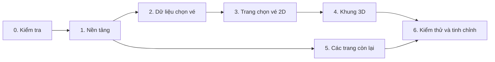

# Lộ trình triển khai

Kế hoạch làm frontend theo hướng **B — Đêm diễn** trong [`CREATIVE_DIRECTION.md`](CREATIVE_DIRECTION.md).
Chỉ bắt đầu sau khi hướng thiết kế được duyệt.

## 1. Điều kiện trước khi bắt đầu

- Hướng thiết kế và bốn câu hỏi ở mục 5 của `CREATIVE_DIRECTION.md` đã được trả lời.
- Thư mục `frontend/` thuộc việc T12 của Nhân (`nhansp`) trong [`TASKS.md`](TASKS.md).
  Cần thống nhất với người phụ trách trước khi sửa.
- Mỗi giai đoạn là một nhánh tạo từ `origin/staging` và một PR nhắm vào `staging`.
- Không sửa `backend/`.
  Mọi nhu cầu dữ liệu mới nằm trong danh sách ở mục 14 của [`3D_EXPERIENCE.md`](3D_EXPERIENCE.md).

## 2. Hợp đồng cần giữ nguyên

| Hạng mục | Giữ nguyên |
|---|---|
| API | Mọi endpoint trong `backend/internal/httpapi/router.go`, đúng request và response hiện tại |
| Đăng nhập | Luồng OTP và cookie phiên qua `AuthContext.tsx` |
| Giữ ghế | `POST /api/holds`, `DELETE /api/holds/{seatId}`, đồng hồ theo `expiresAt` |
| Giới hạn vé | `ticketLimitOf(event)` và `ticketsBookedFor(eventId)` |
| Đặt vé | `createBooking` và khoá `localStorage` `sms_user_bookings` |
| Thanh toán | Luồng mô phỏng hiện có; không giả làm cổng MoMo hay VNPAY thật |
| Cờ tính năng | `FeatureContext.tsx` và các cờ đang bật |

## 3. Các giai đoạn

Cỡ việc: S là dưới 1 ngày, M là 1–3 ngày, L là 3–5 ngày.
Đây là ước lượng thô cho một người.

### Giai đoạn 0 — Kiểm tra (S)

Không sửa mã.

- Xác nhận Archivo trên Google Fonts có subset `vietnamese` và trục `wdth`.
- Xác nhận Be Vietnam Pro có chữ số đều cột (`tnum`).
- Thử thuật toán lấy màu nhấn trên cả 6 ảnh trong `frontend/public/events/`.
  Ghi lại ảnh nào phải dùng `accent-fallback`.
- Chụp màn hình hiện trạng các trang để so sánh sau này.

**Xong khi:** có bảng kết quả kiểm tra.
Nếu Archivo không đạt thì đề xuất bộ chữ thay thế để duyệt lại.

### Giai đoạn 1 — Nền tảng (M)

- `frontend/src/index.css`:
  - đổi giá trị token Kumo theo mục 2.2 của [`DESIGN_SYSTEM.md`](DESIGN_SYSTEM.md);
  - thêm `--color-stage`, `--color-spot`, `--color-accent`, `--color-accent-ink`;
  - thêm thang cỡ chữ và token chuyển động.
- `frontend/index.html`: nạp Archivo cùng Be Vietnam Pro.
- Hook `useEventAccent(event)`: lấy màu nhấn từ ảnh.
- Component dùng chung: mã vị trí, giá, đồng hồ giữ ghế, ghi nguồn ảnh.

**Xong khi:**

- `npx tsc --noEmit` và `vite build` chạy qua.
- Mọi trang vẫn hoạt động như cũ, chỉ đổi giao diện.
- Tương phản đạt mục 9 của `DESIGN_SYSTEM.md` ở cả chế độ sáng và tối.

### Giai đoạn 2 — Dữ liệu chọn vé (M)

- Hook `useSeatInventory(eventId)`: tách phần tải ghế, SSE, giữ và trả ghế ra khỏi `SeatMap.tsx`.
- Hàm `isStandingZone(zone)`: nhận diện khu đứng theo tên.
- Hàm thuần `buildVenueLayout(zones, seats)`: sinh hình học sơ đồ.
- Logic giữ nhiều chỗ ở khu đứng (mục 3.3 của [`3D_EXPERIENCE.md`](3D_EXPERIENCE.md)).
- `SeatMap.tsx` chuyển sang đọc từ `useSeatInventory`, hành vi không đổi.

**Xong khi:**

- Sơ đồ 2D hiện tại chạy y như trước.
- `isStandingZone` nhận đúng 14 khu đứng trong dữ liệu mẫu.
- `buildVenueLayout` cho cùng kết quả với cùng đầu vào.

### Giai đoạn 3 — Trang chọn vé 2D (M)

- Route mới `/events/:id/tickets` trong `App.tsx`.
- `TicketSelectionPage` gồm `ZonePanel`, `SelectionTray` và sơ đồ 2D.
- Trang chi tiết sự kiện bỏ sơ đồ ghế, nút "Chọn vé" dẫn sang trang mới.
- Trang thanh toán bỏ hộp thoại sơ đồ ghế.
  Nút "Đổi vị trí ghế" quay về trang chọn vé.
- Khu đứng chọn theo số lượng.

**Xong khi:** mua được vé từ đầu đến cuối trên trang mới, chưa cần 3D.
Đây là mốc an toàn: nếu dừng ở đây, sản phẩm vẫn đầy đủ chức năng.

### Giai đoạn 4 — Khung 3D (L)

- Cài `three`, `@react-three/fiber` 9.x, `@react-three/drei`, `@types/three`.
- `VenueScene` tải lười, gồm sân khấu, khu, ghế instanced, vòng đèn dõi, nhãn và camera.
- Đồng bộ hai chiều giữa khung 3D và bảng điều khiển DOM.
- Dự phòng: không có WebGL, mất context, nút "Xem sơ đồ phẳng".
- Giảm chuyển động.

**Xong khi:**

- Chunk 3D chỉ được tải ở trang chọn vé.
- Đạt ngân sách ở mục 7.2 của `3D_EXPERIENCE.md`, hoặc ghi rõ chỉ số nào chưa đạt.
- Chọn, trả ghế và mua vé được bằng bàn phím, không cần chạm vào khung 3D.

### Giai đoạn 5 — Các trang còn lại (L)

Không dùng 3D ở các trang này.

| Trang | Việc chính |
|---|---|
| Trang chủ | Ảnh mở đầu của sự kiện gần nhất; lịch diễn theo ngày thay cho lưới thẻ |
| Khám phá | Bộ lọc thể loại, thành phố, ngày, giá trên lịch diễn |
| Chi tiết sự kiện | Ảnh, ngày giờ, địa điểm, bảng giá theo khu, nút "Chọn vé" |
| Đăng nhập | Giữ luồng OTP; đổi giao diện theo token mới |
| Thanh toán | Ba bước có đánh số; mã vị trí lớn; đồng hồ giữ ghế luôn hiện |
| Xác nhận | Tấm vé với đường xé, khoảnh khắc `encore` |
| Vé của tôi | Vé sắp diễn và đã diễn; nút huỷ giữ hộp thoại xác nhận hiện có |
| Ban Tổ chức | Chỉ áp token mới, không thiết kế lại |

Giai đoạn này làm song song được với giai đoạn 2–4 sau khi xong giai đoạn 1.

**Xong khi:** mọi trang dùng token mới, không còn màu hay cỡ chữ viết cứng.

### Giai đoạn 6 — Kiểm thử và tinh chỉnh (M)

- Thiết bị:
  - Chrome và Safari trên điện thoại thật;
  - một máy Android tầm trung;
  - Chrome, Firefox, Safari trên máy tính.
- Tiếp cận:
  - chỉ dùng bàn phím;
  - trình đọc màn hình (VoiceOver, TalkBack);
  - tăng cỡ chữ hệ thống lên 200%.
- Giảm chuyển động bật và tắt.
- Thời gian thực: hai trình duyệt cùng giữ một ghế, ghế hết giờ.
- Đo kích thước chunk và khung hình, so với ngân sách.

**Xong khi:** mọi lỗi nghiêm trọng đã sửa.
Các chỉ số chưa đạt được ghi vào PR.

## 4. Ngoài phạm vi

- Mọi thay đổi trong `backend/`, kể cả các đề nghị ở mục 14 của `3D_EXPERIENCE.md`.
- Cổng thanh toán thật.
- Ảnh góc nhìn thật từ ghế.
- Phòng chờ (waiting room): bảng `queue_entries` đã có nhưng backend chưa có endpoint.

## 5. Rủi ro của lộ trình

| Rủi ro | Giảm thiểu |
|---|---|
| Xung đột với việc T12 đang làm trong `frontend/` | Thống nhất với người phụ trách trước giai đoạn 1; PR nhỏ theo từng giai đoạn |
| Backend đổi hợp đồng API giữa chừng | Mọi lời gọi API nằm trong `services/` và `useSeatInventory` |
| Giai đoạn 3D kéo dài | Giai đoạn 3 đã là sản phẩm hoàn chỉnh; 3D có thể ra sau |
| Bộ chữ không hỗ trợ tiếng Việt | Giai đoạn 0 kiểm tra trước khi viết mã |
