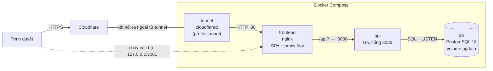
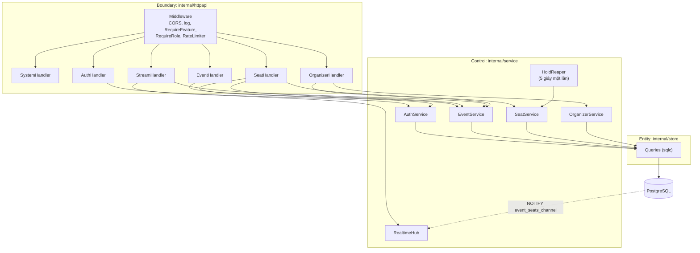
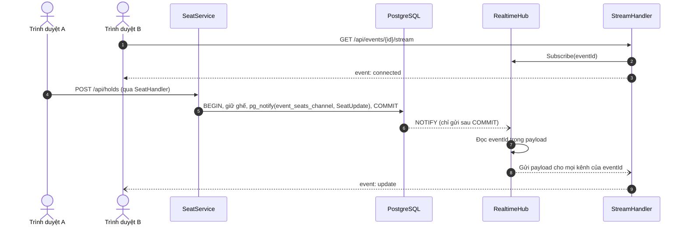

# Kiến trúc hệ thống

Tài liệu mô tả kiến trúc đang chạy ở `compose.yaml`, `backend/` và `frontend/`.
Nguyên tắc thiết kế nằm ở mục 3 của [`design/README.md`](design/README.md).
Đặc tả API nằm ở [`api/openapi.yaml`](api/openapi.yaml).

## 1. Nguyên tắc

Chỉ một database, không dùng Redis.
PostgreSQL lo cả ba việc:
- khóa ghế, bằng câu `UPDATE` có điều kiện và partial unique index trên `seat_holds`;
- hàng chờ, bằng bảng `queue_entries`;
- phát sự kiện realtime, bằng `LISTEN/NOTIFY`.

Mọi thay đổi trạng thái ghế và thông báo `NOTIFY` nằm trong cùng một giao dịch.
Giao dịch bị hủy thì trình duyệt cũng không nhận thông báo.

Realtime dùng SSE.
Trình duyệt mở `EventSource` một lần, không phải hỏi lại liên tục.

api là một file chạy Go duy nhất, chia lớp theo BCE (bài B05):

| Lớp | Gói | Việc |
|---|---|---|
| Boundary | `internal/httpapi` | Định tuyến, đọc JSON, tra phiên, kiểm tra cờ và vai trò, trả mã HTTP |
| Control | `internal/service` | Nghiệp vụ: OTP, giữ ghế, giá khu vực, realtime, nhả ghế hết hạn |
| Entity | `internal/store` | Model và truy vấn sinh bằng `sqlc` từ `queries/*.sql`, chạy trên `pgx/v5` |

## 2. Triển khai

| Dịch vụ | Image | Cổng | Ghi chú |
|---|---|---|---|
| `db` | `postgres:18.6-alpine3.24` | 5432, chỉ trong mạng Compose | Healthcheck `pg_isready` |
| `api` | Build từ `backend/Dockerfile`: `golang:1.26.10-alpine3.24`, chạy trên `alpine:3.24.3` | 8080, chỉ trong mạng Compose | Chạy bằng user không phải root. Healthcheck `GET /api/health` |
| `frontend` | Build từ `frontend/Dockerfile`: `oven/bun:1.4.4-alpine`, chạy trên `nginx:1.31.8-alpine3.24` | `127.0.0.1:${FRONTEND_PORT:-3001}` → 80 | Cổng duy nhất mở ra máy chủ |
| `tunnel` | `cloudflare/cloudflared:2026.10.7` | Không mở cổng | Chỉ chạy khi bật profile `tunnel` và có `TUNNEL_TOKEN` |

Thứ tự khởi động: `db` khỏe → `api` khỏe → `frontend` → `tunnel`.

nginx của `frontend`:
- trả file tĩnh của SPA, đường dẫn lạ thì trả `index.html`;
- chuyển `/api/` sang `http://api:8080/api/`;
- đặt `X-Real-IP` để api biết IP thật của khách;
- tắt `proxy_buffering` và để `proxy_read_timeout 24h` cho luồng SSE.

## 3. Bên trong api

Khi khởi động, `cmd/api/main.go`:
1. Đọc cấu hình từ biến môi trường.
2. Chạy migration bằng `goose` (`store.RunMigrations`).
3. Mở pool `pgxpool`, tối thiểu 5, tối đa 30 kết nối.
4. Tạo các service.
5. Chạy `RealtimeHub` và `HoldReaper` ở nền.
6. Mở HTTP server.
   Timeout đọc và ghi là 15 giây; riêng luồng SSE bỏ hạn ghi.

Nhận tín hiệu dừng thì server có 10 giây để đóng các kết nối đang mở.

## 4. Luồng realtime

`RealtimeHub` giữ riêng một kết nối `LISTEN`, kết nối này không trả về pool.
Mất kết nối thì sau 3 giây hub tự kết nối lại.
Hàng đợi của một trình duyệt bị đầy thì thông báo đó bị bỏ, để một trình duyệt chậm không chặn các trình duyệt khác.

Có ba loại thông báo:
- `seat_held`: vừa giữ ghế;
- `seat_released`: khách tự nhả ghế;
- `seat_expired`: `HoldReaper` nhả ghế hết hạn.

## 5. Cấu hình

| Biến | Mặc định trong `compose.yaml` | Ý nghĩa |
|---|---|---|
| `POSTGRES_PASSWORD` | Bắt buộc | Mật khẩu database |
| `POSTGRES_USER`, `POSTGRES_DB` | `postgres`, `event_ticketing` | Tài khoản và tên database |
| `FEATURE_PROFILE` | `sprint2` | Profile cờ: `sprint2`, `sprint3`, `sprint4`, `final` |
| `FEATURE_<TÊN>` | — | Bật/tắt riêng một cờ, ví dụ `FEATURE_TICKET_LIMIT=on` |
| `OTP_DEMO` | `false` | `true` thì trả mã OTP của khách hàng ngay trong phản hồi |
| `COOKIE_SECURE` | `false` | `true` khi chạy qua HTTPS |
| `APP_ENV` | `development` | Môi trường chạy |
| `FRONTEND_PORT` | `3001` | Cổng trên máy chủ |
| `COMPOSE_PROFILES`, `TUNNEL_TOKEN` | — | Đặt `tunnel` và token để mở ra Internet |

Cờ tắt thì:
- giao diện ẩn tính năng;
- api trả `404` với `{"error":"feature_disabled","feature":"<tên cờ>"}`.

`GET /api/features` trả profile và trạng thái từng cờ để frontend biết nên hiện gì.

## 6. Trạng thái API

Đã làm, có trong `openapi.yaml`:

| Endpoint | Cờ |
|---|---|
| `GET /api/health`, `GET /api/features` | — |
| `POST /api/auth/otp/request`, `POST /api/auth/otp/verify` | `otp_login` |
| `GET /api/auth/me`, `POST /api/auth/logout` | — |
| `GET /api/events`, `GET /api/events/{slug}` | — (FR-02 luôn bật) |
| `GET /api/events/{id}/seats`, `GET /api/events/{id}/stream` | `seat_map_realtime` |
| `POST /api/holds`, `DELETE /api/holds/{seatId}` | `seat_hold` |
| `GET /api/organizer/events` | `organizer_console` |
| `PUT /api/organizer/events/{id}/zones/{zoneId}/pricing` | `organizer_console`, `zone_pricing` |

Chưa làm, theo mục 7 của thiết kế:

| Nhóm | Cờ |
|---|---|
| Hàng chờ: `/api/events/{id}/queue…` | `waiting_room` |
| Đơn hàng, thanh toán, IPN | `payments`, `reconciliation` |
| Vé và QR: `/api/me/tickets`, `/api/tickets/{id}/qr` | `rotating_qr`, `ticket_email` |
| BTC: địa điểm, tạo sự kiện, duyệt đề xuất giá | `organizer_console`, `dynamic_pricing` |
| Soát vé: `/api/gate/…` | `gate_checkin`, `offline_checkin` |
| CEO: `/api/dashboard/stream`, `/api/reports/…` | `ceo_dashboard`, `reports_export` |

## 7. Khác biệt so với thiết kế

- **Nhả ghế hết hạn.**
  Thiết kế đặt bộ hẹn giờ chạy đúng lúc lượt giữ sớm nhất hết hạn.
  Code hiện quét 5 giây một lần, nên ghế có thể trễ tối đa 5 giây mới trống lại.
  Trong lúc đó, ghế vẫn giữ được, vì `TryStealExpiredSeatHold` cho phép lấy lượt giữ đã hết hạn.
- **Gửi OTP.**
  Chưa có SMTP hay SMS Gateway.
  Mã chỉ hiện trên màn hình (`OTP_DEMO`) hoặc ghi vào log của api.
- **Turnstile.**
  Cờ `bot_check` có trong profile `sprint3` nhưng api chưa kiểm tra token.
- **Frontend.**
  Thiết kế có TanStack Query, nhưng `frontend/package.json` chưa dùng.
