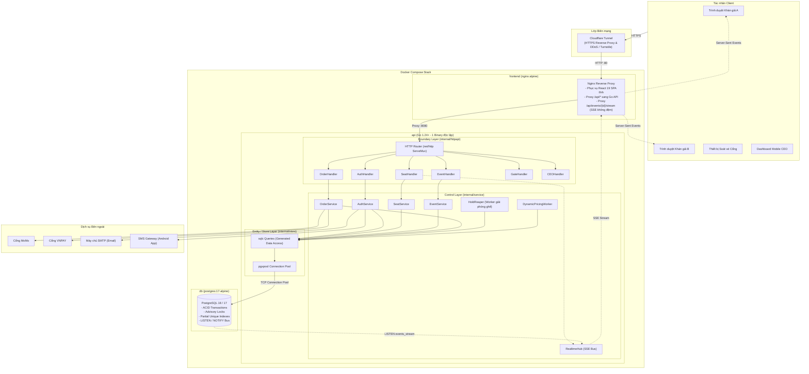

# Kiến trúc hệ thống (System Architecture)

Tài liệu đặc tả kiến trúc tổng thể của hệ thống **EventTicketing**, mô tả các thành phần phần mềm, nguyên lý phân tầng BCE (Boundary - Control - Entity), luồng dữ liệu thời gian thực và cấu hình triển khai Docker Compose dựa trên Mục 3 của [`docs/design/README.md`](design/README.md).

---

## 1. Nguyên lý kiến trúc cốt lõi

1. **Đơn cơ sở dữ liệu (Single Source of Truth - Không dùng Redis):**
   Hệ thống không sử dụng Redis để lưu trạng thái tạm hay hàng chờ. Toàn bộ các bài toán hóc búa về tính toàn vẹn và hiệu năng đều được giao phó cho **PostgreSQL 18**:
   - **Khóa ghế & Chống bán trùng:** Sử dụng khóa có điều kiện nguyên tử (`atomic row-level update`) và chỉ mục một phần duy nhất (`partial unique index`).
   - **Hàng chờ ảo:** Lưu trực tiếp trong bảng `queue_entries` có index theo thứ tự thời gian.
   - **Phát sự kiện thời gian thực (Realtime Event Bus):** Tận dụng tính năng `LISTEN / NOTIFY` nội tại của PostgreSQL trong cùng giao dịch ACID.
   - **Kiểm toán bất biến:** Sử dụng database trigger ngăn chặn thao tác `UPDATE` và `DELETE` trên bảng `price_changes` và `audit_logs`.
   $\implies$ Kiến trúc giảm thiểu độ phức tạp vận hành, loại trừ hoàn toàn nguy cơ mất đồng bộ giữa Cache và Database.

2. **Phát trực tiếp qua Server-Sent Events (SSE):**
   Thay vì bắt hàng chục ngàn trình duyệt phải liên tục gửi request hỏi trạng thái (polling) gây quá tải server, backend duy trì một kết nối dài hạn qua SSE (`/api/events/{id}/stream`). Khi cơ sở dữ liệu phát tín hiệu `pg_notify`, background worker của Go chuyển tiếp ngay lập tức thông báo đến các client đang lắng nghe.

3. **Phân lớp kiến trúc BCE (Boundary - Control - Entity):**
   - **Boundary (`internal/httpapi`):** Tiếp nhận HTTP request, xác thực token cookie, parse JSON, kiểm tra cờ tính năng (`feature flags`) và trả về mã HTTP chuẩn.
   - **Control (`internal/service`):** Đóng gói toàn bộ nghiệp vụ lõi (quy trình giữ ghế, kiểm tra quota 4 vé, tính toán định giá động, xử lý đối soát IPN).
   - **Entity / Store (`internal/store`):** Tầng truy cập dữ liệu được sinh tự động bằng `sqlc` và thư viện driver `pgx/v5`, bảo đảm an toàn kiểu dữ liệu (type-safe) tại thời điểm biên dịch.

---

## 2. Sơ đồ kiến trúc triển khai (Deployment Architecture)

---

## 3. Các thành phần hệ thống và Trách nhiệm

| Thành phần | Công nghệ | Cấu hình & Vai trò chính |
|---|---|---|
| **Edge Proxy** | Cloudflare Tunnel | Bảo vệ DDoS, cung cấp SSL/TLS tự động, tích hợp dịch vụ Cloudflare Turnstile (`bot_check`). |
| **Frontend Web** | React 19, TypeScript, Vite, Tailwind | Ứng dụng Single Page Application (SPA), tích hợp TanStack Query quản lý state, hiển thị sơ đồ ghế động và đồng hồ đếm ngược. |
| **Web Server / Proxy** | Nginx Alpine | Phục vụ file SPA tĩnh; cấu hình `proxy_buffering off` cho endpoint SSE `/api/events/*/stream` để không bị nghẽn thông báo. |
| **Backend API** | Go 1.24+, `net/http` | Biên dịch thành 1 file thực thi tĩnh (Single Binary); tiêu thụ ít bộ nhớ (< 50MB RAM), thời gian khởi động tức thì (< 100ms). |
| **Cơ sở dữ liệu** | PostgreSQL 18 | Quản lý 26 bảng dữ liệu, chạy cơ chế khóa hàng nguyên tử, hàng chờ ảo và kênh pub/sub `LISTEN/NOTIFY`. |
| **Realtime Hub** | Go Goroutines & Channels | Mở 1 kết nối chuyên biệt `LISTEN events_stream` tới Postgres; điều phối sự kiện tới các HTTP response writer qua SSE. |
| **Hold Reaper Worker** | Go Background Worker | Chạy ngầm định kỳ quét các lượt giữ ghế quá 5 phút (`expires_at <= now()`), thu hồi ghế về `AVAILABLE` và phát tín hiệu giải phóng. |

---

## 4. Quản lý cấu hình & Cờ tính năng (Feature Flags)

Mọi tính năng được kiểm soát thông qua biến môi trường độc lập hoặc thông qua hồ sơ (**Profile**):
- `FEATURE_PROFILE=sprint2` (Giữa kỳ: Đăng nhập OTP, Sơ đồ ghế SSE, Giữ ghế 5 phút, Cấu hình giá sàn/trần).
- `FEATURE_PROFILE=sprint3` (Hàng chờ ảo, Cloudflare Turnstile, Giới hạn 4 vé, QR xoay vòng).
- `FEATURE_PROFILE=sprint4` (Thanh toán MoMo/VNPAY, Gửi vé qua Email, Đối soát tự động).
- `FEATURE_PROFILE=final` (Bật toàn bộ tính năng, bao gồm Soát vé cổng, Dashboard CEO và Định giá động).

Khi một cờ tính năng bị tắt (`disabled`):
- Giao diện người dùng ẩn toàn bộ các nút bấm và màn hình liên quan.
- API máy chủ từ chối phục vụ ngay tại tầng Boundary với mã phản hồi `404 Not Found` kèm nội dung `{"error": "feature_disabled"}`.
