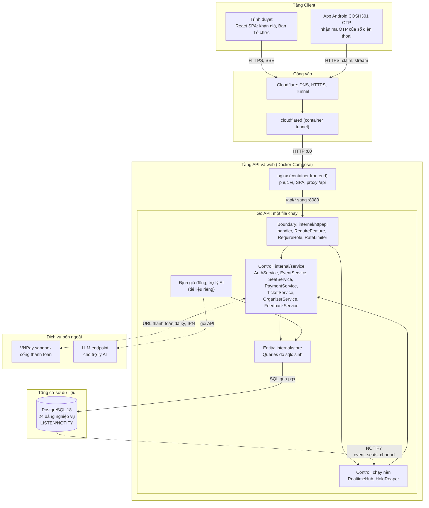
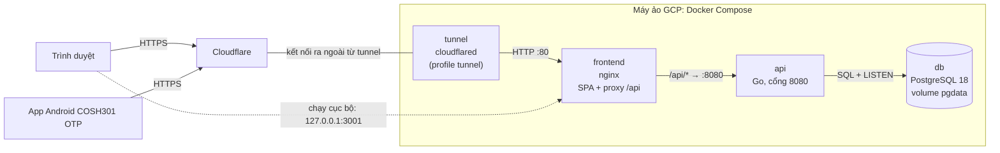
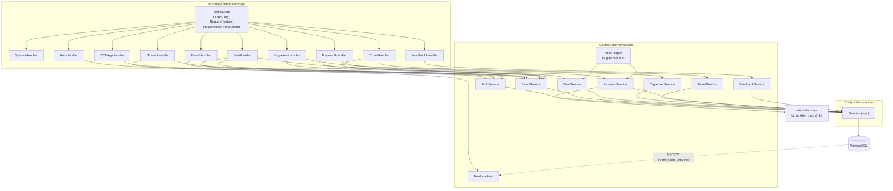
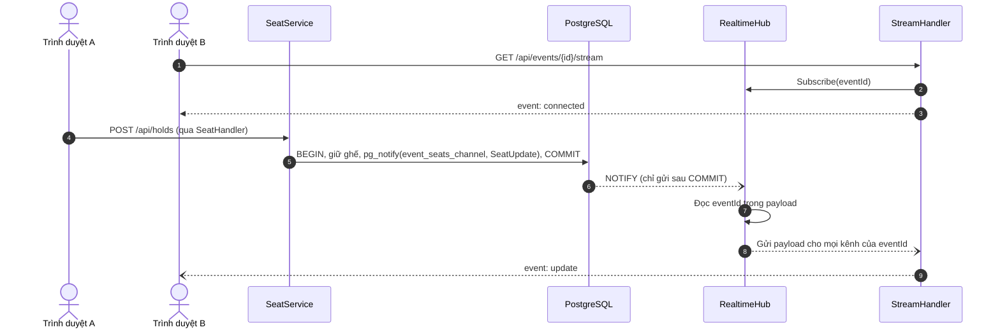

# Kiến trúc hệ thống

Tài liệu mô tả kiến trúc đang chạy ở `compose.yaml`, `backend/`, `frontend/` và `android/`.
Nguyên tắc thiết kế nằm ở mục 3 của [`design/README.md`](design/README.md).
Đặc tả API nằm ở [`api/openapi.yaml`](api/openapi.yaml).

Hai tính năng được làm riêng và có tài liệu riêng, tài liệu này chỉ nhắc đến:
- định giá động: [`dynamic-pricing.md`](dynamic-pricing.md);
- trợ lý AI: [`assistant.md`](assistant.md).

## 1. Nguyên tắc

Chỉ một database, không dùng Redis.
PostgreSQL lo cả ba việc:
- khóa ghế, bằng câu `UPDATE` có điều kiện và partial unique index trên `seat_holds`;
- hàng chờ, bằng bảng `queue_entries` (chưa có code);
- phát sự kiện realtime, bằng `LISTEN/NOTIFY`.

Mọi thay đổi trạng thái ghế và thông báo `NOTIFY` nằm trong cùng một giao dịch.
Giao dịch bị hủy thì trình duyệt cũng không nhận thông báo.

Realtime dùng SSE.
Trình duyệt mở `EventSource` một lần, không phải hỏi lại liên tục.

api là một file chạy Go duy nhất, chia lớp theo BCE (bài B05):

| Lớp | Gói | Việc |
|---|---|---|
| Boundary | `internal/httpapi` | Định tuyến, đọc JSON, tra phiên, kiểm tra cờ và vai trò, trả mã HTTP |
| Control | `internal/service` | Nghiệp vụ: OTP, giữ ghế, thanh toán và phát vé, giá khu vực, hủy vé và nhật ký, khảo sát, realtime, nhả ghế hết hạn |
| Entity | `internal/store` | Model và truy vấn sinh bằng `sqlc` từ `queries/*.sql`, chạy trên `pgx/v5` |

Gói `internal/vnpay` chỉ ký và kiểm tra chữ ký VNPay, không đụng đến database.
`PaymentService` dùng gói này.

## 2. Kiến trúc phân tầng

Hệ thống có bốn tầng: Client, Web và API, Cơ sở dữ liệu, và các dịch vụ bên ngoài.
Mũi tên đi từ bên gọi sang bên được gọi.
Nét đứt là kênh phụ hoặc tính năng có tài liệu riêng.

| Tầng | Thành phần | Công nghệ | Việc |
|---|---|---|---|
| Client | Trình duyệt | React 19, Vite, Tailwind | Hiện giao diện, mở `EventSource` để nhận cập nhật ghế |
| Client | App COSH301 OTP | Kotlin, Jetpack Compose | Nhận mã OTP của số điện thoại, hiện trong thông báo ([`otp-app.md`](otp-app.md)) |
| Cổng vào | Cloudflare, `cloudflared` | Cloudflare Tunnel | Nhận HTTPS từ Internet, chuyển vào `frontend`. Máy chủ không mở cổng web |
| API và máy chủ web | `frontend` | nginx | Trả file tĩnh, chuyển `/api/` sang `api`, đặt `X-Real-IP` |
| API và máy chủ web | `api` | Go, `net/http` | Nghiệp vụ theo BCE, tác vụ nền, SSE |
| Cơ sở dữ liệu | `db` | PostgreSQL 18 | Lưu dữ liệu, khóa ghế, phát `NOTIFY` |
| Bên ngoài | VNPay sandbox | VNPay API 2.1.0 | Thanh toán. Gọi IPN về api |
| Bên ngoài | LLM endpoint | HTTP API của nhà cung cấp mô hình | Chỉ trợ lý AI dùng |

Luồng thanh toán không đi qua api khi chuyển sang VNPay.
api trả URL đã ký, trình duyệt tự chuyển sang VNPay.
VNPay gọi IPN về api qua Cloudflare, và trình duyệt quay về trang `/payment/vnpay/return`.
Chi tiết ở [`payments.md`](payments.md) và [`sequences/payment.md`](sequences/payment.md).

## 3. Triển khai

| Dịch vụ | Image | Cổng | Ghi chú |
|---|---|---|---|
| `db` | `postgres:18.6-alpine3.24` | `127.0.0.1:5432` trên máy chủ | Healthcheck `pg_isready` |
| `api` | Build từ `backend/Dockerfile`: `golang:1.26.10-alpine3.24`, chạy trên `alpine:3.24.3` | 8080, chỉ trong mạng Compose | Chạy bằng user không phải root. Healthcheck `GET /api/health` |
| `frontend` | Build từ `frontend/Dockerfile`: `oven/bun:1.4.4-alpine`, chạy trên `nginx:1.31.8-alpine3.24` | `127.0.0.1:${FRONTEND_PORT:-3001}` → 80 | Cổng duy nhất mở ra máy chủ |
| `tunnel` | `cloudflare/cloudflared:2026.10.7` | Không mở cổng | Chỉ chạy khi bật profile `tunnel` và có `TUNNEL_TOKEN` |

Thứ tự khởi động: `db` khỏe → `api` khỏe → `frontend` → `tunnel`.

nginx của `frontend`:
- trả file tĩnh của SPA, đường dẫn lạ thì trả `index.html`;
- chuyển `/api/` sang `http://api:8080/api/`;
- đặt `X-Real-IP` bằng `CF-Connecting-IP` của Cloudflare, nếu không có thì dùng địa chỉ kết nối, để api biết IP thật của khách;
- tắt `proxy_buffering` và để `proxy_read_timeout 24h` cho luồng SSE.

### Bản chạy trực tuyến

Hệ thống chạy trên một máy ảo GCP (Compute Engine) bằng Docker Compose, gồm bốn dịch vụ `db`, `api`, `frontend` và `tunnel`.
Địa chỉ công khai: `https://cosh301.nhansp.id.vn`, qua Cloudflare Tunnel.

- `tunnel` (cloudflared) tự kết nối ra Cloudflare và chuyển HTTP vào `frontend`.
  Máy ảo không mở cổng web ra Internet.
- `.env` trên máy ảo đặt `COMPOSE_PROFILES=tunnel`, `TUNNEL_TOKEN`, `FEATURE_PROFILE=sprint2`, `APP_ENV=production` và `COOKIE_SECURE=true`.
- Muốn thanh toán VNPay sandbox, thêm `FEATURE_PAYMENTS=on`, `VNPAY_TMN_CODE`, `VNPAY_HASH_SECRET` và `PUBLIC_URL` (xem [`payments.md`](payments.md) mục 5 và 7).
- Muốn đưa mã OTP của số điện thoại cho app Android, thêm `OTP_APP_DELIVERY=true` (xem [`otp-app.md`](otp-app.md)).
- `APP_ENV=production` tắt `POST /api/auth/demo-login` và `POST /api/tickets/reset-demo`.
- Dữ liệu PostgreSQL nằm trong volume `pgdata` trên đĩa của máy ảo.
- Cập nhật bằng cách lấy mã mới từ nhánh `rewrite` rồi chạy lại `docker compose up -d --build`. Migration tự chạy khi api khởi động.

## 4. Bên trong api

Khi khởi động, `cmd/api/main.go`:
1. Đọc cấu hình từ biến môi trường.
2. Nếu cờ `payments` bật mà thiếu cấu hình VNPay thì dừng ngay, báo tên biến thiếu.
3. Chạy migration bằng `goose` (`store.RunMigrations`).
4. Mở pool `pgxpool`, tối thiểu 5, tối đa 30 kết nối.
5. Tạo các service.
6. Chạy `RealtimeHub` và `HoldReaper` ở nền. Khi `OTP_APP_DELIVERY=true`, chạy thêm tác vụ xóa mã OTP hết hạn của app, mỗi phút một lần.
7. Mở HTTP server.
   Timeout đọc và ghi là 15 giây; riêng luồng SSE bỏ hạn ghi.

Nhận tín hiệu dừng thì server có 10 giây để đóng các kết nối đang mở.

`HoldReaper` mỗi 5 giây làm hai việc:
- `SeatService.ExpireStaleHolds`: nhả các ghế có lượt giữ hết hạn;
- `PaymentService.ExpireStaleOrders`: chuyển các đơn `PENDING` quá hạn sang `EXPIRED`.

## 5. Luồng realtime

`RealtimeHub` giữ riêng một kết nối `LISTEN`, kết nối này không trả về pool.
Mất kết nối thì sau 3 giây hub tự kết nối lại.
Hàng đợi của một trình duyệt bị đầy thì thông báo đó bị bỏ, để một trình duyệt chậm không chặn các trình duyệt khác.
`StreamHandler` gửi một dòng `: ping` mỗi 15 giây để kết nối không bị cắt.

Có bốn loại thông báo (`SeatUpdateMessage.Type`):
- `seat_held`: vừa giữ ghế;
- `seat_released`: khách tự nhả ghế hoặc hủy vé;
- `seat_expired`: `HoldReaper` nhả ghế hết hạn;
- `seat_sold`: IPN của VNPay thành công, ghế chuyển `SOLD`.

Luồng SSE thứ hai dành cho app OTP: `POST /api/otp-app/stream`.
Luồng này chỉ báo "có mã đang chờ", không mang mã, và không đi qua `LISTEN/NOTIFY` (xem [`otp-app.md`](otp-app.md)).

## 6. Cấu hình

| Biến | Mặc định trong `compose.yaml` | Ý nghĩa |
|---|---|---|
| `POSTGRES_PASSWORD` | Bắt buộc | Mật khẩu database |
| `POSTGRES_USER`, `POSTGRES_DB` | `postgres`, `event_ticketing` | Tài khoản và tên database |
| `FEATURE_PROFILE` | `sprint2` | Profile cờ: `sprint2`, `sprint3`, `sprint4`, `final` |
| `FEATURE_<TÊN>` | — | Bật/tắt riêng một cờ, ví dụ `FEATURE_TICKET_LIMIT=on`. `compose.yaml` chỉ nối sẵn `FEATURE_PAYMENTS` |
| `OTP_DEMO` | `false` | `true` thì trả mã OTP của email khách hàng ngay trong phản hồi |
| `OTP_APP_DELIVERY` | `false` | `true` thì mã OTP của số điện thoại giao cho app Android |
| `COOKIE_SECURE` | `false` | `true` khi chạy qua HTTPS |
| `APP_ENV` | `development` | Môi trường chạy. `production` thì tắt `/api/auth/demo-login` và `/api/tickets/reset-demo` |
| `PUBLIC_URL` | trống | Địa chỉ công khai của site, dùng để suy ra URL return của VNPay |
| `VNPAY_TMN_CODE`, `VNPAY_HASH_SECRET` | trống | Khóa merchant VNPay. Bắt buộc khi cờ `payments` bật |
| `VNPAY_PAY_URL`, `VNPAY_RETURN_URL` | sandbox, `$PUBLIC_URL/payment/vnpay/return` | URL cổng thanh toán và URL trả về |
| `FRONTEND_PORT` | `3001` | Cổng trên máy chủ |
| `COMPOSE_PROFILES`, `TUNNEL_TOKEN` | — | Đặt `tunnel` và token để mở ra Internet |

Cờ tắt thì:
- giao diện ẩn tính năng;
- api trả `404` với `{"error":"feature_disabled","feature":"<tên cờ>"}`.

`GET /api/features` trả profile và trạng thái từng cờ để frontend biết nên hiện gì.

Cờ `user_testing` bật ở mọi profile từ `sprint2`. Cờ này phục vụ trang khảo sát `/khao-sat` cho kiểm thử với người dùng, không thuộc bảng cờ của thiết kế.

## 7. Trạng thái API

Đã làm, có trong `openapi.yaml`:

| Endpoint | Cờ |
|---|---|
| `GET /api/health`, `GET /api/features` | — |
| `POST /api/auth/otp/request`, `POST /api/auth/otp/verify` | `otp_login` |
| `POST /api/otp-app/claim`, `POST /api/otp-app/stream` | `otp_login`, chỉ khi `OTP_APP_DELIVERY=true` |
| `POST /api/auth/demo-login` | Chỉ khi `APP_ENV` khác `production` |
| `GET /api/auth/me`, `POST /api/auth/logout` | — |
| `GET /api/events`, `GET /api/events/{slug}` | — (FR-02 luôn bật) |
| `GET /api/events/{id}/seats`, `GET /api/events/{id}/stream` | `seat_map_realtime` |
| `GET /api/holds`, `POST /api/holds`, `DELETE /api/holds/{seatId}` | `seat_hold` |
| `GET /api/organizer/events` | `organizer_console` |
| `PUT /api/organizer/events/{id}/zones/{zoneId}/pricing` | `organizer_console`, `zone_pricing` |
| `GET /api/tickets/audit-logs` | `organizer_console` |
| `GET /api/tickets` | `payments` |
| `POST /api/tickets/cancel`, `GET /api/tickets/cancelled` | `payments` |
| `POST /api/tickets/reset-demo` | `seat_hold`, chỉ khi `APP_ENV` khác `production` |
| `POST /api/payments/vnpay/create` | `payments` |
| `GET /api/payments/vnpay/ipn`, `GET /api/payments/vnpay/return` | `payments`, không cần phiên, chữ ký VNPay là cách xác thực |
| `POST /api/feedback` | `user_testing`, giới hạn 20 lần mỗi giờ theo IP |
| `GET /api/feedback/summary`, `GET /api/feedback/export.csv` | `user_testing`, vai trò `ORGANIZER`, `ADMIN` |

Các endpoint của định giá động và trợ lý AI nằm trong tài liệu riêng ([`dynamic-pricing.md`](dynamic-pricing.md), [`assistant.md`](assistant.md)).

Chưa làm, theo mục 7 của thiết kế:

| Nhóm | Cờ |
|---|---|
| Hàng chờ: `/api/events/{id}/queue…` | `waiting_room` |
| Hoàn tiền, đối soát chủ động (truy vấn giao dịch) | `reconciliation` |
| QR và gửi vé email: `/api/tickets/{id}/qr` | `rotating_qr`, `ticket_email` |
| BTC: địa điểm, tạo sự kiện | `organizer_console` |
| Soát vé: `/api/gate/…` | `gate_checkin`, `offline_checkin` |
| CEO: `/api/dashboard/stream`, `/api/reports/…` | `ceo_dashboard`, `reports_export` |

## 8. Khác biệt so với thiết kế

- **Nhả ghế hết hạn.**
  Thiết kế đặt bộ hẹn giờ chạy đúng lúc lượt giữ sớm nhất hết hạn.
  Code hiện quét 5 giây một lần, nên ghế có thể trễ tối đa 5 giây mới trống lại.
  Trong lúc đó, ghế vẫn giữ được, vì `TryStealExpiredSeatHold` cho phép lấy lượt giữ đã hết hạn.
- **Gửi OTP.**
  Chưa có SMTP hay SMS Gateway.
  Mã của số điện thoại giao cho app Android khi bật `OTP_APP_DELIVERY`.
  Mã của email hiện trên màn hình (`OTP_DEMO`, chỉ với tài khoản khách hàng) hoặc ghi vào log của api.
- **Thanh toán.**
  Chỉ có VNPay, một lần gọi `POST /api/payments/vnpay/create` thay cho cặp `POST /api/orders` và `POST /api/orders/{id}/payments`.
  IPN dùng `GET` vì VNPay gọi bằng `GET`.
  Danh sách vé ở `GET /api/tickets`, không phải `GET /api/me/tickets`.
  Bảng đối chiếu đầy đủ ở [`payments.md`](payments.md) mục 9.
- **Turnstile.**
  Cờ `bot_check` có trong profile `sprint3` nhưng api chưa kiểm tra token.
- **Frontend.**
  Thiết kế có TanStack Query, nhưng `frontend/package.json` chưa dùng.
  Danh sách sự kiện chỉ lấy từ `GET /api/events`; không còn dữ liệu mẫu phía client.
  Giá "từ" lấy từ `priceFrom`, hạng vé lấy từ `zones` của `GET /api/events/{id}`, số vé còn lại đếm từ sơ đồ ghế.
