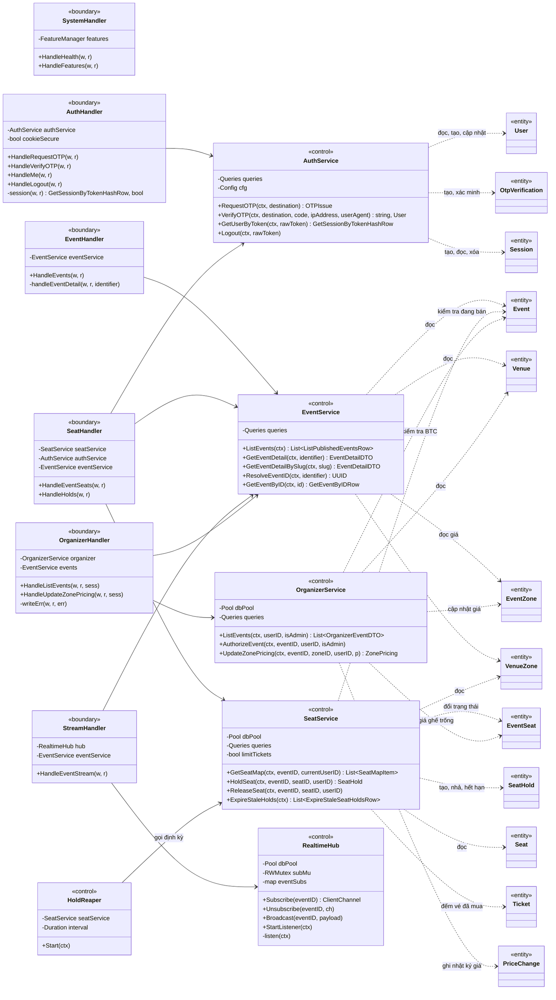
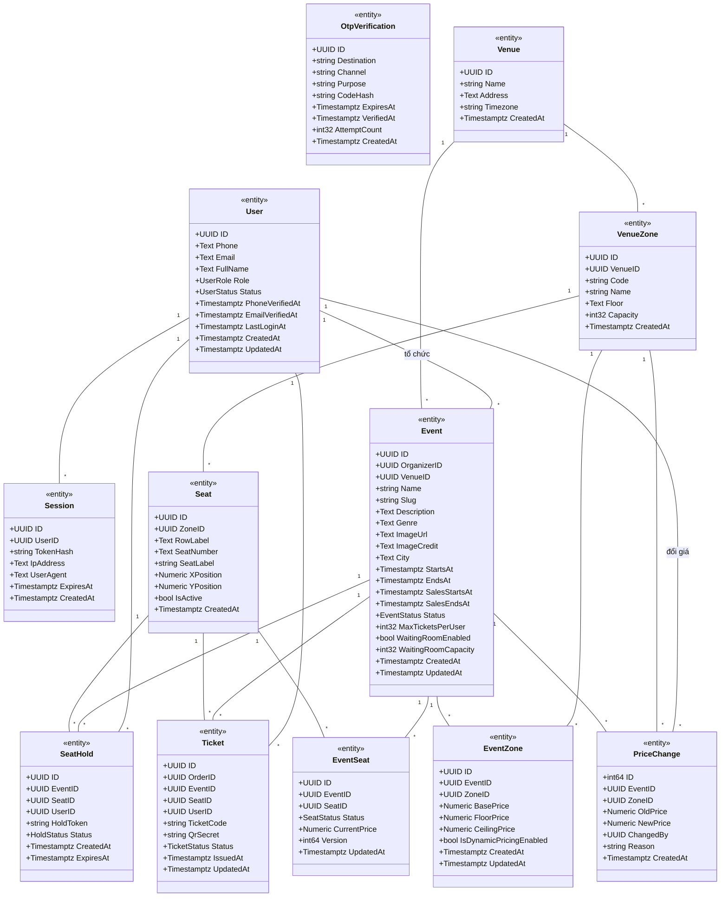

# Sơ đồ lớp theo BCE (Boundary — Control — Entity)

Sơ đồ lớp của backend, chia theo BCE như bài B05.
Mục 2 và 3 vẽ đúng code đang có, tức phạm vi Sprint 2.
Mục 5 liệt kê các lớp dự kiến cho Sprint 3–5, chưa có trong code.

## 1. Phân lớp

- **Boundary** — `internal/httpapi`.
  Handler nhận request HTTP và SSE, đọc JSON, lấy phiên đăng nhập và trả JSON.
  Handler không gọi `store` trực tiếp, mọi truy cập dữ liệu đều qua service.
- **Control** — `internal/service`.
  Service giữ quy tắc nghiệp vụ và mở giao dịch với PostgreSQL.
  Khi ghế đổi trạng thái, service gửi `pg_notify` trong cùng giao dịch.
  `RealtimeHub` và `HoldReaper` chạy nền từ lúc api khởi động.
- **Entity** — `internal/store`.
  `sqlc` sinh struct từ schema trong `migrations/` và sinh hàm truy vấn từ `queries/`.
  Mỗi struct ứng với một bảng trong [ERD](erd.md).

Middleware trong `httpapi` không vẽ thành lớp, vì chúng là hàm bọc handler:
- `RequireFeature` trả `404 feature_disabled` khi cờ tắt;
- `RequireRole` chặn người dùng không đúng vai trò;
- `RateLimiter` giới hạn số lần gọi API OTP theo IP;
- `LoggingMiddleware`, `CORSMiddleware`.

Quy ước ghi trong sơ đồ:
- Kiểu trả về bỏ `error` và bỏ dấu con trỏ.
  Ví dụ `HoldSeat` trả `(*store.SeatHold, error)`, sơ đồ ghi `SeatHold`.
- `List~T~` là slice `[]T` của Go.
- Kiểu cột bỏ tiền tố `pgtype.`.
  `Text` là chuỗi cho phép `NULL`.
  `Numeric` là kiểu `numeric` của PostgreSQL, dùng cho tiền và tọa độ ghế.

## 2. Sơ đồ BCE của code hiện tại

Cách các lớp phối hợp:
- `SeatHandler` gọi `AuthService.GetUserByToken` để lấy người dùng, rồi gọi `SeatService`.
- `OrganizerHandler` dùng `RequireRole`, nên chỉ `ORGANIZER` và `ADMIN` vào được.
  Trước khi đổi giá, handler gọi `OrganizerService.AuthorizeEvent` để kiểm tra người gọi là BTC của sự kiện.
- `SeatService` không gọi `RealtimeHub` trực tiếp.
  Service gửi `pg_notify` lên kênh `event_seats_channel`.
  `RealtimeHub` giữ một kết nối `LISTEN` riêng trên kênh này và chuyển tin tới các `StreamHandler` đang mở.
- `HoldReaper` gọi `SeatService.ExpireStaleHolds` mỗi 5 giây.
- `SeatService` chỉ đếm vé trong bảng `tickets` khi bật cờ `ticket_limit`.
  Khi đó, `HoldSeat` khóa cặp (người dùng, sự kiện) bằng `pg_advisory_xact_lock` trước khi đếm.
- `HoldSeat` không dùng khóa advisory để chống bán trùng.
  Ghế chỉ chuyển sang `HELD` khi đang `AVAILABLE`.
  Partial unique index trên `seat_holds` là lớp chặn thứ hai.

## 3. Thuộc tính các Entity đang dùng

Thuộc tính lấy đúng tên trường trong `internal/store/models.go`.

`OtpVerification` không có khóa ngoại tới `User`, vì mã OTP được gửi trước khi có tài khoản.
`Ticket.OrderID` trỏ tới `Order`, lớp này chưa có service nào dùng nên không vẽ ở đây.

Các kiểu enum lấy từ `models.go`:

| Kiểu | Giá trị |
|---|---|
| `UserRole` | `CUSTOMER`, `ORGANIZER`, `CEO`, `GATE_STAFF`, `ADMIN` |
| `UserStatus` | `PENDING`, `ACTIVE`, `LOCKED`, `DISABLED` |
| `EventStatus` | `DRAFT`, `ON_SALE`, `SOLD_OUT`, `PAUSED`, `ENDED`, `CANCELLED` |
| `SeatStatus` | `AVAILABLE`, `HELD`, `SOLD`, `BLOCKED` |
| `HoldStatus` | `ACTIVE`, `EXPIRED`, `RELEASED`, `CONVERTED` |
| `TicketStatus` | `ISSUED`, `ACTIVE`, `USED`, `REVOKED`, `VOID` |

## 4. Ánh xạ Entity với bảng

`models.go` có đủ 23 struct cho 23 bảng của ERD.
Cột "Control dùng" cho biết service nào đang đọc hoặc ghi bảng đó.
Dấu "—" nghĩa là chưa có code dùng, bảng chờ tính năng của cờ tương ứng.

| Entity | Bảng | Control dùng | Cờ |
|---|---|---|---|
| `User` | `users` | `AuthService` | `otp_login` |
| `OtpVerification` | `otp_verifications` | `AuthService` | `otp_login` |
| `Session` | `sessions` | `AuthService` | `otp_login` |
| `Venue` | `venues` | `EventService`, `OrganizerService` | `organizer_console` |
| `VenueZone` | `venue_zones` | `EventService`, `SeatService` | `organizer_console` |
| `Seat` | `seats` | `SeatService` | `seat_map_realtime` |
| `Event` | `events` | `EventService`, `SeatService`, `OrganizerService` | FR-02, luôn bật |
| `EventZone` | `event_zones` | `EventService`, `OrganizerService` | `zone_pricing` |
| `EventSeat` | `event_seats` | `SeatService`, `OrganizerService` | `seat_map_realtime`, `seat_hold` |
| `SeatHold` | `seat_holds` | `SeatService` | `seat_hold` |
| `PriceChange` | `price_changes` | `OrganizerService` | `zone_pricing`, `price_log` |
| `Ticket` | `tickets` | `SeatService` (chỉ đếm) | `ticket_limit`, `payments`, `rotating_qr` |
| `Order` | `orders` | — | `payments` |
| `OrderItem` | `order_items` | — | `payments` |
| `Payment` | `payments` | — | `payments`, `reconciliation` |
| `QueueEntry` | `queue_entries` | — | `waiting_room` |
| `GateDevice` | `gate_devices` | — | `gate_checkin` |
| `Checkin` | `checkins` | — | `gate_checkin`, `offline_checkin` |
| `SalesSnapshot` | `sales_snapshots` | — | `ceo_dashboard` |
| `PriceSuggestion` | `price_suggestions` | — | `dynamic_pricing` |
| `Promotion` | `promotions` | — | `promo_suggestions` |
| `PromotionUsage` | `promotion_usages` | — | `promo_suggestions` |
| `AuditLog` | `audit_logs` | — | chưa gắn cờ |

Bảng `price_changes` luôn được ghi khi giá cơ bản đổi.
Cờ `price_log` chỉ ẩn hoặc hiện trang xem nhật ký.

## 5. Lớp dự kiến (chưa làm)

Các lớp dưới đây chưa có trong code.
Tên lớp là tên dự kiến, có thể đổi khi viết code.
Endpoint lấy từ mục 7 của [thiết kế](design/README.md).

| Lớp dự kiến | Cờ | Endpoint, tác vụ nền | Bảng |
|---|---|---|---|
| Mở rộng `OrganizerHandler`, `OrganizerService` | `organizer_console` | `/api/organizer/venues/…`, `/api/organizer/events/…` | `venues`, `venue_zones`, `seats`, `events`, `event_seats` |
| `QueueHandler`, `QueueService` | `waiting_room` | `POST /api/events/{id}/queue`, `GET /api/events/{id}/queue/me`; tác vụ cho người kế tiếp vào | `queue_entries` |
| Middleware kiểm tra Turnstile | `bot_check` | Bọc `POST /api/auth/otp/request` | — |
| `OrderHandler`, `OrderService` | `payments` | `POST /api/orders`, `GET /api/orders/{id}` | `orders`, `order_items`, `seat_holds` |
| `PaymentHandler`, `PaymentService` | `payments`, `reconciliation` | `POST /api/orders/{id}/payments`, `GET /api/payments/{provider}/return`, `POST /api/payments/{provider}/ipn`; tác vụ đối soát | `payments`, `orders`, `tickets` |
| `TicketHandler`, `TicketService` | `rotating_qr`, `ticket_email` | `GET /api/me/tickets`, `GET /api/tickets/{id}/qr` | `tickets` |
| Lớp gửi OTP và vé qua SMTP, SMS Gateway | `otp_login`, `ticket_email` | Dùng trong `AuthService` và `TicketService` | — |
| `GateHandler`, `GateCheckinService` | `gate_checkin`, `offline_checkin` | `GET /api/gate/events/{id}/manifest`, `POST /api/gate/checkins`, `POST /api/gate/sync` | `tickets`, `checkins`, `gate_devices` |
| `DashboardHandler`, `DashboardService` | `ceo_dashboard`, `reports_export` | `GET /api/dashboard/stream`, `GET /api/reports/sales.csv`, `GET /api/reports/sales.xlsx`; tác vụ chụp số liệu | `sales_snapshots` |
| `DynamicPricingEngine` | `dynamic_pricing` | Tác vụ tính đề xuất 5 phút một lần; `POST /api/organizer/suggestions/{id}/approve`, `…/reject` | `price_suggestions`, `price_changes`, `event_zones`, `event_seats` |
| Chưa thiết kế | `promo_suggestions` | Chưa có endpoint trong thiết kế | `promotions`, `promotion_usages` |
| Chưa thiết kế | `price_log` | Chưa có endpoint trong thiết kế | `price_changes` |
