# Sơ đồ lớp theo mô hình BCE (Boundary — Control — Entity)

Tài liệu này đặc tả thiết kế hướng đối tượng của hệ thống EventTicketing theo kiến trúc BCE (bài B05), phân tách rành mạch giữa giao diện ngoại vi, nghiệp vụ điều khiển và thực thể dữ liệu.

## 1. Nguyên tắc phân lớp BCE

- **Boundary (`internal/httpapi`):** Tiếp nhận yêu cầu HTTP/SSE từ trình duyệt hoặc ứng dụng di động, giải mã dữ liệu, xác thực phiên đăng nhập, kiểm tra cờ tính năng (`RequireFeature`), phân quyền vai trò và đóng gói phản hồi JSON.
- **Control (`internal/service`):** Xử lý quy tắc nghiệp vụ, điều phối giao dịch ACID, khóa ghế độc quyền bằng `pg_advisory_xact_lock`, phát thông báo thời gian thực qua `LISTEN/NOTIFY`, và thực thi các tiến trình chạy nền.
- **Entity (`internal/store`):** Mô hình hóa các bảng dữ liệu trong PostgreSQL, quản lý truy vấn qua `sqlc` và ánh xạ dữ liệu trực tiếp từ cơ sở dữ liệu.

---

## 2. Sơ đồ lớp tổng thể

```mermaid
classDiagram
    %% ==========================================
    %% BOUNDARY LAYER (internal/httpapi)
    %% ==========================================
    class SystemHandler {
        -FeatureManager features
        +HandleHealth(w, r)
        +HandleFeatures(w, r)
    }

    class AuthHandler {
        -AuthService authService
        +HandleRequestOTP(w, r)
        +HandleVerifyOTP(w, r)
        +HandleMe(w, r)
        +HandleLogout(w, r)
    }

    class EventHandler {
        -EventService eventService
        +HandleEvents(w, r)
        +HandleEventDetail(w, r, slug)
    }

    class SeatHandler {
        -SeatService seatService
        -AuthService authService
        +HandleEventSeats(w, r)
        +HandleHolds(w, r)
    }

    class StreamHandler {
        -RealtimeHub hub
        +HandleEventStream(w, r)
    }

    class OrderHandler {
        -OrderService orderService
        -AuthService authService
        +HandleCreateOrder(w, r)
        +HandleGetOrder(w, r)
    }

    class PaymentHandler {
        -PaymentService paymentService
        +HandleCreatePayment(w, r)
        +HandleIPN(w, r, provider)
        +HandleReturn(w, r, provider)
    }

    class GateHandler {
        -GateCheckinService checkinService
        +HandleScan(w, r)
        +HandleSyncOffline(w, r)
        +HandleManifest(w, r)
    }

    class DashboardHandler {
        -DashboardService dashboardService
        +HandleStream(w, r)
        +HandleExportCSV(w, r)
        +HandleExportXLSX(w, r)
    }

    %% ==========================================
    %% CONTROL LAYER (internal/service)
    %% ==========================================
    class AuthService {
        -Queries queries
        -Config cfg
        +RequestOTP(ctx, destination, channel) string
        +VerifyOTP(ctx, destination, code, ip, ua) tuple
        +GetUserByToken(ctx, token) SessionUser
        +Logout(ctx, token) error
    }

    class SeatService {
        -Pool dbPool
        -Queries queries
        +GetSeatMap(ctx, eventID, userID) list
        +HoldSeat(ctx, eventID, seatID, userID) SeatHold
        +ReleaseSeat(ctx, eventID, seatID, userID) error
        +ExpireStaleHolds(ctx) list
    }

    class EventService {
        -Queries queries
        +ListEvents(ctx) list
        +GetEventDetailBySlug(ctx, slug) EventDetailDTO
        +GetEventByID(ctx, id) Event
    }

    class RealtimeHub {
        -Pool dbPool
        -map eventSubs
        +Subscribe(eventID) ClientChannel
        +Unsubscribe(eventID, ch)
        +Broadcast(eventID, payload)
        +StartListener(ctx)
    }

    class HoldReaper {
        -SeatService seatService
        -Duration interval
        +Start(ctx)
    }

    class OrderService {
        -Pool dbPool
        -Queries queries
        +CreateOrderFromHolds(ctx, userID, eventID) Order
        +GetOrderByCode(ctx, orderCode) Order
        +CancelExpiredOrders(ctx) list
    }

    class PaymentService {
        -Pool dbPool
        -Queries queries
        +InitiatePayment(ctx, orderID, provider) Payment
        +ProcessIPN(ctx, provider, txnID, payload) error
        +ReconcilePayments(ctx) list
    }

    class GateCheckinService {
        -Queries queries
        +ValidateOnline(ctx, qrToken, gateID) CheckinResult
        +SyncOfflineCheckins(ctx, checkins) SyncReport
    }

    class DynamicPricingEngine {
        -Queries queries
        +CalculateSuggestions(ctx, eventID) list
        +ApproveSuggestion(ctx, suggestionID, userID) error
        +RejectSuggestion(ctx, suggestionID, userID) error
    }

    %% ==========================================
    %% ENTITY LAYER (internal/store)
    %% ==========================================
    class User {
        +UUID ID
        +string Phone
        +string Email
        +string FullName
        +UserRole Role
        +UserStatus Status
        +Time CreatedAt
    }

    class OtpVerification {
        +UUID ID
        +string Destination
        +string Channel
        +string Purpose
        +string CodeHash
        +Time ExpiresAt
        +Time VerifiedAt
    }

    class Session {
        +UUID ID
        +UUID UserID
        +string TokenHash
        +string IPAddress
        +Time ExpiresAt
    }

    class Venue {
        +UUID ID
        +string Name
        +string Address
        +string Timezone
    }

    class VenueZone {
        +UUID ID
        +UUID VenueID
        +string Code
        +string Name
        +int Capacity
    }

    class Seat {
        +UUID ID
        +UUID ZoneID
        +string RowLabel
        +string SeatNumber
        +string SeatLabel
        +bool IsActive
    }

    class Event {
        +UUID ID
        +UUID OrganizerID
        +UUID VenueID
        +string Name
        +string Slug
        +EventStatus Status
        +int MaxTicketsPerUser
        +bool WaitingRoomEnabled
    }

    class EventSeat {
        +UUID ID
        +UUID EventID
        +UUID SeatID
        +SeatStatus Status
        +int64 CurrentPrice
        +int64 Version
    }

    class EventZone {
        +UUID ID
        +UUID EventID
        +UUID ZoneID
        +int64 BasePrice
        +int64 FloorPrice
        +int64 CeilingPrice
        +bool IsDynamicPricingEnabled
    }

    class SeatHold {
        +UUID ID
        +UUID EventID
        +UUID SeatID
        +UUID UserID
        +string HoldToken
        +HoldStatus Status
        +Time ExpiresAt
    }

    class Order {
        +UUID ID
        +UUID EventID
        +UUID UserID
        +string OrderCode
        +OrderStatus Status
        +int64 TotalAmount
        +int64 FinalAmount
    }

    class OrderItem {
        +UUID ID
        +UUID OrderID
        +UUID SeatID
        +int64 Price
    }

    class Payment {
        +UUID ID
        +UUID OrderID
        +string PaymentCode
        +string Provider
        +string ProviderTxnID
        +int64 Amount
        +PaymentStatus Status
    }

    class Ticket {
        +UUID ID
        +UUID OrderID
        +UUID EventID
        +UUID SeatID
        +UUID UserID
        +string TicketCode
        +string QRSecret
        +TicketStatus Status
    }

    class GateDevice {
        +UUID ID
        +UUID VenueID
        +string GateName
        +string DeviceCode
        +bool IsActive
    }

    class Checkin {
        +UUID ID
        +UUID TicketID
        +UUID EventID
        +UUID GateDeviceID
        +CheckinResult Result
        +bool IsOffline
    }

    class PriceChange {
        +int64 ID
        +UUID EventID
        +UUID ZoneID
        +int64 OldPrice
        +int64 NewPrice
        +UUID ChangedBy
        +string Reason
    }

    class PriceSuggestion {
        +UUID ID
        +UUID EventID
        +UUID ZoneID
        +int64 CurrentPrice
        +int64 SuggestedPrice
        +string Reason
        +string Status
    }

    class QueueEntry {
        +UUID ID
        +UUID EventID
        +UUID UserID
        +int Position
        +string Status
    }

    class Promotion {
        +UUID ID
        +UUID EventID
        +string Code
        +string DiscountType
        +int64 DiscountValue
        +bool IsActive
    }

    class PromotionUsage {
        +UUID ID
        +UUID PromotionID
        +UUID OrderID
        +UUID UserID
        +int64 DiscountAmount
    }

    class AuditLog {
        +int64 ID
        +UUID ActorUserID
        +UUID EventID
        +string Action
        +string EntityType
    }

    class SalesSnapshot {
        +int64 ID
        +UUID EventID
        +int TicketsSold
        +int64 GrossRevenue
    }

    %% ==========================================
    %% RELATIONSHIPS (Boundary -> Control -> Entity)
    %% ==========================================
    AuthHandler --> AuthService : "goi nghiep vu xac thuc"
    EventHandler --> EventService : "truy van thong tin su kien"
    SeatHandler --> SeatService : "dieu phoi giu va nha ghe"
    StreamHandler --> RealtimeHub : "dang ky kenh SSE"
    HoldReaper --> SeatService : "kich hoat quet dinh ky"
    OrderHandler --> OrderService : "xu ly dat ve"
    PaymentHandler --> PaymentService : "xu ly thanh toan & IPN"
    GateHandler --> GateCheckinService : "xac thuc ve tai cong"
    DashboardHandler --> DynamicPricingEngine : "quan tri de xuat gia"

    AuthService ..> User : "quan ly"
    AuthService ..> OtpVerification : "tao & xac minh"
    AuthService ..> Session : "ghi nhan phien"

    SeatService ..> EventSeat : "kiem tra & khoa status"
    SeatService ..> SeatHold : "tao ban ghi giu 5 phut"
    SeatService ..> Seat : "doc toa do"

    EventService ..> Event : "doc thong tin"
    EventService ..> EventZone : "lay danh sach gia"
    EventService ..> Venue : "thong tin dia diem"

    OrderService ..> Order : "tao don hang"
    OrderService ..> OrderItem : "chi tiet ve trong don"

    PaymentService ..> Payment : "ghi nhan giao dich"
    PaymentService ..> Ticket : "phat hanh khi paid"

    GateCheckinService ..> Ticket : "kiem tra chu ky HMAC"
    GateCheckinService ..> Checkin : "luu lich su quet"

    DynamicPricingEngine ..> PriceSuggestion : "sinh de xuat"
    DynamicPricingEngine ..> PriceChange : "ghi nhat ky khi duyet"
```

---

## 3. Bảng ánh xạ Entity với Bảng Cơ sở dữ liệu

Mỗi thực thể (Entity) trong sơ đồ lớp đều ánh xạ 1-1 với một bảng trong cơ sở dữ liệu PostgreSQL (`internal/store`):

| Lớp Thực thể (Entity) | Bảng trong Database | Mục đích nghiệp vụ |
|---|---|---|
| `User` | `users` | Thông tin tài khoản, vai trò và trạng thái người dùng |
| `OtpVerification` | `otp_verifications` | Lưu trữ mã hash OTP và mốc hết hạn phục vụ đăng nhập |
| `Session` | `sessions` | Quản lý phiên làm việc của người dùng trên máy chủ |
| `Venue` | `venues` | Địa điểm tổ chức sự kiện |
| `VenueZone` | `venue_zones` | Khu vực ghế thuộc địa điểm (VIP, Khán đài A, GA...) |
| `Seat` | `seats` | Vị trí ghế vật lý (hàng, số ghế, tọa độ hiển thị) |
| `Event` | `events` | Sự kiện, thời gian diễn ra, trạng thái mở bán |
| `EventSeat` | `event_seats` | Trạng thái (`AVAILABLE`, `HELD`, `SOLD`) và giá hiện tại của ghế trong sự kiện |
| `EventZone` | `event_zones` | Cấu hình giá cơ bản, giá sàn, giá trần của từng khu vực trong sự kiện |
| `SeatHold` | `seat_holds` | Lịch sử và thông tin khóa ghế độc quyền trong 5 phút |
| `Order` | `orders` | Đơn hàng mua vé kèm tổng tiền thanh toán |
| `OrderItem` | `order_items` | Danh sách ghế chi tiết nằm trong đơn hàng |
| `Payment` | `payments` | Giao dịch qua cổng MoMo / VNPAY và đối soát |
| `Ticket` | `tickets` | Vé điện tử đã phát hành kèm mã bí mật sinh QR xoay vòng |
| `GateDevice` | `gate_devices` | Thiết bị máy quét soát vé tại các cổng vào |
| `Checkin` | `checkins` | Nhật ký các lượt quét vé (trực tuyến và ngoại tuyến) |
| `PriceChange` | `price_changes` | Nhật ký bất biến ghi lại lịch sử thay đổi giá vé |
| `PriceSuggestion` | `price_suggestions` | Đề xuất giá vé tự động chờ Ban Tổ chức phê duyệt |
| `QueueEntry` | `queue_entries` | Hàng chờ ảo sắp xếp vị trí mua vé công bằng |
| `Promotion` | `promotions` | Chương trình khuyến mại và mã giảm giá |
| `PromotionUsage` | `promotion_usages` | Lịch sử áp dụng mã giảm giá theo từng đơn hàng |
| `AuditLog` | `audit_logs` | Nhật ký kiểm toán bất biến phục vụ truy vết hệ thống |
| `SalesSnapshot` | `sales_snapshots` | Dữ liệu tổng hợp theo phút phục vụ CEO Dashboard |
