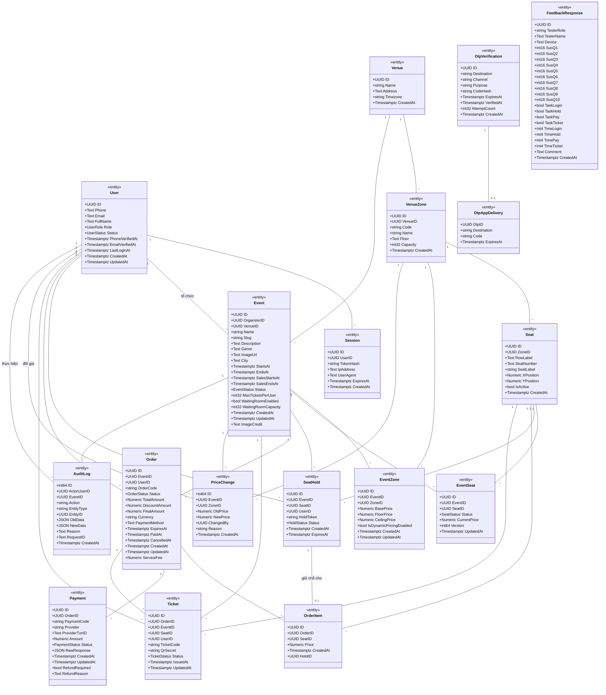
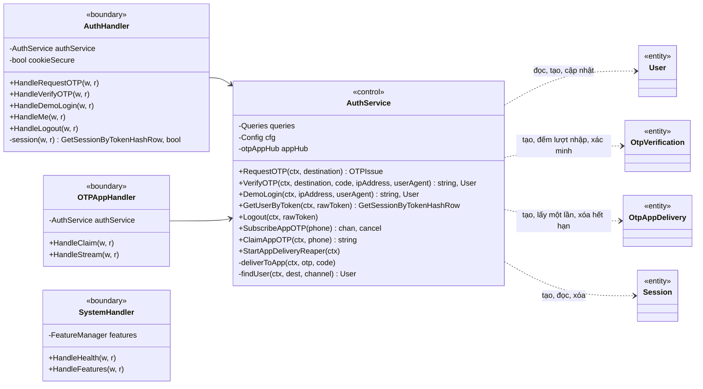
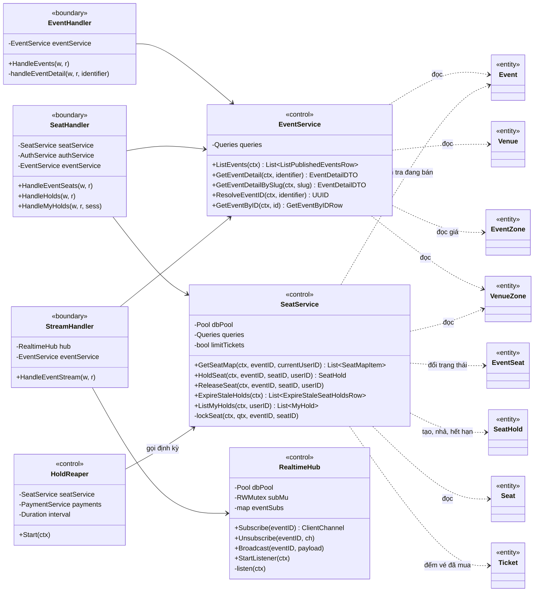
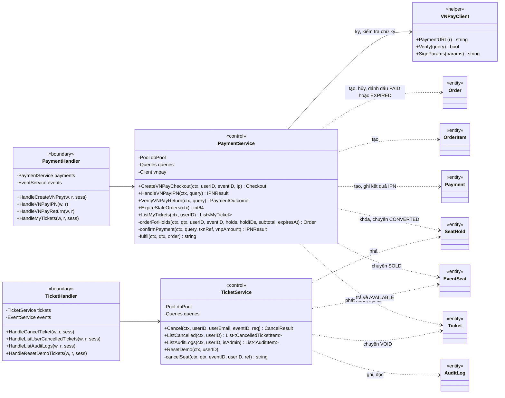
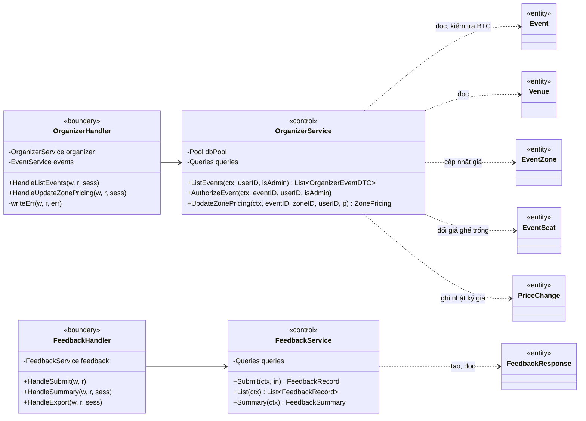

# Sơ đồ lớp theo BCE (Boundary — Control — Entity)

Sơ đồ lớp của backend V2, làm theo phương pháp của bài B05 (Object-Oriented Design).
Mọi tên lớp và tên phương thức trong tài liệu này lấy đúng từ `backend/internal/`.
Phần "dự kiến" ở mục 8 là lớp chưa có trong code.

## 1. Phương pháp

Bài B05 đi từ dữ liệu đến lớp theo bốn bước:

| Bước | Việc | Kết quả | Mục |
|---|---|---|---|
| 1 | Lấy bảng của [ERD](erd.md), mỗi bảng thành một lớp Entity | Bảng ánh xạ Entity với bảng | 2 |
| 2 | Ghi thuộc tính của Entity, lấy từ cột của bảng | Sơ đồ thuộc tính | 3 |
| 3 | Thêm lớp Boundary (nhận yêu cầu) và Control (xử lý nghiệp vụ) cho từng use case | Sơ đồ BCE | 4 |
| 4 | Rút phương thức của Boundary và Control từ các [sơ đồ tuần tự](sequences/) | Bảng phương thức theo sơ đồ tuần tự | 5 |

Phân lớp trong code:

- **Boundary** — `internal/httpapi`.
  Handler nhận request HTTP và SSE, đọc JSON, lấy phiên đăng nhập và trả JSON.
  Handler không gọi truy vấn của `store`, mọi truy cập dữ liệu đều qua service.
  Handler chỉ dùng kiểu của `store`, ví dụ `GetSessionByTokenHashRow` và `UserRole`.
- **Control** — `internal/service`.
  Service giữ quy tắc nghiệp vụ và mở giao dịch với PostgreSQL.
  Khi ghế đổi trạng thái, service gửi `pg_notify` trong cùng giao dịch.
  `RealtimeHub` và `HoldReaper` chạy nền từ lúc api khởi động.
- **Entity** — `internal/store`.
  `sqlc` sinh struct từ schema trong `migrations/` và sinh hàm truy vấn từ `queries/`.
  Mỗi struct ứng với một bảng trong [ERD](erd.md).

Gói `internal/vnpay` (`vnpay.Client`) là một lớp hỗ trợ của `PaymentService`: ký tham số và kiểm tra chữ ký VNPay.
Gói này không thuộc BCE vì không có dữ liệu riêng.

Middleware trong `httpapi` không vẽ thành lớp, vì chúng là hàm bọc handler:
- `RequireFeature` trả `404 feature_disabled` khi cờ tắt;
- `RequireRole` chặn người dùng không đúng vai trò;
- `RateLimiter` giới hạn số lần gọi theo IP (API OTP, API của app OTP, `POST /api/feedback`);
- `LoggingMiddleware`, `CORSMiddleware`.

Quy ước ghi trong sơ đồ:
- Kiểu trả về bỏ `error` và bỏ dấu con trỏ.
  Ví dụ `HoldSeat` trả `(*store.SeatHold, error)`, sơ đồ ghi `SeatHold`.
- `List~T~` là slice `[]T` của Go.
- Kiểu cột bỏ tiền tố `pgtype.`.
  `Text` là chuỗi cho phép `NULL`.
  `Numeric` là kiểu `numeric` của PostgreSQL, dùng cho tiền và tọa độ ghế.
  `JSON` là cột `jsonb`.
- Handler có chữ ký `(w, r)` hoặc `(w, r, sess)`. `sess` là phiên do `RequireRole` truyền vào.

## 2. Bước 1: từ bảng sang Entity

`internal/store/models.go` có 25 struct cho 25 bảng: 24 bảng của ERD và bảng `feedback_responses`.
Cột "Control dùng" cho biết service nào đang đọc hoặc ghi bảng đó.
Dấu "—" nghĩa là chưa có code dùng, bảng chờ tính năng của cờ tương ứng.

| Entity | Bảng | Control dùng | Cờ |
|---|---|---|---|
| `User` | `users` | `AuthService` | `otp_login` |
| `OtpVerification` | `otp_verifications` | `AuthService` | `otp_login` |
| `OtpAppDelivery` | `otp_app_deliveries` | `AuthService` | `otp_login`, `OTP_APP_DELIVERY` |
| `Session` | `sessions` | `AuthService` | `otp_login` |
| `Venue` | `venues` | `EventService`, `OrganizerService` | `organizer_console` |
| `VenueZone` | `venue_zones` | `EventService`, `SeatService` | `organizer_console` |
| `Seat` | `seats` | `SeatService`, `TicketService` | `seat_map_realtime` |
| `Event` | `events` | `EventService`, `SeatService`, `OrganizerService`, `PaymentService`, `TicketService` | FR-02, luôn bật |
| `EventZone` | `event_zones` | `EventService`, `OrganizerService` | `zone_pricing` |
| `EventSeat` | `event_seats` | `SeatService`, `OrganizerService`, `PaymentService`, `TicketService` | `seat_map_realtime`, `seat_hold`, `payments` |
| `SeatHold` | `seat_holds` | `SeatService`, `PaymentService`, `TicketService` | `seat_hold`, `payments` |
| `Order` | `orders` | `PaymentService` | `payments` |
| `OrderItem` | `order_items` | `PaymentService` | `payments` |
| `Payment` | `payments` | `PaymentService` | `payments` |
| `Ticket` | `tickets` | `PaymentService` (phát vé, liệt kê), `TicketService` (hủy), `SeatService` (đếm) | `payments`, `ticket_limit`, `rotating_qr` |
| `PriceChange` | `price_changes` | `OrganizerService` | `zone_pricing`, `price_log` |
| `AuditLog` | `audit_logs` | `TicketService` | `organizer_console`, `payments` |
| `FeedbackResponse` | `feedback_responses` | `FeedbackService` | `user_testing` |
| `QueueEntry` | `queue_entries` | — | `waiting_room` |
| `GateDevice` | `gate_devices` | — | `gate_checkin` |
| `Checkin` | `checkins` | — | `gate_checkin`, `offline_checkin` |
| `SalesSnapshot` | `sales_snapshots` | — | `ceo_dashboard` |
| `PriceSuggestion` | `price_suggestions` | — (định giá động: [`dynamic-pricing.md`](dynamic-pricing.md)) | `dynamic_pricing` |
| `Promotion` | `promotions` | — | `promo_suggestions` |
| `PromotionUsage` | `promotion_usages` | — | `promo_suggestions` |

Bảng `price_changes` luôn được ghi khi giá cơ bản đổi.
Cờ `price_log` chỉ ẩn hoặc hiện trang xem nhật ký.

Các bảng và lớp thêm bởi migration `00007` (định giá động) và `00008` (trợ lý AI) nằm trong [`dynamic-pricing.md`](dynamic-pricing.md) và [`assistant.md`](assistant.md).

## 3. Bước 2: thuộc tính của Entity

Thuộc tính lấy đúng tên trường trong `internal/store/models.go`, theo thứ tự cột của bảng.
Sơ đồ chỉ vẽ các Entity đã có code dùng.

`OtpVerification` không có khóa ngoại tới `User`, vì mã OTP được gửi trước khi có tài khoản.
`FeedbackResponse` đứng riêng, không có quan hệ với Entity nào, để người thử gửi ẩn danh được.

Các kiểu enum lấy từ `models.go`:

| Kiểu | Giá trị |
|---|---|
| `UserRole` | `CUSTOMER`, `ORGANIZER`, `CEO`, `GATE_STAFF`, `ADMIN` |
| `UserStatus` | `PENDING`, `ACTIVE`, `LOCKED`, `DISABLED` |
| `EventStatus` | `DRAFT`, `ON_SALE`, `SOLD_OUT`, `PAUSED`, `ENDED`, `CANCELLED` |
| `SeatStatus` | `AVAILABLE`, `HELD`, `SOLD`, `BLOCKED` |
| `HoldStatus` | `ACTIVE`, `EXPIRED`, `RELEASED`, `CONVERTED` |
| `OrderStatus` | `PENDING`, `PAID`, `EXPIRED`, `CANCELLED`, `REFUNDED` |
| `PaymentStatus` | `INITIATED`, `PROCESSING`, `SUCCESS`, `FAILED`, `REFUNDED` |
| `TicketStatus` | `ISSUED`, `ACTIVE`, `USED`, `REVOKED`, `VOID` |

## 4. Bước 3: sơ đồ BCE

Sơ đồ chia theo nhóm chức năng để dễ đọc.
Mỗi nhóm có đủ ba lớp: Boundary gọi Control, Control đọc và ghi Entity.
Thuộc tính của Entity xem ở mục 3.

### 4.1 Xác thực và OTP (UC-01)

### 4.2 Sự kiện, sơ đồ ghế và giữ ghế (UC-02, UC-04)

`SeatHandler` gọi `AuthService.GetUserByToken` để lấy người dùng, rồi gọi `SeatService`.

### 4.3 Thanh toán, phát vé và hủy vé (UC-05, UC-06)

`HoldReaper` (mục 4.2) cũng gọi `PaymentService.ExpireStaleOrders` mỗi 5 giây.

### 4.4 Ban Tổ chức và khảo sát (UC-07, hỗ trợ kiểm thử)

`OrganizerHandler` dùng `RequireRole`, nên chỉ `ORGANIZER` và `ADMIN` vào được.
Trước khi đổi giá, handler gọi `OrganizerService.AuthorizeEvent` để kiểm tra người gọi là BTC của sự kiện.
`FeedbackHandler.HandleSubmit` không cần đăng nhập. Hai hàm còn lại cũng chỉ cho `ORGANIZER` và `ADMIN`.
`FeedbackService.Summary` gọi hàm thuần `Summarize` để tính điểm SUS (công thức chuẩn: câu lẻ lấy điểm trừ 1, câu chẵn lấy 5 trừ điểm, tổng nhân 2,5).

## 5. Bước 4: phương thức rút ra từ sơ đồ tuần tự

Mỗi dòng là một thông điệp trong sơ đồ tuần tự và phương thức tương ứng của lớp nhận thông điệp.
Tên đối tượng trong sơ đồ tuần tự trùng tên lớp ở trên.

| Sơ đồ tuần tự | Thông điệp | Lớp nhận | Phương thức |
|---|---|---|---|
| [`otp-login.md`](sequences/otp-login.md) | Xin mã OTP | `AuthHandler` | `HandleRequestOTP` |
| | Cấp mã, kiểm tra giới hạn, chọn kênh giao | `AuthService` | `RequestOTP` |
| | Xác thực mã, tạo tài khoản, mở phiên | `AuthService` | `VerifyOTP` |
| | Kiểm tra phiên | `AuthService` | `GetUserByToken` |
| | Đăng xuất | `AuthService` | `Logout` |
| [`otp-app.md`](sequences/otp-app.md) | App mở luồng báo hiệu | `OTPAppHandler` | `HandleStream` |
| | Đăng ký nhận báo hiệu | `AuthService` | `SubscribeAppOTP` |
| | App lấy mã | `OTPAppHandler` | `HandleClaim` |
| | Giao mã một lần | `AuthService` | `ClaimAppOTP` |
| | Lưu mã chờ app lấy | `AuthService` | `deliverToApp` |
| | Xóa mã hết hạn | `AuthService` | `StartAppDeliveryReaper` |
| [`hold.md`](sequences/hold.md) | Giữ ghế | `SeatHandler` | `HandleHolds` |
| | Giữ ghế trong một giao dịch | `SeatService` | `HoldSeat`, `lockSeat` |
| | Khách nhả ghế | `SeatService` | `ReleaseSeat` |
| | Nhả ghế hết hạn | `HoldReaper`, `SeatService` | `Start`, `ExpireStaleHolds` |
| | Nhận `NOTIFY`, chuyển cho trình duyệt | `RealtimeHub`, `StreamHandler` | `listen`, `Broadcast`, `HandleEventStream` |
| [`double-booking.md`](sequences/double-booking.md) | Hai khán giả cùng giữ một ghế | `SeatService` | `HoldSeat`, `lockSeat` |
| [`payment.md`](sequences/payment.md) | Tạo thanh toán | `PaymentHandler` | `HandleCreateVNPay` |
| | Tính tiền, tạo hoặc dùng lại đơn, tạo giao dịch | `PaymentService` | `CreateVNPayCheckout`, `orderForHolds` |
| | Ký URL thanh toán | `VNPayClient` | `PaymentURL` |
| | VNPay gọi IPN | `PaymentHandler` | `HandleVNPayIPN` |
| | Kiểm tra chữ ký, số tiền, ghi kết quả | `PaymentService` | `HandleVNPayIPN`, `confirmPayment` |
| | Bán ghế, phát vé hoặc đánh dấu cần hoàn tiền | `PaymentService` | `fulfil` |
| | Trang return đọc kết quả | `PaymentHandler` | `HandleVNPayReturn` |
| | | `PaymentService` | `VerifyVNPayReturn` |
| | Xem vé | `PaymentHandler` | `HandleMyTickets` |
| | | `PaymentService` | `ListMyTickets` |
| | Đơn quá hạn | `PaymentService` | `ExpireStaleOrders` |

Sơ đồ tuần tự của hủy vé, đặt giá khu vực và khảo sát chưa có file riêng.
Phương thức của các luồng đó lấy từ code: `TicketService.Cancel`, `OrganizerService.UpdateZonePricing`, `FeedbackService.Submit`.

## 6. Cách các lớp phối hợp

- `SeatService` không gọi `RealtimeHub` trực tiếp.
  Service gửi `pg_notify` lên kênh `event_seats_channel`.
  `RealtimeHub` giữ một kết nối `LISTEN` riêng trên kênh này và chuyển tin tới các `StreamHandler` đang mở.
  `PaymentService` và `TicketService` cũng gửi `pg_notify` theo cách này (`seat_sold`, `seat_released`).
- `HoldReaper` gọi `SeatService.ExpireStaleHolds` và `PaymentService.ExpireStaleOrders` mỗi 5 giây.
- `SeatService` chỉ đếm vé khi bật cờ `ticket_limit`.
  Khi đó, `HoldSeat` khóa cặp (người dùng, sự kiện) bằng `pg_advisory_xact_lock` rồi đếm lượt giữ còn hạn cộng vé chưa `VOID`.
- `HoldSeat` không dùng khóa advisory để chống bán trùng.
  Ghế chỉ chuyển sang `HELD` khi đang `AVAILABLE`.
  Partial unique index `uq_seat_holds_active` trên `seat_holds (event_id, seat_id)` là lớp chặn thứ hai.
- `PaymentService.CreateVNPayCheckout` và `TicketService.Cancel` dùng cùng khóa advisory (người dùng, sự kiện) với `HoldSeat`, nên một người không thể vừa giữ, vừa hủy, vừa thanh toán cùng lúc.
- `PaymentService.HandleVNPayIPN` là nơi duy nhất chuyển một giao dịch thành vé.
  Tính lũy đẳng đến từ khóa dòng `payments`, kiểm tra trạng thái và chỉ mục duy nhất `uq_payment_provider_txn`.

## 7. Khác biệt so với thiết kế

- Thiết kế đặt `OrderHandler` và `OrderService` riêng.
  Code gộp tạo đơn và tạo giao dịch vào `PaymentService.CreateVNPayCheckout` để không để lại đơn mồ côi (xem [`payments.md`](payments.md) mục 9).
- `TicketService` chưa có sinh QR, và `TicketHandler` chưa có `GET /api/tickets/{id}/qr`.

## 8. Lớp dự kiến (chưa làm)

Các lớp dưới đây chưa có trong code.
Tên lớp là tên dự kiến, có thể đổi khi viết code.
Endpoint lấy từ mục 7 của [thiết kế](design/README.md).
Định giá động và trợ lý AI do nhóm khác làm, xem [`dynamic-pricing.md`](dynamic-pricing.md) và [`assistant.md`](assistant.md).

| Lớp dự kiến | Cờ | Endpoint, tác vụ nền | Bảng |
|---|---|---|---|
| Mở rộng `OrganizerHandler`, `OrganizerService` | `organizer_console` | `/api/organizer/venues/…`, `/api/organizer/events/…` | `venues`, `venue_zones`, `seats`, `events`, `event_seats` |
| `QueueHandler`, `QueueService` | `waiting_room` | `POST /api/events/{id}/queue`, `GET /api/events/{id}/queue/me`; tác vụ cho người kế tiếp vào | `queue_entries` |
| Middleware kiểm tra Turnstile | `bot_check` | Bọc `POST /api/auth/otp/request` | — |
| Mở rộng `PaymentService` | `reconciliation` | Truy vấn giao dịch khi IPN không tới, hoàn tiền | `payments`, `orders` |
| Mở rộng `TicketHandler`, `TicketService` | `rotating_qr`, `ticket_email` | `GET /api/tickets/{id}/qr`; gửi vé qua SMTP | `tickets` |
| Lớp gửi OTP qua SMTP | `otp_login` | Dùng trong `AuthService` | — |
| `GateHandler`, `GateCheckinService` | `gate_checkin`, `offline_checkin` | `GET /api/gate/events/{id}/manifest`, `POST /api/gate/checkins`, `POST /api/gate/sync` | `tickets`, `checkins`, `gate_devices` |
| `DashboardHandler`, `DashboardService` | `ceo_dashboard`, `reports_export` | `GET /api/dashboard/stream`, `GET /api/reports/sales.csv`, `GET /api/reports/sales.xlsx`; tác vụ chụp số liệu | `sales_snapshots` |
| Chưa thiết kế | `promo_suggestions` | Chưa có endpoint trong thiết kế | `promotions`, `promotion_usages` |
| Chưa thiết kế | `price_log` | Chưa có endpoint trong thiết kế | `price_changes` |
