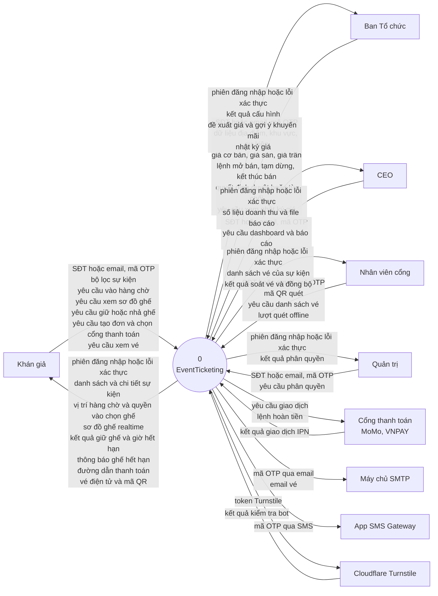
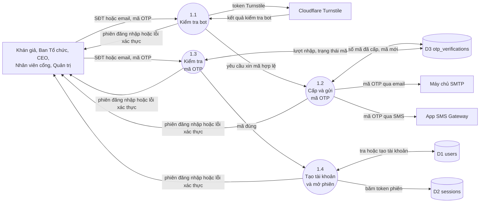
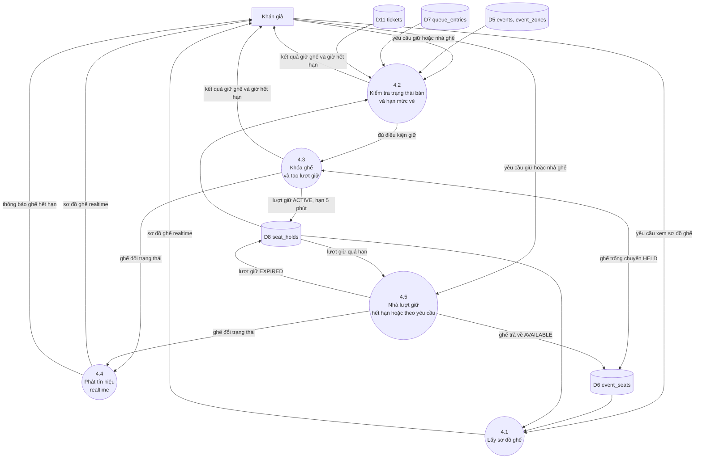
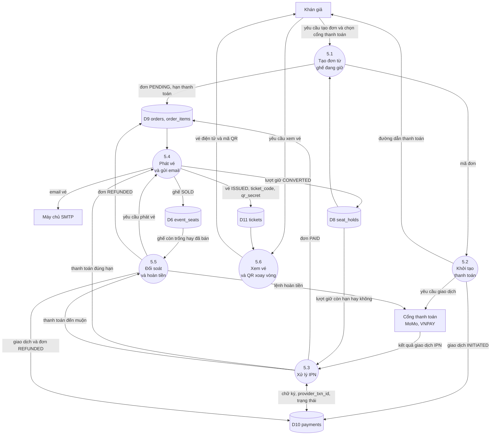

# Sơ đồ luồng dữ liệu (DFD)

DFD của **EventTicketing** gồm bốn phần:
1. Mức ngữ cảnh.
2. Mức 0.
3. Mức 1 của ba tiến trình: 1.0 (xác thực), 4.0 (ghế và giữ chỗ), 5.0 (đơn hàng và thanh toán).
4. Bảng ánh xạ kho dữ liệu sang bảng PostgreSQL.

Tác nhân và luồng lấy từ mục 2 và mục 4 của [`design/README.md`](design/README.md).
Kho dữ liệu là các bảng trong [`00001_initial_schema.sql`](../backend/internal/store/migrations/00001_initial_schema.sql), xem [`erd.md`](erd.md).
Hệ thống chỉ dùng PostgreSQL, không có Redis.

DFD mô tả hệ thống thiết kế cho cả năm Sprint.
Tiến trình nào chưa có code thì ghi trong cột "Sprint" của mục 5.

Quy ước:
- Hình tròn là tiến trình, hình trụ là kho dữ liệu, hình chữ nhật là tác nhân ngoài.
- Một luồng giữ nguyên tên ở mọi mức.
- Mũi tên hai chiều (`<-->`) là tiến trình vừa đọc vừa ghi kho.
- Mũi tên một chiều vào kho là chỉ ghi, ra khỏi kho là chỉ đọc.
- Bộ hẹn giờ trong api (`HoldReaper`, tính giá, chụp số liệu) là một phần của hệ thống, không phải tác nhân ngoài.

---

## 1. Mức ngữ cảnh

Hệ thống là một tiến trình duy nhất.
Mỗi mũi tên gộp các luồng cùng hướng giữa hệ thống và một tác nhân.
Tên từng luồng nằm ở mục 2 và bảng cân bằng ở mục 4.

---

## 2. Mức 0

Hệ thống tách thành chín tiến trình.
Nhãn của các luồng giữa tác nhân và tiến trình trùng với nhãn ở mức ngữ cảnh.
Mọi tiến trình đều tra phiên đăng nhập trong `sessions` (D2).
Các đường tra phiên đó không vẽ để sơ đồ khỏi rối.

```mermaid
flowchart TB
    KG["Khán giả"]
    BTC["Ban Tổ chức"]
    CEO["CEO"]
    NV["Nhân viên cổng"]
    QT["Quản trị"]
    PAY["Cổng thanh toán<br/>MoMo, VNPAY"]
    SMTP["Máy chủ SMTP"]
    SMS["App SMS Gateway"]
    TS["Cloudflare Turnstile"]

    P1(("1.0<br/>Xác thực OTP<br/>và phiên"))
    P2(("2.0<br/>Sự kiện, địa điểm<br/>và giá khu vực"))
    P3(("3.0<br/>Phòng chờ ảo"))
    P4(("4.0<br/>Sơ đồ ghế<br/>và giữ chỗ"))
    P5(("5.0<br/>Đơn hàng, thanh toán,<br/>vé và đối soát"))
    P6(("6.0<br/>Soát vé<br/>tại cổng"))
    P7(("7.0<br/>Định giá động<br/>và gợi ý khuyến mãi"))
    P8(("8.0<br/>Dashboard, báo cáo<br/>và nhật ký giá"))
    P9(("9.0<br/>Phân quyền"))

    D1[("D1 users")]
    D2[("D2 sessions")]
    D3[("D3 otp_verifications")]
    D4[("D4 venues, venue_zones, seats")]
    D5[("D5 events, event_zones")]
    D6[("D6 event_seats")]
    D7[("D7 queue_entries")]
    D8[("D8 seat_holds")]
    D9[("D9 orders, order_items")]
    D10[("D10 payments")]
    D11[("D11 tickets")]
    D12[("D12 gate_devices, checkins")]
    D13[("D13 price_suggestions")]
    D14[("D14 price_changes")]
    D15[("D15 promotions, promotion_usages")]
    D16[("D16 audit_logs")]
    D17[("D17 sales_snapshots")]

    %% 1.0
    KG & BTC & CEO & NV & QT -->|"SĐT hoặc email, mã OTP"| P1
    P1 -->|"phiên đăng nhập hoặc lỗi xác thực"| KG & BTC & CEO & NV & QT
    P1 -->|"token Turnstile"| TS
    TS -->|"kết quả kiểm tra bot"| P1
    P1 -->|"mã OTP qua email"| SMTP
    P1 -->|"mã OTP qua SMS"| SMS
    P1 <--> D1
    P1 <--> D3
    P1 --> D2

    %% 2.0
    KG -->|"bộ lọc sự kiện"| P2
    P2 -->|"danh sách và chi tiết sự kiện"| KG
    BTC -->|"dữ liệu địa điểm, khu vực, sự kiện"| P2
    BTC -->|"giá cơ bản, giá sàn, giá trần"| P2
    BTC -->|"lệnh mở bán, tạm dừng, kết thúc bán"| P2
    P2 -->|"kết quả cấu hình"| BTC
    P2 <--> D4
    P2 <--> D5
    P2 --> D6
    P2 --> D14
    P2 --> D16

    %% 3.0
    KG -->|"yêu cầu vào hàng chờ"| P3
    P3 -->|"vị trí hàng chờ và quyền vào chọn ghế"| KG
    D5 --> P3
    P3 <--> D7

    %% 4.0
    KG -->|"yêu cầu xem sơ đồ ghế"| P4
    KG -->|"yêu cầu giữ hoặc nhả ghế"| P4
    P4 -->|"sơ đồ ghế realtime"| KG
    P4 -->|"kết quả giữ ghế và giờ hết hạn"| KG
    P4 -->|"thông báo ghế hết hạn"| KG
    D5 --> P4
    D7 --> P4
    D11 --> P4
    P4 <--> D6
    P4 <--> D8

    %% 5.0
    KG -->|"yêu cầu tạo đơn và chọn cổng thanh toán"| P5
    KG -->|"yêu cầu xem vé"| P5
    P5 -->|"đường dẫn thanh toán"| KG
    P5 -->|"vé điện tử và mã QR"| KG
    P5 -->|"yêu cầu giao dịch"| PAY
    P5 -->|"lệnh hoàn tiền"| PAY
    PAY -->|"kết quả giao dịch IPN"| P5
    P5 -->|"email vé"| SMTP
    P5 <--> D6
    P5 <--> D8
    P5 <--> D9
    P5 <--> D10
    P5 <--> D11

    %% 6.0
    NV -->|"mã QR quét"| P6
    NV -->|"yêu cầu danh sách vé"| P6
    NV -->|"lượt quét offline"| P6
    P6 -->|"danh sách vé của sự kiện"| NV
    P6 -->|"kết quả soát vé và đồng bộ"| NV
    P6 <--> D11
    P6 <--> D12

    %% 7.0
    D5 --> P7
    D7 --> P7
    D8 --> P7
    D9 --> P7
    P7 <--> D6
    P7 <--> D13
    P7 --> D14
    P7 <--> D15
    P7 -->|"đề xuất giá và gợi ý khuyến mãi"| BTC
    BTC -->|"quyết định duyệt hoặc từ chối"| P7

    %% 8.0
    CEO -->|"yêu cầu dashboard và báo cáo"| P8
    P8 -->|"số liệu doanh thu và file báo cáo"| CEO
    BTC -->|"yêu cầu xem nhật ký giá"| P8
    P8 -->|"nhật ký giá"| BTC
    D9 --> P8
    D14 --> P8
    P8 <--> D17

    %% 9.0
    QT -->|"yêu cầu phân quyền"| P9
    P9 -->|"kết quả phân quyền"| QT
    P9 <--> D1
    P9 --> D16
```

---

## 3. Mức 1

### 3.1 Tiến trình 1.0: Xác thực OTP và phiên (FR-01, FR-04, FR-10)

Mọi vai trò đăng nhập bằng cùng một luồng.
Lần đầu đăng nhập, hệ thống tạo tài khoản `CUSTOMER`.
Kiểm tra Turnstile thuộc Sprint 3, mức 1 vẽ sẵn bước này.

### 3.2 Tiến trình 4.0: Sơ đồ ghế và giữ chỗ (FR-03, FR-05, FR-06, FR-07, FR-11)

Giữ ghế đi qua `POST /api/holds`.
Bước kiểm tra hạn mức (4.2) chỉ chạy khi cờ `ticket_limit` bật.
Hạn mức lấy từ `events.max_tickets_per_user`, mặc định 4.
Tiến trình 4.5 nhả ghế khi khán giả bấm bỏ chọn (`DELETE /api/holds/{seatId}`), và khi bộ hẹn giờ `HoldReaper` thấy lượt giữ quá hạn.

### 3.3 Tiến trình 5.0: Đơn hàng, thanh toán, vé và đối soát (FR-12, FR-13, FR-14, FR-15)

Tiến trình 5.3 kiểm tra chữ ký của mọi IPN.
Một `provider_txn_id` chỉ được xử lý một lần.
Tiền về sau khi lượt giữ đã hết hạn thì chuyển sang 5.5:
- ghế còn trống: phát vé;
- ghế đã bán cho người khác: hoàn tiền.

---

## 4. Cân bằng giữa các mức

Luồng giữa hệ thống và tác nhân ở mức ngữ cảnh khớp với mức 0 như sau.

| Tác nhân | Luồng vào hệ thống | Tiến trình nhận | Luồng ra khỏi hệ thống | Tiến trình gửi |
|---|---|---|---|---|
| Mọi người dùng | SĐT hoặc email, mã OTP | 1.0 | phiên đăng nhập hoặc lỗi xác thực | 1.0 |
| Khán giả | bộ lọc sự kiện | 2.0 | danh sách và chi tiết sự kiện | 2.0 |
| | yêu cầu vào hàng chờ | 3.0 | vị trí hàng chờ và quyền vào chọn ghế | 3.0 |
| | yêu cầu xem sơ đồ ghế, yêu cầu giữ hoặc nhả ghế | 4.0 | sơ đồ ghế realtime, kết quả giữ ghế và giờ hết hạn, thông báo ghế hết hạn | 4.0 |
| | yêu cầu tạo đơn và chọn cổng thanh toán, yêu cầu xem vé | 5.0 | đường dẫn thanh toán, vé điện tử và mã QR | 5.0 |
| Ban Tổ chức | dữ liệu địa điểm, khu vực, sự kiện; giá cơ bản, giá sàn, giá trần; lệnh mở bán, tạm dừng, kết thúc bán | 2.0 | kết quả cấu hình | 2.0 |
| | quyết định duyệt hoặc từ chối | 7.0 | đề xuất giá và gợi ý khuyến mãi | 7.0 |
| | yêu cầu xem nhật ký giá | 8.0 | nhật ký giá | 8.0 |
| CEO | yêu cầu dashboard và báo cáo | 8.0 | số liệu doanh thu và file báo cáo | 8.0 |
| Nhân viên cổng | mã QR quét, yêu cầu danh sách vé, lượt quét offline | 6.0 | danh sách vé của sự kiện, kết quả soát vé và đồng bộ | 6.0 |
| Quản trị | yêu cầu phân quyền | 9.0 | kết quả phân quyền | 9.0 |
| Cổng thanh toán | kết quả giao dịch IPN | 5.0 | yêu cầu giao dịch, lệnh hoàn tiền | 5.0 |
| Máy chủ SMTP | không có | | mã OTP qua email | 1.0 |
| | | | email vé | 5.0 |
| App SMS Gateway | không có | | mã OTP qua SMS | 1.0 |
| Cloudflare Turnstile | kết quả kiểm tra bot | 1.0 | token Turnstile | 1.0 |

Mức 1 của 1.0, 4.0 và 5.0 giữ nguyên các luồng ra vào tiến trình cha ở mức 0, và chỉ đọc hoặc ghi đúng các kho mà tiến trình cha nối tới:

| Tiến trình | Kho ở mức 0 | Kho ở mức 1 |
|---|---|---|
| 1.0 | D1, D2, D3 | D1 (1.4), D2 (1.4), D3 (1.2, 1.3) |
| 4.0 | D5, D6, D7, D8, D11 | D5, D7, D11 (4.2), D6 (4.1, 4.3, 4.5), D8 (4.1, 4.2, 4.3, 4.5) |
| 5.0 | D6, D8, D9, D10, D11 | D6 (5.4, 5.5), D8 (5.1, 5.3, 5.4), D9 (5.1, 5.3, 5.4, 5.5), D10 (5.2, 5.3, 5.5), D11 (5.4, 5.6) |

---

## 5. Kho dữ liệu và bảng PostgreSQL

Mỗi kho ứng với một hoặc vài bảng thật.
Tên bảng viết đúng như trong migration.
17 kho phủ 23 bảng, bảng nào cũng thuộc một kho.

| Kho | Bảng PostgreSQL | Tiến trình dùng | Sprint |
|---|---|---|:---:|
| D1 | `users` | 1.0, 9.0 | 2 |
| D2 | `sessions` | 1.0 | 2 |
| D3 | `otp_verifications` | 1.0 | 2 |
| D4 | `venues`, `venue_zones`, `seats` | 2.0 | 2 |
| D5 | `events`, `event_zones` | 2.0, 3.0, 4.0, 7.0 | 2 |
| D6 | `event_seats` | 2.0, 4.0, 5.0, 7.0 | 2 |
| D7 | `queue_entries` | 3.0, 4.0, 7.0 | 3 |
| D8 | `seat_holds` | 4.0, 5.0, 7.0 | 2 |
| D9 | `orders`, `order_items` | 5.0, 7.0, 8.0 | 4 |
| D10 | `payments` | 5.0 | 4 |
| D11 | `tickets` | 4.0, 5.0, 6.0 | 4 |
| D12 | `gate_devices`, `checkins` | 6.0 | 5 |
| D13 | `price_suggestions` | 7.0 | 5 |
| D14 | `price_changes` | 2.0, 7.0, 8.0 | 2 |
| D15 | `promotions`, `promotion_usages` | 7.0 | 5 |
| D16 | `audit_logs` | 2.0, 9.0 | 4 |
| D17 | `sales_snapshots` | 8.0 | 5 |

Ghi chú:
- Cột Sprint là Sprint đầu tiên có tiến trình ghi vào kho. Bảng nào cũng đã có trong migration từ đầu.
- Code Sprint 2 chưa ghi `audit_logs`. Bảng này nhận nhật ký giao dịch và thao tác phân quyền từ Sprint 4.
- `price_changes` và `audit_logs` có trigger chặn sửa và xóa (NFR-12), nên tiến trình chỉ thêm dòng mới.
- Phòng chờ dùng bảng `queue_entries`, không dùng Redis. Bảng này cũng là nguồn cho tiến trình 4.2 kiểm tra người dùng đã được vào mua chưa.
- Realtime dùng `LISTEN/NOTIFY` của PostgreSQL, không có kho riêng.

## 6. Tiến trình theo Sprint

| Tiến trình | FR liên quan | Sprint | Cờ |
|---|---|:---:|---|
| 1.0 | FR-01, FR-04, FR-10 | 2, 3 | `otp_login`, `bot_check` |
| 2.0 | FR-02, FR-08 | 2 | luôn bật, `zone_pricing`, `organizer_console` |
| 3.0 | FR-09 | 3 | `waiting_room` |
| 4.0 | FR-03, FR-05, FR-06, FR-07, FR-11 | 2, 3 | `seat_map_realtime`, `seat_hold`, `ticket_limit` |
| 5.0 | FR-12, FR-13, FR-14, FR-15 | 3, 4 | `rotating_qr`, `payments`, `ticket_email`, `reconciliation` |
| 6.0 | FR-16, FR-17, FR-18 | 5 | `gate_checkin`, `offline_checkin` |
| 7.0 | FR-20, FR-22, FR-23 | 5 | `price_log`, `dynamic_pricing`, `promo_suggestions` |
| 8.0 | FR-19, FR-20, FR-21 | 5 | `ceo_dashboard`, `price_log`, `reports_export` |
| 9.0 | phân quyền theo `users.role` | 2 | luôn bật |
