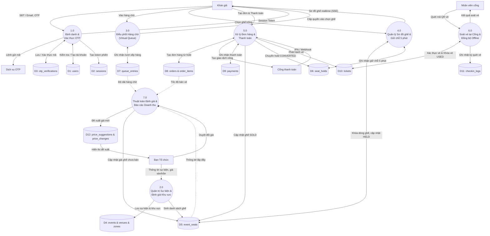
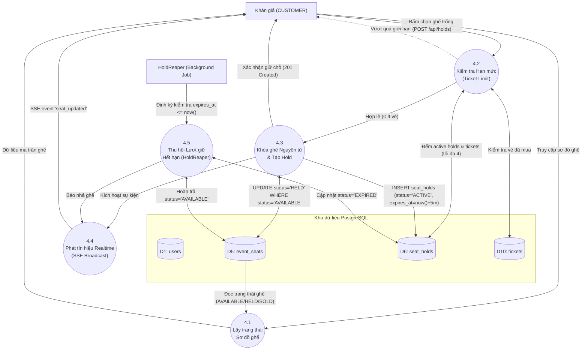
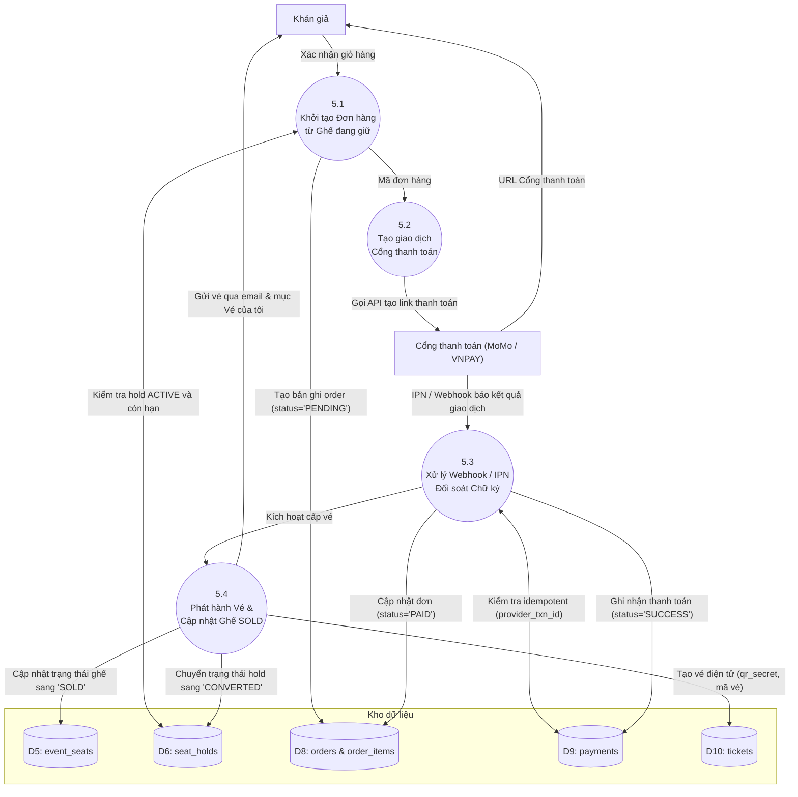

# Sơ đồ luồng dữ liệu (Data Flow Diagram - DFD)

Tài liệu đặc tả Sơ đồ luồng dữ liệu (DFD) cho hệ thống **EventTicketing**, bao gồm:
1. **DFD Mức ngữ cảnh (Context Diagram / Level 0)**
2. **DFD Mức 0 (Diagram 0)**
3. **DFD Mức 1 (Diagram 1)** cho hai phân hệ cốt lõi: Quản lý Giữ chỗ / Chống bán trùng và Quản lý Thanh toán / Phát hành vé.
4. **Bảng ánh xạ kho dữ liệu (Data Stores)** khớp 100% với các bảng cơ sở dữ liệu PostgreSQL đã chuẩn hóa trong ERD ([`docs/erd.md`](erd.md)).

---

## 1. DFD Mức ngữ cảnh (Context Diagram)

Sơ đồ thể hiện ranh giới hệ thống **EventTicketing**, tương tác luồng dữ liệu hai chiều với 5 tác nhân người dùng nội bộ và 3 hệ sinh thái bên ngoài (theo Mục 2 của [`docs/design/README.md`](design/README.md)).

```mermaid
flowchart TD
    subgraph ExternalEntities["Tác nhân ngoài (External Entities)"]
        Customer["Khán giả (CUSTOMER)"]
        Organizer["Ban Tổ chức (ORGANIZER)"]
        CEO["Giám đốc điều hành (CEO)"]
        GateStaff["Nhân viên cổng (GATE_STAFF)"]
        Admin["Quản trị viên (ADMIN)"]
        PaymentGateway["Cổng thanh toán (MoMo / VNPAY)"]
        OTPService["Dịch vụ gửi OTP (SMTP / SMS Gateway)"]
        Turnstile["Cloudflare Turnstile (Chống Bot)"]
    end

    System(("0.0<br/>Hệ thống Quản lý Bán vé Sự kiện<br/>(EventTicketing)"))

    %% Customer flows
    Customer -->|"Yêu cầu OTP, token Captcha, thông tin tài khoản"| System
    Customer -->|"Lệnh xếp hàng, yêu cầu giữ ghế, yêu cầu tạo đơn"| System
    Customer -->|"Yêu cầu xem vé, mã QR động"| System
    System -->|"Mã OTP xác thực, vị trí hàng chờ, sơ đồ ghế realtime"| System
    System -->|"Xác nhận giữ chỗ (5 phút), link thanh toán, vé điện tử"| Customer

    %% Organizer flows
    Organizer -->|"Thông tin địa điểm, khu vực, cấu hình giá sàn/trần"| System
    Organizer -->|"Quyết định duyệt / từ chối đề xuất giá động"| System
    System -->|"Báo cáo tình trạng bán, đề xuất giá động từ thuật toán"| Organizer

    %% CEO flows
    CEO -->|"Yêu cầu xem dashboard doanh thu, bộ lọc báo cáo"| System
    System -->|"Chỉ số doanh thu realtime, tỷ lệ lấp đầy, file báo cáo (CSV/XLSX)"| CEO

    %% GateStaff flows
    GateStaff -->|"Mã QR quét tại cổng, dữ liệu check-in offline đồng bộ"| System
    System -->|"Kết quả xác thực vé (Hợp lệ, Đã dùng, Không hợp lệ)"| GateStaff

    %% Admin flows
    Admin -->|"Phân quyền tài khoản, cấu hình hệ thống"| System
    System -->|"Nhật ký kiểm toán (Audit logs)"| Admin

    %% External Systems
    System -->|"Yêu cầu gửi OTP (SĐT / Email)"| OTPService
    OTPService -->|"Trạng thái gửi tin (Thành công / Lỗi)"| System

    System -->|"Token Turnstile cần xác thực"| Turnstile
    Turnstile -->|"Kết quả đánh giá Bot (Pass / Fail)"| System

    System -->|"Yêu cầu khởi tạo giao dịch thanh toán"| PaymentGateway
    PaymentGateway -->|"Thông báo kết quả giao dịch (Webhook / IPN)"| System
```

---

## 2. DFD Mức 0 (Diagram 0)

Phân rã hệ thống thành 6 tiến trình nghiệp vụ chính và ánh xạ các luồng dữ liệu vào 14 kho dữ liệu (Data Stores) tương ứng các bảng PostgreSQL.

---

## 3. DFD Mức 1: Phân hệ Quản lý Sơ đồ ghế & Giữ chỗ 5 phút (Process 4.0)

Phân hệ xử lý giữ chỗ có điều kiện nguyên tử, quản lý thời gian đếm ngược và chống bán trùng ghế (`FR-06`, `FR-07`, `FR-11`).

---

## 4. DFD Mức 1: Phân hệ Xử lý Đơn hàng & Thanh toán (Process 5.0)

Phân hệ xử lý tạo đơn hàng, đối soát IPN đa kênh và phát hành vé an toàn (`FR-13`, `FR-14`, `FR-15`).

---

## 5. Bảng danh mục Kho dữ liệu (Data Stores Mapping)

Tất cả các kho dữ liệu trên sơ đồ DFD đều khớp chính xác với các bảng trong cơ sở dữ liệu PostgreSQL của hệ thống:

| Ký hiệu kho | Tên kho dữ liệu | Bảng PostgreSQL tương ứng | Mục đích lưu trữ chính |
|---|---|---|---|
| **D1** | Tài khoản & Khách hàng | `users` | Hồ sơ người dùng, số điện thoại, email, vai trò (`role`) |
| **D2** | Phiên đăng nhập | `sessions` | Quản lý token xác thực máy chủ, thời hạn phiên |
| **D3** | Xác thực OTP | `otp_verifications` | Mã băm OTP, đích đến (SĐT/Email), số lần thử |
| **D4** | Sự kiện & Khu vực | `events`, `venues`, `zones` | Thông tin sự kiện, địa điểm biểu diễn, cấu hình giá sàn/trần |
| **D5** | Trạng thái Ghế | `event_seats` | Tình trạng ghế (`AVAILABLE`, `HELD`, `SOLD`) trong từng sự kiện |
| **D6** | Nhật ký Giữ chỗ | `seat_holds` | Lịch sử giữ ghế 5 phút, trạng thái `ACTIVE`, `EXPIRED`, `CONVERTED` |
| **D7** | Hàng chờ ảo | `queue_entries` | Vị trí xếp hàng, trạng thái chờ, thời hạn vào mua |
| **D8** | Đơn hàng & Chi tiết | `orders`, `order_items` | Thông tin đơn hàng, tổng tiền thanh toán, danh sách vé |
| **D9** | Giao dịch Thanh toán | `payments` | Mã giao dịch cổng thanh toán (`provider_txn_id`), trạng thái đối soát |
| **D10** | Vé điện tử | `tickets` | Mã vé, `qr_secret`, trạng thái vé (`ISSUED`, `ACTIVE`, `USED`, `VOID`) |
| **D11** | Nhật ký Soát vé | `checkin_logs` | Lịch sử quét mã QR tại cổng, ghi nhận xung đột offline |
| **D12** | Đề xuất & Thay đổi giá | `price_suggestions`, `price_changes` | Đề xuất giá động thuật toán tính toán và lịch sử giá bất biến |
