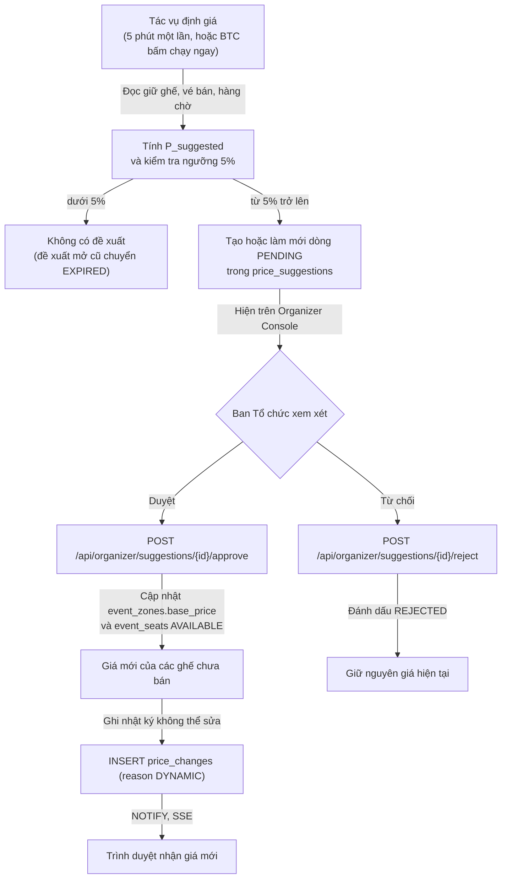

# Bài toán và thiết kế Định giá động (Dynamic Pricing)

Tài liệu đặc tả bài toán, mô hình giả định, dữ liệu đầu vào, quy tắc đổi giá và ví dụ tính tay cho **Định giá động (FR-22, cờ `dynamic_pricing`)**.
Ban Tổ chức luôn là người quyết định cuối cùng (Human-in-the-loop, `W-01`), theo mục 6 của [`docs/design/README.md`](design/README.md).

- **Mã công việc:** `T08`
- **Yêu cầu liên quan:** FR-22, FR-08, FR-20, W-01

## 0. Trạng thái triển khai

FR-22 đã làm xong và chạy ở profile `sprint2` (cờ `dynamic_pricing` bật, cùng migration `00007`).
Phần đã có trong code:
- gói `backend/internal/pricing`: công thức thuần, không đọc cơ sở dữ liệu;
- `PricingService`: tác vụ nền phân tích mỗi 5 phút, tạo và làm mới đề xuất trong `price_suggestions`;
- `POST /api/organizer/suggestions/{id}/approve` và `.../reject`;
- `GET /api/organizer/events/{id}/pricing` và `POST /api/organizer/events/{id}/pricing/run`;
- `PUT /api/organizer/events/{id}/zones/{zoneId}/dynamic-pricing`: bật hoặc tắt định giá động cho từng khu vực;
- Organizer Console hiện số liệu đầu vào, đề xuất, biểu đồ giá và nút duyệt, từ chối;
- sơ đồ ghế của khán giả nhận giá mới qua SSE và hiện dấu "Giá vừa tăng" hoặc "Giá vừa giảm".

Hệ thống vẫn không tự đổi giá. Giá chỉ đổi khi BTC duyệt (`W-01`).
FR-23 (gợi ý khuyến mãi) chưa làm.

---

## 1. Mô tả bài toán và mục tiêu kinh doanh

### 1.1. Bối cảnh
Trong sự kiện âm nhạc quy mô lớn, nhu cầu mua vé phân bổ không đều:
- **Khu vực "hot" (VIP, Fanzone):** bán hết trong vài phút đầu, tạo cơ hội cho phe vé bán lại với giá cao hơn nhiều lần.
- **Khu vực xa sân khấu (khán đài phổ thông):** bán chậm hơn dự kiến, dễ còn ghế trống khi sự kiện diễn ra.

### 1.2. Mục tiêu
1. **Tăng doanh thu và tỷ lệ lấp đầy (fill rate):** điều chỉnh giá từng khu vực theo cung và cầu thực tế.
2. **Thu hẹp chênh lệch với thị trường chợ đen:** giá khu vực "hot" được phép tiến gần giá trị thị trường, phần chênh về cho nghệ sĩ và nhà tổ chức.
3. **An toàn pháp lý và thương hiệu (`W-01`):** hệ thống không bao giờ tự đổi giá.
   Thuật toán chỉ sinh đề xuất vào `price_suggestions`.
   Giá chỉ đổi khi BTC duyệt.
4. **Bảo vệ người mua:** giá luôn nằm trong `[giá sàn, giá trần]` do BTC đặt từ trước (FR-08).
   Mọi lần đổi giá đều ghi vào `price_changes` và hiển thị ở trang nhật ký giá (FR-20, cờ `price_log`).

---

## 2. Mô hình giả định

Hệ thống định giá dựa trên các giả định kinh tế vi mô:
1. **Độ co giãn của cầu theo giá (Price Elasticity of Demand):** Nhu cầu mua vé sự kiện nhạy cảm với thời gian mở bán và số lượng ghế còn lại.
2. **Chu kỳ đánh giá:** Định kỳ mỗi **5 phút** (`T = 300` giây), một background job thu thập số liệu vận hành của từng khu vực trong sự kiện đang mở bán.
3. **Cửa sổ trượt (Sliding Window):** Đo lường tốc độ bán trong khoảng thời gian trượt $\Delta t = 15$ phút gần nhất để giảm thiểu hiện tượng nhiễu đột biến ngắn hạn.
4. **Tín hiệu cầu đến từ lượt giữ ghế:** mỗi vé bán ra đều bắt đầu bằng một lượt giữ ghế.
   Đếm cả lượt giữ giúp cầu hiện lên ngay khi khán giả chọn ghế, không phải chờ thanh toán xong.

---

## 3. Dữ liệu đầu vào (Input Parameters)

Mỗi lần chạy, thuật toán đọc các tham số của từng khu vực (`zone_id`) từ PostgreSQL:

| Ký hiệu | Tên tham số | Đơn vị | Nguồn dữ liệu |
|---|---|---|---|
| $P_{\text{current}}$ | Giá bán hiện tại của khu vực | VNĐ | `event_zones.base_price` (giá ghế `AVAILABLE` là `event_seats.current_price`) |
| $P_{\text{floor}}$ | Giá sàn | VNĐ | `event_zones.floor_price` |
| $P_{\text{ceiling}}$ | Giá trần | VNĐ | `event_zones.ceiling_price` |
| $S_{\text{rem}}$ | Số ghế chưa bán (`AVAILABLE` và `HELD`, không tính `SOLD` và `BLOCKED`) | Ghế | `event_seats.status` |
| $S_{\text{held}}$ | Số ghế đang giữ | Ghế | `event_seats` có `status = 'HELD'` |
| $T_{\text{rem}}$ | Thời gian còn lại đến khi đóng bán, tối thiểu 1 phút | Phút | `COALESCE(events.sales_ends_at, events.starts_at) - now()`, có thể bị chặn trên bởi `PRICING_TARGET_HORIZON_MINUTES` |
| $v_{\text{target}}$ | Tốc độ bán cần đạt: $\frac{S_{\text{rem}}}{T_{\text{rem}}}$ | Vé/phút | Tính nội bộ |
| $v_{\text{actual}}$ | Tốc độ bán thực tế: $\frac{\text{số ghế bị giữ hoặc đã bán trong 15 phút}}{15}$ | Ghế/phút | số ghế khác nhau có `seat_holds.created_at` hoặc `tickets.issued_at` (vé khác `VOID`) trong cửa sổ, theo khu vực của ghế |
| $Q$ | Số người đang chờ trong phòng chờ | Người | `queue_entries` có `status = 'WAITING'` |
| $r_{\text{held}}$ | Tỷ lệ ghế đang giữ: $\frac{S_{\text{held}}}{S_{\text{rem}}}$ | [0, 1] | Tính nội bộ |

Ngoài các tham số trên, giao diện còn hiện tỷ lệ lấp đầy $\frac{\text{ghế đã bán}}{\text{tổng ghế}}$.
Tỷ lệ này chỉ để BTC đọc, công thức giá không dùng nó.

Khu vực chỉ được tính giá động khi `event_zones.is_dynamic_pricing_enabled = TRUE` và sự kiện đang `ON_SALE` trong khung giờ mở bán.
Khu vực hết ghế không có đề xuất.

### 3.1. Cấu hình

Tác vụ đọc các biến môi trường sau. Để trống thì dùng giá trị mặc định.

| Biến | Mặc định | Ý nghĩa |
|---|---|---|
| `PRICING_INTERVAL_SECONDS` | `300` | Chu kỳ phân tích. |
| `PRICING_WINDOW_MINUTES` | `15` | Độ dài cửa sổ trượt đo tốc độ bán. |
| `PRICING_TARGET_HORIZON_MINUTES` | `0` (không chặn) | Chặn trên của $T_{\text{rem}}$ khi tính $v_{\text{target}}$. Dùng khi demo. |
| `PRICING_REJECT_COOLDOWN_MINUTES` | `60` | Thời gian một đề xuất đã bị từ chối không được đưa ra lại. |

Sự kiện thật thường còn vài tuần đến giờ đóng bán, nên $v_{\text{target}}$ rất nhỏ và chỉ cần vài lượt giữ ghế là tốc độ bán vượt xa mục tiêu.
Khi demo, đặt `PRICING_TARGET_HORIZON_MINUTES=60` để mục tiêu là bán hết trong một giờ.
Khi đó vài chục lượt giữ ghế đủ làm đề xuất đổi chiều.
Production để trống biến này.

---

## 4. Quy tắc và Công thức tính toán

### 4.1. Chỉ số áp lực thị trường tổng hợp ($\alpha$)

Chỉ số $\alpha$ phản ánh tương quan giữa lực cầu và nguồn cung khả dụng:
$$\alpha = w_1 \cdot \left(\frac{v_{\text{actual}}}{v_{\text{target}}}\right) + w_2 \cdot \left(1 + \frac{Q}{C_{\text{target}}}\right) + w_3 \cdot \left(1 + r_{\text{held}}\right)$$

Trong đó trọng số chuẩn hóa:
- $w_1 = 0.50$ (Áp lực từ tốc độ bán thực tế so với mục tiêu)
- $w_2 = 0.30$ (Áp lực từ hàng chờ ảo, với dung lượng mục tiêu $C_{\text{target}} = 500$)
- $w_3 = 0.20$ (Áp lực từ lượng ghế đang bị người dùng giữ chỗ tích cực)

*(Nếu $\alpha > 1.0$: Nhu cầu cao hơn kế hoạch $\rightarrow$ Cần xem xét tăng giá. Nếu $\alpha < 1.0$: Nhu cầu chậm $\rightarrow$ Cần xem xét giảm giá).*

### 4.2. Tỉ lệ điều chỉnh giá ($\delta$)

Tỉ lệ điều chỉnh được tính tuyến tính theo độ lệch của $\alpha$, đồng thời chặn trần biến động tối đa $\pm 20\%$ mỗi chu kỳ:
$$\delta = \text{clamp}\left( k \cdot (\alpha - 1.0), -0.20, +0.20 \right)$$
*(Với độ nhạy $k = 0.25$)*.

### 4.3. Giá đề xuất sơ bộ ($P_{\text{raw}}$)
$$P_{\text{raw}} = P_{\text{current}} \cdot (1 + \delta)$$

### 4.4. Giới hạn an toàn (clamping) và làm tròn tiền tệ
1. **Chặn giá sàn và giá trần:**
   $$P_{\text{clamped}} = \max\left(P_{\text{floor}}, \min\left(P_{\text{ceiling}}, P_{\text{raw}}\right)\right)$$
2. **Làm tròn tiền tệ đến bội số 10.000 VNĐ:**
   $$P_{\text{suggested}} = \text{round}_{10,000}\left(P_{\text{clamped}}\right) = \left\lfloor \frac{P_{\text{clamped}} + 5000}{10000} \right\rfloor \times 10000$$
3. **Chặn lại sau khi làm tròn:** nếu giá làm tròn vượt khỏi `[floor_price, ceiling_price]` thì dùng đúng giá sàn hoặc giá trần.

### 4.5. Ngưỡng lọc nhiễu 5% (Threshold Filter)
Để tránh làm phiền Ban Tổ chức với những biến động không đáng kể:
$$\Delta P_{\text{rel}} = \frac{|P_{\text{suggested}} - P_{\text{current}}|}{P_{\text{current}}}$$
- **Nếu $\Delta P_{\text{rel}} < 5\%$:** không có đề xuất.
- **Nếu $\Delta P_{\text{rel}} \ge 5\%$:** có đề xuất, kèm lý do bằng lời và toàn bộ số liệu đầu vào (cột `metrics`).

### 4.6. Vòng đời của một đề xuất

Mỗi khu vực có tối đa một đề xuất `PENDING` (chỉ mục duy nhất từng phần `uq_price_suggestions_pending`).

| Tình huống ở lần phân tích | Việc hệ thống làm |
|---|---|
| Chưa có đề xuất mở, lệch từ 5% | Tạo dòng `PENDING` mới. |
| Đã có đề xuất mở, lệch từ 5% | Làm mới dòng đó tại chỗ (giá, lý do, số liệu, `updated_at`). |
| Lệch dưới 5%, khu vực hết ghế, sự kiện ngừng bán, hoặc BTC tắt định giá động | Chuyển đề xuất mở sang `EXPIRED`. |
| Đúng cặp giá hiện tại và giá đề xuất này đã bị BTC từ chối trong `PRICING_REJECT_COOLDOWN_MINUTES` | Không tạo lại; đề xuất mở (nếu có) chuyển sang `EXPIRED`. |
| BTC đặt giá tay (FR-08) | Đề xuất mở chuyển sang `EXPIRED`, vì nó tính trên giá cũ. |

Trạng thái hợp lệ: `PENDING`, `APPROVED`, `REJECTED`, `EXPIRED`.
Dòng `APPROVED` và `REJECTED` luôn có `reviewed_by` và `reviewed_at`.

---

## 5. Quy trình phê duyệt của Ban Tổ chức



Sơ đồ tuần tự của luồng duyệt nằm ở [`docs/sequences/dynamic-pricing.md`](sequences/dynamic-pricing.md).

Khi duyệt, `PricingService.Approve` làm trong một giao dịch:
1. Khóa dòng `event_zones` của khu vực, rồi khóa dòng đề xuất (`FOR UPDATE`). Thứ tự này giống tác vụ phân tích nên hai bên không khóa chéo nhau.
2. Nếu đề xuất không còn `PENDING`, trả `409 suggestion_not_pending`. Hai lần duyệt đồng thời chỉ có một lần được áp dụng.
3. Nếu `base_price` hiện tại khác `current_price` của đề xuất, hoặc giá đề xuất nằm ngoài `[floor_price, ceiling_price]` hiện tại, chuyển đề xuất sang `EXPIRED` và trả `409 suggestion_stale`.
4. Đặt `event_zones.base_price` bằng giá đề xuất.
5. Đặt `event_seats.current_price` cho các ghế `AVAILABLE` của khu vực. Ghế `HELD` và `SOLD` giữ nguyên giá. Ghế `HELD` nhận giá mới khi được nhả về `AVAILABLE`.
6. Ghi một dòng `price_changes` với `reason = 'DYNAMIC'` và `changed_by` là người duyệt.
7. Đánh dấu đề xuất `APPROVED`.
8. Gửi `pg_notify` trên kênh `event_seats_channel`. PostgreSQL chỉ phát thông báo khi giao dịch đã commit.

Kênh này đã có sẵn từ FR-05. Thông báo giá có dạng:

```json
{"type":"price_changed","eventId":"…","zoneId":"…","oldPrice":500000,"newPrice":540000,"reason":"DYNAMIC","timestamp":"…"}
```

Trình duyệt của khán giả nhận qua SSE, cập nhật giá các ghế `available` của khu vực và hiện dấu giá vừa đổi.
Đặt giá tay (FR-08) cũng phát thông báo này với `reason = 'MANUAL'`.

Từ chối chỉ đổi trạng thái đề xuất sang `REJECTED`, không đụng tới giá nào.

Quyền: chỉ `ORGANIZER` của sự kiện đó và `ADMIN` được gọi các endpoint này.
Khán giả nhận `403 forbidden`, BTC của sự kiện khác nhận `403 not_event_organizer`.

---

## 6. Ví dụ tính tay cụ thể (Numerical Walkthrough)

### Kịch bản 1: Khu Fanzone nhu cầu bùng nổ (Đề xuất tăng giá)

- **Thông số khu vực:**
  - $P_{\text{current}} = 1.200.000$ VNĐ
  - $P_{\text{floor}} = 1.000.000$ VNĐ; $P_{\text{ceiling}} = 2.000.000$ VNĐ
  - $S_{\text{rem}} = 300$ ghế; Thời gian còn lại $T_{\text{rem}} = 60$ phút $\implies v_{\text{target}} = \frac{300}{60} = 5.0$ vé/phút.
- **Dữ liệu thực tế đo được:**
  - 15 phút vừa qua bán được 150 vé $\implies v_{\text{actual}} = \frac{150}{15} = 10.0$ vé/phút.
  - Hàng chờ ảo $Q = 250$ người; $C_{\text{target}} = 500 \implies \frac{Q}{C_{\text{target}}} = 0.5$.
  - Số ghế đang giữ $S_{\text{held}} = 120$ ghế $\implies r_{\text{held}} = \frac{120}{300} = 0.4$.
- **Các bước tính toán:**
  1. Chỉ số áp lực $\alpha$:
     $$\alpha = 0.5 \cdot \left(\frac{10.0}{5.0}\right) + 0.3 \cdot (1 + 0.5) + 0.2 \cdot (1 + 0.4) = 0.5 \cdot 2.0 + 0.3 \cdot 1.5 + 0.2 \cdot 1.4 = 1.0 + 0.45 + 0.28 = 1.73$$
  2. Tỉ lệ điều chỉnh $\delta$:
     $$\delta = \text{clamp}(0.25 \cdot (1.73 - 1.0), -0.20, +0.20) = \text{clamp}(0.1825, -0.20, +0.20) = +18.25\%$$
  3. Giá sơ bộ $P_{\text{raw}}$:
     $$P_{\text{raw}} = 1.200.000 \times (1 + 0.1825) = 1.419.000 \text{ VNĐ}$$
  4. Ràng buộc & làm tròn 10.000 VNĐ:
     - $P_{\text{clamped}} = \max(1.000.000, \min(2.000.000, 1.419.000)) = 1.419.000$ VNĐ
     - $P_{\text{suggested}} = \text{round}_{10,000}(1.419.000) = 1.420.000$ VNĐ
  5. Kiểm tra ngưỡng 5%:
     $$\Delta P_{\text{rel}} = \frac{|1.420.000 - 1.200.000|}{1.200.000} = \frac{220.000}{1.200.000} \approx 18.33\% \ge 5\% \quad \text{(HỢP LỆ)}$$
- **Kết quả:** Hệ thống tạo đề xuất tăng từ **1.200.000 VNĐ** lên **1.420.000 VNĐ** (+18.3%) kèm lý do: *"Tốc độ bán gấp 2.0x mục tiêu, 250 người xếp hàng chờ và 40% ghế đang bị giữ"*.

---

### Kịch bản 2: Khán đài C bán chậm (Đề xuất giảm giá kích cầu)

- **Thông số khu vực:**
  - $P_{\text{current}} = 500.000$ VNĐ; $P_{\text{floor}} = 350.000$ VNĐ; $P_{\text{ceiling}} = 700.000$ VNĐ
  - $S_{\text{rem}} = 800$ ghế; $T_{\text{rem}} = 80$ phút $\implies v_{\text{target}} = \frac{800}{80} = 10.0$ vé/phút.
- **Dữ liệu thực tế đo được:**
  - 15 phút vừa qua bán được 30 vé $\implies v_{\text{actual}} = \frac{30}{15} = 2.0$ vé/phút.
  - Hàng chờ ảo $Q = 0$ người; $S_{\text{held}} = 16$ ghế $\implies r_{\text{held}} = \frac{16}{800} = 0.02$.
- **Các bước tính toán:**
  1. Chỉ số áp lực $\alpha$:
     $$\alpha = 0.5 \cdot \left(\frac{2.0}{10.0}\right) + 0.3 \cdot (1 + 0) + 0.2 \cdot (1 + 0.02) = 0.5 \cdot 0.2 + 0.3 \cdot 1.0 + 0.2 \cdot 1.02 = 0.10 + 0.30 + 0.204 = 0.604$$
  2. Tỉ lệ điều chỉnh $\delta$:
     $$\delta = \text{clamp}(0.25 \cdot (0.604 - 1.0), -0.20, +0.20) = \text{clamp}(-0.099, -0.20, +0.20) = -9.9\%$$
  3. Giá sơ bộ $P_{\text{raw}}$:
     $$P_{\text{raw}} = 500.000 \times (1 - 0.099) = 450.500 \text{ VNĐ}$$
  4. Ràng buộc & làm tròn 10.000 VNĐ:
     - $P_{\text{clamped}} = \max(350.000, \min(700.000, 450.500)) = 450.500$ VNĐ
     - $P_{\text{suggested}} = \text{round}_{10,000}(450.500) = 450.000$ VNĐ
  5. Kiểm tra ngưỡng 5%:
     $$\Delta P_{\text{rel}} = \frac{|450.000 - 500.000|}{500.000} = 10.0\% \ge 5\% \quad \text{(HỢP LỆ)}$$
- **Kết quả:** Hệ thống đề xuất giảm từ **500.000 VNĐ** xuống **450.000 VNĐ** (-10.0%) kèm lý do: *"Tốc độ bán chỉ đạt 20% mục tiêu, không có hàng chờ"*.

---

### Kịch bản 3: Biến động nhỏ dưới 5% (Bỏ qua)

- $P_{\text{current}} = 800.000$ VNĐ.
- Thuật toán tính ra $P_{\text{suggested}} = 820.000$ VNĐ.
- Tỉ lệ chênh lệch: $\Delta P_{\text{rel}} = \frac{20.000}{800.000} = 2.5\% < 5\%$.
- **Kết quả:** Hệ thống bỏ qua, không làm phiền BTC.

---

### Kịch bản 4: Demo trên hệ thống (số liệu thật từ lượt giữ ghế)

Kịch bản này cũng là bài kiểm thử tích hợp `TestPricing_SuggestionFollowsRealHoldsAndSales`.

- Khu vực 24 ghế, $P_{\text{current}} = 1.000.000$ VNĐ, sàn 800.000, trần 1.200.000.
- Đóng bán sau 120 phút: $v_{\text{target}} = \frac{24}{120} = 0.2$ vé/phút.
- **Chưa ai giữ ghế:** $v_{\text{actual}} = 0$, $Q = 0$, $r_{\text{held}} = 0$.
  - $\alpha = 0 + 0.3 \cdot 1 + 0.2 \cdot 1 = 0.5$, $\delta = 0.25 \cdot (0.5 - 1) = -12.5\%$.
  - $P_{\text{raw}} = 875.000$, làm tròn thành **880.000 VNĐ** (−12,0%). Có đề xuất giảm giá.
- **12 ghế bị giữ:** $v_{\text{actual}} = \frac{12}{15} = 0.8$ vé/phút, $r_{\text{held}} = \frac{12}{24} = 0.5$.
  - $\alpha = 0.5 \cdot 4 + 0.3 + 0.2 \cdot 1.5 = 2.6$, $\delta = 0.25 \cdot 1.6 = 40\%$, chặn xuống **+20%**.
  - $P_{\text{raw}} = 1.200.000$ nằm đúng trần. Đề xuất cũ được làm mới thành **1.200.000 VNĐ** (+20,0%).
- Giá chưa đổi cho đến khi BTC bấm duyệt.

---

## 7. Phản biện Định giá động và cách thiết kế giảm rủi ro

Định giá động gây tranh cãi trong ngành vé sự kiện.
Mục này nêu các lập luận phản biện và cách thiết kế ở trên đáp lại chúng.
Nhóm chưa chạy thực nghiệm nào về hành vi người mua, nên các lập luận dưới đây là lập luận lý thuyết và tiền lệ công khai, không phải số liệu của nhóm.

### 7.1. Tiền lệ công khai
- **Oasis (Anh):** Cơ quan Quản lý Cạnh tranh và Thị trường (CMA) điều tra việc bán vé tour Oasis vì cách trình bày giá có thể gây hiểu lầm cho người mua.
  Ticketmaster đưa ra cam kết với CMA về cách công bố giá.
- **Bruce Springsteen (Mỹ):** đợt bán vé tour 2022 dùng giá theo nhu cầu.
  Nhiều vé có giá hàng nghìn USD và bị chỉ trích rộng rãi.

Cần bổ sung nguồn trích dẫn trước khi nộp.
Các số liệu cụ thể (mức giá, thời hạn cam kết, dự luật các nước) nhóm chưa kiểm chứng nên không đưa vào tài liệu này.

### 7.2. Các lập luận phản biện
1. **Minh bạch:** người mua không biết trước giá có thể tăng khi đang chọn ghế hoặc thanh toán.
2. **Công bằng:** tăng giá theo cầu có thể gây bất lợi cho nhóm khán giả không linh hoạt về thời gian.
3. **Uy tín:** nghệ sĩ và BTC chịu phản ứng của công chúng dù không tự đặt từng mức giá.
4. **Hiệu quả chống phe vé:** phần chênh lệch có thể chuyển từ phe vé sang nền tảng bán vé, chưa chắc có lợi cho người mua.

### 7.3. Cách thiết kế đáp lại

| Lập luận | Biện pháp trong thiết kế |
|---|---|
| Minh bạch | Giá chỉ đổi khi BTC duyệt. Đề xuất ghi rõ lý do và số liệu (`reason`, `metrics`). |
| Biến động đột ngột | Mỗi chu kỳ đổi tối đa ±20%. Chênh dưới 5% thì bỏ qua. |
| Giá vô lý | Giá luôn nằm trong `[giá sàn, giá trần]` do BTC đặt (FR-08). |
| Đang chọn ghế | Duyệt đề xuất chỉ đổi giá ghế `AVAILABLE`. Ghế `HELD` giữ nguyên giá. |
| Truy vết | Mọi lần đổi giá ghi vào `price_changes` (lý do `DYNAMIC` hoặc `MANUAL`), không thể sửa hoặc xóa (NFR-12). |
| Muốn tắt | Cờ `dynamic_pricing` tắt thì tác vụ không chạy và các endpoint trả `404 feature_disabled`. Mỗi khu vực tắt riêng bằng `is_dynamic_pricing_enabled`, ngay trên Organizer Console. |

---

## 8. Giao diện

### 8.1. Organizer Console (`/organizer`)

Chọn một sự kiện, mỗi khu vực hiện thêm khối "Định giá động":
- 8 chỉ số đầu vào: tốc độ bán, tốc độ cần đạt, tỷ lệ giữa hai tốc độ, tỷ lệ lấp đầy, tỷ lệ ghế đang giữ, hàng chờ, $\alpha$ và $\delta$;
- đề xuất đang chờ: giá hiện tại → giá đề xuất, phần trăm đổi kèm dấu ▲ hoặc ▼, lý do, giờ tính, nút **Duyệt** và **Từ chối**;
- khi không có đề xuất, dòng giải thích mức đổi theo số liệu hiện tại và vì sao bị bỏ qua (dưới 5%);
- giá sàn, giá trần và biểu đồ bậc thang giá của các lần đổi gần nhất (từ `price_changes`), có nét đứt tới giá đề xuất;
- công tắc bật hoặc tắt định giá động cho khu vực.

Đầu trang có nút **Chạy lại phân tích ngay**, gọi `POST .../pricing/run` để chạy đúng một lượt phân tích.
Console tải lại số liệu mỗi 4 giây nên khi khán giả giữ ghế, các chỉ số đổi theo mà không cần bấm gì.
Đề xuất đang chờ chỉ đổi sau lượt phân tích kế tiếp. Nếu số liệu mới cho giá khác, khung đề xuất báo "Theo số liệu hiện tại, đề xuất sẽ là …".

### 8.2. Sơ đồ ghế của khán giả

- Danh sách hạng vé, tiêu đề khu vực và khu đứng hiện dấu "Giá vừa tăng 8%" hoặc "Giá vừa giảm 8%" trong 30 phút sau lần đổi giá gần nhất. Dấu có mũi tên và chữ, không chỉ dựa vào màu.
- Trang đang mở nhận thông báo `price_changed` qua SSE: giá ghế còn trống đổi ngay, nhãn giá trên sơ đồ đổi theo và có một thông báo ngắn.
- Ghế đang giữ của chính khán giả giữ nguyên giá đã thấy.

## 9. API

Mọi endpoint cần cờ `organizer_console` và `dynamic_pricing`, vai trò `ORGANIZER` hoặc `ADMIN`.
Đặc tả đầy đủ ở [`docs/api/openapi.yaml`](api/openapi.yaml).

| Phương thức | Đường dẫn | Việc làm |
|---|---|---|
| `GET` | `/api/organizer/events/{id}/pricing` | Số liệu hiện tại, đề xuất đang chờ và lịch sử giá của từng khu vực. Không đổi dữ liệu. |
| `POST` | `/api/organizer/events/{id}/pricing/run` | Chạy một lượt phân tích cho sự kiện, trả về bảng số liệu mới. Giới hạn 30 lần mỗi phút mỗi địa chỉ. |
| `PUT` | `/api/organizer/events/{id}/zones/{zoneId}/dynamic-pricing` | Bật hoặc tắt định giá động cho khu vực. |
| `POST` | `/api/organizer/suggestions/{id}/approve` | Duyệt đề xuất. |
| `POST` | `/api/organizer/suggestions/{id}/reject` | Từ chối đề xuất. |

`GET /api/events/{slug}` trả thêm `recentChange` cho khu vực có giá đổi trong 30 phút gần nhất.

## 10. Kiểm thử

- Kiểm thử đơn vị `backend/internal/pricing`: hai kịch bản 1 và 2 ở trên, giới hạn ±20%, chặn sàn và trần, làm tròn (kể cả khi sàn hoặc trần không chia hết cho 10.000), đầu vào không hợp lệ, câu giải thích.
- Kiểm thử tích hợp trên PostgreSQL (`TEST_DATABASE_URL`):
  - đề xuất đổi chiều theo lượt giữ ghế và ghế bán thật, và không có giá nào đổi khi chưa duyệt;
  - duyệt chỉ đổi giá ghế `AVAILABLE`, ghi một dòng `price_changes` `DYNAMIC`, phát thông báo `price_changed`;
  - từ chối giữ nguyên giá, và đề xuất không quay lại ngay;
  - 8 lần duyệt đồng thời chỉ áp dụng một lần;
  - giá luôn trong `[giá sàn, giá trần]`;
  - đặt giá tay hoặc đổi trần làm đề xuất cũ không duyệt được;
  - tắt khu vực hoặc ngừng bán thì không có đề xuất;
  - khán giả và BTC của sự kiện khác nhận `403`, người chưa đăng nhập nhận `401`, cờ tắt nhận `404`.
- `RunMigrations` giữ khóa tư vấn của PostgreSQL, nên nhiều tiến trình khởi động cùng lúc (các gói test chạy song song, nhiều bản sao API) chạy migration lần lượt thay vì tranh nhau.

## 11. Các bước demo

1. Chạy hệ thống với `PRICING_TARGET_HORIZON_MINUTES=60`, đăng nhập tài khoản BTC, vào **Quản lý sự kiện** và chọn một sự kiện.
2. Xem khu vực CAT 3: tốc độ bán 0,00, $\alpha = 0{,}50$, đề xuất giảm khoảng 12%.
3. Mở trang chọn vé của sự kiện đó ở tab khác bằng tài khoản khán giả, giữ khoảng 9 ghế ở CAT 3.
4. Quay lại Organizer Console. Sau tối đa 4 giây, tốc độ bán lên 0,60, $\alpha$ lên 1,32 và khung đề xuất báo số liệu hiện tại cho +8%.
5. Bấm **Chạy lại phân tích ngay**. Đề xuất đổi từ ▼ −12% sang ▲ +8% (500.000 → 540.000).
6. Bấm **Duyệt**. Giá cơ bản thành 540.000, biểu đồ có thêm một bậc.
7. Ở tab khán giả, giá CAT 3 đổi ngay, hiện thông báo và dấu "Giá vừa tăng 8%". Các ghế đang giữ vẫn ở giá cũ.

---

## 12. Đề xuất ngoài phạm vi: gợi ý sự kiện và chỗ ngồi

Một hướng bổ sung là gợi ý sự kiện hoặc ghế cho từng khán giả, dựa trên thể loại đã xem, ngân sách và góc nhìn.
Hướng này không có mã FR, không có cờ tính năng, không có endpoint và không nằm trong thiết kế hệ thống.
Chưa được phân công và chưa có trong kế hoạch Sprint.
Chỉ ghi lại như ý tưởng cho giai đoạn sau.
