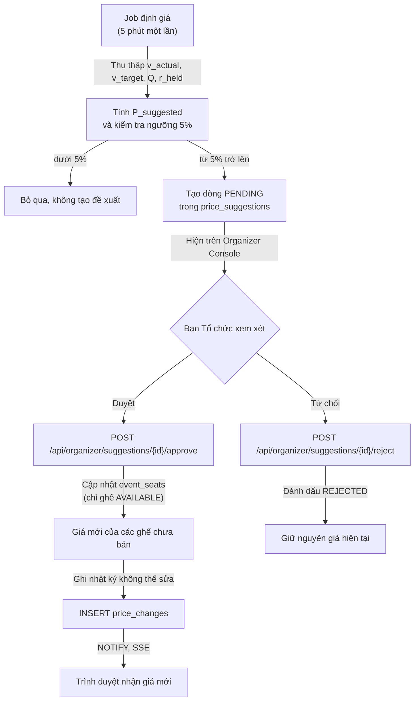

# Bài toán và thiết kế Định giá động (Dynamic Pricing)

Tài liệu đặc tả bài toán, mô hình giả định, dữ liệu đầu vào, quy tắc đổi giá và ví dụ tính tay cho **Định giá động (FR-22, cờ `dynamic_pricing`)**.
Ban Tổ chức luôn là người quyết định cuối cùng (Human-in-the-loop, `W-01`), theo mục 6 của [`docs/design/README.md`](design/README.md).

- **Mã công việc:** `T08`
- **Yêu cầu liên quan:** FR-22, FR-08, FR-20, W-01

## 0. Trạng thái triển khai

Cờ `dynamic_pricing` thuộc profile `sprint2`, tuy nhiên job tính đề xuất và endpoint duyệt chưa được cài đặt nên FR-22 vẫn ở trạng thái **chưa làm**.
Phần đã có trong code:
- bảng `price_suggestions` (đề xuất giá) và `price_changes` (nhật ký giá, trigger chặn sửa và xóa);
- cột `event_zones.floor_price`, `base_price`, `ceiling_price` với ràng buộc `floor_price <= base_price <= ceiling_price`;
- `PUT /api/organizer/events/{id}/zones/{zoneId}/pricing` (FR-08, cờ `organizer_console` và `zone_pricing`): BTC đặt giá tay, mỗi lần đổi giá cơ bản ghi một dòng `price_changes` với lý do `MANUAL`.

Phần chưa có trong code:
- job tính đề xuất giá mỗi 5 phút;
- endpoint `POST /api/organizer/suggestions/{id}/approve` và `reject`.

Mọi công thức dưới đây là thiết kế, chưa chạy trong hệ thống.

---

## 1. Mô tả bài toán và mục tiêu kinh doanh

### 1.1. Bối cảnh
Trong sự kiện âm nhạc quy mô lớn, nhu cầu mua vé phân bổ không đều:
- **Khu vực "hot" (VIP, Fanzone):** bán hết trong vài phút đầu, tạo cơ hội cho phe vé bán lại với giá cao hơn nhiều lần.
- **Khu vực xa sân khấu (khán đài phổ thông):** bán chậm hơn dự kiến, dễ còn ghế trống khi sự kiện diễn ra.

### 1.2. Mục tiêu
1. **Tăng doanh thu và tỷ lệ lấp đầy (fill rate):** điều chỉnh giá từng khu vực theo cung và cầu thực tế.
2. **Thu hẹp chênh lệch với thị trường chợ đen:** giá khu vực "hot" được phép tiến gần giá trị thị trường, phần chênh về cho nghệ sĩ và nhà tổ chức.
3. **An toàn pháp lý và thương hiệu (`W-01`):** hệ thống không bao giờ tự đổi giá.
   Thuật toán chỉ sinh đề xuất vào `price_suggestions`.
   Giá chỉ đổi khi BTC duyệt.
4. **Bảo vệ người mua:** giá luôn nằm trong `[giá sàn, giá trần]` do BTC đặt từ trước (FR-08).
   Mọi lần đổi giá đều ghi vào `price_changes` và hiển thị ở trang nhật ký giá (FR-20, cờ `price_log`).

---

## 2. Mô hình giả định

Hệ thống định giá dựa trên các giả định kinh tế vi mô:
1. **Độ co giãn của cầu theo giá (Price Elasticity of Demand):** Nhu cầu mua vé sự kiện nhạy cảm với thời gian mở bán và số lượng ghế còn lại.
2. **Chu kỳ đánh giá:** Định kỳ mỗi **5 phút** (`T = 300` giây), một background job thu thập số liệu vận hành của từng khu vực trong sự kiện đang mở bán.
3. **Cửa sổ trượt (Sliding Window):** Đo lường tốc độ bán trong khoảng thời gian trượt $\Delta t = 15$ phút gần nhất để giảm thiểu hiện tượng nhiễu đột biến ngắn hạn.

---

## 3. Dữ liệu đầu vào (Input Parameters)

Mỗi lần chạy, thuật toán đọc các tham số của từng khu vực (`zone_id`) từ PostgreSQL:

| Ký hiệu | Tên tham số | Đơn vị | Nguồn dữ liệu |
|---|---|---|---|
| $P_{\text{current}}$ | Giá bán hiện tại của khu vực | VNĐ | `event_zones.base_price` (giá ghế `AVAILABLE` là `event_seats.current_price`) |
| $P_{\text{floor}}$ | Giá sàn | VNĐ | `event_zones.floor_price` |
| $P_{\text{ceiling}}$ | Giá trần | VNĐ | `event_zones.ceiling_price` |
| $S_{\text{rem}}$ | Số ghế chưa bán (`AVAILABLE` và `HELD`) | Ghế | `event_seats.status` |
| $S_{\text{held}}$ | Số ghế đang giữ | Ghế | `event_seats` có `status = 'HELD'` |
| $T_{\text{rem}}$ | Thời gian còn lại đến khi đóng bán | Phút | `events.sales_ends_at - now()` |
| $v_{\text{target}}$ | Tốc độ bán cần đạt: $\frac{S_{\text{rem}}}{T_{\text{rem}}}$ | Vé/phút | Tính nội bộ |
| $v_{\text{actual}}$ | Tốc độ bán thực tế: $\frac{\text{số vé bán trong 15 phút}}{15}$ | Vé/phút | `tickets.issued_at` theo `event_id` và khu vực của ghế |
| $Q$ | Số người đang chờ trong phòng chờ | Người | `queue_entries` có `status = 'WAITING'` |
| $r_{\text{held}}$ | Tỷ lệ ghế đang giữ: $\frac{S_{\text{held}}}{S_{\text{rem}}}$ | [0, 1] | Tính nội bộ |

Khu vực chỉ được tính giá động khi `event_zones.is_dynamic_pricing_enabled = TRUE`.

---

## 4. Quy tắc và Công thức tính toán

### 4.1. Chỉ số áp lực thị trường tổng hợp ($\alpha$)

Chỉ số $\alpha$ phản ánh tương quan giữa lực cầu và nguồn cung khả dụng:
$$\alpha = w_1 \cdot \left(\frac{v_{\text{actual}}}{v_{\text{target}}}\right) + w_2 \cdot \left(1 + \frac{Q}{C_{\text{target}}}\right) + w_3 \cdot \left(1 + r_{\text{held}}\right)$$

Trong đó trọng số chuẩn hóa:
- $w_1 = 0.50$ (Áp lực từ tốc độ bán thực tế so với mục tiêu)
- $w_2 = 0.30$ (Áp lực từ hàng chờ ảo, với dung lượng mục tiêu $C_{\text{target}} = 500$)
- $w_3 = 0.20$ (Áp lực từ lượng ghế đang bị người dùng giữ chỗ tích cực)

*(Nếu $\alpha > 1.0$: Nhu cầu cao hơn kế hoạch $\rightarrow$ Cần xem xét tăng giá. Nếu $\alpha < 1.0$: Nhu cầu chậm $\rightarrow$ Cần xem xét giảm giá).*

### 4.2. Tỉ lệ điều chỉnh giá ($\delta$)

Tỉ lệ điều chỉnh được tính tuyến tính theo độ lệch của $\alpha$, đồng thời chặn trần biến động tối đa $\pm 20\%$ mỗi chu kỳ:
$$\delta = \text{clamp}\left( k \cdot (\alpha - 1.0), -0.20, +0.20 \right)$$
*(Với độ nhạy $k = 0.25$)*.

### 4.3. Giá đề xuất sơ bộ ($P_{\text{raw}}$)
$$P_{\text{raw}} = P_{\text{current}} \cdot (1 + \delta)$$

### 4.4. Giới hạn an toàn (clamping) và làm tròn tiền tệ
1. **Chặn giá sàn và giá trần:**
   $$P_{\text{clamped}} = \max\left(P_{\text{floor}}, \min\left(P_{\text{ceiling}}, P_{\text{raw}}\right)\right)$$
2. **Làm tròn tiền tệ đến bội số 10.000 VNĐ:**
   $$P_{\text{suggested}} = \text{round}_{10,000}\left(P_{\text{clamped}}\right) = \left\lfloor \frac{P_{\text{clamped}} + 5000}{10000} \right\rfloor \times 10000$$
3. **Chặn lại sau khi làm tròn:** nếu giá làm tròn vượt khỏi `[floor_price, ceiling_price]` thì dùng đúng giá sàn hoặc giá trần.

### 4.5. Ngưỡng lọc nhiễu 5% (Threshold Filter)
Để tránh làm phiền Ban Tổ chức với những biến động không đáng kể:
$$\Delta P_{\text{rel}} = \frac{|P_{\text{suggested}} - P_{\text{current}}|}{P_{\text{current}}}$$
- **Nếu $\Delta P_{\text{rel}} < 5\%$:** Bỏ qua, không sinh bản ghi đề xuất.
- **Nếu $\Delta P_{\text{rel}} \ge 5\%$:** Tạo một đề xuất mới trong bảng `price_suggestions` với `status = 'PENDING'` kèm chuỗi giải thích định lượng.

---

## 5. Quy trình phê duyệt của Ban Tổ chức

Hai endpoint `approve` và `reject` là thiết kế, chưa có trong router.
Việc duyệt dùng cùng ràng buộc như FR-08: giá mới phải nằm trong `[floor_price, ceiling_price]` của khu vực.
Ghế đang `HELD` giữ nguyên giá của người đang giữ.

---

## 6. Ví dụ tính tay cụ thể (Numerical Walkthrough)

### Kịch bản 1: Khu Fanzone nhu cầu bùng nổ (Đề xuất tăng giá)

- **Thông số khu vực:**
  - $P_{\text{current}} = 1.200.000$ VNĐ
  - $P_{\text{floor}} = 1.000.000$ VNĐ; $P_{\text{ceiling}} = 2.000.000$ VNĐ
  - $S_{\text{rem}} = 300$ ghế; Thời gian còn lại $T_{\text{rem}} = 60$ phút $\implies v_{\text{target}} = \frac{300}{60} = 5.0$ vé/phút.
- **Dữ liệu thực tế đo được:**
  - 15 phút vừa qua bán được 150 vé $\implies v_{\text{actual}} = \frac{150}{15} = 10.0$ vé/phút.
  - Hàng chờ ảo $Q = 250$ người; $C_{\text{target}} = 500 \implies \frac{Q}{C_{\text{target}}} = 0.5$.
  - Số ghế đang giữ $S_{\text{held}} = 120$ ghế $\implies r_{\text{held}} = \frac{120}{300} = 0.4$.
- **Các bước tính toán:**
  1. Chỉ số áp lực $\alpha$:
     $$\alpha = 0.5 \cdot \left(\frac{10.0}{5.0}\right) + 0.3 \cdot (1 + 0.5) + 0.2 \cdot (1 + 0.4) = 0.5 \cdot 2.0 + 0.3 \cdot 1.5 + 0.2 \cdot 1.4 = 1.0 + 0.45 + 0.28 = 1.73$$
  2. Tỉ lệ điều chỉnh $\delta$:
     $$\delta = \text{clamp}(0.25 \cdot (1.73 - 1.0), -0.20, +0.20) = \text{clamp}(0.1825, -0.20, +0.20) = +18.25\%$$
  3. Giá sơ bộ $P_{\text{raw}}$:
     $$P_{\text{raw}} = 1.200.000 \times (1 + 0.1825) = 1.419.000 \text{ VNĐ}$$
  4. Ràng buộc & làm tròn 10.000 VNĐ:
     - $P_{\text{clamped}} = \max(1.000.000, \min(2.000.000, 1.419.000)) = 1.419.000$ VNĐ
     - $P_{\text{suggested}} = \text{round}_{10,000}(1.419.000) = 1.420.000$ VNĐ
  5. Kiểm tra ngưỡng 5%:
     $$\Delta P_{\text{rel}} = \frac{|1.420.000 - 1.200.000|}{1.200.000} = \frac{220.000}{1.200.000} \approx 18.33\% \ge 5\% \quad \text{(HỢP LỆ)}$$
- **Kết quả:** Hệ thống tạo đề xuất tăng từ **1.200.000 VNĐ** lên **1.420.000 VNĐ** (+18.3%) kèm lý do: *"Tốc độ bán gấp 2.0x mục tiêu, 250 người xếp hàng chờ và 40% ghế đang bị giữ"*.

---

### Kịch bản 2: Khán đài C bán chậm (Đề xuất giảm giá kích cầu)

- **Thông số khu vực:**
  - $P_{\text{current}} = 500.000$ VNĐ; $P_{\text{floor}} = 350.000$ VNĐ; $P_{\text{ceiling}} = 700.000$ VNĐ
  - $S_{\text{rem}} = 800$ ghế; $T_{\text{rem}} = 80$ phút $\implies v_{\text{target}} = \frac{800}{80} = 10.0$ vé/phút.
- **Dữ liệu thực tế đo được:**
  - 15 phút vừa qua bán được 30 vé $\implies v_{\text{actual}} = \frac{30}{15} = 2.0$ vé/phút.
  - Hàng chờ ảo $Q = 0$ người; $S_{\text{held}} = 16$ ghế $\implies r_{\text{held}} = \frac{16}{800} = 0.02$.
- **Các bước tính toán:**
  1. Chỉ số áp lực $\alpha$:
     $$\alpha = 0.5 \cdot \left(\frac{2.0}{10.0}\right) + 0.3 \cdot (1 + 0) + 0.2 \cdot (1 + 0.02) = 0.5 \cdot 0.2 + 0.3 \cdot 1.0 + 0.2 \cdot 1.02 = 0.10 + 0.30 + 0.204 = 0.604$$
  2. Tỉ lệ điều chỉnh $\delta$:
     $$\delta = \text{clamp}(0.25 \cdot (0.604 - 1.0), -0.20, +0.20) = \text{clamp}(-0.099, -0.20, +0.20) = -9.9\%$$
  3. Giá sơ bộ $P_{\text{raw}}$:
     $$P_{\text{raw}} = 500.000 \times (1 - 0.099) = 450.500 \text{ VNĐ}$$
  4. Ràng buộc & làm tròn 10.000 VNĐ:
     - $P_{\text{clamped}} = \max(350.000, \min(700.000, 450.500)) = 450.500$ VNĐ
     - $P_{\text{suggested}} = \text{round}_{10,000}(450.500) = 450.000$ VNĐ
  5. Kiểm tra ngưỡng 5%:
     $$\Delta P_{\text{rel}} = \frac{|450.000 - 500.000|}{500.000} = 10.0\% \ge 5\% \quad \text{(HỢP LỆ)}$$
- **Kết quả:** Hệ thống đề xuất giảm từ **500.000 VNĐ** xuống **450.000 VNĐ** (-10.0%) kèm lý do: *"Tốc độ bán chỉ đạt 20% mục tiêu, không có hàng chờ"*.

---

### Kịch bản 3: Biến động nhỏ dưới 5% (Bỏ qua)

- $P_{\text{current}} = 800.000$ VNĐ.
- Thuật toán tính ra $P_{\text{suggested}} = 820.000$ VNĐ.
- Tỉ lệ chênh lệch: $\Delta P_{\text{rel}} = \frac{20.000}{800.000} = 2.5\% < 5\%$.
- **Kết quả:** Hệ thống bỏ qua, không làm phiền BTC.

---

## 7. Phản biện Định giá động và cách thiết kế giảm rủi ro

Định giá động gây tranh cãi trong ngành vé sự kiện.
Mục này nêu các lập luận phản biện và cách thiết kế ở trên đáp lại chúng.
Nhóm chưa chạy thực nghiệm nào về hành vi người mua, nên các lập luận dưới đây là lập luận lý thuyết và tiền lệ công khai, không phải số liệu của nhóm.

### 7.1. Tiền lệ công khai
- **Oasis (Anh):** Cơ quan Quản lý Cạnh tranh và Thị trường (CMA) điều tra việc bán vé tour Oasis vì cách trình bày giá có thể gây hiểu lầm cho người mua.
  Ticketmaster đưa ra cam kết với CMA về cách công bố giá.
- **Bruce Springsteen (Mỹ):** đợt bán vé tour 2022 dùng giá theo nhu cầu.
  Nhiều vé có giá hàng nghìn USD và bị chỉ trích rộng rãi.

Cần bổ sung nguồn trích dẫn trước khi nộp.
Các số liệu cụ thể (mức giá, thời hạn cam kết, dự luật các nước) nhóm chưa kiểm chứng nên không đưa vào tài liệu này.

### 7.2. Các lập luận phản biện
1. **Minh bạch:** người mua không biết trước giá có thể tăng khi đang chọn ghế hoặc thanh toán.
2. **Công bằng:** tăng giá theo cầu có thể gây bất lợi cho nhóm khán giả không linh hoạt về thời gian.
3. **Uy tín:** nghệ sĩ và BTC chịu phản ứng của công chúng dù không tự đặt từng mức giá.
4. **Hiệu quả chống phe vé:** phần chênh lệch có thể chuyển từ phe vé sang nền tảng bán vé, chưa chắc có lợi cho người mua.

### 7.3. Cách thiết kế đáp lại

| Lập luận | Biện pháp trong thiết kế |
|---|---|
| Minh bạch | Giá chỉ đổi khi BTC duyệt. Đề xuất ghi rõ lý do và số liệu (`reason`, `metrics`). |
| Biến động đột ngột | Mỗi chu kỳ đổi tối đa ±20%. Chênh dưới 5% thì bỏ qua. |
| Giá vô lý | Giá luôn nằm trong `[giá sàn, giá trần]` do BTC đặt (FR-08). |
| Đang chọn ghế | Duyệt đề xuất chỉ đổi giá ghế `AVAILABLE`. Ghế `HELD` giữ nguyên giá. |
| Truy vết | Mọi lần đổi giá ghi vào `price_changes`, không thể sửa hoặc xóa (NFR-12). |
| Muốn tắt | Cờ `dynamic_pricing` tắt thì không có đề xuất nào được sinh. Mỗi khu vực có thể tắt riêng bằng `is_dynamic_pricing_enabled`. |

---

## 8. Đề xuất ngoài phạm vi: gợi ý sự kiện và chỗ ngồi

Một hướng bổ sung là gợi ý sự kiện hoặc ghế cho từng khán giả, dựa trên thể loại đã xem, ngân sách và góc nhìn.
Hướng này không có mã FR, không có cờ tính năng, không có endpoint và không nằm trong thiết kế hệ thống.
Chưa được phân công và chưa có trong kế hoạch Sprint.
Chỉ ghi lại như ý tưởng cho giai đoạn sau.
