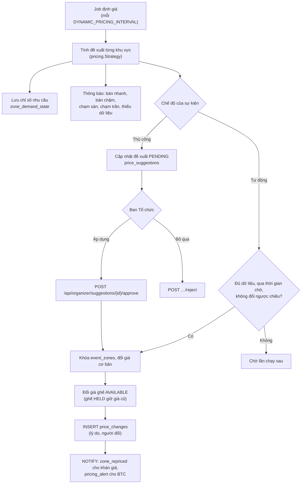

# Định giá động và Gợi ý sự kiện

Tài liệu đặc tả **Định giá động (FR-22, cờ `dynamic_pricing`)** và **Gợi ý sự kiện (cờ `recommendations`)** như đang chạy trong code.

- **Mã công việc:** `T08`
- **Yêu cầu liên quan:** FR-22, FR-08, FR-20, NFR-12, W-01

## 0. Trạng thái và thay đổi so với thiết kế

Cả hai tính năng đã có trong code, mặc định tắt:
- `dynamic_pricing` chỉ bật ở profile `final` hoặc bằng `FEATURE_DYNAMIC_PRICING=on`.
- `recommendations` chỉ bật ở profile `final` hoặc bằng `FEATURE_RECOMMENDATIONS=on`.
- Mỗi sự kiện có định giá động tắt cho tới khi Ban Tổ chức tự bật.

Hai điểm khác thiết kế gốc, cần nhóm duyệt:
- **W-01.** Thiết kế ghi "Hệ thống không bao giờ tự đổi giá". Chế độ Tự động (mục 2) cho hệ thống tự đổi giá, nhưng chỉ khi BTC tự bật cho từng sự kiện, đã duyệt giá sàn, giá trần của từng khu vực, và trong giới hạn bước đổi, thời gian chờ do BTC đặt. Việc "AI tự đổi giá không có sự đồng ý của BTC" vẫn không làm.
- **Cờ `recommendations`.** Gợi ý sự kiện không có mã FR. Cờ mới này chưa có trong bảng cờ của tài liệu SA.

## 1. Bài toán

Nhu cầu mua vé phân bổ không đều giữa các khu vực:
- Khu vực "hot" bán hết trong vài phút, mở đường cho phe vé.
- Khu vực xa sân khấu bán chậm, dễ còn ghế trống khi sự kiện diễn ra.

Mục tiêu:
1. Giá mỗi khu vực bám theo nhu cầu thực, để ghế bán hết trước giờ đóng bán.
2. BTC luôn kiểm soát: chọn chế độ, duyệt khoảng giá, xem lý do của mọi đề xuất và mọi lần đổi giá.
3. Người mua được bảo vệ: giá không vượt khoảng BTC đã duyệt, không nhảy vọt, ghế đang giữ không đổi giá.

## 2. Ba chế độ cho mỗi sự kiện

| Chế độ | `enabled` | `auto_adjust` | Hệ thống làm gì |
|---|---|---|---|
| Tắt | `FALSE` | `FALSE` | Không phân tích, không đề xuất. Mặc định. |
| Thủ công, AI đề xuất (Mode B) | `TRUE` | `FALSE` | Phân tích, gửi đề xuất và thông báo. Không bao giờ tự đổi giá. |
| Tự động (Mode A) | `TRUE` | `TRUE` | Phân tích và tự đổi giá trong khoảng đã duyệt. |

Cấu hình nằm ở bảng `event_pricing_settings`:
- `max_step_pct`: bước đổi giá tối đa mỗi lần, 1–20%, mặc định 10%.
- `cooldown_minutes`: thời gian chờ tối thiểu giữa hai lần đổi giá của một khu vực, 5–1440 phút, mặc định 60.
- Ràng buộc `CHECK (enabled OR NOT auto_adjust)`: không thể bật Tự động khi đang tắt.

Từng khu vực có thể tham gia hoặc không, qua cột `event_zones.is_dynamic_pricing_enabled`.
Bật định giá cho một sự kiện chưa có khu vực nào tham gia thì mọi khu vực cùng tham gia.

### 2.1. Duyệt giá sàn, giá trần

BTC lưu giá ở một khu vực (`PUT …/zones/{zoneId}/pricing`) thì giá sàn, giá trần đó được tính là đã duyệt.
Hệ thống ghi `event_zones.bounds_approved_at` và `bounds_approved_by`.

- Bật Tự động khi còn khu vực tham gia chưa được duyệt: trả `409 bounds_not_approved`.
- Thêm một khu vực chưa duyệt vào khi đang Tự động: cũng trả `409 bounds_not_approved`.
- Hệ thống luôn gợi ý một khoảng sàn, trần (mục 4.5). BTC dùng nút "Dùng sàn, trần đề xuất" hoặc tự nhập.

### 2.2. Bảo vệ chống dao động

Một đề xuất chỉ được tự động áp dụng khi qua cả bốn chốt:
1. Đủ dữ liệu (độ tin cậy ≥ 35%, mục 4.3).
2. Hành động là tăng hoặc giảm, không phải giữ giá.
3. Đã qua `cooldown_minutes` kể từ lần đổi giá gần nhất của khu vực, dù lần đó do BTC hay do hệ thống.
4. Không đổi ngược chiều lần trước nếu chưa qua 2 × `cooldown_minutes`.

Chốt 3 bảo đảm giá BTC vừa đặt tay không bị ghi đè ngay.
Ngoài ra, mỗi lần đổi không quá `max_step_pct`, và chỉ số nhu cầu được làm mượt giữa các lần chạy (mục 4.3).

Khi áp dụng, hệ thống khóa dòng `event_zones`, kiểm tra lại giá hiện tại và khoảng sàn, trần.
Ai đó vừa đổi giá trong lúc phân tích thì bỏ qua lần này.

## 3. Dữ liệu đầu vào

Job chạy mỗi `DYNAMIC_PRICING_INTERVAL` (mặc định 5 phút) cho mọi sự kiện `ON_SALE` có định giá bật và chưa đóng bán.
BTC cũng có thể bấm "Phân tích ngay".

| Tín hiệu | Nguồn |
|---|---|
| Giá hiện tại, sàn, trần | `event_zones` |
| Giá niêm yết | `old_price` của lần đổi giá đầu tiên trong `price_changes`, hoặc giá hiện tại |
| Sức chứa, còn trống, đang giữ, đã bán | `event_seats` theo khu vực |
| Lượt giữ ghế trong 1 giờ, 24 giờ, từ đầu | `seat_holds` |
| Vé bán trong 1 giờ, 24 giờ, từ đầu | `tickets` khác `VOID` |
| Người đang chờ, sức chứa phòng chờ | `queue_entries`, `events.waiting_room_capacity` |
| Lượt xem 24 giờ, tỷ lệ xem → giữ ghế chung 30 ngày | `event_views`, `seat_holds` (do hệ thống Gợi ý cung cấp) |
| Giờ mở bán | `events.sales_starts_at`, không có thì `events.created_at` |
| Giờ đóng bán | `events.sales_ends_at`, không có thì `events.starts_at` |
| Chỉ số nhu cầu lần trước | `zone_demand_state` |
| Lần đổi giá gần nhất và chiều đổi | `price_changes` |

## 4. Mô hình nhu cầu

Mã nguồn: `backend/internal/pricing/demand.go`.
Gói `pricing` không phụ thuộc database. Mọi chiến lược định giá cài đặt interface `pricing.Strategy`, nên có thể thay mô hình mà không sửa job, API hay giao diện.

### 4.1. Ước lượng nhu cầu đã cam kết

- Tỷ lệ chuyển đổi giữ ghế → mua $c$:
  - chưa bật `payments`: dùng giá trị mặc định $c = 0{,}5$;
  - đã bật `payments`: $c = \dfrac{\text{vé} + 10 \cdot 0{,}5}{\text{lượt giữ} + 10}$, giới hạn trong $[0{,}05; 1]$.
- Ghế đã cam kết: $S = \text{đã bán} + c \cdot \text{đang giữ}$.
- Tốc độ bán (vé/giờ), kết hợp hai cửa sổ:
  $v = 0{,}6 \cdot \dfrac{c \cdot \text{giữ}_{1h}}{t_1} + 0{,}4 \cdot \dfrac{c \cdot \text{giữ}_{24h}}{t_{24}}$,
  với $t_1, t_{24}$ là độ dài thực của cửa sổ (không quá thời gian đã mở bán).
- Tốc độ cần đạt để hết ghế: $v^* = \dfrac{\text{sức chứa} - S}{\text{số giờ còn lại}}$.

### 4.2. Đường bán vé kỳ vọng

Vé sự kiện thường bán mạnh lúc mở bán, chững lại, rồi tăng lại sát ngày diễn.
Tỷ lệ sức chứa kỳ vọng đã bán ở thời điểm $t \in [0, 1]$ của đợt bán:

$$E(t) = 0{,}55 \cdot \frac{1 - e^{-6t}}{1 - e^{-6}} + 0{,}45 \cdot t^3$$

$E(0) = 0$, $E(1) = 1$, và $E$ tăng đều.

### 4.3. Chỉ số nhu cầu

Năm thành phần, mỗi thành phần bằng 1 khi đúng kế hoạch:

| Thành phần | Công thức | Trọng số |
|---|---|---|
| Tốc độ so với cần đạt | $P = \dfrac{v + 0{,}1}{v^* + 0{,}1}$ | 0,35 |
| Tiến độ so với kế hoạch | $R = \dfrac{S/\text{sức chứa} + 0{,}02}{E(t) + 0{,}02}$ | 0,30 |
| Áp lực phòng chờ | $q = 1 + \dfrac{\text{người chờ}}{\text{sức chứa phòng chờ}}$ | 0,15 |
| Áp lực giữ ghế | $h = 1 + \dfrac{\text{đang giữ}}{\text{còn trống} + \text{đang giữ}}$ | 0,10 |
| Độ nhạy giá | $I = \dfrac{\text{giữ}/\text{xem của sự kiện} + 0{,}01}{\text{giữ}/\text{xem chung} + 0{,}01}$, giới hạn $[0{,}5; 2]$ | 0,10 |

$I$ chỉ tính khi sự kiện có ít nhất 20 lượt xem trong 24 giờ.
Nhiều người xem nhưng ít người giữ ghế cho thấy giá có thể đang cao.

$$\ln \alpha = 0{,}35 \ln P + 0{,}30 \ln R + 0{,}15 \ln q + 0{,}10 \ln h + 0{,}10 \ln I, \quad \alpha \in [0{,}25; 4]$$

Tốc độ cao không tự động nghĩa là tăng giá.
$P$ so tốc độ với số ghế còn lại và thời gian còn lại:
bán 40 vé/giờ nhưng còn 900 ghế trong 2 giờ vẫn là thiếu cầu và được đề xuất giảm giá.

**Độ tin cậy.**
Bằng chứng $n = \text{giữ}_{24h} + \text{vé}_{24h} + \text{xem}_{24h}/10$, nhưng không nhỏ hơn số vé kỳ vọng đã bán $E(t) \cdot \text{sức chứa}$, vì bán chậm kéo dài cũng là bằng chứng.

$$\text{tin cậy} = \left(1 - e^{-n/8}\right) \cdot \min\left(1, \frac{\text{giờ đã mở bán}}{2}\right)$$

- Dưới 35%: "chưa đủ dữ liệu", giữ nguyên giá, gửi thông báo `INSUFFICIENT_DATA`.
- Chỉ số được co về 1 theo độ tin cậy: $\ln \alpha_{\text{eff}} = \text{tin cậy} \cdot \ln \alpha$.
- Làm mượt với lần chạy trước: $\ln \alpha_s = 0{,}5 \ln \alpha_{\text{eff}} + 0{,}5 \ln \alpha_{\text{trước}}$.

### 4.4. Từ nhu cầu ra giá

Với độ co giãn giả định $\varepsilon = 2$, muốn đưa nhu cầu về đúng mức cần thì giá nhân với $\alpha_s^{1/\varepsilon}$:

1. Bước đổi: $\delta = \text{clamp}\left(\alpha_s^{1/2} - 1, -\text{bước tối đa}, +\text{bước tối đa}\right)$.
2. Giá đề xuất: giá hiện tại × $(1 + \delta)$, kẹp vào $[\text{sàn}, \text{trần}]$, làm tròn tới 10.000đ, kẹp lại.
3. Hành động: tăng hoặc giảm khi $|\delta| \ge 5\%$ và giá thực sự đổi; còn lại là giữ giá.
4. Khoảng hợp lý: tính lại với $\alpha_s \cdot e^{\pm(0{,}05 + 0{,}4 \cdot (1 - \text{tin cậy}))}$.

Ngưỡng 5% áp lên tín hiệu, không áp lên mức đổi còn lại sau khi kẹp.
Nhờ vậy tín hiệu mạnh vẫn đưa được giá tới đúng giá sàn hoặc giá trần.

### 4.5. Gợi ý giá sàn, giá trần

- Sàn: giá niêm yết × 0,80.
- Trần: giá niêm yết × (1,25 + $\text{clamp}(0{,}5 \ln \alpha_s, 0, 0{,}25)$): nhu cầu cao thì nới trần.
- Khoảng gợi ý luôn chứa giá hiện tại.

### 4.6. Ví dụ: khu GA bán nhanh

Số liệu từ lần kiểm thử end-to-end, tính bằng chính mã nguồn:
- GA: 24 chỗ, đã bán 14, còn 10. Giá 1.500.000đ, sàn 1.200.000đ, trần 1.800.000đ.
- Mở bán 24 giờ trước, còn 24 giờ. Chưa bật `payments`, nên $c = 0{,}5$.
- 24 lượt giữ trong 1 giờ qua, 48 lượt trong 24 giờ.

Các bước:
1. $v = 0{,}6 \cdot 12 + 0{,}4 \cdot 1 = 7{,}6$ vé/giờ. $v^* = 10 / 24 \approx 0{,}42$ vé/giờ. $P \approx 14{,}9$.
2. Đã bán 58%, kế hoạch $E(0{,}5) \approx 58\%$, nên $R \approx 1{,}0$.
3. $\ln \alpha \approx 0{,}35 \ln 14{,}9 \approx 0{,}95$, nên $\alpha \approx 2{,}57$. Độ tin cậy 99,8%.
4. $\delta = \min(2{,}57^{1/2} - 1;\ 10\%) = 10\%$. Giá 1.650.000đ, trong khoảng sàn, trần.

Kết quả: **tăng lên 1.650.000đ**, lý do "bán 7.6 vé/giờ, cần 0.4 vé/giờ để hết ghế trước giờ đóng bán".
Cùng lúc, các khu chưa bán vé nào được đề xuất giảm 10%: đã nửa đợt bán, kế hoạch 58%, thực tế 0%.

## 5. Quy trình

Trong chế độ Thủ công, đề xuất `PENDING` tự hết hạn (`EXPIRED`) khi:
- lần phân tích sau là "giữ giá" hoặc "chưa đủ dữ liệu";
- giá khu vực bị đổi theo cách khác;
- BTC tắt định giá, chuyển sang Tự động, hoặc bỏ khu vực khỏi định giá động.

## 6. Nhất quán giá và tồn kho

- Mọi lần đổi giá cơ bản (thủ công, duyệt đề xuất, tự động) đi qua một hàm `recordBaseChange`, trong cùng giao dịch với việc đổi giá.
- Hàm này đổi giá ghế `AVAILABLE`, ghi `price_changes`, đóng đề xuất đang chờ, rồi gửi `NOTIFY`.
- Ghế `HELD` giữ giá người mua đã thấy.
- Ghế trở lại bán (nhả, hết hạn, hủy vé) lấy giá cơ bản bằng truy vấn con có `FOR SHARE OF ez`.
  Truy vấn này chờ giao dịch đổi giá đang chạy kết thúc, nên ghế không bao giờ trở lại với giá cũ.
- Trang chọn ghế nhận `zone_repriced` qua SSE và tải lại giá.
- Giá khán giả thấy luôn là `event_seats.current_price`: giá "từ" của khu vực là giá thấp nhất trong các ghế còn trống; giỏ giữ ghế dùng giá của ghế đang giữ.

## 7. Nhật ký giá và thông báo

`price_changes.reason` ghi nguồn của lần đổi:

| `reason` | Ý nghĩa | `changed_by` | `details` |
|---|---|---|---|
| `MANUAL` | BTC tự đổi | BTC | trống |
| `SUGGESTION` | BTC duyệt đề xuất AI | BTC | lý do của đề xuất |
| `AUTO` | Hệ thống tự đổi | `NULL` | lý do của đề xuất |

Bảng vẫn không thể sửa hoặc xóa (NFR-12).

Thông báo nằm ở bảng `pricing_alerts`, gắn với sự kiện và khu vực:

| `kind` | Khi nào | Không lặp lại trong |
|---|---|---|
| `SELLING_FAST` | Chỉ số nhu cầu ≥ 1,5, tin cậy ≥ 50% | 3 giờ |
| `SELLING_SLOW` | Chỉ số nhu cầu ≤ 0,6, tin cậy ≥ 50% | 3 giờ |
| `RECOMMENDATION` | Có đề xuất mới hoặc giá đề xuất đổi (Thủ công) | — |
| `AUTO_ADJUSTED` | Hệ thống vừa đổi giá (Tự động) | — |
| `AT_CEILING` | Nhu cầu cao nhưng giá đã ở trần | 6 giờ |
| `AT_FLOOR` | Nhu cầu thấp nhưng giá đã ở sàn | 6 giờ |
| `INSUFFICIENT_DATA` | Độ tin cậy dưới 35% | 6 giờ |
| `BOUNDS_NOT_APPROVED` | Khu vực tham gia Tự động nhưng chưa duyệt sàn, trần | 6 giờ |

Thông báo đến trang BTC ngay qua SSE `GET /api/organizer/events/{id}/pricing/stream`.
`RealtimeHub` chuyển mọi tin `pricing_*` sang chủ đề riêng của BTC, nên luồng SSE của khán giả không nhận được.

## 8. Gợi ý sự kiện (cờ `recommendations`)

Mã nguồn: `backend/internal/recommend/score.go`.

### 8.1. Dữ liệu hành vi

- Xem: `POST /api/events/{id}/views` khi người dùng đã đăng nhập mở trang sự kiện hoặc trang chọn ghế. Mỗi người, mỗi sự kiện tính một lần mỗi 30 phút.
- Giữ ghế: `seat_holds`.
- Mua: `tickets` khác `VOID`.

Hồ sơ người dùng tính trong 180 ngày:
- trọng số xem 1, giữ ghế 2, mua 3;
- suy giảm theo thời gian, nửa đời 30 ngày;
- giá quen thuộc là trung vị giá các ghế đã giữ hoặc đã mua.

### 8.2. Điểm ưu tiên

| Tiêu chí | Công thức (0–100) | Trọng số |
|---|---|---|
| Hợp thể loại | cosin giữa vector thể loại của người dùng và thể loại sự kiện | 35% |
| Hợp ngân sách | $100 \cdot \max\left(0, 1 - \dfrac{\lvert P_{\text{khu}} - \bar P \rvert}{\bar P}\right)$, khu còn ghế có giá gần $\bar P$ nhất; chưa biết $\bar P$ thì 50 | 25% |
| Hợp thành phố | cosin giữa vector thành phố của người dùng và thành phố sự kiện | 15% |
| Còn chỗ ở khu gợi ý | tỷ lệ ghế còn trống của khu đó | 15% |
| Còn chỗ toàn sự kiện | tỷ lệ ghế còn trống của sự kiện | 10% |

Khác bản nháp cũ của Priority Scoring:
- Không có tọa độ địa điểm, nên dùng thành phố thay khoảng cách.
- Không có vị trí sân khấu, nên dùng "còn chỗ ở khu gợi ý" thay góc nhìn ghế.
- Không có lịch sử nghe nhạc và thông báo đẩy.

### 8.3. Người mới và người ít dữ liệu

- Độ phổ biến 7 ngày: $\text{xem} + 3 \cdot \text{giữ} + 5 \cdot \text{mua}$, chia cho sự kiện phổ biến nhất.
- Điểm phổ biến: $100 \cdot (0{,}7 \cdot \text{phổ biến} + 0{,}3 \cdot \text{tỷ lệ còn chỗ})$.
- Mức cá nhân hóa $\omega = \min(1, \text{số tương tác} / 5)$.
- Điểm xếp hạng: $\omega \cdot \text{điểm hợp} + (1 - \omega) \cdot \text{điểm phổ biến}$.

Người chưa đăng nhập hoặc chưa có tương tác nhận danh sách "Đang được quan tâm".
Bỏ qua sự kiện người dùng đã mua vé và sự kiện đã hết ghế.

### 8.4. Tầng hiển thị

Tầng dựa trên điểm hợp (không dựa trên điểm xếp hạng), để sự kiện chỉ phổ biến không bị gắn nhãn "hợp với bạn":

| Tầng | Điểm hợp | Nhãn |
|---|---|---|
| `TOP_PICK` | ≥ 80 | Hợp nhất với bạn |
| `TRENDING` | 65–79 | Xu hướng hợp gu |
| `DISCOVERY` | 50–64 | Khám phá thêm |
| `MORE` | dưới 50 | Có thể bạn thích |
| `POPULAR` | chưa cá nhân hóa | Đang được quan tâm |

Mỗi gợi ý kèm lý do và khu vực gợi ý, hiện ở mục "Dành cho bạn" trên trang chủ.

### 8.5. Liên kết với định giá

`RecommendationService.EventInterest` cung cấp lượt xem 24 giờ và tỷ lệ xem → giữ ghế chung cho job định giá.
Đây là thành phần "độ nhạy giá" $I$ ở mục 4.3.
Gói `pricing` chỉ nhận số liệu, không gọi ngược gói `recommend`.

## 9. API

| Endpoint | Việc |
|---|---|
| `GET /api/organizer/events/{id}/pricing` | Tổng quan: chế độ, từng khu vực, đề xuất, tồn kho, biểu đồ 48 giờ |
| `PUT /api/organizer/events/{id}/pricing/settings` | Đổi chế độ, bước đổi, thời gian chờ |
| `PUT /api/organizer/events/{id}/zones/{zoneId}/dynamic-pricing` | Cho khu vực tham gia hoặc không |
| `POST /api/organizer/events/{id}/pricing/analyze` | Phân tích ngay |
| `GET /api/organizer/events/{id}/pricing/history` | Nhật ký giá |
| `GET /api/organizer/events/{id}/pricing/alerts` | Thông báo |
| `POST /api/organizer/events/{id}/pricing/alerts/read` | Đánh dấu đã đọc tất cả |
| `POST /api/organizer/pricing/alerts/{id}/read` | Đánh dấu một thông báo đã đọc |
| `GET /api/organizer/events/{id}/pricing/stream` | SSE cho trang BTC |
| `GET /api/organizer/events/{id}/pricing/suggestions` | Đề xuất đang chờ |
| `POST /api/organizer/suggestions/{id}/approve`, `…/reject` | Duyệt hoặc bỏ qua đề xuất |
| `GET /api/recommendations/events` | Gợi ý sự kiện |
| `POST /api/events/{id}/views` | Ghi lượt xem |

Mọi endpoint BTC cần cờ `organizer_console` và `dynamic_pricing`, vai trò `ORGANIZER` hoặc `ADMIN`, và phải là BTC của sự kiện.
Đặc tả đầy đủ ở [`api/openapi.yaml`](api/openapi.yaml).

## 10. Kiểm thử

| Kịch bản | Kết quả | Test |
|---|---|---|
| Mới mở bán, chưa có dữ liệu | Giữ giá, báo thiếu dữ liệu | `TestRecommend_ColdStartHoldsPrice`, `TestPricing_InsufficientDataHoldsAndAlerts` |
| Nhu cầu cao | Tăng, không quá bước tối đa | `TestRecommend_StrongDemandRaisesWithinStep` |
| Bán nhanh nhưng còn quá nhiều ghế so với thời gian | Giảm | `TestRecommend_FastSalesButTooMuchInventoryLowers` |
| Chạm sàn, chạm trần | Dừng ở sàn, trần, báo | `TestRecommend_SlowSalesStopAtFloor`, `TestRecommend_AtCeilingMaintains` |
| Thời gian chờ, chống đổi ngược | Không áp dụng | `TestAutoDecision` |
| Định giá tắt | Không đề xuất, không đổi | `TestPricing_OffByDefault` |
| Thủ công | Đề xuất, không bao giờ tự đổi; duyệt thì đổi và ghi `SUGGESTION` | `TestPricing_ManualModeSuggestsButNeverChangesPrice` |
| Tự động chưa duyệt sàn, trần | `bounds_not_approved` | `TestPricing_AutoModeNeedsApprovedBounds` |
| Tự động | Đổi trong khoảng, ghi `AUTO`, lần sau chờ | `TestPricing_AutoModeAdjustsWithinBoundsThenCoolsDown` |
| BTC vừa đổi tay khi đang Tự động | Hệ thống không ghi đè | `TestPricing_AutoModeRespectsManualOverride` |
| Giữ, nhả ghế song song với đổi giá | Mọi ghế trống đúng giá cơ bản | `TestPricing_ConcurrentHoldsAndRepricingStayConsistent` |
| BTC khác, khán giả, người chưa đăng nhập | 403, 403, 401 | `TestPricingHandler_OnlyTheEventsOrganizer`, kiểm thử end-to-end |
| Gợi ý theo hành vi, người mới | Cá nhân hóa, hoặc phổ biến | `TestRank_*`, `TestRecommendations_FollowViewsAndHolds` |

## 11. Phản biện Định giá động và cách thiết kế giảm rủi ro

Định giá động gây tranh cãi trong ngành vé sự kiện.
Nhóm chưa chạy thực nghiệm nào về hành vi người mua, nên các lập luận dưới đây là lập luận lý thuyết và tiền lệ công khai, không phải số liệu của nhóm.

### 11.1. Tiền lệ công khai
- **Oasis (Anh):** Cơ quan Quản lý Cạnh tranh và Thị trường (CMA) điều tra việc bán vé tour Oasis vì cách trình bày giá có thể gây hiểu lầm cho người mua.
- **Bruce Springsteen (Mỹ):** đợt bán vé tour 2022 dùng giá theo nhu cầu, nhiều vé có giá hàng nghìn USD và bị chỉ trích rộng rãi.

Cần bổ sung nguồn trích dẫn trước khi nộp.

### 11.2. Lập luận phản biện và cách thiết kế đáp lại

| Lập luận | Biện pháp |
|---|---|
| Người mua không biết giá có thể tăng khi đang chọn ghế | Ghế `HELD` giữ giá. Giá đổi chỉ áp cho ghế còn trống. |
| Giá nhảy vọt | Bước tối đa 1–20% mỗi lần, có thời gian chờ, chống đổi ngược, làm mượt chỉ số. |
| Giá vô lý | Luôn trong khoảng sàn, trần BTC đã duyệt. |
| Hệ thống quyết thay BTC | Mặc định tắt. Chế độ Thủ công không bao giờ tự đổi giá. Tự động phải do BTC bật. |
| Không minh bạch | Mọi đề xuất và mọi lần đổi giá có lý do bằng số liệu, lưu trong `price_changes`, không thể sửa. |
