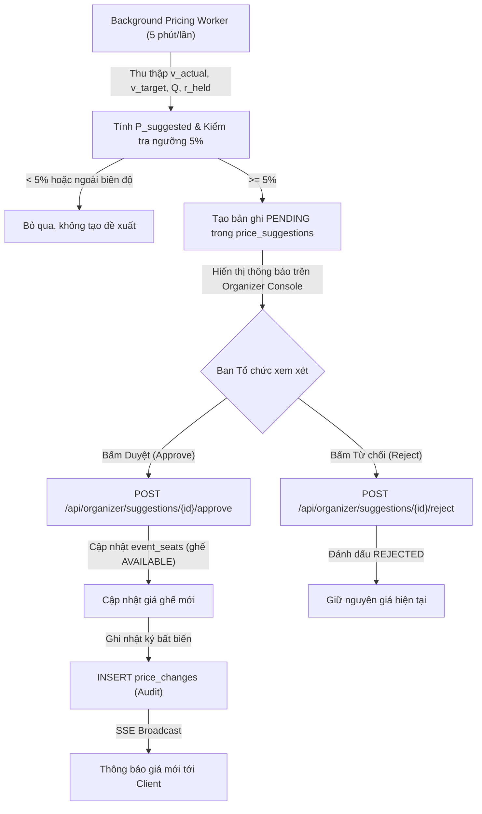

# Bài toán và thiết kế Định giá động (Dynamic Pricing)

Tài liệu đặc tả bài toán, mô hình toán học giả định, thuật toán tính toán và quy trình phê duyệt cho tính năng **Định giá động (Dynamic Pricing - FR-22)** trong hệ thống EventTicketing, tuân thủ nguyên tắc kiểm soát của Ban Tổ chức (Human-in-the-loop, `W-01`) theo Mục 6 của [`docs/design/README.md`](design/README.md).

---

## 1. Mô tả bài toán & Mục tiêu kinh doanh

### 1.1. Bối cảnh
Trong các sự kiện âm nhạc và giải trí quy mô lớn, nhu cầu mua vé thường phân bổ không đồng đều:
- **Khu vực "Hot" (VIP, Fanzone):** Thường bị săn lùng và "cháy vé" trong vài phút đầu mở bán, tạo cơ hội cho phe vé đầu cơ và bán lại trên thị trường chợ đen với giá gấp 2–5 lần.
- **Khu vực xa sân khấu (Khán đài phổ thông):** Tốc độ bán chậm hơn nhiều so với dự kiến, dẫn đến nguy cơ lãng phí ghế trống khi sự kiện diễn ra.

### 1.2. Mục tiêu
1. **Tối đa hóa doanh thu và tỷ lệ lấp đầy (Fill Rate):** Tự động điều chỉnh linh hoạt theo quy luật cung - cầu thực tế của từng khu vực khán đài.
2. **Thu hẹp thị trường chợ đen:** Cho phép giá vé khu vực "hot" tăng tiệm cận giá trị thị trường, mang doanh thu thặng dư về cho nghệ sĩ và nhà sản xuất thay vì rơi vào tay phe vé.
3. **An toàn pháp lý và thương hiệu (`W-01`):** Hệ thống **không bao giờ tự động đổi giá trực tiếp**. Thuật toán đóng vai trò cố vấn thông minh định kỳ sinh ra đề xuất giá (`price_suggestions`). Mọi thay đổi chỉ có hiệu lực khi được Ban Tổ chức (BTC) phê duyệt trên giao diện quản trị.
4. **Bảo vệ người tiêu dùng:** Giá bán luôn bị chặn cứng trong khoảng an toàn `[giá sàn, giá trần]` đã được đăng ký và phê duyệt từ trước.

---

## 2. Mô hình giả định (Mathematical Assumption Model)

Hệ thống định giá dựa trên các giả định kinh tế vi mô:
1. **Độ co giãn của cầu theo giá (Price Elasticity of Demand):** Nhu cầu mua vé sự kiện nhạy cảm với thời gian mở bán và số lượng ghế còn lại.
2. **Chu kỳ đánh giá:** Định kỳ mỗi **5 phút** (`T = 300` giây), một background job thu thập số liệu vận hành của từng khu vực trong sự kiện đang mở bán.
3. **Cửa sổ trượt (Sliding Window):** Đo lường tốc độ bán trong khoảng thời gian trượt $\Delta t = 15$ phút gần nhất để giảm thiểu hiện tượng nhiễu đột biến ngắn hạn.

---

## 3. Dữ liệu đầu vào (Input Parameters)

Mỗi lần chạy, thuật toán đọc các tham số của từng khu vực (`zone_id`) từ PostgreSQL:

| Ký hiệu | Tên tham số | Đơn vị | Nguồn dữ liệu |
|---|---|---|---|
| $P_{\text{current}}$ | Giá bán hiện tại của khu vực | VNĐ | `event_seats.price` |
| $P_{\text{floor}}$ | Giá sàn tuyệt đối | VNĐ | `zones.floor_price` |
| $P_{\text{ceiling}}$ | Giá trần tuyệt đối | VNĐ | `zones.ceiling_price` |
| $S_{\text{rem}}$ | Số ghế còn lại chưa bán (`AVAILABLE` + `HELD`) | Ghế | `event_seats` |
| $S_{\text{held}}$ | Số ghế đang ở trạng thái giữ chỗ (`HELD`) | Ghế | `event_seats` WHERE `status = 'HELD'` |
| $T_{\text{rem}}$ | Thời gian còn lại đến khi đóng bán | Phút | `events.end_sale_time - now()` |
| $v_{\text{target}}$ | Tốc độ bán mục tiêu cần đạt: $\frac{S_{\text{rem}}}{T_{\text{rem}}}$ | Vé/phút | Tính toán nội bộ |
| $v_{\text{actual}}$ | Tốc độ bán thực tế: $\frac{\text{Số vé bán thành công trong 15 phút}}{15}$ | Vé/phút | Bảng `tickets` & `order_items` |
| $Q$ | Số lượng người dùng đang chờ trong phòng chờ ảo | Người | Bảng `queue_entries` WHERE `status = 'WAITING'` |
| $r_{\text{held}}$ | Tỷ lệ ghế đang bị giữ: $\frac{S_{\text{held}}}{S_{\text{rem}}}$ | Tỉ lệ [0, 1] | Tính toán nội bộ |

---

## 4. Quy tắc và Công thức tính toán

### 4.1. Chỉ số áp lực thị trường tổng hợp ($\alpha$)

Chỉ số $\alpha$ phản ánh tương quan giữa lực cầu và nguồn cung khả dụng:
$$\alpha = w_1 \cdot \left(\frac{v_{\text{actual}}}{v_{\text{target}}}\right) + w_2 \cdot \left(1 + \frac{Q}{C_{\text{target}}}\right) + w_3 \cdot \left(1 + r_{\text{held}}\right)$$

Trong đó trọng số chuẩn hóa:
- $w_1 = 0.50$ (Áp lực từ tốc độ bán thực tế so với mục tiêu)
- $w_2 = 0.30$ (Áp lực từ hàng chờ ảo, với dung lượng mục tiêu $C_{\text{target}} = 500$)
- $w_3 = 0.20$ (Áp lực từ lượng ghế đang bị người dùng giữ chỗ tích cực)

*(Nếu $\alpha > 1.0$: Nhu cầu cao hơn kế hoạch $\rightarrow$ Cần xem xét tăng giá. Nếu $\alpha < 1.0$: Nhu cầu chậm $\rightarrow$ Cần xem xét giảm giá).*

### 4.2. Tỉ lệ điều chỉnh giá ($\delta$)

Tỉ lệ điều chỉnh được tính tuyến tính theo độ lệch của $\alpha$, đồng thời chặn trần biến động tối đa $\pm 20\%$ mỗi chu kỳ:
$$\delta = \text{clamp}\left( k \cdot (\alpha - 1.0), -0.20, +0.20 \right)$$
*(Với độ nhạy $k = 0.25$)*.

### 4.3. Giá đề xuất sơ bộ ($P_{\text{raw}}$)
$$P_{\text{raw}} = P_{\text{current}} \cdot (1 + \delta)$$

### 4.4. Áp dụng giới hạn an toàn (Clamping) & Làm tròn tiền tệ
1. **Chặn giá sàn và giá trần:**
   $$P_{\text{clamped}} = \max\left(P_{\text{floor}}, \min\left(P_{\text{ceiling}}, P_{\text{raw}}\right)\right)$$
2. **Làm tròn tiền tệ đến bội số 10.000 VNĐ:**
   $$P_{\text{suggested}} = \text{round}_{10,000}\left(P_{\text{clamped}}\right) = \left\lfloor \frac{P_{\text{clamped}} + 5000}{10000} \right\rfloor \times 10000$$

### 4.5. Ngưỡng lọc nhiễu 5% (Threshold Filter)
Để tránh làm phiền Ban Tổ chức với những biến động không đáng kể:
$$\Delta P_{\text{rel}} = \frac{|P_{\text{suggested}} - P_{\text{current}}|}{P_{\text{current}}}$$
- **Nếu $\Delta P_{\text{rel}} < 5\%$:** Bỏ qua, không sinh bản ghi đề xuất.
- **Nếu $\Delta P_{\text{rel}} \ge 5\%$:** Tạo một đề xuất mới trong bảng `price_suggestions` với `status = 'PENDING'` kèm chuỗi giải thích định lượng.

---

## 5. Quy trình phê duyệt của Ban Tổ chức (Workflow)

---

## 6. Ví dụ tính tay cụ thể (Numerical Walkthrough)

### Kịch bản 1: Khu Fanzone nhu cầu bùng nổ (Đề xuất tăng giá)

- **Thông số khu vực:**
  - $P_{\text{current}} = 1.200.000$ VNĐ
  - $P_{\text{floor}} = 1.000.000$ VNĐ; $P_{\text{ceiling}} = 2.000.000$ VNĐ
  - $S_{\text{rem}} = 300$ ghế; Thời gian còn lại $T_{\text{rem}} = 60$ phút $\implies v_{\text{target}} = \frac{300}{60} = 5.0$ vé/phút.
- **Dữ liệu thực tế đo được:**
  - 15 phút vừa qua bán được 150 vé $\implies v_{\text{actual}} = \frac{150}{15} = 10.0$ vé/phút.
  - Hàng chờ ảo $Q = 250$ người; $C_{\text{target}} = 500 \implies \frac{Q}{C_{\text{target}}} = 0.5$.
  - Số ghế đang giữ $S_{\text{held}} = 120$ ghế $\implies r_{\text{held}} = \frac{120}{300} = 0.4$.
- **Các bước tính toán:**
  1. Chỉ số áp lực $\alpha$:
     $$\alpha = 0.5 \cdot \left(\frac{10.0}{5.0}\right) + 0.3 \cdot (1 + 0.5) + 0.2 \cdot (1 + 0.4) = 0.5 \cdot 2.0 + 0.3 \cdot 1.5 + 0.2 \cdot 1.4 = 1.0 + 0.45 + 0.28 = 1.73$$
  2. Tỉ lệ điều chỉnh $\delta$:
     $$\delta = \text{clamp}(0.25 \cdot (1.73 - 1.0), -0.20, +0.20) = \text{clamp}(0.1825, -0.20, +0.20) = +18.25\%$$
  3. Giá sơ bộ $P_{\text{raw}}$:
     $$P_{\text{raw}} = 1.200.000 \times (1 + 0.1825) = 1.419.000 \text{ VNĐ}$$
  4. Ràng buộc & làm tròn 10.000 VNĐ:
     - $P_{\text{clamped}} = \max(1.000.000, \min(2.000.000, 1.419.000)) = 1.419.000$ VNĐ
     - $P_{\text{suggested}} = \text{round}_{10,000}(1.419.000) = 1.420.000$ VNĐ
  5. Kiểm tra ngưỡng 5%:
     $$\Delta P_{\text{rel}} = \frac{|1.420.000 - 1.200.000|}{1.200.000} = \frac{220.000}{1.200.000} \approx 18.33\% \ge 5\% \quad \text{(HỢP LỆ)}$$
- **Kết quả:** Hệ thống tạo đề xuất tăng từ **1.200.000 VNĐ** lên **1.420.000 VNĐ** (+18.3%) kèm lý do: *"Tốc độ bán gấp 2.0x mục tiêu, 250 người xếp hàng chờ và 40% ghế đang bị giữ"*.

---

### Kịch bản 2: Khán đài C bán chậm (Đề xuất giảm giá kích cầu)

- **Thông số khu vực:**
  - $P_{\text{current}} = 500.000$ VNĐ; $P_{\text{floor}} = 350.000$ VNĐ; $P_{\text{ceiling}} = 700.000$ VNĐ
  - $S_{\text{rem}} = 800$ ghế; $T_{\text{rem}} = 80$ phút $\implies v_{\text{target}} = \frac{800}{80} = 10.0$ vé/phút.
- **Dữ liệu thực tế đo được:**
  - 15 phút vừa qua bán được 30 vé $\implies v_{\text{actual}} = \frac{30}{15} = 2.0$ vé/phút.
  - Hàng chờ ảo $Q = 0$ người; $S_{\text{held}} = 16$ ghế $\implies r_{\text{held}} = \frac{16}{800} = 0.02$.
- **Các bước tính toán:**
  1. Chỉ số áp lực $\alpha$:
     $$\alpha = 0.5 \cdot \left(\frac{2.0}{10.0}\right) + 0.3 \cdot (1 + 0) + 0.2 \cdot (1 + 0.02) = 0.5 \cdot 0.2 + 0.3 \cdot 1.0 + 0.2 \cdot 1.02 = 0.10 + 0.30 + 0.204 = 0.604$$
  2. Tỉ lệ điều chỉnh $\delta$:
     $$\delta = \text{clamp}(0.25 \cdot (0.604 - 1.0), -0.20, +0.20) = \text{clamp}(-0.099, -0.20, +0.20) = -9.9\%$$
  3. Giá sơ bộ $P_{\text{raw}}$:
     $$P_{\text{raw}} = 500.000 \times (1 - 0.099) = 450.500 \text{ VNĐ}$$
  4. Ràng buộc & làm tròn 10.000 VNĐ:
     - $P_{\text{clamped}} = \max(350.000, \min(700.000, 450.500)) = 450.500$ VNĐ
     - $P_{\text{suggested}} = \text{round}_{10,000}(450.500) = 450.000$ VNĐ
  5. Kiểm tra ngưỡng 5%:
     $$\Delta P_{\text{rel}} = \frac{|450.000 - 500.000|}{500.000} = 10.0\% \ge 5\% \quad \text{(HỢP LỆ)}$$
- **Kết quả:** Hệ thống đề xuất giảm từ **500.000 VNĐ** xuống **450.000 VNĐ** (-10.0%) kèm lý do: *"Tốc độ bán chỉ đạt 20% mục tiêu, không có hàng chờ"*.

---

### Kịch bản 3: Biến động nhỏ dưới 5% (Bỏ qua)

- $P_{\text{current}} = 800.000$ VNĐ.
- Thuật toán tính ra $P_{\text{suggested}} = 820.000$ VNĐ.
- Tỉ lệ chênh lệch: $\Delta P_{\text{rel}} = \frac{20.000}{800.000} = 2.5\% < 5\%$.
- **Kết quả:** Hệ thống bỏ qua, không làm phiền BTC.
