# Sơ đồ thực thể liên kết (ERD) — Cơ sở dữ liệu PostgreSQL

Tài liệu này đặc tả cấu trúc cơ sở dữ liệu PostgreSQL của hệ thống EventTicketing V2, phục vụ toàn bộ các yêu cầu từ Sprint 2 đến Sprint 5.

Schema V2 có **24 bảng**, lấy từ `backend/internal/store/migrations/`:
- `00001_initial_schema.sql`: 23 bảng;
- `00005_otp_app_deliveries.sql`: bảng `otp_app_deliveries`;
- `00006_payments.sql`: chỉ thêm cột và chỉ mục cho `orders`, `order_items`, `payments`.

Thiết kế Sprint 1 trên MySQL có 26 bảng. Mục 2 liệt kê bảng nào bị bỏ, bảng nào thêm.
Mỗi bảng ứng với một Entity trong [`class-diagram.md`](class-diagram.md), và mỗi kho dữ liệu của [`dfd.md`](dfd.md) gồm một hoặc vài bảng.

Các bảng thêm sau này nằm ngoài 24 bảng trên:
- `feedback_responses` (migration `00009`) lưu phản hồi của người dùng thử. Bảng không có khóa ngoại, xem mục 4.
- Migration `00007` (định giá động) và `00008` (trợ lý AI) có tài liệu riêng: [`dynamic-pricing.md`](dynamic-pricing.md) và [`assistant.md`](assistant.md).

## 1. Sơ đồ ERD tổng thể

```mermaid
erDiagram
    users ||--o{ sessions : "duy trì"
    users ||--o{ events : "tổ chức"
    users ||--o{ seat_holds : "giữ"
    users ||--o{ orders : "đặt"
    users ||--o{ tickets : "sở hữu"
    users ||--o{ queue_entries : "xếp hàng"
    users ||--o{ price_changes : "thực hiện"
    users ||--o{ price_suggestions : "duyệt"
    users ||--o{ promotions : "phê duyệt"
    users ||--o{ promotion_usages : "sử dụng"
    users ||--o{ audit_logs : "tác động"

    venues ||--o{ venue_zones : "chia khu"
    venues ||--o{ events : "địa điểm tổ chức"
    venues ||--o{ gate_devices : "lắp đặt"

    venue_zones ||--o{ seats : "chứa"
    venue_zones ||--o{ event_zones : "áp giá"
    venue_zones ||--o{ price_changes : "ghi nhận giá"
    venue_zones ||--o{ price_suggestions : "đề xuất giá"

    events ||--o{ event_seats : "phát hành ghế"
    events ||--o{ event_zones : "cấu hình vùng"
    events ||--o{ queue_entries : "hàng chờ"
    events ||--o{ seat_holds : "khóa ghế"
    events ||--o{ orders : "tạo đơn"
    events ||--o{ tickets : "vé bán"
    events ||--o{ checkins : "soát vé"
    events ||--o{ price_changes : "đổi giá"
    events ||--o{ price_suggestions : "đề xuất"
    events ||--o{ promotions : "khuyến mãi"
    events ||--o{ sales_snapshots : "thống kê"
    events ||--o{ audit_logs : "nhật ký"

    seats ||--o{ event_seats : "tham gia sự kiện"
    seats ||--o{ seat_holds : "khóa tạm"
    seats ||--o{ order_items : "dòng đơn hàng"
    seats ||--o{ tickets : "phat hanh"

    orders ||--o{ order_items : "gồm có"
    orders ||--o{ payments : "thanh toán"
    orders ||--o{ tickets : "sinh ra"
    orders ||--o{ promotion_usages : "áp dụng mã"

    seat_holds ||--o{ order_items : "giữ chỗ cho"
    otp_verifications ||--o| otp_app_deliveries : "giao mã cho app"

    tickets ||--o{ checkins : "kiểm tra"
    gate_devices ||--o{ checkins : "thực hiện quét"

    users {
        uuid id PK
        varchar phone UK
        varchar email UK
        varchar full_name
        enum role
        enum status
        timestamptz phone_verified_at
        timestamptz email_verified_at
        timestamptz last_login_at
        timestamptz created_at
        timestamptz updated_at
    }

    otp_verifications {
        uuid id PK
        varchar destination
        varchar channel
        varchar purpose
        varchar code_hash
        timestamptz expires_at
        timestamptz verified_at
        int attempt_count
        timestamptz created_at
    }

    otp_app_deliveries {
        uuid otp_id PK
        varchar destination
        char code
        timestamptz expires_at
    }

    sessions {
        uuid id PK
        uuid user_id FK
        varchar token_hash UK
        varchar ip_address
        text user_agent
        timestamptz expires_at
        timestamptz created_at
    }

    venues {
        uuid id PK
        varchar name
        text address
        varchar timezone
        timestamptz created_at
    }

    venue_zones {
        uuid id PK
        uuid venue_id FK
        varchar code
        varchar name
        varchar floor
        int capacity
        timestamptz created_at
    }

    seats {
        uuid id PK
        uuid zone_id FK
        varchar row_label
        varchar seat_number
        varchar seat_label
        numeric x_position
        numeric y_position
        boolean is_active
        timestamptz created_at
    }

    events {
        uuid id PK
        uuid organizer_id FK
        uuid venue_id FK
        varchar name
        varchar slug UK
        text description
        varchar genre
        text image_url
        text image_credit
        varchar city
        timestamptz starts_at
        timestamptz ends_at
        timestamptz sales_starts_at
        timestamptz sales_ends_at
        enum status
        int max_tickets_per_user
        boolean waiting_room_enabled
        int waiting_room_capacity
        timestamptz created_at
        timestamptz updated_at
    }

    event_seats {
        uuid id PK
        uuid event_id FK
        uuid seat_id FK
        enum status
        numeric current_price
        bigint version
        timestamptz updated_at
    }

    event_zones {
        uuid id PK
        uuid event_id FK
        uuid zone_id FK
        numeric base_price
        numeric floor_price
        numeric ceiling_price
        boolean is_dynamic_pricing_enabled
        timestamptz created_at
        timestamptz updated_at
    }

    queue_entries {
        uuid id PK
        uuid event_id FK
        uuid user_id FK
        int position
        varchar status
        timestamptz admitted_at
        timestamptz expires_at
        timestamptz created_at
    }

    seat_holds {
        uuid id PK
        uuid event_id FK
        uuid seat_id FK
        uuid user_id FK
        varchar hold_token
        enum status
        timestamptz created_at
        timestamptz expires_at
    }

    orders {
        uuid id PK
        uuid event_id FK
        uuid user_id FK
        varchar order_code UK
        enum status
        numeric total_amount
        numeric discount_amount
        numeric service_fee
        numeric final_amount
        varchar currency
        varchar payment_method
        timestamptz expires_at
        timestamptz paid_at
        timestamptz cancelled_at
        timestamptz created_at
        timestamptz updated_at
    }

    order_items {
        uuid id PK
        uuid order_id FK
        uuid seat_id FK
        uuid hold_id FK
        numeric price
        timestamptz created_at
    }

    payments {
        uuid id PK
        uuid order_id FK
        varchar payment_code UK
        varchar provider
        varchar provider_txn_id
        numeric amount
        enum status
        jsonb raw_response
        boolean refund_required
        text refund_reason
        timestamptz created_at
        timestamptz updated_at
    }

    tickets {
        uuid id PK
        uuid order_id FK
        uuid event_id FK
        uuid seat_id FK
        uuid user_id FK
        varchar ticket_code UK
        varchar qr_secret
        enum status
        timestamptz issued_at
        timestamptz updated_at
    }

    gate_devices {
        uuid id PK
        uuid venue_id FK
        varchar gate_name
        varchar device_code UK
        boolean is_active
        timestamptz last_synced_at
        timestamptz created_at
    }

    checkins {
        uuid id PK
        uuid ticket_id FK
        uuid event_id FK
        uuid gate_device_id FK
        timestamptz scanned_at
        enum result
        boolean is_offline
        varchar client_event_id UK
        timestamptz synced_at
    }

    price_changes {
        bigserial id PK
        uuid event_id FK
        uuid zone_id FK
        numeric old_price
        numeric new_price
        uuid changed_by FK
        text reason
        timestamptz created_at
    }

    price_suggestions {
        uuid id PK
        uuid event_id FK
        uuid zone_id FK
        numeric current_price
        numeric suggested_price
        text reason
        jsonb metrics
        varchar status
        uuid reviewed_by FK
        timestamptz reviewed_at
        timestamptz created_at
        timestamptz updated_at
    }

    promotions {
        uuid id PK
        uuid event_id FK
        varchar code
        varchar name
        varchar discount_type
        numeric discount_value
        timestamptz starts_at
        timestamptz ends_at
        int usage_limit
        int used_count
        uuid approved_by FK
        timestamptz approved_at
        boolean is_active
    }

    promotion_usages {
        uuid id PK
        uuid promotion_id FK
        uuid order_id FK
        uuid user_id FK
        numeric discount_amount
        timestamptz used_at
    }

    audit_logs {
        bigserial id PK
        uuid actor_user_id FK
        uuid event_id FK
        varchar action
        varchar entity_type
        uuid entity_id
        jsonb old_data
        jsonb new_data
        text reason
        varchar request_id
        timestamptz created_at
    }

    sales_snapshots {
        bigserial id PK
        uuid event_id FK
        timestamptz captured_at
        int tickets_sold
        int tickets_available
        int tickets_held
        numeric gross_revenue
        numeric net_revenue
        int payment_success_count
    }
```



---

## 2. Điểm khác biệt so với ERD Sprint 1

Sprint 1 thiết kế 26 bảng. Bản V2 có 24 bảng, trong đó 19 bảng giữ nguyên tên.

Bảng của Sprint 1 không còn trong V2:

| Bảng Sprint 1 | Lý do |
|---|---|
| `payment_transactions` | Gộp vào `payments`, mỗi lần thanh toán là một dòng |
| `payment_reconciliations` | Đối soát dùng `payments.status` và `payments.refund_required` |
| `refunds` | Chưa có API hoàn tiền. Đơn cần hoàn được đánh dấu `refund_required` trong `payments` |
| `ticket_qr_tokens` | Dùng cột `tickets.qr_secret`, QR sinh từ khóa này |
| `ticket_deliveries` | Chưa gửi vé qua email (cờ `ticket_email`) |
| `bot_challenges` | Chưa kiểm tra Turnstile (cờ `bot_check`) |
| `zone_price_rules` | Giá khu vực nằm trong `event_zones` |

Bảng mới trong V2 so với Sprint 1:

| Bảng | Vai trò |
|---|---|
| `sessions` | Phiên đăng nhập trên máy chủ |
| `event_zones` | Giá cơ bản, giá sàn, giá trần của từng khu vực trong một sự kiện |
| `payments` | Mỗi lần thanh toán qua VNPay |
| `price_suggestions` | Đề xuất giá động chờ Ban Tổ chức duyệt |
| `otp_app_deliveries` | Giữ mã OTP đến khi app Android lấy (migration `00005`) |

Hệ thống chuyển từ thiết kế MySQL ban đầu sang PostgreSQL 18 nhằm tận dụng cơ chế khóa mức dòng, giao dịch ACID và phát thông báo thời gian thực.

| Bảng | Thay đổi so với Sprint 1 | Lý do nghiệp vụ & kỹ thuật |
|---|---|---|
| Toàn bộ bảng | Khóa chính chuyển từ `char(36)` sang `uuid` mặc định `gen_random_uuid()` | Tối ưu dung lượng lưu trữ index và hiệu năng join trong PostgreSQL |
| Tiền tệ | Chuyển từ `decimal(14,2)` sang `numeric(14,0)` | Tiền đồng Việt Nam (VND) không sử dụng phần thập phân |
| Thời gian | Chuyển từ `datetime` sang `timestamptz` | Chuẩn hóa múi giờ quốc tế và tránh lệch giờ khi đối soát |
| Trạng thái | Chuyển thành kiểu `enum` riêng của PostgreSQL | Đảm bảo tính toàn vẹn dữ liệu từ tầng lưu trữ |
| `users` | Cho phép cột `phone` nhận giá trị rỗng (`NULL`) | Hỗ trợ đăng nhập khán giả qua email mà không bắt buộc số điện thoại |
| `users` | Bổ sung ràng buộc `CHECK (phone IS NOT NULL OR email IS NOT NULL)` | Đảm bảo luôn có ít nhất một kênh định danh để liên hệ và gửi vé |
| `users` | Bổ sung cột `email_verified_at` | Lưu mốc thời gian người dùng xác thực địa chỉ email |
| `otp_verifications` | Loại bỏ `user_id`, thêm `destination` và `channel` | Cho phép gửi mã OTP trước khi người dùng có bản ghi trong bảng `users` |
| `sessions` | Bổ sung bảng mới | Quản trị phiên đăng nhập trên máy chủ, lưu hash token và kiểm soát đăng xuất |
| `seat_holds` | Bỏ ràng buộc `UNIQUE(event_id, seat_id)` trên toàn bảng | Cho phép lưu lịch sử các lượt giữ ghế trước đó của từng ghế |
| `seat_holds` | Bổ sung Partial Unique Index `WHERE status = 'ACTIVE'` | Ngăn chặn triệt để tình trạng hai người cùng giữ một ghế tại một thời điểm |
| `tickets` | Bổ sung Partial Unique Index `WHERE status <> 'VOID'` | Đảm bảo một ghế thực tế chỉ thuộc về một vé hợp lệ duy nhất |
| `tickets` | Bổ sung cột `qr_secret` | Lưu khóa bí mật riêng từng vé phục vụ thuật toán sinh mã QR động đổi theo chu kỳ 30 giây (FR-12) |
| `events` | Bổ sung các cột `genre`, `image_url`, `city` | Cung cấp đầy đủ thông tin cho giao diện trang chủ và bộ lọc sự kiện |
| `events` | Bổ sung `waiting_room_enabled` và `waiting_room_capacity` | Cấu hình bật/tắt và giới hạn sức chứa của phòng chờ ảo khi mở bán (FR-09) |
| `payments` | Bổ sung Partial Unique Index trên `(provider, provider_txn_id)` | Đảm bảo tính lũy kế (idempotency) khi cổng thanh toán gửi lại webhook IPN nhiều lần |
| `price_suggestions` | Bổ sung bảng mới | Lưu trữ đề xuất định giá động do thuật toán AI sinh ra để Ban Tổ chức xem xét phê duyệt (W-01, FR-22) |
| `price_suggestions` | Bổ sung cột `updated_at`, ràng buộc `status` thuộc `PENDING`, `APPROVED`, `REJECTED`, `EXPIRED` và chỉ mục duy nhất từng phần `WHERE status = 'PENDING'` | Mỗi khu vực có tối đa một đề xuất mở, được làm mới tại chỗ ở mỗi lần phân tích (FR-22, migration `00007`) |
| `event_zones` | Cột `is_dynamic_pricing_enabled` mặc định `TRUE` | Định giá động là mặc định, BTC tắt riêng từng khu vực khi cần (migration `00007`) |
| `seat_holds`, `tickets` | Bổ sung chỉ mục `(event_id, created_at)` và `(event_id, issued_at)` | Đếm nhanh số ghế bị giữ hoặc bán trong cửa sổ 15 phút của định giá động |
| `price_changes`, `audit_logs` | Bổ sung trigger chặn `UPDATE` và `DELETE`, và trigger chặn `TRUNCATE` (migration `00003`) | Đảm bảo tính bất biến tuyệt đối của nhật ký thay đổi giá và nhật ký kiểm toán hệ thống (NFR-12) |
| `events` | Bổ sung cột `image_credit` (migration `00002`) | Ghi tên tác giả ảnh theo giấy phép Creative Commons |
| `orders` | Bổ sung cột `service_fee` và ràng buộc `chk_orders_final_amount` (migration `00006`) | `final_amount = total_amount - discount_amount + service_fee`, phí dịch vụ 3% |
| `order_items` | Bổ sung cột `hold_id` (migration `00006`) | Khi IPN thành công, chỉ chuyển đúng các lượt giữ đã đặt cho đơn sang `CONVERTED` |
| `payments` | Bổ sung cột `refund_required`, `refund_reason` (migration `00006`) | Đánh dấu giao dịch đã thu tiền nhưng không phát hành được vé, cần hoàn tiền thủ công |
| `otp_app_deliveries` | Bảng mới (migration `00005`) | Giao mã OTP của số điện thoại cho app Android; dòng bị xóa khi app lấy mã hoặc hết hạn |

---

## 3. Các chỉ mục (Index) then chốt bảo vệ toàn vẹn dữ liệu

1. **Chống bán trùng ghế (FR-07, NFR-03):**
   ```sql
   CREATE UNIQUE INDEX uq_seat_holds_active 
   ON seat_holds (event_id, seat_id) 
   WHERE status = 'ACTIVE';
   ```
2. **Chống phát hành vé trùng ghế (FR-12):**
   ```sql
   CREATE UNIQUE INDEX uq_tickets_active_seat 
   ON tickets (event_id, seat_id) 
   WHERE status <> 'VOID';
   ```
3. **Chống xử lý trùng giao dịch cổng thanh toán (FR-13, NFR-04):**
   ```sql
   CREATE UNIQUE INDEX uq_payment_provider_txn 
   ON payments (provider, provider_txn_id) 
   WHERE provider_txn_id IS NOT NULL;
   ```
4. **Kiểm tra giới hạn vé mỗi tài khoản (FR-11):**
   ```sql
   CREATE INDEX idx_seat_holds_user_event 
   ON seat_holds (user_id, event_id, status);

   CREATE INDEX idx_tickets_user_event 
   ON tickets (user_id, event_id, status);
   ```
5. **Tìm đơn chờ thanh toán đã quá hạn (migration `00006`):**
   ```sql
   CREATE INDEX idx_orders_pending_expiry
   ON orders (expires_at)
   WHERE status = 'PENDING';
   ```
6. **Liệt kê giao dịch cần hoàn tiền (migration `00006`):**
   ```sql
   CREATE INDEX idx_payments_refund_required
   ON payments (created_at)
   WHERE refund_required;
   ```
7. **Tra mã OTP chờ app lấy và dọn mã hết hạn (migration `00005`):**
   ```sql
   CREATE INDEX idx_otp_app_deliveries_destination ON otp_app_deliveries (destination);
   CREATE INDEX idx_otp_app_deliveries_expires_at ON otp_app_deliveries (expires_at);
   ```

---

## 4. Bảng khảo sát người dùng thử (migration `00009`)

Bảng `feedback_responses` lưu mỗi lượt gửi của trang `/khao-sat`, phục vụ báo cáo kiểm thử ở [`testing.md`](testing.md).
Bảng đứng riêng, không có khóa ngoại và không lưu IP, nên người thử gửi ẩn danh được.

| Cột | Ý nghĩa |
|---|---|
| `tester_role` | `AUDIENCE` hoặc `ORGANIZER` |
| `tester_name`, `device` | Tên và thiết bị, có thể để trống |
| `sus_q1` … `sus_q10` | Mười câu SUS, mỗi câu từ 1 đến 5 |
| `task_login`, `task_hold`, `task_pay`, `task_ticket` | Bước đã hoàn thành |
| `time_login`, `time_hold`, `time_pay`, `time_ticket` | Số giây, từ 0 đến 3600, có thể để trống |
| `comment` | Góp ý, tối đa 2000 ký tự |
| `created_at` | Thời điểm gửi |
