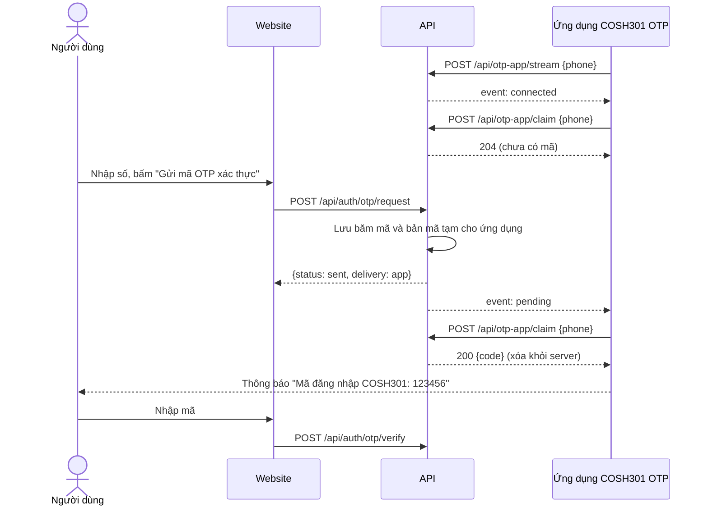

# Ứng dụng Android nhận mã OTP

Hệ thống chưa có nhà cung cấp SMS.
Với đăng nhập bằng số điện thoại, mã OTP được giao cho ứng dụng Android `COSH301 OTP` thay vì gửi tin nhắn.
Ứng dụng hiện mã trong thông báo trên điện thoại của người dùng.

Tính năng này liên quan FR-01 và FR-04 (đăng nhập OTP).
Mã nguồn ở `android/`, phần backend ở `backend/internal/service/otp_app.go` và `backend/internal/httpapi/otp_app.go`.

## Luồng



Luồng SSE chỉ báo hiệu, không mang mã.
Mã không đi qua `LISTEN/NOTIFY` và không ghi vào log.
Khi kết nối lại, ứng dụng gọi `claim` ngay, nên mã phát sinh lúc mất mạng vẫn nhận được nếu còn hạn.

## Số điện thoại

Dạng chuẩn là `+84...`, dùng chung cho website, ứng dụng và bảng `users`.
`0912345678`, `84912345678`, `0084912345678` và `+84912345678` là cùng một số.
Hàm `NormalizeDestination` ở backend và `normalizePhone` ở ứng dụng làm cùng việc.
Migration `00005` đổi các số `0...` đang lưu trong `users.phone` sang `+84...`.

Ứng dụng xin quyền `READ_PHONE_NUMBERS` và `READ_PHONE_STATE`.
Nó đọc số bằng `SubscriptionManager.getPhoneNumber` (Android 13 trở lên) hoặc `TelephonyManager.getLine1Number`.
Nhiều SIM không lưu số của chính nó, khi đó ứng dụng báo và để người dùng nhập số.
Số đã xác nhận được lưu trên máy.

## Cấu hình

| Biến | Mặc định | Ý nghĩa |
|---|---|---|
| `OTP_APP_DELIVERY` | `false` | Giao mã của số điện thoại cho ứng dụng |

Khi bật:

- Mã gửi tới số điện thoại không hiện trên màn hình, kể cả khi `OTP_DEMO=true`.
- Quy tắc này áp dụng cho cả tài khoản nhân sự.
- Mã gửi tới email giữ nguyên (`OTP_DEMO` hoặc log của server).
- Hai endpoint `/api/otp-app/*` được đăng ký và cũng cần cờ `otp_login`.

Khi tắt, hệ thống chạy như trước: `OTP_DEMO` hiện mã trên màn hình, còn lại mã ghi vào log.

## Lưu mã

`otp_verifications.code_hash` vẫn lưu băm như trước.
Để giao cho ứng dụng, server cần bản rõ, nên có bảng `otp_app_deliveries` (migration `00005`):

- Mỗi dòng giữ một mã chưa được lấy, cùng số điện thoại và thời điểm hết hạn.
- `claim` dùng `DELETE ... RETURNING`, nên mỗi mã chỉ giao một lần, kể cả khi nhiều yêu cầu cùng lúc.
- Yêu cầu mã mới xóa mã cũ chưa lấy của số đó.
- Một tác vụ nền xóa dòng hết hạn mỗi phút.
- Mã quá hạn, hoặc đã dùng để đăng nhập, không còn lấy được.

Chọn dòng tồn tại ngắn thay vì mã hóa, vì mã 6 chữ số chỉ có một triệu giá trị.
Mã hóa bằng khóa trong cấu hình không bảo vệ thêm gì so với băm đã có, mà phải quản lý thêm một khóa.

## Giới hạn bảo mật

Cần nói rõ: cách này yếu hơn SMS thật.

- Server không có cách nào chứng minh số mà ứng dụng gửi lên đúng là số của chiếc máy đó.
- Ai biết số điện thoại của người khác có thể gọi `claim` ngay sau khi có người yêu cầu mã cho số đó, lấy mã rồi đăng nhập vào tài khoản ấy.
- Người dùng thật khi đó không nhận được mã, vì mã chỉ giao một lần.
- Các lớp giảm thiểu hiện có: giới hạn 60 lần/phút mỗi IP cho `claim` và `stream`, 30 lần/phút cho `/api/auth/otp/*`, 60 giây giữa hai mã, mã hết hạn sau 5 phút và chỉ nhập sai 5 lần.
- `claim` trả `204` giống nhau cho mọi số, nên không lộ số nào có tài khoản.
- Thông báo hiện mã cả trên màn hình khóa. Người cầm máy có thể đọc mã.

Vì vậy tính năng này phù hợp cho demo và đồ án.
Khi chạy thật, cần SMS của nhà mạng hoặc ghép đôi ứng dụng với tài khoản bằng một bước xác nhận khác.

## Ứng dụng

- Kotlin, Jetpack Compose, `minSdk 29`, `targetSdk 36`.
- Một Activity và một foreground service (`OtpService`) giữ luồng SSE, có thông báo thường trực yên lặng.
- Xin quyền thông báo (Android 13 trở lên) và quyền đọc số điện thoại khi cần.
- Địa chỉ máy chủ nhập trong ứng dụng, mặc định `https://cosh301.nhansp.id.vn`.
- HTTP thường chỉ được phép tới `127.0.0.1` và `localhost` (`network_security_config.xml`).
- Ứng dụng không tự chạy lại sau khi khởi động máy. Người dùng mở lại và bấm "Bắt đầu nhận mã".

### Build

Cần JDK 17 trở lên và Android SDK có `platforms;android-36`.

```bash
cd android
ANDROID_HOME=$HOME/Android/Sdk ./gradlew assembleRelease
# android/app/build/outputs/apk/release/app-release.apk, khoảng 2 MB
```

Bản `release` ký bằng khóa debug để cài trực tiếp được. Không đưa lên cửa hàng ứng dụng.

### Thử trên máy thật với backend cục bộ

```bash
adb reverse tcp:3001 tcp:3001
adb install -r android/app/build/outputs/apk/release/app-release.apk
```

Trong ứng dụng nhập địa chỉ `http://127.0.0.1:3001`, nhập số điện thoại rồi bấm "Bắt đầu nhận mã".
Chạy backend với `OTP_APP_DELIVERY=true` rồi yêu cầu mã trên trang đăng nhập.

## Triển khai

1. Đặt `OTP_APP_DELIVERY=true` trong `.env` của server (biến đã được nối vào `compose.yaml`).
2. Build lại và chạy lại `api`. Migration `00005` tự chạy khi `api` khởi động.
3. Giữ nguyên `proxy_buffering off` và `proxy_read_timeout 24h` của nginx cho `/api/` để luồng SSE sống lâu.
4. Cài APK lên điện thoại, nhập địa chỉ `https://cosh301.nhansp.id.vn` và số điện thoại.
