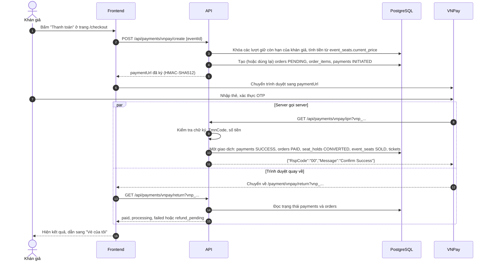

# Thanh toán VNPay sandbox (FR-13)

Tài liệu này mô tả luồng thanh toán bằng cổng VNPay, môi trường sandbox.
Cờ `payments` điều khiển toàn bộ luồng. Cờ tắt thì mọi endpoint bên dưới trả `404 feature_disabled`.

Phạm vi hiện tại:

- chỉ có VNPay, chưa có MoMo;
- vé được phát hành khi IPN báo thành công, chưa gửi email;
- trang "Vé của tôi" hiện danh sách vé, chưa có QR đổi mỗi 30 giây;
- chưa có API hoàn tiền, đơn cần hoàn được đánh dấu để xử lý tay.

## 1. Luồng thanh toán



Quy tắc chính:

- IPN là nguồn sự thật duy nhất. Trang return chỉ đọc và hiển thị.
- Trang return hỏi lại mỗi 2 giây, tối đa 8 lần, khi VNPay báo thành công mà IPN chưa tới.
- Đơn hết hạn cùng lúc với lượt giữ ghế sớm nhất. Hệ thống không gia hạn gì.
- `vnp_ExpireDate` bằng giờ hết hạn của đơn, nên VNPay không nhận tiền sau thời điểm đó.
- Khán giả cần ít nhất 60 giây giữ ghế còn lại mới tạo được thanh toán, nếu không API trả `409 holds_expiring`.

## 2. Giá và phí dịch vụ

Server tự tính tiền. Client không gửi giá.

- Tạm tính là tổng `event_seats.current_price` của các ghế đang giữ.
- Phí dịch vụ là 3% tạm tính, làm tròn lên theo số nguyên VND: `(tạm tính * 3 + 50) / 100`.
- Số tiền thanh toán `final_amount = total_amount - discount_amount + service_fee`. Cột `orders.service_fee` thêm ở migration `00006`, ràng buộc `chk_orders_final_amount` giữ đẳng thức này.
- `vnp_Amount` bằng `final_amount * 100`.

Trang chọn ghế (`SelectionTray`) vốn đã hiện phí 3%, còn trang `/checkout` và "Vé của tôi" trước đây chỉ hiện tạm tính.
Bản này sửa cho cả ba nơi cùng dùng `serviceFeeOf` (frontend) và `ServiceFee` (backend), cùng công thức làm tròn.

## 3. Các endpoint

Chi tiết nằm trong [`docs/api/openapi.yaml`](api/openapi.yaml).

| Endpoint | Ai gọi | Xác thực |
|---|---|---|
| `POST /api/payments/vnpay/create` | Frontend | Phiên đăng nhập |
| `GET /api/payments/vnpay/ipn` | VNPay | Chữ ký `vnp_SecureHash` |
| `GET /api/payments/vnpay/return` | Frontend, sau khi VNPay chuyển về | Chữ ký `vnp_SecureHash` |
| `GET /api/tickets` | Frontend | Phiên đăng nhập |

### 3.1 Tạo thanh toán

- Khóa các dòng `seat_holds` và `event_seats` của khán giả trong một giao dịch, cùng advisory lock với lúc giữ ghế.
- Đơn `PENDING` cũ của khán giả cho sự kiện này được dùng lại nếu đúng bộ lượt giữ hiện tại. Nếu không, đơn cũ chuyển `CANCELLED`.
- Mỗi lần bấm tạo một dòng `payments` mới. `payment_code` là `vnp_TxnRef`, không lặp trong ngày.
- Lỗi: `no_active_holds`, `holds_expiring`, `event_not_on_sale` (đều `409`), `event_not_found` (`404`).

### 3.2 IPN

VNPay gọi bằng `GET`. API luôn trả HTTP 200 kèm JSON, vì VNPay chỉ đọc `RspCode`.

| RspCode | Message | Khi nào |
|---|---|---|
| `00` | `Confirm Success` | Đã ghi nhận, kể cả giao dịch thất bại và giao dịch cần hoàn tiền |
| `01` | `Order not found` | Không có `payment_code` khớp `vnp_TxnRef` |
| `02` | `Order already confirmed` | Giao dịch này đã được xử lý |
| `04` | `Invalid amount` | `vnp_Amount` khác `payments.amount * 100` |
| `97` | `Invalid signature` | Sai chữ ký |
| `99` | `Unknown error` | Sai `vnp_TmnCode`, thiếu tham số, hoặc lỗi hệ thống |

VNPay gọi lại tối đa 10 lần, cách nhau 5 phút, với mã khác `00` và `02`.

Thứ tự kiểm tra:

1. Chữ ký, so sánh hằng thời gian (`crypto/subtle`). Sai thì dừng, không đọc cơ sở dữ liệu.
2. `vnp_TmnCode` đúng mã của mình.
3. Tìm `payments` theo `vnp_TxnRef`, khóa `orders` rồi khóa `payments`.
4. Số tiền.
5. Trạng thái `payments`. Khác `INITIATED` và `PROCESSING` thì trả `02`.
6. Kết quả: `vnp_ResponseCode = 00` và `vnp_TransactionStatus = 00` là thành công.

Giao dịch thất bại: `payments` thành `FAILED`, đơn vẫn `PENDING` để khán giả thử lại bằng lần thanh toán mới.

Giao dịch thành công, trong một giao dịch cơ sở dữ liệu:

- `payments` thành `SUCCESS`, ghi `provider_txn_id = vnp_TransactionNo`;
- `orders` thành `PAID`;
- `seat_holds` thành `CONVERTED`;
- `event_seats` thành `SOLD`;
- phát hành `tickets`, rồi `NOTIFY` kênh `event_seats_channel` để sơ đồ ghế cập nhật.

Tính lũy đẳng đến từ ba lớp: khóa dòng `payments`, kiểm tra trạng thái, và chỉ mục duy nhất `uq_payment_provider_txn`.

### 3.3 Tiền đã vào nhưng không phát hành được vé

Điều này xảy ra khi lượt giữ ghế đã hết hạn, ghế đã thuộc người khác, đơn đã bị hủy, hoặc đơn đã được thanh toán bằng lần khác.

- `payments` vẫn là `SUCCESS` và có `refund_required = true`, kèm `refund_reason`.
- Không bán ghế, không phát hành vé, không đụng đến lượt giữ của người khác.
- Đơn hết hạn thì thành `EXPIRED`.
- IPN vẫn trả `00` để VNPay không gọi lại.
- Trang return hiện "Thanh toán đã nhận nhưng không phát hành được vé" cùng mã đơn.

`refund_reason` nhận một trong các giá trị:

| Giá trị | Nghĩa |
|---|---|
| `holds_no_longer_valid` | Lượt giữ hết hạn, bị nhả, hoặc ghế đã thuộc người khác |
| `order_not_pending` | Đơn đã `EXPIRED` hoặc `CANCELLED` trước khi tiền về |
| `order_already_paid` | Một lần thanh toán khác của cùng đơn đã thành công trước |

Danh sách cần hoàn tiền cho vận hành:

```sql
SELECT p.payment_code, p.provider_txn_id, p.amount, p.refund_reason, o.order_code, p.created_at
FROM payments p JOIN orders o ON o.id = p.order_id
WHERE p.refund_required ORDER BY p.created_at;
```

Hoàn tiền thực hiện thủ công trên cổng quản trị VNPay merchant, sau đó cập nhật `payments.status = 'REFUNDED'`.

### 3.4 Trang return

`/payment/vnpay/return` là route của frontend. Trang gửi nguyên query string sang `GET /api/payments/vnpay/return`.

- Sai chữ ký trả `400 invalid_signature`.
- Không tìm thấy giao dịch trả `404 payment_not_found`.
- Hợp lệ thì trả `status`:

| `status` | Nghĩa |
|---|---|
| `paid` | IPN đã xác nhận, vé đã phát hành |
| `processing` | VNPay báo thành công nhưng IPN chưa tới |
| `failed` | Thất bại hoặc khách hủy |
| `refund_pending` | Tiền đã vào nhưng không phát hành được vé |

## 4. Ký và xác thực

Theo VNPay API 2.1.0 (<https://sandbox.vnpayment.vn/apis/docs/thanh-toan-pay/pay.html>).

- Tham số: `vnp_Version=2.1.0`, `vnp_Command=pay`, `vnp_TmnCode`, `vnp_Amount`, `vnp_CurrCode=VND`, `vnp_TxnRef`, `vnp_OrderInfo`, `vnp_OrderType=other`, `vnp_Locale=vn`, `vnp_ReturnUrl`, `vnp_IpAddr`, `vnp_CreateDate`, `vnp_ExpireDate`.
- `vnp_CreateDate` và `vnp_ExpireDate` theo `yyyyMMddHHmmss`, múi giờ GMT+7.
- `vnp_OrderInfo` không dấu, chỉ gồm chữ, số và dấu cách (`Thanh toan ve <mã đơn>`).
- Sắp xếp tham số theo tên, mã hóa URL cả tên và giá trị, dấu cách thành `+`.
- `vnp_SecureHash` là HMAC-SHA512 của chuỗi query vừa tạo, khóa là `VNPAY_HASH_SECRET`, viết hex thường.
- Khi xác thực, bỏ `vnp_SecureHash` và `vnp_SecureHashType`, ký lại các tham số `vnp_*` còn lại.
- Tham số `vnp_*` bị lặp thì coi là sai chữ ký.
- Mẫu của VNPay không thống nhất về giá trị rỗng (PHP, Node ký `key=`, Java bỏ qua). API chấp nhận cả hai cách.

Mã nguồn nằm ở `backend/internal/vnpay`. Kiểm thử dùng một giá trị băm tính độc lập bằng `openssl dgst -sha512 -hmac`, vì VNPay không công bố khóa mẫu.

## 5. Cấu hình

| Biến | Bắt buộc | Mặc định | Ý nghĩa |
|---|---|---|---|
| `FEATURE_PAYMENTS` | Để bật | trống | `on` bật cờ `payments`, ghi đè profile. Profile `sprint4` và `final` đã bật sẵn |
| `VNPAY_TMN_CODE` | Khi cờ bật | không | Mã merchant do VNPay cấp |
| `VNPAY_HASH_SECRET` | Khi cờ bật | không | Khóa ký, chỉ đặt trong `.env` trên máy chủ |
| `VNPAY_PAY_URL` | Không | `https://sandbox.vnpayment.vn/paymentv2/vpcpay.html` | URL cổng thanh toán |
| `VNPAY_RETURN_URL` | Không | `$PUBLIC_URL/payment/vnpay/return` | URL VNPay chuyển trình duyệt về |
| `PUBLIC_URL` | Khi không đặt `VNPAY_RETURN_URL` | không | Địa chỉ công khai của site, không có dấu `/` cuối |

Quy tắc:

- Cờ `payments` bật mà thiếu `VNPAY_TMN_CODE`, `VNPAY_HASH_SECRET` hoặc URL hợp lệ thì API không khởi động, và báo tên biến thiếu.
- `compose.yaml` truyền các biến từ `.env`, không có giá trị mặc định cho khóa.
- API không bao giờ ghi khóa vào log. Log IPN chỉ có `vnp_TxnRef`.
- `raw_response` của `payments` lưu các tham số `vnp_*` VNPay gửi, không có chữ ký.

## 6. Thử trên sandbox

Thẻ thử (ngân hàng NCB, đã đối chiếu với <https://sandbox.vnpayment.vn/apis/vnpay-demo/>):

| Mục | Giá trị |
|---|---|
| Số thẻ | `9704198526191432198` |
| Tên chủ thẻ | `NGUYEN VAN A` |
| Ngày phát hành | `07/15` |
| Mã OTP | `123456` |

Các thẻ NCB khác cùng tên và ngày phát hành, dùng để thử lỗi:

| Số thẻ | Kết quả |
|---|---|
| `9704195798459170488` | Không đủ số dư |
| `9704192181368742` | Thẻ chưa kích hoạt |
| `9704193370791314` | Thẻ bị khóa |
| `9704194841945513` | Thẻ hết hạn |

Trên sandbox chỉ dùng được các thẻ trong danh sách của VNPay.

Các bước thử:

1. Đăng nhập, giữ 1 đến 4 ghế, mở `/checkout/<mã sự kiện>`.
2. Bấm "Thanh toán", nhập thẻ thành công ở trên.
3. Trang return báo "Thanh toán thành công". "Vé của tôi" hiện các vé.
4. Thử lại với thẻ không đủ số dư: đơn vẫn `PENDING`, ghế vẫn được giữ.
5. Thử để quá 5 phút rồi mới nhập OTP: VNPay báo hết thời gian, ghế được trả.

## 7. Triển khai

IPN URL đăng ký trên cổng quản trị merchant sandbox:

```text
https://cosh301.nhansp.id.vn/api/payments/vnpay/ipn
```

Cloudflare Tunnel chuyển mọi request đến nginx của frontend, nginx chuyển `/api/` sang API. Không cần cấu hình thêm.

Các bước:

1. Thêm vào `.env` trên máy chủ: `FEATURE_PAYMENTS=on`, `VNPAY_TMN_CODE`, `VNPAY_HASH_SECRET`, `PUBLIC_URL=https://cosh301.nhansp.id.vn`.
2. Đăng ký IPN URL ở trên trong trang quản trị merchant sandbox của VNPay.
3. `docker compose up -d --build`. Migration `00006` tự chạy khi API khởi động.
4. Kiểm tra: `GET /api/features` có `"payments": true`, rồi thử một lần thanh toán bằng thẻ thử.

## 8. Giới hạn

- Chưa thử vòng đầy đủ với VNPay sandbox thật, vì khóa merchant chỉ có trên máy chủ. Kiểm thử tự động dùng khóa giả và IPN do chính bộ kiểm thử ký.
- Không có API truy vấn giao dịch (`querydr`) để đối soát khi IPN không tới. Đơn `PENDING` quá hạn chuyển `EXPIRED`, và nếu IPN thành công đến muộn thì được đánh dấu cần hoàn tiền.
- Chưa có API hoàn tiền. Hủy vé qua `POST /api/tickets/cancel` nhả ghế và hủy vé nhưng không hoàn tiền.
- Lượt giữ ghế còn `ACTIVE` vài giây sau `expires_at` (bộ dọn chạy mỗi 5 giây) vẫn được chốt khi IPN tới. VNPay chỉ nhận tiền trước `vnp_ExpireDate`, nên đây là thanh toán hợp lệ.
- Khán giả tự trả ghế hoặc hủy trong lúc đang ở trang VNPay thì tiền vẫn vào, và được đánh dấu cần hoàn.
- `vnp_IpAddr` lấy từ `X-Real-IP` do nginx đặt. Địa chỉ ngắn hơn 7 ký tự (ví dụ `::1`) được thay bằng `127.0.0.1`.
- Các thẻ thử của VNPay có thể đổi hoặc ngừng. Luôn đối chiếu lại với trang demo của VNPay.

## 9. Khác biệt với thiết kế

`docs/design/README.md` mục 7 dự kiến các endpoint khác. Bản này làm gọn hơn:

| Thiết kế | Bản này | Lý do |
|---|---|---|
| `POST /api/orders` rồi `POST /api/orders/{id}/payments` | `POST /api/payments/vnpay/create` | Một lần gọi tạo đơn và lần thanh toán, tránh đơn mồ côi |
| `POST /api/payments/{provider}/ipn` | `GET /api/payments/vnpay/ipn` | VNPay gọi IPN bằng `GET` |
| `GET /api/payments/{provider}/return` | `GET /api/payments/vnpay/return` | Chỉ có VNPay |
| `GET /api/me/tickets` | `GET /api/tickets` | Cùng nhóm với các endpoint vé đã có |
| Chọn MoMo hoặc VNPAY | Chỉ VNPAY | Chưa làm MoMo |
| Vé gửi qua email, QR đổi mỗi 30 giây | Chưa có | Thuộc cờ `ticket_email` và `rotating_qr` |

Nên cập nhật mục 7 của thiết kế khi nhóm chốt hướng này.

## 10. Kiểm thử

- `backend/internal/vnpay`: ký, xác thực, định dạng thời gian GMT+7, làm sạch `vnp_OrderInfo`.
- `backend/internal/service/payment_service_test.go` (cần `TEST_DATABASE_URL`): tính tiền, dùng lại đơn, IPN thành công, IPN trùng và đồng thời, sai chữ ký, sai số tiền, giao dịch thất bại, tiền về sau khi hết hạn giữ ghế, ghế bị người khác lấy, hai lần thanh toán cho một đơn.
- `backend/internal/httpapi/payments_test.go`: IPN và return với chữ ký giả.
- `backend/internal/config/vnpay_test.go`: giá trị mặc định và từ chối cấu hình thiếu.
