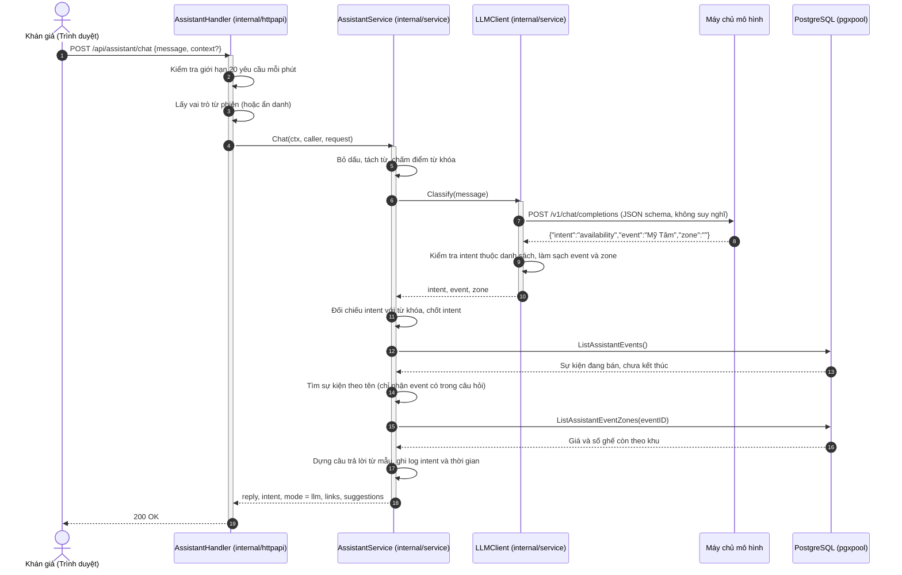
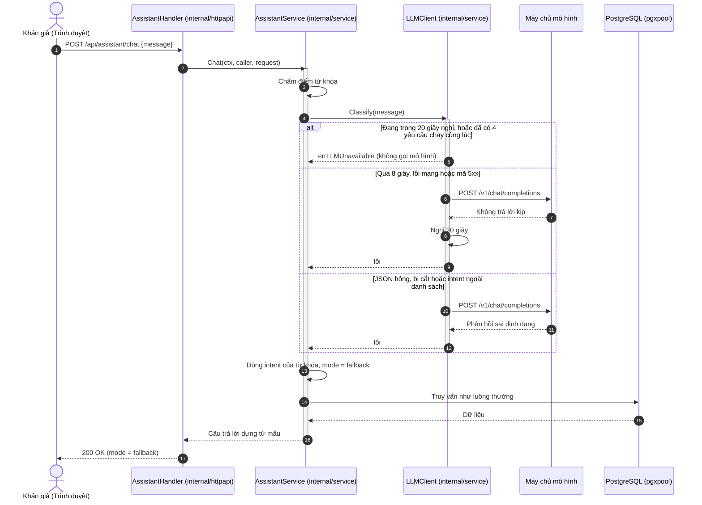
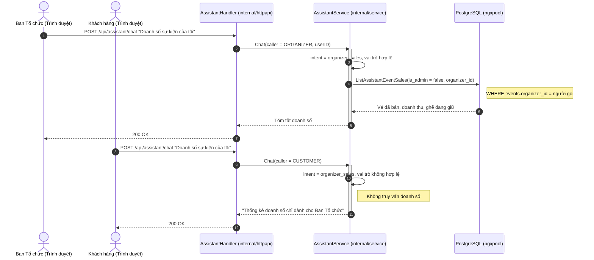

# Sơ đồ tuần tự: Hỏi trợ lý chatbot (FR-24)

Khán giả hoặc Ban Tổ chức gõ một câu hỏi. Mô hình ngôn ngữ chỉ phân loại câu hỏi, câu trả lời do server dựng từ dữ liệu PostgreSQL.
Thiết kế và các chốt chặn nằm ở [`../assistant.md`](../assistant.md).

Cờ tính năng: `chatbot` (Sprint 2). Cờ tắt thì `POST /api/assistant/chat` trả `404 feature_disabled`.

## 1. Quy tắc

- Vai trò lấy từ phiên trên server. Chưa đăng nhập thì chỉ nhận thông tin công khai.
- Mô hình chỉ trả `intent`, `event`, `zone`. Chữ của mô hình không tới người dùng.
- Mô hình lỗi, quá 8 giây hoặc trả sai định dạng thì dùng bộ từ khóa (`mode = fallback`).
- Truy vấn doanh số lọc theo `events.organizer_id` của người gọi.

## 2. Đối tượng

| Đối tượng | Lớp hoặc nơi | Vai trò |
|---|---|---|
| Người dùng | Trình duyệt | Gõ câu hỏi trong khung "Trợ lý" |
| `AssistantHandler` | `internal/httpapi` | Boundary: giới hạn tốc độ, lấy vai trò từ phiên |
| `AssistantService` | `internal/service` | Control: phân loại, kiểm tra, truy vấn, dựng câu trả lời |
| `LLMClient` | `internal/service` | Gọi máy chủ mô hình, kiểm tra JSON trả về |
| Máy chủ mô hình | llama.cpp, tương thích OpenAI | Chọn một `intent` |
| PostgreSQL | `events`, `event_zones`, `event_seats`, `seat_holds`, `tickets`, `order_items` | Nguồn của mọi số liệu |

## 3. Câu hỏi của khán giả, mô hình trả lời được

## 4. Mô hình lỗi: chuyển sang từ khóa

## 5. Ban Tổ chức hỏi doanh số, khách hàng bị từ chối

## 6. Mã phản hồi

| Mã | `error` | Khi nào |
|---|---|---|
| 200 | | Có câu trả lời, kể cả khi mô hình lỗi |
| 400 | `invalid_payload` | JSON sai hoặc body quá 4 KB |
| 400 | `empty_message` | Câu hỏi rỗng |
| 404 | `feature_disabled` | Cờ `chatbot` tắt |
| 429 | `rate_limited` | Quá 20 yêu cầu mỗi phút cho một tài khoản (hoặc địa chỉ), hoặc 60 mỗi phút cho một địa chỉ |
| 500 | `internal_error` | Lỗi truy vấn PostgreSQL |
