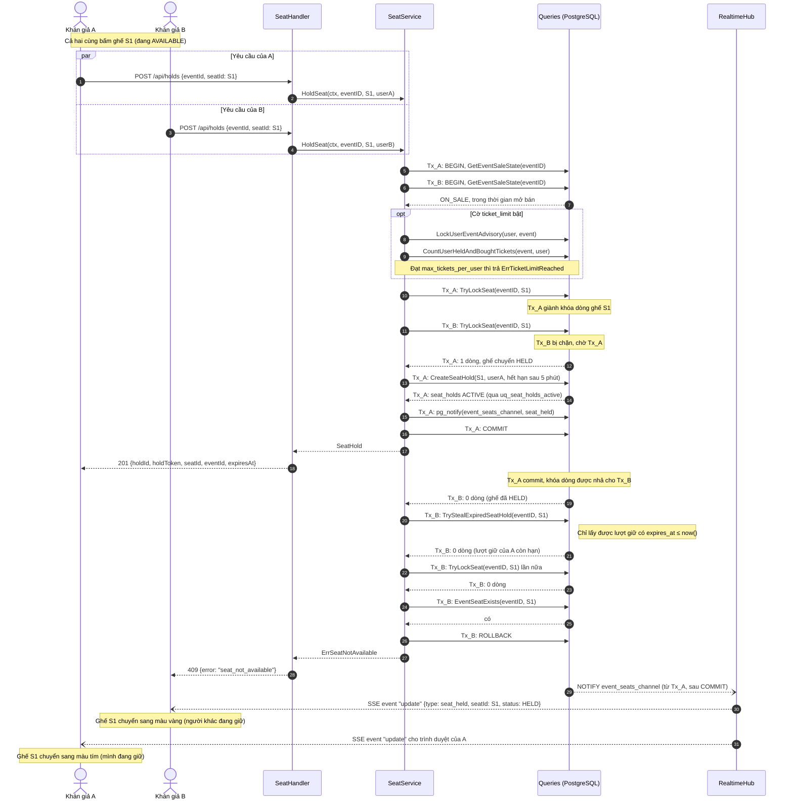

# Sơ đồ tuần tự: Chống bán trùng ghế (FR-07)

Tài liệu đặc tả sơ đồ tuần tự khi hai khán giả cùng giữ một ghế tại cùng một thời điểm.
Hệ thống bảo đảm chỉ một người giữ được, theo yêu cầu FR-07 và NFR-03.
Quy tắc nằm ở mục 6 của [`design/README.md`](../design/README.md).

Cờ tính năng: `seat_hold` (Sprint 2).

---

## 1. Cơ chế chống bán trùng

Việc chống bán trùng nằm hoàn toàn ở PostgreSQL, không cần bộ nhớ đệm ngoài.
Có hai lớp chặn:

1. **Lớp 1: câu `UPDATE` có điều kiện** (`TryLockSeat` trong `queries/seats.sql`):
   ```sql
   UPDATE event_seats
   SET status = 'HELD', version = version + 1, updated_at = now()
   WHERE event_id = $1 AND seat_id = $2 AND status = 'AVAILABLE'
   RETURNING id, event_id, seat_id, status, current_price, version, updated_at;
   ```
   PostgreSQL khóa dòng ghế khi một giao dịch cập nhật nó.
   Giao dịch đến sau bị chặn cho đến khi giao dịch trước commit hoặc rollback.
   Sau đó câu `UPDATE` của giao dịch sau đọc lại dòng: ghế đã `HELD`, điều kiện `status = 'AVAILABLE'` không còn đúng, nên không có dòng nào được cập nhật.

2. **Lớp 2: chỉ mục duy nhất một phần** (migration `00001`):
   ```sql
   CREATE UNIQUE INDEX uq_seat_holds_active
   ON seat_holds (event_id, seat_id)
   WHERE status = 'ACTIVE';
   ```
   Mỗi ghế của một sự kiện chỉ có tối đa một lượt giữ `ACTIVE`.
   Nếu lớp 1 bị bỏ sót vì lý do nào đó, câu `INSERT` vào `seat_holds` bị từ chối với lỗi `23505` (`unique_violation`).
   `HoldSeat` đổi lỗi này thành `ErrSeatNotAvailable`.

Giới hạn số vé của mỗi tài khoản (FR-11) là việc khác, không phải chống bán trùng ghế:
- Chỉ chạy khi cờ `ticket_limit` bật. Profile `sprint2` tắt cờ này.
- Khi bật, `HoldSeat` khóa cặp (người dùng, sự kiện) bằng `pg_advisory_xact_lock(hashtext(user_id || ':' || event_id))`.
- Sau đó `HoldSeat` đếm lượt giữ `ACTIVE` còn hạn cộng vé chưa `VOID` của người đó.
- Số đếm đạt `events.max_tickets_per_user` (mặc định 4) thì trả `400 ticket_limit_reached`.
- Khóa này giữ cho một tài khoản gửi nhiều yêu cầu cùng lúc cũng không vượt hạn mức.

---

## 2. Sơ đồ tuần tự

Tên các đối tượng trùng tên lớp trong [`class-diagram.md`](../class-diagram.md):
- **Boundary:** `SeatHandler` (`internal/httpapi`)
- **Control:** `SeatService` (`internal/service`)
- **Entity:** `Queries` của `internal/store`, chạy trên PostgreSQL
- **Realtime:** `RealtimeHub`, `StreamHandler`



Các bước lấy ghế lần nữa sau `TryStealExpiredSeatHold` có lý do:
- Câu `TryStealExpiredSeatHold` phải chờ khóa dòng như `TryLockSeat`.
- Trong lúc chờ, `HoldReaper` có thể đã nhả ghế về `AVAILABLE`.
- Vì vậy `lockSeat` thử `TryLockSeat` thêm một lần trước khi kết luận ghế không còn.

---

## 3. Các kịch bản ngoại lệ

| Tình huống | Cơ chế xử lý | Kết quả |
|---|---|---|
| Hai giao dịch cùng `INSERT` vào `seat_holds` cho một ghế | Chỉ mục `uq_seat_holds_active` từ chối một bên | Bên bị từ chối nhận `23505`, `HoldSeat` rollback và trả `409 seat_not_available` |
| Ghế còn `HELD` vì lượt giữ cũ đã quá 5 phút mà `HoldReaper` chưa quét | `TryStealExpiredSeatHold` đổi lượt giữ cũ thành `EXPIRED` và giữ ghế cho người mới trong cùng giao dịch | Khán giả mới giữ thành công. Lượt giữ cũ không còn hiệu lực |
| Ghế không có trong sự kiện | `EventSeatExists` trả `false` | `404 seat_not_found` |
| Sự kiện chưa mở bán, tạm dừng hoặc đã kết thúc | `GetEventSaleState` | `409 event_not_on_sale` |
| Một tài khoản gửi nhiều yêu cầu cùng lúc, cờ `ticket_limit` bật | Khóa advisory theo (người dùng, sự kiện) tuần tự hóa các yêu cầu | Số ghế giữ cộng vé không vượt `max_tickets_per_user`. Yêu cầu thừa nhận `400 ticket_limit_reached` |

---

## 4. Kiểm chứng

Test `TestHoldSeat_ConcurrentHoldersGetOneSeat` (`backend/internal/service/integration_test.go`, cần `TEST_DATABASE_URL`) cho 50 tài khoản cùng giữ một ghế.
Kết quả mong đợi: đúng một tài khoản thành công, 49 tài khoản còn lại nhận `ErrSeatNotAvailable`.
