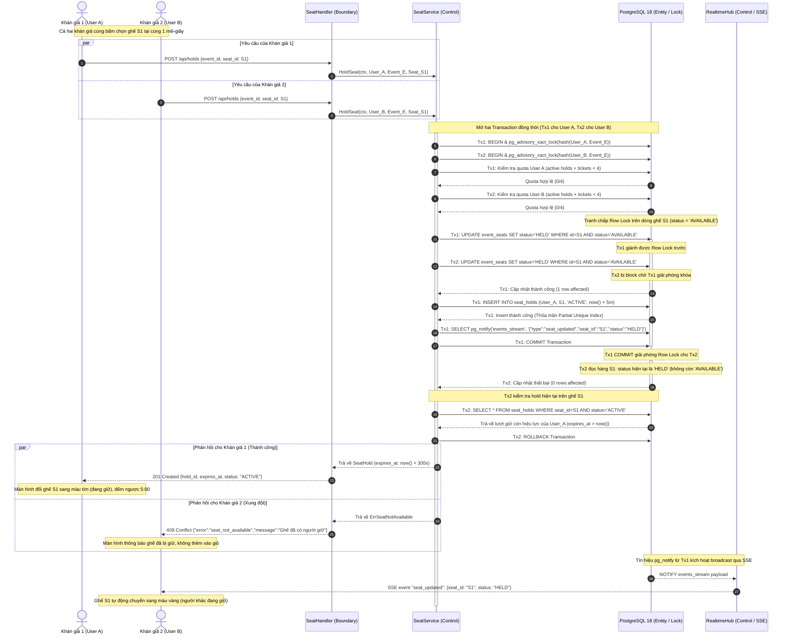

# Sơ đồ tuần tự: Chống bán trùng ghế (FR-07)

Tài liệu đặc tả sơ đồ tuần tự (Sequence Diagram) xử lý kịch bản hai hoặc nhiều khán giả cùng tranh chấp một ghế tại cùng một mili-giây, bảo đảm loại trừ bán trùng ghế tuyệt đối theo yêu cầu `FR-07` và tiêu chuẩn kiến trúc mục 6 của [`docs/design/README.md`](../design/README.md).

---

## 1. Cơ chế phòng thủ hai tầng

Hệ thống loại bỏ hoàn toàn khả năng bán trùng (double-booking) tại tầng cơ sở dữ liệu PostgreSQL 18 mà không cần phụ thuộc vào bộ nhớ đệm ngoài:

1. **Tầng 1 — Cập nhật có điều kiện nguyên tử (Atomic Conditional Update):**
   ```sql
   UPDATE event_seats 
   SET status = 'HELD', updated_at = now()
   WHERE id = $1 AND event_id = $2 AND status = 'AVAILABLE'
   RETURNING id, status, updated_at;
   ```
   PostgreSQL tự động áp dụng khóa mức hàng (Row-level Lock) trên bản ghi ghế. Khi hai giao dịch đồng thời yêu cầu cập nhật cùng một hàng, một giao dịch sẽ tranh được khóa trước và đổi trạng thái thành `HELD`. Giao dịch đến sau bị chặn lại; khi giao dịch trước commit, câu truy vấn của giao dịch sau thực thi trên trạng thái mới của dòng (`status = 'HELD'`) nên điều kiện `status = 'AVAILABLE'` không còn thỏa mãn, trả về `rows_affected = 0`.

2. **Tầng 2 — Chỉ mục duy nhất có điều kiện (Partial Unique Index):**
   ```sql
   CREATE UNIQUE INDEX idx_seat_holds_active_seat 
   ON seat_holds (event_id, seat_id) 
   WHERE status = 'ACTIVE';
   ```
   Bảo đảm tại một thời điểm, chỉ duy nhất một bản ghi giữ chỗ ở trạng thái `ACTIVE` được phép tồn tại cho mỗi ghế trong một sự kiện. Mọi xung đột phát sinh ngoài ý muốn sẽ lập tức bị chặn bởi vi phạm ràng buộc toàn vẹn duy nhất của PostgreSQL.

---

## 2. Sơ đồ tuần tự tương tác (Sequence Diagram)

Tên các đối tượng tuân thủ chặt chẽ mô hình BCE đã chuẩn hóa tại [`docs/class-diagram.md`](../class-diagram.md):
- **Boundary:** `SeatHandler` (`internal/httpapi`)
- **Control:** `SeatService`, `RealtimeHub` (`internal/service`)
- **Entity / Store:** `DB (PostgreSQL 18)` (`internal/store`)



---

## 3. Các kịch bản ngoại lệ và giải quyết

| Tình huống | Cơ chế xử lý | Kết quả |
|---|---|---|
| Cả hai cùng gửi lệnh `INSERT` vào `seat_holds` | Partial Unique Index `idx_seat_holds_active_seat` chặn lại tại engine cơ sở dữ liệu. | Một bên thành công, bên còn lại gặp lỗi `23505 (unique_violation)`. Transaction rollback an toàn. |
| Ghế đang có một lượt giữ cũ đã quá 5 phút | Lệnh `HoldSeat` kiểm tra `expires_at <= now()`. Nếu lượt giữ cũ đã hết hạn, hệ thống thực hiện giải phóng hoặc ghi đè lượt giữ mới (stale hold stealing). | Khán giả mới giữ thành công; khán giả cũ quá hạn bị từ chối thanh toán. |
| Một người dùng gửi đồng thời 10 request giữ ghế | Hàm `pg_advisory_xact_lock(hash(user_id, event_id))` tuần tự hóa các yêu cầu của cùng một người dùng. Kiểm tra `COUNT(seat_holds) + COUNT(tickets)` tại bước 2. | Tối đa 4 yêu cầu thành công, các yêu cầu thứ 5 trở đi bị từ chối với mã `400 Bad Request (ticket_limit_exceeded)`. |
