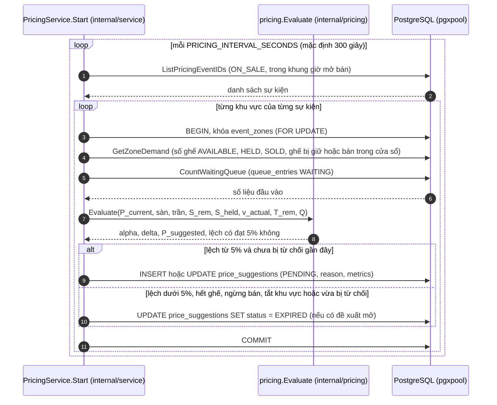
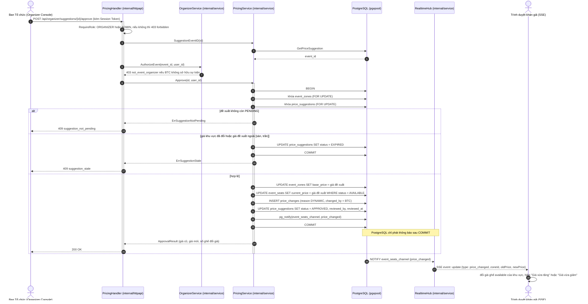
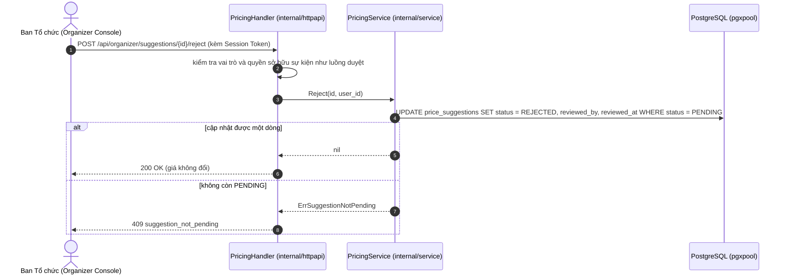

# Sơ đồ tuần tự: Đề xuất và duyệt giá động (FR-22, W-01)

Tài liệu này mô tả hai luồng của định giá động: tác vụ nền sinh đề xuất, và Ban Tổ chức duyệt hoặc từ chối đề xuất.
Công thức và quy tắc nằm ở [`docs/dynamic-pricing.md`](../dynamic-pricing.md).

## 1. Quy tắc nghiệp vụ

- Hệ thống không tự đổi giá. Tác vụ nền chỉ ghi đề xuất vào `price_suggestions`.
- Mỗi khu vực có tối đa một đề xuất `PENDING`. Lần phân tích sau làm mới đề xuất đó tại chỗ.
- Giá đề xuất luôn nằm trong `[floor_price, ceiling_price]` và làm tròn tới 10.000 VNĐ.
- Duyệt đề xuất chỉ đổi giá ghế `AVAILABLE`. Ghế `HELD` giữ nguyên giá của người đang giữ.
- Mọi lần duyệt ghi một dòng `price_changes` với `reason = 'DYNAMIC'`.
- Hai lần duyệt đồng thời cùng một đề xuất chỉ có một lần được áp dụng.

---

## 2. Sơ đồ tuần tự: Tác vụ nền phân tích và sinh đề xuất

Cùng luồng này chạy khi BTC bấm "Chạy lại phân tích ngay", chỉ khác là chỉ phân tích một sự kiện.

---

## 3. Sơ đồ tuần tự: Ban Tổ chức duyệt đề xuất

---

## 4. Sơ đồ tuần tự: Ban Tổ chức từ chối đề xuất

Sau khi từ chối, tác vụ nền không đưa lại đúng cặp giá hiện tại và giá đề xuất đó trong `PRICING_REJECT_COOLDOWN_MINUTES` (mặc định 60 phút).
Nếu số liệu đổi và cho ra giá đề xuất khác, đề xuất mới vẫn xuất hiện.
