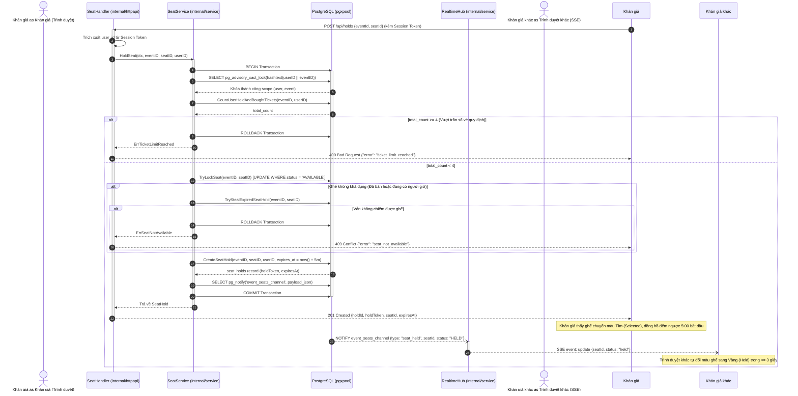
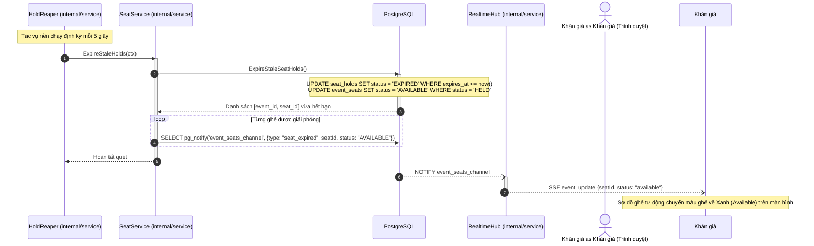

# Sơ đồ tuần tự: Giữ ghế độc quyền 5 phút (FR-06, US-03)

Tài liệu này đặc tả luồng tương tác giữa các thành phần Boundary, Control và Entity khi khán giả thực hiện thao tác chọn giữ ghế và khi lượt giữ ghế hết hạn tự động.

## 1. Quy tắc nghiệp vụ

- Mọi thao tác giữ ghế được thực hiện trong một giao dịch cơ sở dữ liệu ACID duy nhất.
- Sử dụng `pg_advisory_xact_lock` theo cặp `(user_id, event_id)` để ngăn chặn tình trạng một tài khoản gửi đồng thời nhiều request nhằm vượt quá số lượng vé cho phép (FR-11).
- Ghế chỉ chuyển sang `HELD` khi trạng thái hiện tại là `AVAILABLE` hoặc là ghế đang `HELD` nhưng lượt giữ cũ đã hết hạn (`expires_at <= now()`).
- Sau khi giữ ghế thành công, hệ thống phát thông báo qua kênh `LISTEN/NOTIFY` của PostgreSQL để cập nhật sơ đồ ghế của tất cả khán giả đang mở trang sự kiện qua SSE (NFR-10).
- Bộ hẹn giờ chạy nền `HoldReaper` quét định kỳ và nhả ghế về trạng thái `AVAILABLE` nếu quá 5 phút mà khán giả chưa hoàn tất thanh toán.

---

## 2. Sơ đồ tuần tự: Khán giả chọn giữ ghế thành công

---

## 3. Sơ đồ tuần tự: Tự động thu hồi ghế khi hết hạn 5 phút

