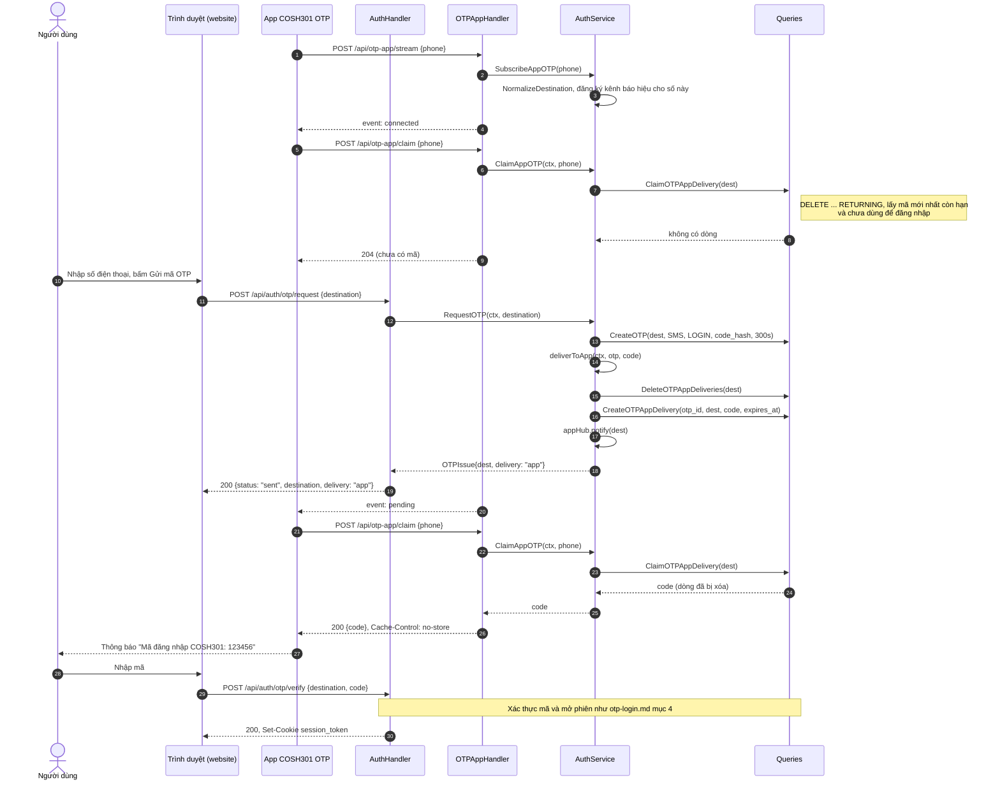

# Sơ đồ tuần tự: Giao mã OTP cho app Android (FR-01)

Hệ thống chưa có nhà cung cấp SMS.
Với đăng nhập bằng số điện thoại, mã OTP được giao cho app Android `COSH301 OTP` thay vì gửi tin nhắn.
Tài liệu này vẽ phần giao mã.
Phần xin mã và xác thực mã giống [`otp-login.md`](otp-login.md).
Cách cài đặt, cấu hình và giới hạn bảo mật nằm ở [`../otp-app.md`](../otp-app.md).

Cờ tính năng: `otp_login`. Hai endpoint của app chỉ được đăng ký khi `OTP_APP_DELIVERY=true`.

## 1. Quy tắc

- Số điện thoại có dạng chuẩn `+84...`. Email không đi qua kênh này, `claim` và `stream` với email trả `400 invalid_destination`.
- Luồng SSE chỉ báo hiệu "có mã đang chờ", không mang mã.
- Mã không đi qua `LISTEN/NOTIFY` và không ghi vào log.
- Mã chỉ giao một lần: `claim` xóa dòng khi trả mã.
- Số điện thoại nằm trong body của `POST`, không nằm trong URL, để không lọt vào log của proxy.
- Một số điện thoại mở tối đa 4 luồng, toàn hệ thống tối đa 500 luồng. Vượt thì trả `429 too_many_streams`.
- Mỗi IP gọi `claim` và `stream` tối đa 60 lần mỗi phút, quá thì trả `429 rate_limited`.
- Một tác vụ nền (`StartAppDeliveryReaper`) xóa các mã app chưa lấy và đã hết hạn, mỗi phút một lần.

## 2. Đối tượng

| Đối tượng | Lớp BCE | Vị trí |
|---|---|---|
| `OTPAppHandler` | Boundary | `internal/httpapi/otp_app.go` |
| `AuthHandler` | Boundary | `internal/httpapi/auth.go` |
| `AuthService` | Control | `internal/service/auth_service.go`, `internal/service/otp_app.go` |
| `Queries` | Entity | `internal/store`, bảng `otp_verifications`, `otp_app_deliveries` |

`AuthService` giữ `otpAppHub`, một bản đồ từ số điện thoại đến các kênh báo hiệu trong bộ nhớ.

## 3. Sơ đồ tuần tự

Khi app mất mạng rồi kết nối lại, app gọi `claim` ngay, nên mã phát sinh trong lúc mất mạng vẫn nhận được nếu còn hạn.

## 4. Mã phản hồi

| Endpoint | Tình huống | HTTP | `error` |
|---|---|:---:|---|
| `claim`, `stream` | Cờ `otp_login` tắt | 404 | `feature_disabled` |
| `claim`, `stream` | Quá 60 lần mỗi phút từ một IP | 429 | `rate_limited` |
| `claim`, `stream` | Body thiếu `phone` hoặc quá 1 KB | 400 | `invalid_payload` |
| `claim`, `stream` | Không phải số điện thoại | 400 | `invalid_destination` |
| `claim` | Chưa có mã, hoặc số chưa từng xin mã. Hai trường hợp trả giống nhau | 204 | — |
| `claim` | Có mã đang chờ | 200 | — |
| `stream` | Quá 4 luồng cho một số, hoặc quá 500 luồng toàn hệ thống | 429 | `too_many_streams` |
