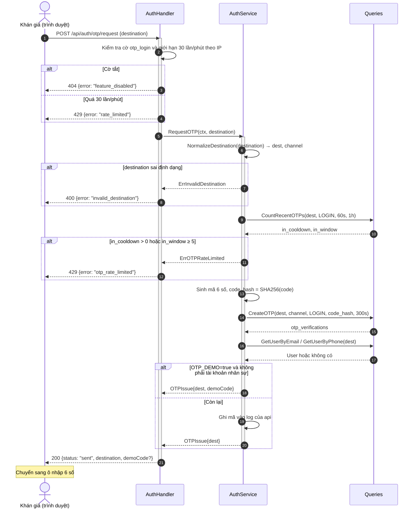
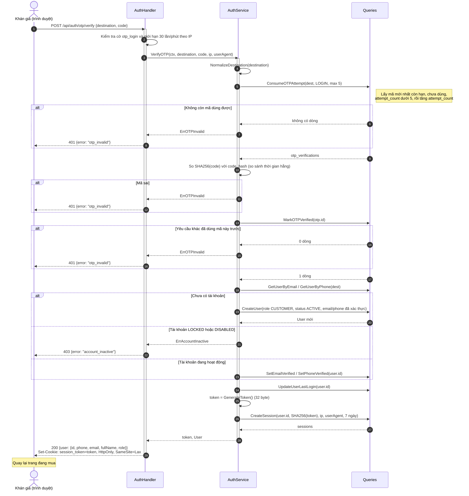
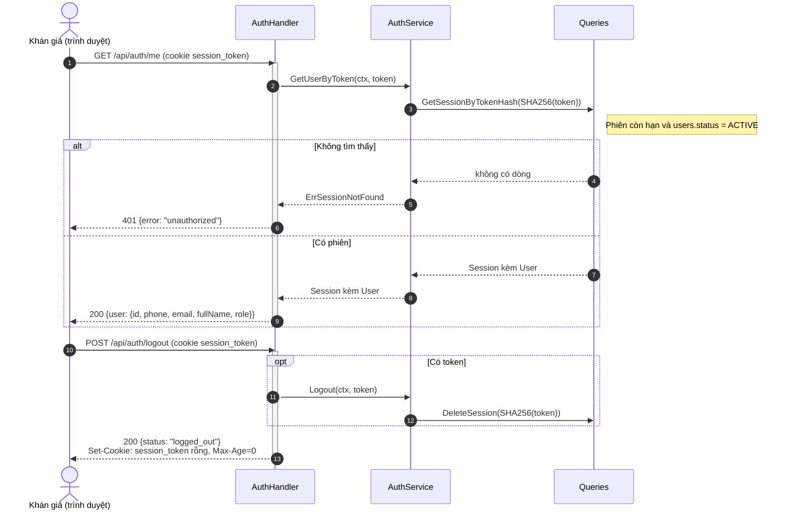

# Sơ đồ tuần tự: Đăng nhập bằng OTP (FR-01, FR-04)

Luồng đăng nhập không mật khẩu: khán giả nhập SĐT hoặc email, nhận mã 6 số, nhập mã để mở phiên.
Lần đầu đăng nhập thì hệ thống tự tạo tài khoản `CUSTOMER`.

Cờ tính năng: `otp_login` (Sprint 2).
Cờ tắt thì `POST /api/auth/otp/request` và `POST /api/auth/otp/verify` trả `404 feature_disabled`.

## 1. Quy tắc

Kênh gửi:
- chuỗi có `@` là email, kênh `EMAIL`, chuyển về chữ thường;
- còn lại là SĐT, kênh `SMS`, bỏ dấu cách, `-`, `.` và phải có 9–15 chữ số.

Giới hạn yêu cầu:
- mỗi IP tối đa 30 lần gọi `otp/request` và `otp/verify` mỗi phút;
- mỗi `destination` phải cách lần xin mã trước ít nhất 60 giây;
- mỗi `destination` tối đa 5 mã trong 1 giờ.

Mã OTP:
- 6 chữ số, sinh bằng `crypto/rand`;
- chỉ lưu SHA-256 của mã trong `otp_verifications.code_hash`;
- hết hạn sau 5 phút;
- mỗi mã cho nhập tối đa 5 lần, tính cả lần đúng;
- chỉ mã mới nhất còn hạn được dùng;
- dùng xong thì ghi `verified_at`, không dùng lại được.

Lượt nhập được trừ trước khi so mã, bằng một câu `UPDATE … FOR UPDATE`.
Vì vậy gửi nhiều yêu cầu cùng lúc cũng không vượt được 5 lần.

Phiên đăng nhập:
- token ngẫu nhiên 32 byte, trả cho trình duyệt dạng hex;
- bảng `sessions` chỉ lưu SHA-256 của token;
- hiệu lực 7 ngày;
- cookie `session_token`: `HttpOnly`, `SameSite=Lax`, `Path=/`;
- cờ `Secure` bật khi `COOKIE_SECURE=true`;
- api cũng nhận token qua header `Authorization: Bearer …`.

Tài khoản `LOCKED` hoặc `DISABLED` không đăng nhập được.

## 2. Đối tượng

| Đối tượng | Lớp BCE | Vị trí |
|---|---|---|
| `AuthHandler` | Boundary | `internal/httpapi/auth.go` |
| `AuthService` | Control | `internal/service/auth_service.go` |
| `Queries` | Entity | `internal/store`, truy vấn bảng `otp_verifications`, `users`, `sessions` |

`RateLimiter` và `RequireFeature` là middleware trong `internal/httpapi/middleware.go`.
Sơ đồ gộp chúng vào `AuthHandler` cho gọn.

## 3. Xin mã OTP

## 4. Xác thực mã và mở phiên

## 5. Kiểm tra phiên và đăng xuất

`GET /api/auth/me` và mọi API cần đăng nhập đều tra phiên theo cùng một cách.

## 6. Mã phản hồi

| Endpoint | Tình huống | HTTP | `error` |
|---|---|:---:|---|
| `otp/request`, `otp/verify` | Cờ `otp_login` tắt | 404 | `feature_disabled` |
| `otp/request`, `otp/verify` | Quá 30 lần/phút từ một IP | 429 | `rate_limited` |
| `otp/request`, `otp/verify` | Body không phải JSON hoặc thiếu trường | 400 | `invalid_payload` |
| `otp/request` | `destination` sai định dạng | 400 | `invalid_destination` |
| `otp/request` | Xin lại trước 60 giây, hoặc quá 5 mã/giờ | 429 | `otp_rate_limited` |
| `otp/request` | Thành công | 200 | — |
| `otp/verify` | Mã sai, hết hạn, đã dùng, hoặc đã nhập sai 5 lần | 401 | `otp_invalid` |
| `otp/verify` | Tài khoản bị khóa hoặc vô hiệu | 403 | `account_inactive` |
| `otp/verify` | Thành công, đặt cookie phiên | 200 | — |
| `me` | Không có phiên, phiên hết hạn, hoặc tài khoản không còn `ACTIVE` | 401 | `unauthorized` |
| `logout` | Luôn thành công, kể cả khi chưa đăng nhập | 200 | — |

## 7. Chưa làm so với thiết kế

Mục 4.1 của thiết kế có hai bước mà code hiện tại chưa có:

- Kiểm tra Turnstile trước khi gửi mã.
  Bước này thuộc cờ `bot_check` (FR-10, Sprint 3).
- Gửi mã qua máy chủ SMTP hoặc app SMS Gateway.
  Hiện mã chỉ hiện trên màn hình (chế độ `OTP_DEMO`) hoặc ghi vào log của api.

Khi hai bước này được làm, sơ đồ ở mục 3 cần thêm đối tượng `Cloudflare Turnstile` và bộ gửi thông báo.
