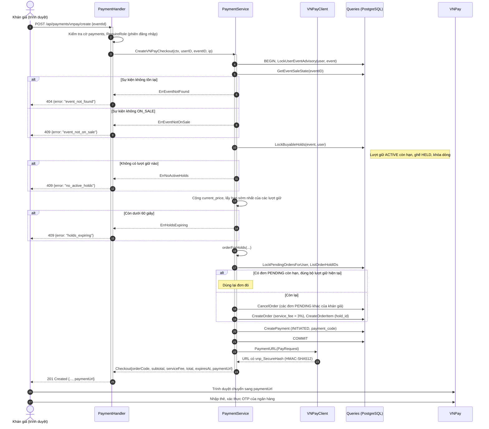
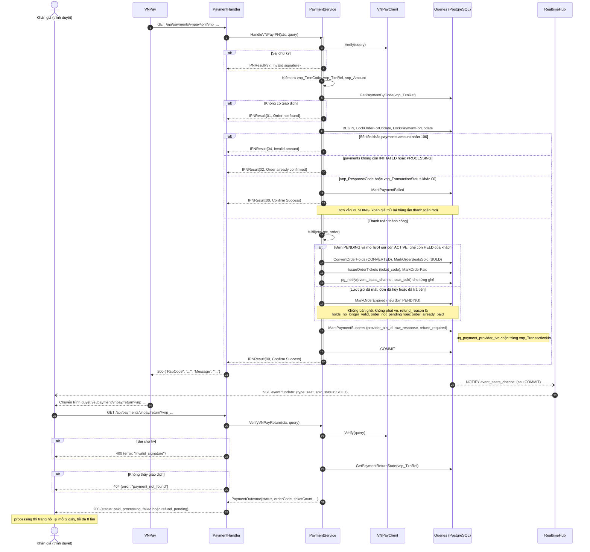
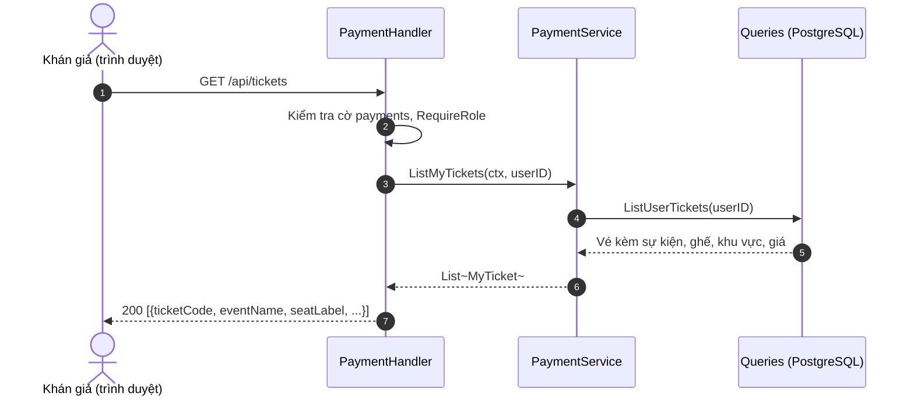

# Sơ đồ tuần tự: Thanh toán VNPay và phát vé (FR-13)

Luồng từ lúc khán giả bấm "Thanh toán" đến lúc vé được phát hành.
Quy tắc ký, mã phản hồi IPN, cấu hình và cách thử nằm ở [`../payments.md`](../payments.md).

Cờ tính năng: `payments`. Cờ tắt thì mọi endpoint bên dưới trả `404 feature_disabled`.
Profile `sprint2` tắt cờ này, nên bản chạy phải đặt `FEATURE_PAYMENTS=on`.

## 1. Quy tắc

- Server tự tính tiền từ `event_seats.current_price`. Client chỉ gửi `eventId`.
- Phí dịch vụ là 3% tạm tính, làm tròn lên theo VND.
- Đơn hết hạn cùng lúc với lượt giữ ghế sớm nhất. Khán giả cần ít nhất 60 giây giữ ghế còn lại mới tạo được thanh toán.
- IPN là nguồn sự thật duy nhất. Trang return chỉ đọc và hiển thị.
- Một giao dịch VNPay chỉ được xử lý một lần, dù IPN đến nhiều lần hay đồng thời.
- Tiền đã vào nhưng ghế không còn của khách thì không phát vé. Giao dịch được đánh dấu `refund_required`.

## 2. Đối tượng

| Đối tượng | Lớp BCE | Vị trí |
|---|---|---|
| `PaymentHandler` | Boundary | `internal/httpapi/payments.go` |
| `PaymentService` | Control | `internal/service/payment_service.go` |
| `VNPayClient` (`vnpay.Client`) | Hỗ trợ | `internal/vnpay`, ký và kiểm tra chữ ký |
| `HoldReaper` | Control | `internal/service/hold_reaper.go` |
| `Queries` | Entity | `internal/store`, bảng `orders`, `order_items`, `payments`, `seat_holds`, `event_seats`, `tickets` |

`RealtimeHub` nhận `NOTIFY` từ giao dịch IPN, giống luồng giữ ghế (xem [`hold.md`](hold.md)).

## 3. Tạo thanh toán

## 4. IPN, phát vé và trang return

IPN và trang return đi song song, không có thứ tự cố định.
Vì vậy trang return có thể đến trước khi IPN ghi xong, và trạng thái `processing` cho biết điều đó.

## 5. Đơn quá hạn và xem vé

`HoldReaper` mỗi 5 giây gọi `PaymentService.ExpireStaleOrders`, chuyển đơn `PENDING` có `expires_at` đã qua sang `EXPIRED`.
Các `payments` của đơn đó giữ nguyên trạng thái, để IPN thành công đến muộn vẫn được ghi và đánh dấu cần hoàn tiền.

## 6. Mã phản hồi của `create` và `return`

| Endpoint | Tình huống | HTTP | `error` |
|---|---|:---:|---|
| `create` | Cờ `payments` tắt | 404 | `feature_disabled` |
| `create` | Chưa đăng nhập | 401 | `unauthorized` |
| `create` | Body không có `eventId` | 400 | `invalid_payload` |
| `create` | Không có sự kiện | 404 | `event_not_found` |
| `create` | Không có lượt giữ còn hạn | 409 | `no_active_holds` |
| `create` | Lượt giữ còn dưới 60 giây | 409 | `holds_expiring` |
| `create` | Sự kiện không ON_SALE | 409 | `event_not_on_sale` |
| `create` | Thành công | 201 | — |
| `return` | Sai chữ ký | 400 | `invalid_signature` |
| `return` | Không thấy giao dịch | 404 | `payment_not_found` |
| `return` | Thành công | 200 | — |

IPN luôn trả HTTP 200, mã kết quả nằm trong `RspCode` (xem [`../payments.md`](../payments.md) mục 3.2).
