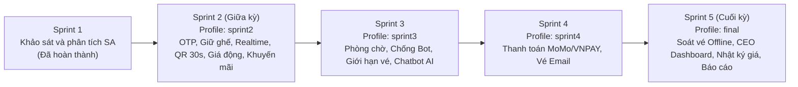

# Kế hoạch Sprint, WBS và Ước lượng Dự án EventTicketing

Tài liệu này chi tiết hóa tiến độ thực hiện dự án theo mô hình Agile/Scrum qua 5 Sprint, phân rã công việc (WBS), ước lượng thời gian và đối soát tương ứng với từng profile cờ tính năng (`FEATURE_PROFILE`).

---

## 1. Tổng quan lộ trình các Sprint

---

## 2. Sprint 1: Khảo sát, Phân tích yêu cầu & Thiết kế sơ bộ (Đã báo cáo)

- **Mục tiêu:** Thu thập yêu cầu từ Ban Tổ chức và 100 khán giả, lập tài liệu SA (B03), xác định các yêu cầu chức năng (FR-01 … FR-24), phi chức năng (NFR-01 … NFR-13), và dựng prototype giao diện ban đầu.
- **Thời gian thực hiện:** 2 tuần.
- **Nội dung công việc chính trong Sprint 1:**
  - Convert requirement (chuyển đổi và chuẩn hóa yêu cầu nghiệp vụ sang đặc tả hệ thống).
  - Thiết kế DFD Level 1.
  - Thiết kế ERD.
  - Demo Database.
  - Review bản thiết kế ERD.
- **Kết quả nghiệm thu:**
  - Biên bản làm việc với Stakeholders (B02).
  - Tài liệu Phân tích yêu cầu hệ thống B03 (Convert requirement).
  - Sơ đồ luồng dữ liệu DFD Level 1.
  - Bản thiết kế ERD (26 bảng ban đầu), biên bản Review bản thiết kế ERD và Demo Database.
  - Giao diện mẫu (Mockup Frontend) dựng bằng React.

---

## 3. Sprint 2: Nền tảng Backend Go, Giữ chỗ nguyên tử, Realtime, QR 30s & Định giá động (Giữa kỳ)

- **Profile cờ tính năng:** `FEATURE_PROFILE=sprint2`
- **Cờ được kích hoạt:** `otp_login`, `seat_map_realtime`, `seat_hold`, `zone_pricing`, `organizer_console`, `rotating_qr`, `dynamic_pricing`, `promo_suggestions` (FR-02 luôn bật).
- **Endpoint demo:** `POST /api/auth/demo-login` và `POST /api/tickets/reset-demo` chỉ có khi `APP_ENV` khác `production`. Bản trực tuyến chạy `production` nên không có hai endpoint này.
- **Hủy vé:** `POST /api/tickets/cancel` và `GET /api/tickets/cancelled` nằm sau cờ `payments` (Sprint 4), nên chưa dùng được ở Sprint 2.
- **Mục tiêu cốt lõi:**
  - Chuyển đổi toàn bộ cơ sở dữ liệu sang PostgreSQL 18 với giao dịch ACID và partial unique index.
  - Hoàn thiện luồng đăng nhập không mật khẩu bằng OTP (FR-01, FR-04). Mã OTP hiện trên màn hình (`OTP_DEMO`) hoặc ghi vào log, chưa gửi qua SMTP hay SMS Gateway.
  - Triển khai cơ chế giữ ghế độc quyền 5 phút chống bán trùng (FR-06, FR-07, NFR-03).
  - Đồng bộ sơ đồ ghế tức thì qua Server-Sent Events (SSE) và `LISTEN/NOTIFY` (FR-03, FR-05, NFR-10).
  - Danh sách sự kiện (FR-02, luôn bật) và Ban Tổ chức đặt giá sàn, giá trần theo khu vực (FR-08).
  - Bổ sung vào phạm vi Sprint 2: mã QR xoay vòng 30 giây bằng HMAC-SHA256 (FR-12, NFR-08), động cơ định giá động theo chu kỳ 5 phút trình BTC duyệt (FR-22, W-01), và gợi ý mã giảm giá kích cầu (FR-23).
  - Hoàn thiện bộ tài liệu thiết kế và kiểm thử giữa kỳ (T01 – T14).

### Bảng phân rã công việc (WBS) Sprint 2

| Mã việc | Nội dung công việc | Người phụ trách | Ước lượng (giờ) | Cờ tính năng / Yêu cầu |
|---|---|---|:---:|---|
| T12.1 | Thiết lập dự án Backend Go, migration PostgreSQL 18, `sqlc` và Docker Compose | Nhân (`nhansp`) | 16 | Hạ tầng, `compose.yaml` |
| T12.2 | Triển khai Service & Endpoint xác thực OTP (`/api/auth/otp/*`), quản lý phiên `sessions` | Nhân (`nhansp`) | 12 | `otp_login` (FR-01, FR-04) |
| T12.3 | Triển khai Service giữ ghế (`/api/holds`, gồm `GET` liệt kê lượt giữ của người gọi): `UPDATE` có điều kiện và unique index trên `seat_holds` chống bán trùng | Huy (`vdhwy`) | 18 | `seat_hold` (FR-06, FR-07) |
| T12.4 | Xây dựng SSE Hub kết nối `LISTEN/NOTIFY` và background worker nhả ghế hết hạn (`HoldReaper`) | Huy (`vdhwy`) | 14 | `seat_map_realtime` (FR-03, FR-05, NFR-10) |
| T12.5 | Tích hợp nginx proxy `/api` trong container `frontend`, kết nối Frontend React với SSE và API giữ ghế | Nhân (`nhansp`) | 12 | Giao diện, `SeatMap.tsx` |
| T12.6 | Danh sách sự kiện và API Ban Tổ chức: xem sự kiện của mình, đặt giá khu vực, ghi `price_changes`, xem `audit_logs` | Nhân (`nhansp`) | 8 | `zone_pricing`, `organizer_console` (FR-02, FR-08) |
| T12.7 | Thuật toán sinh mã QR xoay vòng 30s `ticket_code.step.HMAC(qr_secret, step)` và giao diện đổi QR | Thành (`Th4nhDT716`) | 14 | `rotating_qr` (FR-12, NFR-08) |
| T12.8 | Job định giá động chạy 5 phút một lần, sinh đề xuất trong `[giá sàn, giá trần]` và endpoint duyệt, từ chối đề xuất | Dũng (`Lan-0924`) | 20 | `dynamic_pricing` (FR-22, W-01) |
| T12.9 | Phân tích tỷ lệ lấp đầy thấp và gợi ý chương trình khuyến mãi kích cầu cho Ban Tổ chức duyệt | Thành (`Th4nhDT716`) | 6 | `promo_suggestions` (FR-23) |
| T01 | Trích xuất schema PostgreSQL, dựng sơ đồ ERD Mermaid và phân tích sai khác so với Sprint 1 | Huy (`vdhwy`) | 8 | `docs/erd.md` |
| T02 | Thiết kế sơ đồ lớp BCE (Boundary, Control, Entity) chuẩn bài B05 và ánh xạ 23 thực thể | Dũng (`Lan-0924`) | 10 | `docs/class-diagram.md` |
| T03 | Lập kế hoạch Sprint 1–5, WBS, bảng ước lượng giờ và phân bổ nhân lực | Dũng (`Lan-0924`) | 6 | `docs/sprints.md` |
| T04 | Thiết kế Sequence Diagram cho luồng giữ ghế 5 phút độc quyền | Dũng (`Lan-0924`) | 8 | `docs/sequences/hold.md` (FR-06) |
| T05 | Lập kịch bản và thực hiện kiểm thử thủ công giữ ghế theo tiêu chí chấp nhận của US-03 | Thành (`Th4nhDT716`) | 10 | `docs/checks/fr-06.md` |
| T06 | Thiết kế Sequence Diagram cho quy trình chống bán trùng ghế đa luồng | Phúc (`phukzz`) | 8 | `docs/sequences/double-booking.md` (FR-07) |
| T07 | Xây dựng sơ đồ luồng dữ liệu (DFD) mức ngữ cảnh, mức 0 và mức 1 | Phúc (`phukzz`) | 12 | `docs/dfd.md` |
| T08 | Bài toán và thiết kế Định giá động: mô hình, công thức, ví dụ tính tay | Dũng (`Lan-0924`) | 16 | `docs/dynamic-pricing.md` (FR-22) |
| T09 | Lập ma trận truy vết yêu cầu (Traceability Matrix) cho 24 FR và 13 NFR | Thành (`Th4nhDT716`) | 8 | `docs/spec.md` |
| T10 | Xây dựng sơ đồ Use Case tổng thể và viết đặc tả chi tiết các ca sử dụng | Đức Anh | 12 | `docs/use-cases.md` |
| T11 | Thiết kế kịch bản kiểm thử trải nghiệm và mẫu khảo sát người dùng thực tế | Đức Anh | 10 | `docs/testing.md` |
| T13 | Thiết kế Sequence Diagram cho quy trình đăng nhập OTP qua SMS và Email | Nhân (`nhansp`) | 6 | `docs/sequences/otp-login.md` (FR-04) |
| T14 | Soạn thảo tài liệu kiến trúc hệ thống và đặc tả OpenAPI 3.0 cho các endpoint | Nhân (`nhansp`) | 12 | `docs/architecture.md`, `openapi.yaml` |
| **Tổng** | | | **246** | |

---

## 4. Sprint 3: Phòng chờ ảo, Kiểm soát tải, Chống đầu cơ vé & Chatbot AI

- **Profile cờ tính năng:** `FEATURE_PROFILE=sprint3`
- **Cờ kích hoạt mới:** `waiting_room`, `bot_check`, `ticket_limit`, `chatbot`.
- **Mục tiêu cốt lõi:**
  - Triển khai phòng chờ ảo (Virtual Waiting Room) điều tiết lượng truy cập cao điểm bằng hàng đợi FIFO trong bảng `queue_entries` (FR-09, NFR-09).
  - Tích hợp Cloudflare Turnstile chặn bot tự động tại các bước trọng yếu (FR-10, NFR-07).
  - Giới hạn số vé mỗi tài khoản theo từng sự kiện (`events.max_tickets_per_user`), kiểm tra trong giao dịch giữ ghế dưới `pg_advisory_xact_lock` (FR-11).
  - Triển khai Trợ lý Chatbot AI hỗ trợ khán giả và Ban Tổ chức (tư vấn sự kiện, hạng ghế, hướng dẫn đặt vé và tóm tắt doanh số theo phân quyền qua `POST /api/assistant/chat`, kết hợp dữ liệu PostgreSQL và tùy chọn LLM Ollama/Gemini) (FR-24).

### Bảng phân rã công việc (WBS) Sprint 3

| Công việc | Nội dung chi tiết | Người phụ trách | Ước lượng (giờ) | Yêu cầu liên quan |
|---|---|---|:---:|---|
| WBS-3.1 | Xây dựng hàng chờ ảo `queue_entries`, API `/api/events/{id}/queue`, tính thời gian chờ ước tính | Huy (`vdhwy`) | 18 | `waiting_room` (FR-09, NFR-09) |
| WBS-3.2 | Tích hợp xác thực Turnstile token trên server Go và frontend form | Nhân (`nhansp`) | 10 | `bot_check` (FR-10, NFR-07) |
| WBS-3.3 | Xây dựng Trợ lý Chatbot AI (`POST /api/assistant/chat`, `AssistantService` gắn Ollama/Gemini và `AssistantWidget.tsx`) | Huy (`vdhwy`) | 14 | `chatbot` (FR-24) |
| WBS-3.4 | Chạy kịch bản kiểm thử tải k6 mô phỏng 10.000 khán giả ảo xếp hàng | Dũng (`Lan-0924`) | 14 | NFR-01, NFR-09 |
| WBS-3.5 | Khảo sát thực tế 5–10 người dùng trải nghiệm phòng chờ và Chatbot AI | Đức Anh | 10 | T11, US-01 |
| WBS-3.6 | Cập nhật tài liệu kiến trúc và đặc tả OpenAPI cho hàng chờ và Chatbot AI | Phúc (`phukzz`) | 8 | T14 |
| **Tổng** | | | **74** | |

---

## 5. Sprint 4: Đa kênh thanh toán, Gửi vé điện tử & Đối soát tự động

- **Profile cờ tính năng:** `FEATURE_PROFILE=sprint4`
- **Cờ kích hoạt mới:** `payments`, `ticket_email`, `reconciliation`.
- **Mục tiêu cốt lõi:**
  - Tích hợp cổng thanh toán MoMo và VNPAY, kiểm tra chữ ký số webhook IPN (FR-13).
  - Đảm bảo tính lũy kế: một giao dịch cổng (`provider_txn_id`) chỉ xử lý phát vé một lần duy nhất (NFR-04).
  - Phát hành vé điện tử tức thì và gửi email xác nhận qua máy chủ SMTP (FR-14).
  - Xây dựng tiến trình đối soát tự động: hoàn tiền nếu tiền về khi lượt giữ ghế đã hết hạn và ghế bị người khác mua (FR-15, NFR-04).

### Bảng phân rã công việc (WBS) Sprint 4

| Công việc | Nội dung chi tiết | Người phụ trách | Ước lượng (giờ) | Yêu cầu liên quan |
|---|---|---|:---:|---|
| WBS-4.1 | Triển khai tạo đơn hàng `orders`, tích hợp SDK/HTTP ký số thanh toán MoMo & VNPAY | Nhân (`nhansp`) | 20 | `payments` (FR-13) |
| WBS-4.2 | Xử lý webhook IPN an toàn, khóa hàng đợi thanh toán chống lặp giao dịch | Huy (`vdhwy`) | 14 | `payments` (NFR-04) |
| WBS-4.3 | Xây dựng dịch vụ gửi email vé kèm file đính kèm/link vé qua SMTP | Dũng (`Lan-0924`) | 10 | `ticket_email` (FR-14) |
| WBS-4.4 | Xây dựng worker đối soát định kỳ (`reconciliation`), tự động kích hoạt hoàn tiền đơn trễ hạn | Thành (`Th4nhDT716`) | 16 | `reconciliation` (FR-15) |
| WBS-4.5 | Kiểm thử tích hợp luồng thanh toán sandbox MoMo, VNPAY và mô phỏng mạng trễ | Đức Anh | 12 | US-04, US-06 |
| WBS-4.6 | Cập nhật sơ đồ Sequence thanh toán & đối soát vào tài liệu hệ thống | Phúc (`phukzz`) | 8 | Sequence Payment |
| **Tổng** | | | **80** | |

---

## 6. Sprint 5: Soát vé ngoại tuyến, CEO Dashboard & Báo cáo kiểm toán (Cuối kỳ)

- **Profile cờ tính năng:** `FEATURE_PROFILE=final`
- **Cờ kích hoạt mới:** `gate_checkin`, `offline_checkin`, `ceo_dashboard`, `price_log`, `reports_export`.
- **Mục tiêu cốt lõi:**
  - Ứng dụng soát vé cho nhân viên cổng: quét camera QR, kiểm tra vé hợp lệ $\le$ 1 giây (FR-16, FR-17, NFR-05).
  - Hoạt động ngoại tuyến khi mất mạng: xác thực chữ ký HMAC cục bộ và đồng bộ khi có mạng (FR-18, NFR-06).
  - CEO Dashboard thời gian thực hiển thị doanh thu, fill rate, số vé đã bán, phân bổ theo phút (FR-19).
  - Trang xem sổ nhật ký giá bất biến (FR-20, NFR-12).
  - Xuất báo cáo kế toán CSV/XLSX (FR-21).

### Bảng phân rã công việc (WBS) Sprint 5

| Công việc | Nội dung chi tiết | Người phụ trách | Ước lượng (giờ) | Yêu cầu liên quan |
|---|---|---|:---:|---|
| WBS-5.1 | Xây dựng giao diện Web/PWA soát vé camera, xác thực chữ ký QR tại cổng | Phúc (`phukzz`) | 16 | `gate_checkin` (FR-16, FR-17) |
| WBS-5.2 | Cơ chế tải trước manifest vé, lưu SQLite/IndexedDB trên máy quét và giải quyết xung đột `OFFLINE_CONFLICT` | Huy (`vdhwy`) | 18 | `offline_checkin` (FR-18, NFR-06) |
| WBS-5.3 | Xây dựng màn hình CEO Dashboard cập nhật trực tiếp qua SSE và xuất báo cáo CSV/XLSX | Nhân (`nhansp`) | 16 | `ceo_dashboard`, `reports_export` (FR-19, FR-21) |
| WBS-5.4 | Giao diện quản trị và tra cứu sổ nhật ký giá bất biến `price_log` | Thành (`Th4nhDT716`) | 6 | `price_log` (FR-20, NFR-12) |
| WBS-5.5 | Tổng kiểm thử nghiệm thu toàn diện (UAT) với 10 người dùng thật và hoàn tất báo cáo cuối kỳ | Đức Anh | 16 | T11, Báo cáo tổng kết |
| **Tổng** | | | **72** | |

---

## 7. Tổng hợp phân bổ nguồn lực toàn dự án

Phụ trách chính lấy theo `docs/TASKS.md`. Riêng T12 được chia nhỏ: giữ ghế (T12.3) và realtime (T12.4) do Huy viết, QR 30s (T12.7) và khuyến mãi (T12.9) do Thành viết, job định giá động (T12.8) do Dũng viết, phần hạ tầng/OTP/frontend/BTC còn lại do Nhân phụ trách.

| Thành viên | Phụ trách chính | Giờ Sprint 2 | Giờ Sprint 3 | Giờ Sprint 4 | Giờ Sprint 5 | Tổng cộng (giờ) |
|---|---|:---:|:---:|:---:|:---:|:---:|
| Huy (`vdhwy`) | ERD, giữ ghế và realtime (T12.3, T12.4), Chatbot AI (Sprint 3) | 40 | 32 | 14 | 18 | **104** |
| Nhân (`nhansp`) | Hạ tầng, OTP, frontend, API Ban Tổ chức (T12.1, T12.2, T12.5, T12.6), sequence OTP, kiến trúc và API | 66 | 10 | 20 | 16 | **112** |
| Dũng (`Lan-0924`) | Sơ đồ lớp BCE, kế hoạch Sprint, bài toán và thiết kế Định giá động, job định giá (T12.8), Sequence giữ ghế | 60 | 14 | 16 | 0 | **90** |
| Phúc (`phukzz`) | Sequence chống bán trùng, DFD, giao diện soát vé PWA | 20 | 8 | 8 | 16 | **52** |
| Thành (`Th4nhDT716`) | Bảng đặc tả 24 FR/13 NFR, ma trận truy vết, kiểm thử thủ công FR-06, QR 30s (T12.7), khuyến mãi (T12.9), nhật ký giá | 38 | 0 | 10 | 6 | **54** |
| Đức Anh | Use Case, kiểm thử người dùng | 22 | 10 | 12 | 16 | **60** |
| **Toàn nhóm** | | **246** | **74** | **80** | **72** | **472** |
