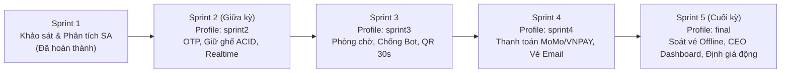

# Kế hoạch Sprint, WBS và Ước lượng Dự án EventTicketing

Tài liệu này chi tiết hóa tiến độ thực hiện dự án theo mô hình Agile/Scrum qua 5 Sprint, phân rã công việc (WBS), ước lượng thời gian và đối soát tương ứng với từng profile cờ tính năng (`FEATURE_PROFILE`).

---

## 1. Tổng quan lộ trình các Sprint

---

## 2. Sprint 1: Khảo sát, Phân tích yêu cầu & Thiết kế sơ bộ (Đã báo cáo)

- **Mục tiêu:** Thu thập yêu cầu từ Ban Tổ chức và 100 khán giả, lập tài liệu SA (B03), xác định các yêu cầu chức năng (FR-01 … FR-23), phi chức năng (NFR-01 … NFR-13), và dựng prototype giao diện ban đầu.
- **Thời gian thực hiện:** 2 tuần.
- **Kết quả nghiệm thu:**
  - Biên bản làm việc với Stakeholders (B02).
  - Tài liệu Phân tích yêu cầu hệ thống B03.
  - Sơ đồ thực thể liên kết (ERD) và cơ sở dữ liệu MySQL ban đầu (26 bảng).
  - Giao diện mẫu (Mockup Frontend) dựng bằng React.

---

## 3. Sprint 2: Nền tảng Backend Go, Giữ chỗ nguyên tử & Realtime (Giữa kỳ)

- **Profile cờ tính năng:** `FEATURE_PROFILE=sprint2`
- **Cờ được kích hoạt:** `otp_login`, `seat_map_realtime`, `seat_hold`, `zone_pricing`, `organizer_console` (FR-02 luôn bật).
- **Mục tiêu cốt lõi:**
  - Chuyển đổi toàn bộ cơ sở dữ liệu sang PostgreSQL 18 với giao dịch ACID và partial unique index.
  - Hoàn thiện luồng đăng nhập không mật khẩu bằng OTP qua SMS/Email (FR-01, FR-04).
  - Triển khai cơ chế giữ ghế độc quyền 5 phút chống bán trùng (FR-06, FR-07, NFR-03).
  - Đồng bộ sơ đồ ghế tức thì qua Server-Sent Events (SSE) và `LISTEN/NOTIFY` (FR-03, FR-05, NFR-10).
  - Hoàn thiện bộ tài liệu thiết kế và kiểm thử giữa kỳ (T01 – T14).

### Bảng phân rã công việc (WBS) Sprint 2

| Mã việc | Nội dung công việc | Người phụ trách | Ước lượng (giờ) | Cờ tính năng / Yêu cầu |
|---|---|---|:---:|---|
| T12.1 | Thiết lập dự án Backend Go, migration PostgreSQL 18, `sqlc` và Docker Compose | Nhân (`nhansp`) | 16 | Hạ tầng, `compose.yaml` |
| T12.2 | Triển khai Service & Endpoint xác thực OTP (`/api/auth/otp/*`), quản lý phiên `sessions` | Nhân (`nhansp`) | 12 | `otp_login` (FR-01, FR-04) |
| T12.3 | Triển khai Service giữ ghế nguyên tử (`/api/holds`), khóa `pg_advisory_xact_lock`, kiểm tra giới hạn vé | Huy (`vdhwy`) | 18 | `seat_hold` (FR-06, FR-07) |
| T12.4 | Xây dựng SSE Hub kết nối `LISTEN/NOTIFY` và background worker nhả ghế hết hạn (`HoldReaper`) | Huy (`vdhwy`) | 14 | `seat_map_realtime` (NFR-10) |
| T12.5 | Tích hợp Reverse Proxy Nginx, kết nối Frontend React với SSE và API giữ ghế | Nhân (`nhansp`) | 12 | Giao diện, `SeatMap.tsx` |
| T01 | Trích xuất schema PostgreSQL, dựng sơ đồ ERD Mermaid và phân tích sai khác so với Sprint 1 | Huy (`vdhwy`) | 8 | `docs/erd.md` |
| T02 | Thiết kế sơ đồ lớp BCE (Boundary, Control, Entity) chuẩn bài B05 và ánh xạ 23 thực thể | Huy (`vdhwy`) | 10 | `docs/class-diagram.md` |
| T03 | Lập kế hoạch Sprint 1–5, WBS, bảng ước lượng giờ và phân bổ nhân lực | Huy (`vdhwy`) | 6 | `docs/sprints.md` |
| T04 | Thiết kế Sequence Diagram cho luồng giữ ghế 5 phút độc quyền | Dũng (`Lan-0924`) | 8 | `docs/sequences/hold.md` (FR-06) |
| T05 | Lập kịch bản và thực hiện kiểm thử thủ công giữ ghế theo tiêu chí chấp nhận của US-03 | Dũng (`Lan-0924`) | 10 | `docs/checks/fr-06.md` |
| T06 | Thiết kế Sequence Diagram cho quy trình chống bán trùng ghế đa luồng | Phúc (`phukzz`) | 8 | `docs/sequences/double-booking.md` (FR-07) |
| T07 | Xây dựng sơ đồ luồng dữ liệu (DFD) mức ngữ cảnh, mức 0 và mức 1 | Phúc (`phukzz`) | 12 | `docs/dfd.md` |
| T08 | Mô hình hóa bài toán, xây dựng công thức và thiết kế giải thuật định giá động giữa kỳ | Thành (`Th4nhDT716`) | 16 | `docs/dynamic-pricing.md` (FR-22) |
| T09 | Lập ma trận truy vết yêu cầu (Traceability Matrix) cho 23 FR và 13 NFR | Thành (`Th4nhDT716`) | 8 | `docs/spec.md` |
| T10 | Xây dựng sơ đồ Use Case tổng thể và viết đặc tả chi tiết các ca sử dụng | Đức Anh | 12 | `docs/use-cases.md` |
| T11 | Thiết kế kịch bản kiểm thử trải nghiệm và mẫu khảo sát người dùng thực tế | Đức Anh | 10 | `docs/testing.md` |
| T13 | Thiết kế Sequence Diagram cho quy trình đăng nhập OTP qua SMS và Email | Nhân (`nhansp`) | 6 | `docs/sequences/otp-login.md` (FR-04) |
| T14 | Soạn thảo tài liệu kiến trúc hệ thống và đặc tả OpenAPI 3.0 cho các endpoint | Nhân (`nhansp`) | 12 | `docs/architecture.md`, `openapi.yaml` |
| **Tổng** | | | **190** | |

---

## 4. Sprint 3: Phòng chờ ảo, Kiểm soát tải & Chống đầu cơ vé

- **Profile cờ tính năng:** `FEATURE_PROFILE=sprint3`
- **Cờ kích hoạt mới:** `waiting_room`, `bot_check`, `ticket_limit`, `rotating_qr`.
- **Mục tiêu cốt lõi:**
  - Triển khai phòng chờ ảo (Virtual Waiting Room) điều tiết lượng truy cập cao điểm bằng hàng đợi FIFO trong bảng `queue_entries` (FR-09, NFR-09).
  - Tích hợp Cloudflare Turnstile chặn bot tự động tại các bước trọng yếu (FR-10, NFR-07).
  - Ràng buộc chặt chẽ trần 4 vé/tài khoản trên toàn hệ thống (FR-11).
  - Triển khai thuật toán sinh mã QR động (Rotating QR) dùng HMAC-SHA256 đổi sau mỗi 30 giây chống chụp màn hình (FR-12, NFR-08).

### Bảng phân rã công việc (WBS) Sprint 3

| Công việc | Nội dung chi tiết | Người phụ trách | Ước lượng (giờ) | Yêu cầu liên quan |
|---|---|---|:---:|---|
| WBS-3.1 | Xây dựng hàng chờ ảo `queue_entries`, API `/api/events/{id}/queue`, tính thời gian chờ ước tính | Huy (`vdhwy`) | 18 | `waiting_room` (FR-09, NFR-09) |
| WBS-3.2 | Tích hợp xác thực Turnstile token trên server Go và frontend form | Nhân (`nhansp`) | 10 | `bot_check` (FR-10, NFR-07) |
| WBS-3.3 | Thuật toán sinh mã QR xoay vòng 30s `ticket_code.step.HMAC(qr_secret, step)` và giao diện đổi QR | Thành (`Th4nhDT716`) | 14 | `rotating_qr` (FR-12, NFR-08) |
| WBS-3.4 | Chạy kịch bản kiểm thử tải k6 mô phỏng 10.000 khán giả ảo xếp hàng | Dũng (`Lan-0924`) | 14 | NFR-01, NFR-09 |
| WBS-3.5 | Khảo sát thực tế 5–10 người dùng trải nghiệm phòng chờ và đánh giá độ trễ | Đức Anh | 10 | T11, US-01 |
| WBS-3.6 | Cập nhật tài liệu kiến trúc và đặc tả OpenAPI cho hàng chờ và QR | Phúc (`phukzz`) | 8 | T14 |
| **Tổng** | | | **74** | |

---

## 5. Sprint 4: Đa kênh thanh toán, Gửi vé điện tử & Đối soát tự động

- **Profile cờ tính năng:** `FEATURE_PROFILE=sprint4`
- **Cờ kích hoạt mới:** `payments`, `ticket_email`, `reconciliation`.
- **Mục tiêu cốt lõi:**
  - Tích hợp cổng thanh toán MoMo và VNPAY, kiểm tra chữ ký số webhook IPN (FR-13).
  - Đảm bảo tính lũy kế: một giao dịch cổng (`provider_txn_id`) chỉ xử lý phát vé một lần duy nhất (NFR-04).
  - Phát hành vé điện tử tức thì và gửi email xác nhận qua máy chủ SMTP (FR-14).
  - Xây dựng tiến trình đối soát tự động: hoàn tiền nếu tiền về khi lượt giữ ghế đã hết hạn và ghế bị người khác mua (FR-15, NFR-04).

### Bảng phân rã công việc (WBS) Sprint 4

| Công việc | Nội dung chi tiết | Người phụ trách | Ước lượng (giờ) | Yêu cầu liên quan |
|---|---|---|:---:|---|
| WBS-4.1 | Triển khai tạo đơn hàng `orders`, tích hợp SDK/HTTP ký số thanh toán MoMo & VNPAY | Nhân (`nhansp`) | 20 | `payments` (FR-13) |
| WBS-4.2 | Xử lý webhook IPN an toàn, khóa hàng đợi thanh toán chống lặp giao dịch | Huy (`vdhwy`) | 14 | `payments` (NFR-04) |
| WBS-4.3 | Xây dựng dịch vụ gửi email vé kèm file đính kèm/link vé qua SMTP | Dũng (`Lan-0924`) | 10 | `ticket_email` (FR-14) |
| WBS-4.4 | Xây dựng worker đối soát định kỳ (`reconciliation`), tự động kích hoạt hoàn tiền đơn trễ hạn | Thành (`Th4nhDT716`) | 16 | `reconciliation` (FR-15) |
| WBS-4.5 | Kiểm thử tích hợp luồng thanh toán sandbox MoMo, VNPAY và mô phỏng mạng trễ | Đức Anh | 12 | US-04, US-06 |
| WBS-4.6 | Cập nhật sơ đồ Sequence thanh toán & đối soát vào tài liệu hệ thống | Phúc (`phukzz`) | 8 | Sequence Payment |
| **Tổng** | | | **80** | |

---

## 6. Sprint 5: Soát vé ngoại tuyến, CEO Dashboard & Đề xuất giá động AI (Cuối kỳ)

- **Profile cờ tính năng:** `FEATURE_PROFILE=final`
- **Cờ kích hoạt mới:** `gate_checkin`, `offline_checkin`, `ceo_dashboard`, `price_log`, `reports_export`, `dynamic_pricing`, `promo_suggestions`.
- **Mục tiêu cốt lõi:**
  - Ứng dụng soát vé cho nhân viên cổng: quét camera QR, kiểm tra vé hợp lệ $\le$ 1 giây (FR-16, FR-17, NFR-05).
  - Hoạt động ngoại tuyến khi mất mạng: xác thực chữ ký HMAC cục bộ và đồng bộ khi có mạng (FR-18, NFR-06).
  - CEO Dashboard thời gian thực hiển thị doanh thu, fill rate, số vé đã bán, phân bổ theo phút (FR-19).
  - Xuất báo cáo kế toán CSV/XLSX (FR-21).
  - Engine định giá động (Dynamic Pricing Engine) chạy chu kỳ 5 phút: tính toán tốc độ bán, hàng chờ, sinh đề xuất trong khoảng [giá sàn, giá trần] trình Ban Tổ chức duyệt (FR-22, W-01).

### Bảng phân rã công việc (WBS) Sprint 5

| Công việc | Nội dung chi tiết | Người phụ trách | Ước lượng (giờ) | Yêu cầu liên quan |
|---|---|---|:---:|---|
| WBS-5.1 | Xây dựng giao diện Web/PWA soát vé camera, xác thực chữ ký QR tại cổng | Phúc (`phukzz`) | 16 | `gate_checkin` (FR-16) |
| WBS-5.2 | Cơ chế tải trước manifest vé, lưu SQLite/IndexedDB trên máy quét và giải quyết xung đột `OFFLINE_CONFLICT` | Huy (`vdhwy`) | 18 | `offline_checkin` (FR-18, NFR-06) |
| WBS-5.3 | Engine định giá động chạy nền chu kỳ 5 phút, tạo đề xuất `price_suggestions` và API phê duyệt của BTC | Thành (`Th4nhDT716`) | 20 | `dynamic_pricing` (FR-22, W-01) |
| WBS-5.4 | Xây dựng màn hình CEO Dashboard cập nhật trực tiếp qua SSE và xuất báo cáo CSV/XLSX | Nhân (`nhansp`) | 16 | `ceo_dashboard`, `reports_export` (FR-19, FR-21) |
| WBS-5.5 | Giao diện quản trị nhật ký giá `price_log` và đề xuất chương trình khuyến mãi | Dũng (`Lan-0924`) | 12 | `price_log`, `promo_suggestions` (FR-20, FR-23) |
| WBS-5.6 | Tổng kiểm thử nghiệm thu toàn diện (UAT) với 10 người dùng thật và hoàn tất báo cáo cuối kỳ | Đức Anh | 16 | T11, Báo cáo tổng kết |
| **Tổng** | | | **98** | |

---

## 7. Tổng hợp phân bổ nguồn lực toàn dự án

| Thành viên | Vai trò chính | Giờ Sprint 2 | Giờ Sprint 3 | Giờ Sprint 4 | Giờ Sprint 5 | Tổng cộng (giờ) |
|---|---|:---:|:---:|:---:|:---:|:---:|
| Huy (`vdhwy`) | Backend Lead, Database Architect, Sprint Master | 56 | 18 | 14 | 18 | **106** |
| Nhân (`nhansp`) | Fullstack Go/React, Docker & CI/CD, API Designer | 58 | 10 | 20 | 16 | **104** |
| Dũng (`Lan-0924`) | QA Lead, Kiểm thử hiệu năng k6, Sequence Engineer | 28 | 14 | 10 | 12 | **64** |
| Phúc (`phukzz`) | System Analyst, DFD Modeler, Gate Staff App | 28 | 8 | 8 | 16 | **60** |
| Thành (`Th4nhDT716`) | Quant/Algorithm Engineer, Dynamic Pricing, Traceability | 32 | 14 | 16 | 20 | **82** |
| Đức Anh | Product Owner, User Testing, Use Case Specialist | 32 | 10 | 12 | 16 | **70** |
| **Toàn nhóm** | | **234** | **74** | **80** | **98** | **486** |
