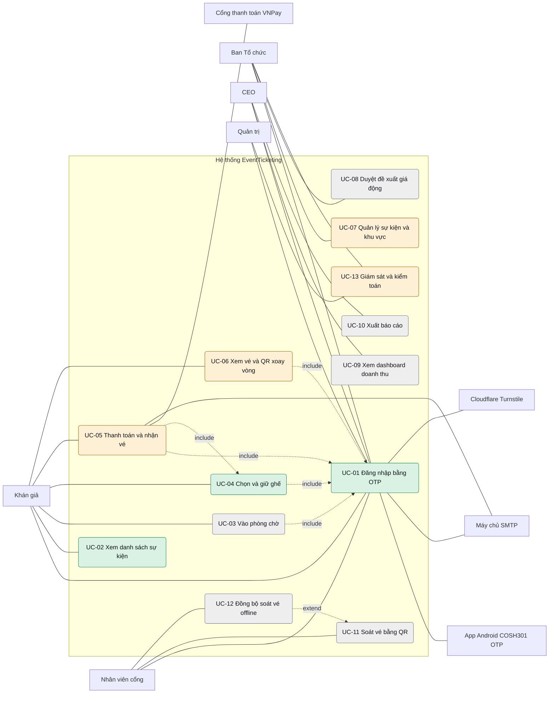

# Sơ đồ và đặc tả Use Case

Tác nhân lấy từ mục 2 của [`design/README.md`](design/README.md).
Luồng chính lấy từ mục 4, quy tắc nghiệp vụ từ mục 6.
Mã FR khớp với bảng cờ ở mục 1 của thiết kế.
Use case đã làm bám theo code trong `backend/` và `frontend/`, các use case còn lại theo thiết kế.

Hệ thống có 13 use case, đánh số UC-01 đến UC-13 như trong báo cáo.
Mục 6 đối chiếu với số hiệu UC-01 đến UC-17 của bản trước.

## 1. Tác nhân

### 1.1 Người dùng

| Tác nhân | `users.role` | Nhiệm vụ |
|---|---|---|
| Khán giả (SH-03) | `CUSTOMER` | Mua vé, xem vé |
| Ban Tổ chức (SH-01) | `ORGANIZER` | Tạo sự kiện, đặt giá, duyệt đề xuất giá |
| CEO (SH-02) | `CEO` | Xem doanh thu, xuất báo cáo |
| Nhân viên cổng (SH-04) | `GATE_STAFF` | Soát vé |
| Quản trị | `ADMIN` | Phân quyền, giám sát, xem nhật ký |

Mọi vai trò đều đăng nhập bằng OTP (UC-01).
Tài khoản mới luôn có vai trò `CUSTOMER`.

### 1.2 Hệ thống ngoài

| Hệ thống | Vai trò | Hiện trạng |
|---|---|---|
| Cổng thanh toán VNPay (SH-05) | Nhận yêu cầu thanh toán, gửi kết quả về api qua IPN | Đã làm, môi trường sandbox. Chưa có MoMo |
| App Android `COSH301 OTP` | Nhận mã OTP của số điện thoại và hiện trong thông báo | Đã làm, thay cho App SMS Gateway của thiết kế |
| Máy chủ SMTP | Gửi mã OTP và vé qua email | Chưa làm |
| Cloudflare Turnstile | Kiểm tra bot khi xin mã OTP | Chưa làm |

## 2. Sơ đồ Use Case

Màu nền cho biết hiện trạng của use case: đã làm, làm một phần, hoặc mới ở mức thiết kế.

## 3. Hiện trạng và sơ đồ tuần tự

Bảng dưới cho biết mỗi use case đã có code đến đâu, và sơ đồ tuần tự nào mô tả nó.
Hiện trạng tính theo bản chạy trực tuyến: profile `sprint2`, bật thêm `FEATURE_PAYMENTS=on` và `OTP_APP_DELIVERY=true`.

| Use case | Tác nhân chính | Cờ | FR | Hiện trạng | Sơ đồ tuần tự |
|---|---|---|---|---|---|
| UC-01 Đăng nhập bằng OTP | Mọi tác nhân | `otp_login`, `bot_check` | FR-01, FR-04, FR-10 | **Đã làm**, trừ Turnstile và SMTP | [`otp-login.md`](sequences/otp-login.md), [`otp-app.md`](sequences/otp-app.md) |
| UC-02 Xem danh sách sự kiện | Khán giả | luôn bật | FR-02 | **Đã làm** | — |
| UC-03 Vào phòng chờ | Khán giả | `waiting_room` | FR-09 | Dự kiến. Đã có bảng `queue_entries` | — |
| UC-04 Chọn và giữ ghế | Khán giả | `seat_map_realtime`, `seat_hold`, `ticket_limit` | FR-03, FR-05, FR-06, FR-07, FR-11 | **Đã làm**. `ticket_limit` có code nhưng tắt ở `sprint2` | [`hold.md`](sequences/hold.md), [`double-booking.md`](sequences/double-booking.md) |
| UC-05 Thanh toán và nhận vé | Khán giả | `payments`, `ticket_email`, `reconciliation` | FR-13, FR-14, FR-15 | **Một phần**: VNPay sandbox, phát vé. Chưa có MoMo, email, hoàn tiền tự động | [`payment.md`](sequences/payment.md) |
| UC-06 Xem vé và QR xoay vòng | Khán giả | `payments`, `rotating_qr` | FR-12 | **Một phần**: xem danh sách vé. Chưa có QR | [`payment.md`](sequences/payment.md) mục 5 |
| UC-07 Quản lý sự kiện và khu vực | Ban Tổ chức | `organizer_console`, `zone_pricing`, `price_log` | FR-08, FR-20 | **Một phần**: xem sự kiện, đặt giá khu vực, ghi nhật ký giá. Chưa tạo được địa điểm, khu vực, sự kiện | — |
| UC-08 Duyệt đề xuất giá động | Ban Tổ chức | `dynamic_pricing` | FR-22, FR-20 | Đang làm riêng, xem [`dynamic-pricing.md`](dynamic-pricing.md) | — |
| UC-09 Xem dashboard doanh thu | CEO | `ceo_dashboard` | FR-19 | Dự kiến. Đã có bảng `sales_snapshots` | — |
| UC-10 Xuất báo cáo | CEO | `reports_export` | FR-21 | Dự kiến | — |
| UC-11 Soát vé bằng QR | Nhân viên cổng | `gate_checkin` | FR-16, FR-17 | Dự kiến. Đã có bảng `gate_devices`, `checkins` | — |
| UC-12 Đồng bộ soát vé offline | Nhân viên cổng | `offline_checkin` | FR-18 | Dự kiến | — |
| UC-13 Giám sát và kiểm toán | Quản trị, Ban Tổ chức | `organizer_console`, `price_log` | FR-20, NFR-12 | **Một phần**: xem `audit_logs`, healthcheck, trigger chặn sửa nhật ký. Chưa có phân quyền và trang nhật ký giá | — |

Sơ đồ tuần tự của UC-07 (đặt giá khu vực) và UC-13 chưa có file riêng.

## 4. Đặc tả

Mỗi use case ghi cờ tính năng.
Cờ tắt thì giao diện ẩn tính năng và API trả `404 feature_disabled`.

### UC-01: Đăng nhập bằng OTP

- **Tác nhân:** Khán giả, Ban Tổ chức, CEO, Nhân viên cổng, Quản trị.
- **Hệ thống ngoài:** App Android `COSH301 OTP`, máy chủ SMTP (chưa làm), Cloudflare Turnstile (chưa làm).
- **Cờ:** `otp_login` (Sprint 2), `bot_check` (Sprint 3).
- **Tiền điều kiện:**
  - Người dùng có SĐT hoặc email.
  - Tài khoản chưa có cũng được, vì lần đầu đăng nhập hệ thống tự tạo.
- **Luồng chính:**
  1. Người dùng nhập SĐT hoặc email ở trang đăng nhập.
  2. Trình duyệt chạy kiểm tra Turnstile (từ Sprint 3).
  3. Người dùng gửi yêu cầu `POST /api/auth/otp/request`.
  4. Hệ thống chuẩn hóa địa chỉ nhận mã:
     - có `@` là email, kênh `EMAIL`, chuyển chữ thường;
     - còn lại là SĐT, kênh `SMS`, bỏ dấu cách, `-`, `.`, đổi về dạng `+84...`, phải có 9–15 chữ số.
  5. Hệ thống sinh mã 6 số, lưu SHA-256 của mã vào `otp_verifications`, hạn 5 phút.
  6. Hệ thống giao mã:
     - SĐT khi bật `OTP_APP_DELIVERY`: lưu mã vào `otp_app_deliveries` và báo cho app `COSH301 OTP`. App lấy mã bằng `POST /api/otp-app/claim` và hiện trong thông báo;
     - email khi bật `OTP_DEMO`, tài khoản khách hàng: mã hiện trên màn hình;
     - còn lại: mã ghi vào log của api.
  7. Người dùng nhập mã, gửi `POST /api/auth/otp/verify`.
  8. Hệ thống kiểm tra mã. Nếu SĐT hoặc email chưa có trong `users` thì tạo tài khoản `CUSTOMER`.
  9. Hệ thống tạo dòng trong `sessions`, trả cookie `session_token` (`HttpOnly`, hiệu lực 7 ngày).
  10. Trình duyệt quay lại trang đang thao tác.
- **Luồng phụ:**
  - 2a. Turnstile không qua: từ chối gửi mã.
  - 3a. Một IP gọi quá 30 lần mỗi phút (tính chung `otp/request` và `otp/verify`): `429 rate_limited`.
  - 4a. Địa chỉ sai định dạng: `400 invalid_destination`.
  - 5a. Cùng địa chỉ xin mã chưa đủ 60 giây, hoặc đã xin 5 mã trong 1 giờ: `429 otp_rate_limited`.
  - 8a. Mã sai, hết hạn (5 phút), đã dùng, hoặc đã nhập 5 lần (tính cả lần đúng): `401 otp_invalid`. Người dùng phải xin mã mới.
  - 8b. Tài khoản `LOCKED` hoặc `DISABLED`: `403 account_inactive`.
  - 10a. Đăng xuất: `POST /api/auth/logout` xóa dòng `sessions` của phiên.
- **Ghi chú:** api chưa gọi SMTP hay SMS Gateway.
  Mã của SĐT đi qua app Android, giới hạn bảo mật của cách này nằm ở [`otp-app.md`](otp-app.md).
- **Đăng nhập thử nhanh:** khi `APP_ENV` khác `production`, `POST /api/auth/demo-login` tạo một tài khoản `CUSTOMER` mới mỗi lần gọi và mở phiên, không cần OTP. Endpoint này không tạo tài khoản Ban Tổ chức. Ở môi trường `production` endpoint không tồn tại.
- **FR liên quan:** FR-01, FR-04, FR-10.

### UC-02: Xem danh sách sự kiện

- **Tác nhân:** Khán giả (không cần đăng nhập).
- **Cờ:** luôn bật.
- **Tiền điều kiện:** không có.
- **Luồng chính:**
  1. Khán giả mở trang chủ, hệ thống gọi `GET /api/events`.
  2. Trang hiện các sự kiện đang bán.
  3. Khán giả lọc theo thể loại, thành phố, ngày, giá.
  4. Khán giả chọn một sự kiện, hệ thống gọi `GET /api/events/{slug}` và hiện trang chi tiết, gồm các hạng vé và giá từng khu vực.
  5. Khán giả bấm **Mua vé** để sang UC-03 hoặc UC-04.
- **Luồng phụ:**
  - 3a. Không sự kiện nào khớp bộ lọc: hiện danh sách rỗng.
  - 4a. Không có sự kiện với `slug` đó: `404 event_not_found`, hiện thông báo không tìm thấy.
- **FR liên quan:** FR-02.

### UC-03: Vào phòng chờ

- **Tác nhân:** Khán giả.
- **Cờ:** `waiting_room` (Sprint 3). Chưa có code.
- **Tiền điều kiện:**
  - Khán giả đã đăng nhập (UC-01).
  - Sự kiện bật `waiting_room_enabled`.
- **Luồng chính:**
  1. Khán giả bấm **Mua vé**, trình duyệt gọi `POST /api/events/{id}/queue`.
  2. Hệ thống ghi một dòng `queue_entries` trạng thái `WAITING`.
  3. Trang hiện "Bạn đang ở vị trí N, chờ khoảng X phút".
     Trình duyệt hỏi `GET /api/events/{id}/queue/me`, thông tin làm mới tối đa 10 giây một lần.
  4. Số người đang mua nhỏ hơn `waiting_room_capacity`, hệ thống cho người đầu hàng vào: trạng thái `ADMITTED`, hạn 10 phút.
  5. Trình duyệt tự chuyển sang trang chọn ghế (UC-04).
- **Luồng phụ:**
  - 1a. Khán giả đã có dòng trong hàng của sự kiện này: trả lại vị trí hiện tại, không tạo dòng mới.
  - 2a. Sự kiện tắt phòng chờ: khán giả vào thẳng trang chọn ghế.
  - 4a. Khán giả được vào nhưng quá 10 phút: trạng thái `EXPIRED`, phải xếp hàng lại.
  - 3b. Khán giả rời trang và hủy chờ: trạng thái `LEFT`.
- **Quy tắc:** thời gian chờ ước tính bằng vị trí chia tốc độ cho vào gần đây.
- **FR liên quan:** FR-09.

### UC-04: Chọn và giữ ghế

- **Tác nhân:** Khán giả.
- **Cờ:** `seat_map_realtime`, `seat_hold` (Sprint 2), `ticket_limit` (Sprint 3).
- **Tiền điều kiện:**
  - Xem sơ đồ không cần đăng nhập, nhưng ghế "mình đang giữ" chỉ hiện khi đã đăng nhập.
  - Giữ ghế cần đăng nhập (UC-01).
  - Nếu sự kiện bật phòng chờ thì khán giả đã được vào (UC-03).
- **Luồng chính:**
  1. Trình duyệt gọi `GET /api/events/{id}/seats`.
  2. Hệ thống trả danh sách ghế kèm khu vực, giá và trạng thái.
  3. Trang vẽ ghế bằng 4 màu:
     - xanh: còn trống;
     - xám: đã bán;
     - vàng: người khác đang giữ;
     - tím: mình đang giữ.
  4. Trình duyệt mở `EventSource` tới `GET /api/events/{id}/stream`.
  5. Khán giả bấm một ghế xanh. Trình duyệt gọi `POST /api/holds` với `eventId` và `seatId`.
  6. Hệ thống mở một giao dịch và kiểm tra sự kiện đang `ON_SALE`, trong thời gian mở bán.
  7. Khi cờ `ticket_limit` bật, hệ thống khóa theo cặp (người dùng, sự kiện) bằng `pg_advisory_xact_lock`. Hệ thống đếm số ghế đang giữ cộng số vé chưa `VOID` của người đó.
  8. Hệ thống chuyển ghế từ `AVAILABLE` sang `HELD` bằng một câu `UPDATE` có điều kiện.
  9. Hệ thống ghi một dòng `seat_holds` trạng thái `ACTIVE`, `expires_at` bằng bây giờ cộng 5 phút.
  10. Hệ thống gửi `NOTIFY` trong cùng giao dịch, rồi commit.
  11. api trả `201` kèm `holdId`, `holdToken`, `expiresAt`.
  12. Ghế của khán giả chuyển tím và đồng hồ đếm ngược theo `expiresAt` của server.
  13. Trình duyệt của người khác nhận SSE và đổi ghế sang vàng, không cần tải lại.
- **Luồng phụ:**
  - 1a. Không có sự kiện với mã đó: `404 event_not_found`.
  - 5a. Chưa đăng nhập: `401 unauthorized`.
  - 6a. Sự kiện chưa mở bán, tạm dừng hoặc đã kết thúc: `409 event_not_on_sale`.
  - 7a. Số ghế giữ cộng vé đã mua đạt `events.max_tickets_per_user` (mặc định 4): `400 ticket_limit_reached`, giao diện hiện "Đã đạt giới hạn số vé cho sự kiện này".
  - 8a. Câu `UPDATE` không đổi dòng nào, tức ghế đã có người giữ hoặc đã bán: `409 seat_not_available`. Giao diện báo lỗi, ghế không vào giỏ.
  - 9a. Unique index `uq_seat_holds_active` từ chối do hai yêu cầu cùng lúc: `409 seat_not_available`. Đây là lớp chặn thứ hai.
  - 12a. Khán giả bỏ chọn: `DELETE /api/holds/{seatId}?eventId=...`, ghế về trống.
  - 12b. Khán giả xem các lượt giữ còn hiệu lực của mình: `GET /api/holds`.
  - 12c. Quá 5 phút chưa thanh toán: `HoldReaper` chuyển lượt giữ sang `EXPIRED`, ghế về `AVAILABLE` trong tối đa 5 giây.
- **Ghi chú:** profile `sprint2` chưa bật `ticket_limit`, nên bước 7 và luồng 7a chưa chạy ở bản trực tuyến.
- **Dữ liệu demo:** khi `APP_ENV` khác `production`, `POST /api/tickets/reset-demo` nhả các lượt giữ của người gọi để chạy lại demo.
- **FR liên quan:** FR-03, FR-05, FR-06, FR-07, FR-11.

### UC-05: Thanh toán và nhận vé

- **Tác nhân:** Khán giả.
- **Hệ thống ngoài:** Cổng thanh toán VNPay, máy chủ SMTP (chưa làm).
- **Cờ:** `payments` (Sprint 4). Bản chạy bật bằng `FEATURE_PAYMENTS=on`. `ticket_email`, `reconciliation` chưa làm.
- **Tiền điều kiện:** khán giả có ít nhất một lượt giữ `ACTIVE` còn hơn 60 giây (UC-04).
- **Luồng chính:**
  1. Khán giả mở trang thanh toán `/checkout/{eventId}`. Trang hiện các ghế đang giữ, tạm tính, phí dịch vụ 3% và tổng.
  2. Khán giả bấm **Thanh toán**. Trình duyệt gọi `POST /api/payments/vnpay/create` với `eventId`.
  3. Hệ thống tự tính tiền từ giá ghế, tạo hoặc dùng lại đơn `PENDING` (`orders`, `order_items`) và một giao dịch `INITIATED` (`payments`).
  4. api trả `paymentUrl` đã ký. Trình duyệt chuyển sang VNPay.
  5. Khán giả nhập thẻ và xác thực OTP của ngân hàng trên VNPay.
  6. VNPay gọi `GET /api/payments/vnpay/ipn`.
  7. api kiểm tra chữ ký, `vnp_TmnCode`, số tiền và trạng thái giao dịch.
  8. Trong một giao dịch cơ sở dữ liệu: `payments` thành `SUCCESS`, đơn thành `PAID`, `seat_holds` thành `CONVERTED`, `event_seats` thành `SOLD`, và phát hành vé vào `tickets`.
  9. Trình duyệt về `/payment/vnpay/return`. Trang hỏi `GET /api/payments/vnpay/return`, hiện kết quả và dẫn sang UC-06 để xem vé.
- **Luồng phụ:**
  - 2a. Không còn lượt giữ nào: `409 no_active_holds`.
  - 2b. Lượt giữ còn dưới 60 giây: `409 holds_expiring`.
  - 2c. Sự kiện không còn mở bán: `409 event_not_on_sale`.
  - 7a. Chữ ký sai: IPN trả `RspCode 97`, đơn giữ nguyên.
  - 7b. IPN gửi lại với cùng giao dịch: chỉ xử lý một lần, các lần sau trả `RspCode 02`, không tạo thêm vé.
  - 8a. Thanh toán thất bại: `payments` thành `FAILED`, đơn vẫn `PENDING` để khán giả thử lại bằng lần thanh toán mới.
  - 8b. Tiền về sau khi lượt giữ hết hạn, hoặc ghế đã thuộc người khác: không bán ghế, không phát vé. `payments` vẫn `SUCCESS` nhưng `refund_required = true` kèm `refund_reason`. Hoàn tiền làm thủ công trên cổng quản trị VNPay.
  - 9a. IPN chưa tới khi trình duyệt về: trang hiện "đang xử lý" và hỏi lại mỗi 2 giây, tối đa 8 lần.
  - 9b. Quá hạn mà chưa thanh toán: `HoldReaper` chuyển đơn sang `EXPIRED`, ghế về trống.
  - 9c. Khán giả hủy ghế hoặc vé của mình: `POST /api/tickets/cancel`. Hệ thống nhả lượt giữ, hủy vé trên các ghế đó và ghi một dòng `audit_logs`. `GET /api/tickets/cancelled` liệt kê các lần hủy. Việc hủy không hoàn tiền.
- **Chưa làm:** MoMo, gửi vé qua email, API hoàn tiền, truy vấn giao dịch khi IPN không tới.
- **FR liên quan:** FR-13, FR-14, FR-15.

### UC-06: Xem vé và QR xoay vòng

- **Tác nhân:** Khán giả.
- **Cờ:** `payments` cho danh sách vé, `rotating_qr` (Sprint 3) cho QR.
- **Tiền điều kiện:** khán giả đã đăng nhập và có vé (UC-05).
- **Luồng chính:**
  1. Khán giả mở trang "Vé của tôi" (`/my-tickets`). Trình duyệt gọi `GET /api/tickets`.
  2. Trang hiện từng vé: mã vé, sự kiện, giờ diễn, địa điểm, ghế, khu vực, giá và mã đơn.
  3. Khán giả chọn một vé, trình duyệt gọi `GET /api/tickets/{id}/qr` *(chưa làm)*.
  4. Hệ thống tạo nội dung QR dạng `ticket_code.step.HMAC(qr_secret, step)`. `step` tăng 1 sau mỗi 30 giây *(chưa làm)*.
  5. Trang vẽ QR, tự lấy mã mới mỗi 30 giây, kèm cảnh báo không dùng ảnh chụp màn hình *(chưa làm)*.
- **Luồng phụ:**
  - 1a. Chưa có vé nào: trang hiện danh sách rỗng.
  - 3a. Vé không thuộc khán giả này: từ chối *(chưa làm)*.
  - 5a. Ảnh chụp màn hình cũ hơn 60 giây bị cổng từ chối (UC-11) *(chưa làm)*.
- **Hiện trạng:** bước 1 và 2 đã chạy. Bước 3 đến 5 chưa có code, cột `tickets.qr_secret` đã có sẵn.
- **FR liên quan:** FR-12.

### UC-07: Quản lý sự kiện và khu vực

- **Tác nhân:** Ban Tổ chức.
- **Cờ:** `organizer_console`, `zone_pricing` (Sprint 2), `price_log` (Sprint 5).
- **Tiền điều kiện:** đã đăng nhập với vai trò `ORGANIZER` (hoặc `ADMIN`).
- **Luồng chính:**
  1. Ban Tổ chức mở trang `/organizer`. Trình duyệt gọi `GET /api/organizer/events`, trang hiện các sự kiện của mình.
  2. Ban Tổ chức chọn một sự kiện, trang hiện các khu vực kèm giá cơ bản, giá sàn, giá trần.
  3. Ban Tổ chức nhập giá mới của một khu vực.
  4. Trình duyệt gọi `PUT /api/organizer/events/{id}/zones/{zoneId}/pricing`.
  5. Hệ thống kiểm tra `0 ≤ giá sàn ≤ giá cơ bản ≤ giá trần`.
  6. Hệ thống cập nhật `event_zones`.
  7. Nếu giá cơ bản đổi, hệ thống đặt lại giá mọi ghế `AVAILABLE` trong khu vực và ghi một dòng `price_changes` (lý do `MANUAL`).
  8. Hệ thống trả giá mới.
- **Luồng phụ:**
  - Người dùng không phải `ORGANIZER` (hoặc `ADMIN`): `403 forbidden`.
  - 4a. Không có sự kiện hoặc khu vực: `404 event_not_found` hoặc `404 zone_not_found`.
  - 4b. Sự kiện của Ban Tổ chức khác: `403 not_event_organizer`.
  - 5a. Không thỏa điều kiện: `400 invalid_price_bounds`, không đổi gì.
  - 7a. Giá cơ bản không đổi: chỉ đổi sàn và trần, không ghi `price_changes`.
  - 1a. Cờ `zone_pricing` tắt: trang chỉ cho xem giá, không cho sửa.
- **Quy tắc:**
  - Ghế đã `HELD` hoặc `SOLD` giữ nguyên giá cũ. Ghế `HELD` nhận giá mới khi trở về `AVAILABLE`.
  - Nhật ký `price_changes` luôn được ghi. Trigger chặn sửa và xóa.
- **Chưa làm:** tạo địa điểm, thêm khu vực, sinh ghế theo hàng, tạo sự kiện, đặt giới hạn vé và phòng chờ, mở bán, tạm dừng hoặc kết thúc bán, trang xem nhật ký giá (`price_log`).
- **FR liên quan:** FR-08, FR-20.

### UC-08: Duyệt đề xuất giá động

- **Tác nhân:** Ban Tổ chức.
- **Cờ:** `dynamic_pricing` (profile `sprint2` trở đi).
- **Tiền điều kiện:** có đề xuất `PENDING` của sự kiện thuộc Ban Tổ chức.
- **Luồng chính:**
  1. Cứ 5 phút, hệ thống tính giá đề xuất cho từng khu vực từ:
     - tốc độ bán thực tế;
     - tốc độ cần đạt để bán hết trước giờ đóng bán;
     - số người trong hàng chờ;
     - tỷ lệ ghế đang bị giữ.
  2. Giá làm tròn tới 10.000đ và nằm trong [giá sàn, giá trần].
  3. Lệch từ 5% so với giá hiện tại thì hệ thống ghi `price_suggestions`.
  4. Ban Tổ chức mở Organizer Console, xem giá mới, lý do, số liệu đầu vào và biểu đồ giá. Nút "Chạy lại phân tích ngay" chạy một lượt phân tích tức thì.
  5. Ban Tổ chức bấm duyệt: `POST /api/organizer/suggestions/{id}/approve`.
  6. Giá các ghế chưa bán trong khu vực đổi, hệ thống ghi `price_changes` và báo giá mới tới sơ đồ ghế của khán giả qua SSE.
- **Luồng phụ:**
  - 5a. Ban Tổ chức không xử lý: đề xuất vẫn `PENDING`, giá không tự đổi.
- **Quy tắc:** hệ thống không bao giờ tự đổi giá (W-01).
- **Hiện trạng:** đã chạy. Bài toán, quy tắc và endpoint nằm ở [`dynamic-pricing.md`](dynamic-pricing.md).
- **FR liên quan:** FR-22, FR-20.

### UC-09: Xem dashboard doanh thu

- **Tác nhân:** CEO.
- **Cờ:** `ceo_dashboard` (Sprint 5). Chưa có code.
- **Tiền điều kiện:** đã đăng nhập với vai trò `CEO`.
- **Luồng chính:**
  1. CEO mở dashboard, trình duyệt kết nối `GET /api/dashboard/stream`.
  2. Dashboard hiện doanh thu, số vé đã bán, tỷ lệ lấp đầy.
  3. Số liệu chia theo phút, theo sự kiện, theo khu vực.
  4. Khi có vé bán ra, số liệu cập nhật trực tiếp, trễ không quá 60 giây (NFR-11).
- **Luồng phụ:**
  - 1a. Người dùng không phải `CEO`: `403 forbidden`.
- **FR liên quan:** FR-19.

### UC-10: Xuất báo cáo

- **Tác nhân:** CEO.
- **Cờ:** `reports_export` (Sprint 5). Chưa có code.
- **Tiền điều kiện:** đã đăng nhập với vai trò `CEO`.
- **Luồng chính:**
  1. CEO chọn định dạng CSV hoặc XLSX.
  2. Trình duyệt gọi `GET /api/reports/sales.csv` hoặc `GET /api/reports/sales.xlsx`.
  3. Hệ thống tạo file và trả về để tải xuống.
- **Luồng phụ:**
  - 1a. Người dùng không phải `CEO`: `403 forbidden`.
- **FR liên quan:** FR-21.

### UC-11: Soát vé bằng QR

- **Tác nhân:** Nhân viên cổng.
- **Cờ:** `gate_checkin` (Sprint 5). Chưa có code.
- **Tiền điều kiện:**
  - Đã đăng nhập với vai trò `GATE_STAFF`, mở trang soát vé trên điện thoại.
  - Đã chọn sự kiện và cổng.
- **Luồng chính:**
  1. Nhân viên quét QR trên điện thoại khán giả bằng camera.
  2. Trình duyệt gọi `POST /api/gate/checkins` với nội dung QR.
  3. Hệ thống kiểm tra `step` là bước hiện tại, liền trước hoặc liền sau, và chữ ký HMAC khớp `qr_secret`.
  4. Hệ thống chuyển vé sang `USED`, chỉ khi vé đang `ISSUED` hoặc `ACTIVE`.
  5. Hệ thống ghi một dòng `checkins`.
  6. Màn hình hiện **Hợp lệ** (xanh).
- **Luồng phụ:**
  - 4a. Vé đã `USED`: hiện **Đã sử dụng** (đỏ), kèm giờ và cổng đã quét trước đó. Hệ thống ghi `checkins` kết quả `ALREADY_USED`.
  - 3a. Chữ ký sai, vé không tồn tại, hoặc `step` cũ hơn 60 giây (ảnh chụp màn hình): hiện **Không hợp lệ**.
  - 1a. Mất mạng: chuyển sang UC-12.
- **Quy tắc:** hai cổng quét cùng một vé cùng lúc thì chỉ một cổng hợp lệ, vì bước 4 là một câu `UPDATE` có điều kiện.
- **FR liên quan:** FR-16, FR-17.

### UC-12: Đồng bộ soát vé offline

- **Tác nhân:** Nhân viên cổng.
- **Cờ:** `offline_checkin` (Sprint 5). Chưa có code.
- **Tiền điều kiện:**
  - Đã đăng nhập với vai trò `GATE_STAFF`.
  - Đã tải danh sách vé của sự kiện khi còn mạng (`GET /api/gate/events/{id}/manifest`).
- **Luồng chính:**
  1. Máy mất mạng, ứng dụng chuyển sang chế độ offline.
  2. Nhân viên quét QR. Máy tự kiểm tra chữ ký QR và đối chiếu danh sách vé đã tải.
  3. Máy lưu từng lượt quét, kèm `client_event_id`, vào bộ nhớ trên máy.
  4. Có mạng lại, máy gửi các lượt quét lên server (`POST /api/gate/sync`).
  5. Server ghi vào `checkins` với `is_offline = true` và `synced_at`.
- **Luồng phụ:**
  - 5a. Hai cổng cùng quét một vé khi offline: lượt quét đến sau được ghi `OFFLINE_CONFLICT`.
  - 4a. Gửi lại cùng một lượt quét: `client_event_id` là duy nhất, nên không ghi trùng.
  - 2a. Vé không có trong danh sách đã tải: hiện **Không hợp lệ**.
- **Quy tắc:** máy chạy offline được ít nhất 4 giờ, đồng bộ trong 2 phút sau khi có mạng (NFR-06).
- **FR liên quan:** FR-18.

### UC-13: Giám sát và kiểm toán

- **Tác nhân:** Quản trị, Ban Tổ chức.
- **Cờ:** `organizer_console` cho xem nhật ký, `price_log` (Sprint 5) cho trang nhật ký giá.
- **Tiền điều kiện:** đã đăng nhập với vai trò `ADMIN` hoặc `ORGANIZER`.
- **Luồng chính:**
  1. Người dùng mở trang xem nhật ký. Trình duyệt gọi `GET /api/tickets/audit-logs`.
  2. Hệ thống đọc 50 dòng `audit_logs` mới nhất. `ADMIN` thấy toàn bộ, `ORGANIZER` chỉ thấy nhật ký của sự kiện mình.
  3. Mỗi dòng cho biết hành động (`TICKET_CANCELLED`, `DEMO_RESET`), người thực hiện, sự kiện, lý do và thời gian.
- **Luồng phụ:**
  - Người dùng không phải `ORGANIZER` hoặc `ADMIN`: `403 forbidden`.
- **Giám sát:** `GET /api/health` trả trạng thái và profile. Docker Compose dùng endpoint này làm healthcheck cho `api`.
- **Quy tắc:** trigger chặn `UPDATE`, `DELETE` và `TRUNCATE` trên `audit_logs` và `price_changes`, nên nhật ký không sửa được (NFR-12).
- **Chưa làm:**
  - Phân quyền: Quản trị tìm tài khoản theo SĐT hoặc email, đổi `users.role` và ghi `audit_logs`. Thiết kế chỉ ghi nhiệm vụ "Phân quyền" cho tác nhân này, không có FR tương ứng, và chưa có endpoint.
  - Trang xem nhật ký giá cho Ban Tổ chức (`price_log`), đọc `price_changes`.
  - Ghi `audit_logs` cho giao dịch thanh toán.
- **FR liên quan:** FR-20, NFR-12.

## 5. Truy vết FR

| FR | Cờ | Use case |
|---|---|---|
| FR-01 | `otp_login` | UC-01 |
| FR-02 | luôn bật | UC-02 |
| FR-03 | `seat_map_realtime` | UC-04 |
| FR-04 | `otp_login` | UC-01 |
| FR-05 | `seat_map_realtime` | UC-04 |
| FR-06 | `seat_hold` | UC-04 |
| FR-07 | `seat_hold` | UC-04 |
| FR-08 | `zone_pricing`, `organizer_console` | UC-07 |
| FR-09 | `waiting_room` | UC-03 |
| FR-10 | `bot_check` | UC-01 |
| FR-11 | `ticket_limit` | UC-04 |
| FR-12 | `rotating_qr` | UC-06 |
| FR-13 | `payments` | UC-05 |
| FR-14 | `ticket_email` | UC-05 |
| FR-15 | `reconciliation` | UC-05 |
| FR-16 | `gate_checkin` | UC-11 |
| FR-17 | `gate_checkin` | UC-11 |
| FR-18 | `offline_checkin` | UC-12 |
| FR-19 | `ceo_dashboard` | UC-09 |
| FR-20 | `price_log` | UC-07, UC-08, UC-13 |
| FR-21 | `reports_export` | UC-10 |
| FR-22 | `dynamic_pricing` | UC-08 |
| FR-23 | `promo_suggestions` | Chưa có use case. Xem mục 6 |

## 6. Đối chiếu với số hiệu UC-01 đến UC-17 của bản trước

Bản trước của tài liệu này (và `BAO_CAO_CUOI_CUNG_COSH301.md`) có 17 use case.
Báo cáo hiện dùng 13 use case, nên tài liệu này gộp như sau:

| Số hiệu cũ | Số hiệu mới | Ghi chú |
|---|---|---|
| UC-01, UC-02, UC-03 | UC-01, UC-02, UC-03 | Giữ nguyên |
| UC-04 Xem sơ đồ ghế, UC-05 Giữ ghế | UC-04 | Gộp, vì khán giả xem và giữ ghế trên cùng một màn hình |
| UC-06 Thanh toán và nhận vé | UC-05 | Đổi số |
| UC-07 Xem vé và QR xoay vòng | UC-06 | Đổi số |
| UC-08 Quản lý địa điểm, khu vực, sự kiện, UC-09 Đặt giá khu vực, UC-11 Xem nhật ký giá | UC-07 | Gộp. Nhật ký giá cũng được nhắc ở UC-13 |
| UC-10 Duyệt đề xuất giá | UC-08 | Đổi số |
| UC-13 Xem dashboard doanh thu | UC-09 | Đổi số |
| UC-14 Xuất báo cáo | UC-10 | Đổi số |
| UC-15 Soát vé tại cổng | UC-11 | Đổi số |
| UC-16 Soát vé offline và đồng bộ | UC-12 | Đổi số |
| UC-17 Phân quyền | UC-13 | Gộp vào "Giám sát và kiểm toán" |
| UC-12 Duyệt gợi ý khuyến mãi | Không có | FR-23 chưa có use case riêng. Thiết kế chưa mô tả luồng này |

## 7. Chức năng hỗ trợ ngoài 13 use case

| Chức năng | Endpoint | Ghi chú |
|---|---|---|
| Khảo sát người dùng thử | Trang `/khao-sat`, `POST /api/feedback` | Cờ `user_testing`. Phục vụ báo cáo kiểm thử ở [`testing.md`](testing.md) |
| Xem kết quả khảo sát | `GET /api/feedback/summary`, `GET /api/feedback/export.csv` | Chỉ `ORGANIZER`, `ADMIN`. Hiện ở cuối trang `/organizer` |
| Đăng nhập thử nhanh | `POST /api/auth/demo-login` | Chỉ khi `APP_ENV` khác `production` |
| Trợ lý AI | Xem [`assistant.md`](assistant.md) | Làm riêng |
