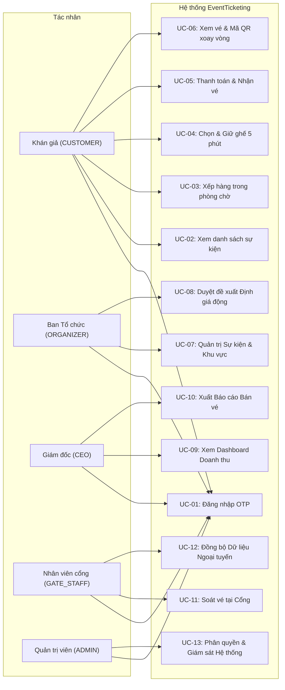

# Sơ đồ và Đặc tả trường hợp sử dụng (Use Case Diagram & Specifications)

Tài liệu đặc tả các trường hợp sử dụng (Use Case) cho hệ thống **EventTicketing**, bám sát các tác nhân và quy trình người dùng (User Flows) được quy định tại Mục 2 và Mục 4 của [`docs/design/README.md`](design/README.md).

---

## 1. Danh sách tác nhân (Actors)

### 1.1. Tác nhân người dùng nội bộ
| Tác nhân | Giá trị `users.role` | Trách nhiệm chính trong hệ thống |
|---|---|---|
| **Khán giả** (`CUSTOMER`, `SH-03`) | `CUSTOMER` | Khám phá sự kiện, xếp hàng ảo, chọn ghế, giữ chỗ 5 phút, thanh toán và quản lý vé QR động. |
| **Ban Tổ chức** (`ORGANIZER`, `SH-01`) | `ORGANIZER` | Khởi tạo địa điểm, khu vực, cấu hình giá sàn/trần, quản lý vòng đời bán vé, duyệt đề xuất giá động. |
| **Giám đốc điều hành** (`CEO`, `SH-02`) | `CEO` | Giám sát doanh thu và tỷ lệ lấp đầy theo thời gian thực, xuất báo cáo tài chính tổng hợp. |
| **Nhân viên cổng** (`GATE_STAFF`, `SH-04`) | `GATE_STAFF` | Quét mã QR kiểm tra tính hợp lệ của vé tại cửa vào (online và offline). |
| **Quản trị viên** (`ADMIN`) | `ADMIN` | Phân quyền tài khoản người dùng, giám sát an ninh và nhật ký kiểm toán hệ thống. |

### 1.2. Tác nhân hệ thống bên ngoài
| Hệ thống bên ngoài | Mã | Chức năng tương tác |
|---|---|---|
| **Cổng thanh toán** | `SH-05` | Cung cấp cổng thanh toán trực tuyến MoMo, VNPAY; gửi kết quả qua IPN/Webhook. |
| **Dịch vụ gửi mã OTP** | — | Máy chủ SMTP (email) và ứng dụng SMS Gateway trên Android (tin nhắn SMS). |
| **Cloudflare Turnstile** | — | Dịch vụ đánh giá bot/CAPTCHA vô hình nhằm bảo vệ các thao tác trọng yếu. |

---

## 2. Sơ đồ Use Case tổng thể (Use Case Diagram)

---

## 3. Đặc tả chi tiết các Use Case cốt lõi

### UC-01: Đăng nhập bằng OTP (Passwordless Authentication)
- **Tác nhân chính:** Khán giả, Ban Tổ chức, CEO, Nhân viên cổng, Quản trị viên.
- **Tác nhân hỗ trợ:** Dịch vụ gửi OTP (SMTP / SMS Gateway), Cloudflare Turnstile.
- **Mục đích:** Xác thực danh tính người dùng bằng mã OTP một lần gửi qua số điện thoại hoặc email mà không cần mật khẩu tĩnh.
- **Tiền điều kiện:** Người dùng có số điện thoại hoặc email hợp lệ và truy cập ứng dụng.
- **Hậu điều kiện:** Người dùng nhận được phiên đăng nhập hợp lệ (`session_token`) lưu trong cookie an toàn `HttpOnly`.
- **Luồng sự kiện chính:**
  1. Người dùng nhập số điện thoại hoặc địa chỉ email trên trang đăng nhập.
  2. Hệ thống kiểm tra thử thách Cloudflare Turnstile để loại trừ bot tự động.
  3. Người dùng bấm "Gửi mã xác thực".
  4. Hệ thống sinh mã OTP ngẫu nhiên 6 chữ số, băm mã lưu vào bảng `otp_verifications` kèm thời hạn 5 phút.
  5. Hệ thống gửi mã OTP qua SMS Gateway hoặc SMTP Server.
  6. Người dùng nhận tin nhắn và nhập mã OTP 6 số vào màn hình xác thực.
  7. Hệ thống kiểm tra mã OTP:
     - Nếu số điện thoại/email chưa tồn tại trong `users`: tự động tạo mới tài khoản với vai trò mặc định `CUSTOMER`.
     - Tạo bản ghi mới trong bảng `sessions`, trả về token phiên làm việc.
  8. Hệ thống điều hướng người dùng quay lại trang thao tác trước đó.
- **Luồng ngoại lệ / Luồng phụ:**
  - *4a. Bot bị chặn:* Thử thách Turnstile không vượt qua $\rightarrow$ Hệ thống từ chối gửi OTP, hiển thị cảnh báo.
  - *7a. Mã OTP sai hoặc hết hạn:* Hệ thống tăng số lần thử `attempts`. Nếu sai quá 5 lần, hủy mã OTP và yêu cầu lấy mã mới.
  - *7b. Yêu cầu gửi lại mã quá nhanh:* Giới hạn gửi lại mã tối thiểu cách nhau 60 giây.
- **Mã FR liên quan:** `FR-01`, `FR-04`, `FR-10`.

---

### UC-04: Chọn & Giữ ghế độc quyền 5 phút
- **Tác nhân chính:** Khán giả.
- **Tác nhân hỗ trợ:** Không có.
- **Mục đích:** Giữ độc quyền tối đa 4 ghế trong 5 phút để hoàn tất quy trình thanh toán, ngăn ngừa hiện tượng tranh chấp hoặc bán trùng vé.
- **Tiền điều kiện:** Khán giả đã đăng nhập và đang mở sơ đồ ghế trực quan của sự kiện.
- **Hậu điều kiện:** Ghế được đánh dấu `HELD` trong `event_seats` và bảng `seat_holds` tạo bản ghi `ACTIVE` với thời hạn 300 giây.
- **Luồng sự kiện chính:**
  1. Khán giả quan sát sơ đồ ghế với 4 màu quy ước (Xanh, Tím, Vàng, Xám).
  2. Khán giả bấm chọn một ghế màu xanh (`AVAILABLE`).
  3. Hệ thống mở giao dịch cơ sở dữ liệu và gọi khóa `pg_advisory_xact_lock(user_id, event_id)`.
  4. Hệ thống kiểm tra giới hạn vé: tổng số ghế đang giữ cộng số vé đã mua không vượt quá 4 (`FR-11`).
  5. Hệ thống thực thi cập nhật nguyên tử: chuyển trạng thái ghế sang `HELD` nếu trạng thái hiện tại là `AVAILABLE`.
  6. Hệ thống thêm bản ghi vào `seat_holds` với `expires_at = now() + INTERVAL '5 minutes'`.
  7. Hệ thống kích hoạt `pg_notify('events_stream')` đẩy thông báo realtime qua SSE.
  8. Giao dịch commit thành công, API trả về `201 Created` kèm `expires_at`.
  9. Màn hình của khán giả chuyển ghế sang màu tím và bắt đầu đếm ngược 5:00.
  10. Trình duyệt của các khán giả khác lập tức nhận sự kiện SSE và cập nhật ghế sang màu vàng cam.
- **Luồng ngoại lệ / Luồng phụ:**
  - *4a. Vượt quá giới hạn vé (4 vé):* Trả về HTTP `400 Bad Request (ticket_limit_exceeded)`. Ghế không được chọn.
  - *5a. Ghế đã bị người khác chọn trước:* Câu lệnh cập nhật khớp 0 dòng $\rightarrow$ Trả về HTTP `409 Conflict`. Màn hình thông báo "Ghế đã có người khác giữ".
  - *Quá hạn 5 phút chưa thanh toán:* Worker `HoldReaper` tự động thu hồi ghế, chuyển `seat_holds` sang `EXPIRED`, trả ghế về `AVAILABLE` và phát tín hiệu SSE cho tất cả client.
- **Mã FR liên quan:** `FR-03`, `FR-05`, `FR-06`, `FR-07`, `FR-11`, `NFR-03`, `NFR-10`.

---

### UC-05: Thanh toán & Nhận vé điện tử
- **Tác nhân chính:** Khán giả.
- **Tác nhân hỗ trợ:** Cổng thanh toán (MoMo / VNPAY), Dịch vụ Email.
- **Mục đích:** Hoàn tất thanh toán tiền vé và nhận vé điện tử an toàn.
- **Tiền điều kiện:** Khán giả đang có ít nhất 1 ghế giữ chỗ hợp lệ (`status = 'ACTIVE'`) còn trong thời hạn 5 phút.
- **Hậu điều kiện:** Đơn hàng chuyển sang `PAID`, ghế chuyển sang `SOLD`, vé được lưu vào cơ sở dữ liệu và gửi vào hòm thư khán giả.
- **Luồng sự kiện chính:**
  1. Khán giả xác nhận giỏ hàng và chọn phương thức thanh toán (MoMo hoặc VNPAY).
  2. Hệ thống tạo đơn hàng trong `orders` và `order_items` với trạng thái `PENDING`.
  3. Hệ thống tạo URL thanh toán tương ứng và điều hướng khán giả sang cổng đối tác.
  4. Khán giả hoàn tất việc quét mã hoặc thanh toán trên cổng đối tác.
  5. Cổng thanh toán gọi Webhook/IPN tới `/api/payments/{provider}/ipn` kèm chữ ký số xác thực.
  6. Hệ thống kiểm tra tính hợp lệ của chữ ký và đối soát mã giao dịch (`provider_txn_id`).
  7. Hệ thống cập nhật đơn hàng thành `PAID`, giao dịch thành `SUCCESS`.
  8. Ghế được chuyển sang trạng thái `SOLD`, lượt giữ ghế chuyển sang `CONVERTED`.
  9. Hệ thống phát hành vé điện tử với `qr_secret` sinh ngẫu nhiên, lưu vào bảng `tickets`.
  10. Hệ thống kích hoạt gửi email xác nhận chứa thông tin vé đến khán giả.
  11. Khán giả được điều hướng về trang thành công trên giao diện web.
- **Luồng ngoại lệ / Luồng phụ:**
  - *6a. Giao dịch IPN trùng lặp:* Hệ thống kiểm tra `provider_txn_id`, nếu đã xử lý thì trả về `200 OK` ngay lập tức mà không xử lý lại (`idempotent`).
  - *7a. Thanh toán tới trễ khi lượt giữ đã hết hạn:* Hệ thống chuyển giao dịch sang quy trình đối soát (`reconciliation`): nếu ghế vẫn còn trống thì tự động cấp vé; nếu ghế đã bị người khác mua thì thực thi lệnh hoàn tiền tự động.
- **Mã FR liên quan:** `FR-13`, `FR-14`, `FR-15`, `NFR-04`.

---

### UC-08: Duyệt đề xuất Định giá động (Dynamic Pricing Approval)
- **Tác nhân chính:** Ban Tổ chức (`ORGANIZER`).
- **Tác nhân hỗ trợ:** Background Pricing Worker.
- **Mục đích:** Ban Tổ chức xem xét và phê duyệt hoặc từ chối các đề xuất điều chỉnh giá vé do thuật toán thông minh đưa ra.
- **Tiền điều kiện:** Ban Tổ chức đã đăng nhập vào Organizer Console; sự kiện đang trong thời gian mở bán.
- **Hậu điều kiện:** Giá của các ghế chưa bán (`AVAILABLE`) được cập nhật theo giá mới được duyệt; bảng `price_changes` ghi nhận nhật ký bất biến.
- **Luồng sự kiện chính:**
  1. Background Pricing Worker định kỳ 5 phút chạy ngầm, tính toán chỉ số cung cầu cho từng khu vực.
  2. Nếu giá đề xuất chênh lệch $\ge 5\%$ so với giá hiện tại, worker tạo bản ghi trong bảng `price_suggestions` với trạng thái `PENDING`.
  3. Ban Tổ chức mở mục "Đề xuất giá" trên Organizer Console và quan sát:
     - Tên khu vực, giá hiện tại, giá đề xuất mới (làm tròn 10.000 VNĐ, trong khoảng giá sàn/trần).
     - Lý do định lượng: tốc độ bán thực tế, độ dài hàng chờ, tỷ lệ ghế giữ.
  4. Ban Tổ chức lựa chọn:
     - **Duyệt (Approve):** Hệ thống gọi API `POST /api/organizer/suggestions/{id}/approve`.
     - Cập nhật giá bán của toàn bộ các ghế đang `AVAILABLE` trong khu vực tương ứng.
     - Thêm bản ghi vào `price_changes` (bảng bất biến, không thể sửa/xóa).
     - Phát tín hiệu SSE cập nhật bảng giá trên toàn bộ màn hình khán giả.
- **Luồng ngoại lệ / Luồng phụ:**
  - *4a. Từ chối (Reject):* Ban Tổ chức bấm "Từ chối" $\rightarrow$ Hệ thống gọi `POST /api/organizer/suggestions/{id}/reject`, đánh dấu đề xuất `REJECTED`, giá bán hiện tại giữ nguyên không đổi.
- **Mã FR liên quan:** `FR-08`, `FR-20`, `FR-22`, `W-01`, `NFR-12`.

---

### UC-11: Soát vé tại Cổng (Gate Check-in)
- **Tác nhân chính:** Nhân viên cổng (`GATE_STAFF`).
- **Tác nhân hỗ trợ:** Camera thiết bị di động.
- **Mục đích:** Xác thực vé của khán giả tại cổng ra vào sự kiện, ngăn ngừa vé giả mạo và vé đã sử dụng trước đó.
- **Tiền điều kiện:** Nhân viên cổng đã đăng nhập ứng dụng soát vé, chọn đúng cổng và sự kiện.
- **Hậu điều kiện:** Vé hợp lệ được chuyển trạng thái sang `USED`, ghi nhận 1 dòng lịch sử vào `checkin_logs`.
- **Luồng sự kiện chính:**
  1. Nhân viên cổng hướng camera vào mã QR trên màn hình điện thoại của khán giả.
  2. Ứng dụng giải mã chuỗi QR gồm: `ticket_code.step.HMAC_signature`.
  3. Hệ thống kiểm tra:
     - Bước nhảy thời gian `step` nằm trong khoảng cho phép ($\pm 1$ chu kỳ 30 giây).
     - Chữ ký HMAC khớp với `qr_secret` của vé.
     - Trạng thái vé trong cơ sở dữ liệu đang là `ISSUED` hoặc `ACTIVE`.
  4. Hệ thống thực hiện cập nhật nguyên tử chuyển trạng thái vé sang `USED`.
  5. Ghi nhận thời gian, mã nhân viên và vị trí cổng vào `checkin_logs`.
  6. Màn hình thiết bị sáng màu xanh: **HỢP LỆ — MỜI VÀO**.
- **Luồng ngoại lệ / Luồng phụ:**
  - *3a. Vé đã được quét trước đó:* Màn hình báo đỏ **ĐÃ SỬ DỤNG**, hiển thị chi tiết thời gian và cổng đã quét lần đầu (`FR-17`).
  - *3b. Mã QR quá hạn (ảnh chụp màn hình):* Bước nhảy `step` cũ hơn 60 giây $\rightarrow$ Báo lỗi **MÃ QR KHÔNG HỢP LỆ HOẶC ĐÃ HẾT HẠN**.
  - *Mất kết nối Internet:* Ứng dụng tự động chuyển sang chế độ Ngoại tuyến (`UC-12 / FR-18`), đối chiếu với danh sách mã vé đã tải sẵn và lưu log trên thiết bị để đồng bộ sau khi có mạng.
- **Mã FR liên quan:** `FR-12`, `FR-16`, `FR-17`, `FR-18`, `NFR-05`, `NFR-06`, `NFR-08`.
