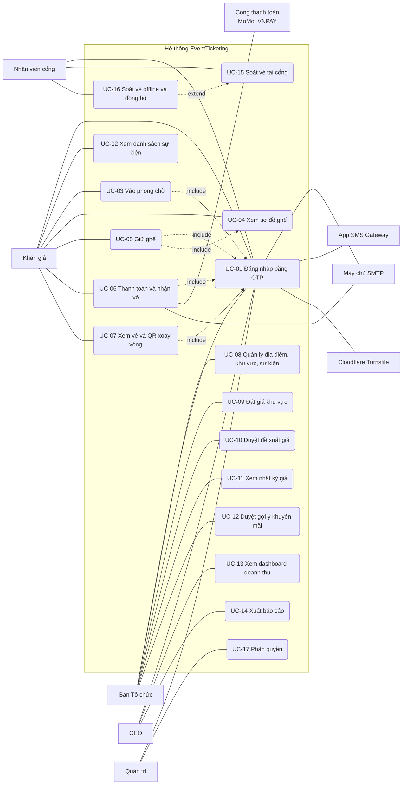

# Sơ đồ và đặc tả Use Case

Tác nhân lấy từ mục 2 của [`design/README.md`](design/README.md).
Luồng chính lấy từ mục 4, quy tắc nghiệp vụ từ mục 6.
Mã FR khớp với bảng cờ ở mục 1 của thiết kế.
Use case của Sprint 2 bám theo code trong `backend/internal/`, các use case sau đó theo thiết kế.

## 1. Tác nhân

### 1.1 Người dùng

| Tác nhân | `users.role` | Nhiệm vụ |
|---|---|---|
| Khán giả (SH-03) | `CUSTOMER` | Mua vé, xem vé |
| Ban Tổ chức (SH-01) | `ORGANIZER` | Tạo sự kiện, đặt giá, duyệt đề xuất giá |
| CEO (SH-02) | `CEO` | Xem doanh thu, xuất báo cáo |
| Nhân viên cổng (SH-04) | `GATE_STAFF` | Soát vé |
| Quản trị | `ADMIN` | Phân quyền |

Mọi vai trò đều đăng nhập bằng OTP (UC-01).
Tài khoản mới luôn có vai trò `CUSTOMER`.

### 1.2 Hệ thống ngoài

| Hệ thống | Vai trò |
|---|---|
| Cổng thanh toán (SH-05): MoMo, VNPAY | Nhận yêu cầu thanh toán, gửi kết quả về api qua IPN |
| Máy chủ SMTP | Gửi mã OTP và vé qua email |
| App SMS Gateway (điện thoại Android) | Gửi mã OTP qua SMS |
| Cloudflare Turnstile | Kiểm tra bot khi xin mã OTP |

## 2. Sơ đồ Use Case

## 3. Đặc tả

Mỗi use case ghi cờ tính năng.
Cờ tắt thì giao diện ẩn tính năng và API trả `404 feature_disabled`.

### UC-01: Đăng nhập bằng OTP

- **Tác nhân:** Khán giả, Ban Tổ chức, CEO, Nhân viên cổng, Quản trị.
- **Hệ thống ngoài:** máy chủ SMTP, app SMS Gateway, Cloudflare Turnstile.
- **Cờ:** `otp_login` (Sprint 2), `bot_check` (Sprint 3).
- **Tiền điều kiện:**
  - Người dùng có SĐT hoặc email.
  - Tài khoản chưa có cũng được, vì lần đầu đăng nhập hệ thống tự tạo.
- **Luồng chính:**
  1. Người dùng nhập SĐT hoặc email ở trang đăng nhập.
  2. Trình duyệt chạy kiểm tra Turnstile (từ Sprint 3).
  3. Người dùng gửi yêu cầu `POST /api/auth/otp/request`.
  4. Hệ thống chuẩn hóa địa chỉ nhận mã:
     - có `@` là email, kênh `EMAIL`, chuyển chữ thường;
     - còn lại là SĐT, kênh `SMS`, bỏ dấu cách, `-`, `.`, phải có 9–15 chữ số.
  5. Hệ thống sinh mã 6 số, lưu SHA-256 của mã vào `otp_verifications`, hạn 5 phút.
  6. Hệ thống gửi mã qua SMTP hoặc SMS Gateway.
  7. Người dùng nhập mã, gửi `POST /api/auth/otp/verify`.
  8. Hệ thống kiểm tra mã. Nếu SĐT hoặc email chưa có trong `users` thì tạo tài khoản `CUSTOMER`.
  9. Hệ thống tạo dòng trong `sessions`, trả cookie `session_token` (`HttpOnly`, hiệu lực 7 ngày).
  10. Trình duyệt quay lại trang đang thao tác.
- **Luồng phụ:**
  - 2a. Turnstile không qua: từ chối gửi mã.
  - 3a. Một IP gọi quá 30 lần mỗi phút (tính chung `otp/request` và `otp/verify`): `429 rate_limited`.
  - 4a. Địa chỉ sai định dạng: `400 invalid_destination`.
  - 5a. Cùng địa chỉ xin mã chưa đủ 60 giây, hoặc đã xin 5 mã trong 1 giờ: `429 otp_rate_limited`.
  - 8a. Mã sai, hết hạn (5 phút), đã dùng, hoặc đã nhập 5 lần (tính cả lần đúng): `401 otp_invalid`. Người dùng phải xin mã mới.
  - 8b. Tài khoản `LOCKED` hoặc `DISABLED`: `403 account_inactive`.
  - 10a. Đăng xuất: `POST /api/auth/logout` xóa dòng `sessions` của phiên.
- **Ghi chú Sprint 2:** api chưa gọi SMTP hay SMS Gateway. Mã hiện trên màn hình khi `OTP_DEMO=true`, nếu không thì ghi vào log của api.
- **FR liên quan:** FR-01, FR-04, FR-10.

### UC-02: Xem danh sách sự kiện

- **Tác nhân:** Khán giả (không cần đăng nhập).
- **Cờ:** luôn bật.
- **Tiền điều kiện:** không có.
- **Luồng chính:**
  1. Khán giả mở trang chủ, hệ thống gọi `GET /api/events`.
  2. Trang hiện các sự kiện đang bán.
  3. Khán giả lọc theo thể loại, thành phố, ngày, giá.
  4. Khán giả chọn một sự kiện, hệ thống gọi `GET /api/events/{slug}` và hiện trang chi tiết.
  5. Khán giả bấm **Mua vé** để sang UC-03 hoặc UC-04.
- **Luồng phụ:**
  - 3a. Không sự kiện nào khớp bộ lọc: hiện danh sách rỗng.
  - 4a. Không có sự kiện với `slug` đó: hiện thông báo không tìm thấy.
- **FR liên quan:** FR-02.

### UC-03: Vào phòng chờ

- **Tác nhân:** Khán giả.
- **Cờ:** `waiting_room` (Sprint 3).
- **Tiền điều kiện:**
  - Khán giả đã đăng nhập (UC-01).
  - Sự kiện bật `waiting_room_enabled`.
- **Luồng chính:**
  1. Khán giả bấm **Mua vé**, trình duyệt gọi `POST /api/events/{id}/queue`.
  2. Hệ thống ghi một dòng `queue_entries` trạng thái `WAITING`.
  3. Trang hiện "Bạn đang ở vị trí N, chờ khoảng X phút".
     Trình duyệt hỏi `GET /api/events/{id}/queue/me`, thông tin làm mới tối đa 10 giây một lần.
  4. Số người đang mua nhỏ hơn `waiting_room_capacity`, hệ thống cho người đầu hàng vào: trạng thái `ADMITTED`, hạn 10 phút.
  5. Trình duyệt tự chuyển sang trang chọn ghế (UC-04).
- **Luồng phụ:**
  - 1a. Khán giả đã có dòng trong hàng của sự kiện này: trả lại vị trí hiện tại, không tạo dòng mới.
  - 2a. Sự kiện tắt phòng chờ: khán giả vào thẳng trang chọn ghế.
  - 4a. Khán giả được vào nhưng quá 10 phút: trạng thái `EXPIRED`, phải xếp hàng lại.
  - 3b. Khán giả rời trang và hủy chờ: trạng thái `LEFT`.
- **Quy tắc:** thời gian chờ ước tính bằng vị trí chia tốc độ cho vào gần đây.
- **FR liên quan:** FR-09.

### UC-04: Xem sơ đồ ghế

- **Tác nhân:** Khán giả.
- **Cờ:** `seat_map_realtime` (Sprint 2).
- **Tiền điều kiện:** sự kiện tồn tại. Xem sơ đồ không cần đăng nhập, nhưng ghế "mình đang giữ" chỉ hiện khi đã đăng nhập.
- **Luồng chính:**
  1. Trình duyệt gọi `GET /api/events/{id}/seats`.
  2. Hệ thống trả danh sách ghế kèm khu vực, giá và trạng thái.
  3. Trang vẽ ghế bằng 4 màu:
     - xanh: còn trống;
     - xám: đã bán;
     - vàng: người khác đang giữ;
     - tím: mình đang giữ.
  4. Trình duyệt mở `EventSource` tới `GET /api/events/{id}/stream`.
  5. Khi ghế đổi trạng thái, hệ thống gửi sự kiện SSE và trang đổi màu ghế, không cần tải lại.
- **Luồng phụ:**
  - 1a. Không có sự kiện với mã đó: `404 event_not_found`.
  - 5a. Lượt giữ hết hạn: ghế về xanh sau tối đa 5 giây, vì `HoldReaper` quét 5 giây một lần.
- **FR liên quan:** FR-03, FR-05.

### UC-05: Giữ ghế

- **Tác nhân:** Khán giả.
- **Cờ:** `seat_hold` (Sprint 2), `ticket_limit` (Sprint 3).
- **Tiền điều kiện:**
  - Khán giả đã đăng nhập.
  - Khán giả đang mở sơ đồ ghế (UC-04).
  - Nếu sự kiện bật phòng chờ thì khán giả đã được vào (UC-03).
- **Luồng chính:**
  1. Khán giả bấm một ghế xanh.
  2. Trình duyệt gọi `POST /api/holds` với `eventId` và `seatId`.
  3. Hệ thống mở một giao dịch và kiểm tra sự kiện đang `ON_SALE`, trong thời gian mở bán.
  4. Khi cờ `ticket_limit` bật, hệ thống khóa theo cặp (người dùng, sự kiện) bằng `pg_advisory_xact_lock`. Hệ thống đếm số ghế đang giữ cộng số vé chưa `VOID` của người đó.
  5. Hệ thống chuyển ghế từ `AVAILABLE` sang `HELD` bằng một câu `UPDATE` có điều kiện.
  6. Hệ thống ghi một dòng `seat_holds` trạng thái `ACTIVE`, `expires_at` bằng bây giờ cộng 5 phút.
  7. Hệ thống gửi `NOTIFY` trong cùng giao dịch, rồi commit.
  8. api trả `201` kèm `holdId`, `holdToken`, `expiresAt`.
  9. Ghế của khán giả chuyển tím và đồng hồ đếm ngược theo `expiresAt` của server.
  10. Trình duyệt của người khác nhận SSE và đổi ghế sang vàng.
- **Luồng phụ:**
  - 2a. Chưa đăng nhập: `401 unauthorized`.
  - 3a. Sự kiện chưa mở bán, tạm dừng hoặc đã kết thúc: `409 event_not_on_sale`.
  - 4a. Số ghế giữ cộng vé đã mua đạt `events.max_tickets_per_user` (mặc định 4): `400 ticket_limit_reached`, giao diện hiện "Đã đạt giới hạn số vé cho sự kiện này".
  - 5a. Câu `UPDATE` không đổi dòng nào, tức ghế đã có người giữ hoặc đã bán: `409 seat_not_available`. Giao diện báo lỗi, ghế không vào giỏ.
  - 6a. Unique index trên `seat_holds` từ chối do hai yêu cầu cùng lúc: `409 seat_not_available`. Đây là lớp chặn thứ hai.
  - 9a. Khán giả bỏ chọn: `DELETE /api/holds/{seatId}`, ghế về trống.
  - 9b. Quá 5 phút chưa thanh toán: `HoldReaper` chuyển lượt giữ sang `EXPIRED`, ghế về `AVAILABLE`, khán giả nhận thông báo hết hạn.
- **Ghi chú Sprint 2:** profile `sprint2` chưa bật `ticket_limit`, nên bước 4 và luồng 4a chưa chạy.
- **FR liên quan:** FR-06, FR-07, FR-11.

### UC-06: Thanh toán và nhận vé

- **Tác nhân:** Khán giả.
- **Hệ thống ngoài:** Cổng thanh toán (MoMo, VNPAY), máy chủ SMTP.
- **Cờ:** `payments`, `ticket_email`, `reconciliation` (Sprint 4).
- **Tiền điều kiện:** khán giả có ít nhất một lượt giữ `ACTIVE` còn hạn (UC-05).
- **Luồng chính:**
  1. Khán giả chọn MoMo hoặc VNPAY.
  2. Hệ thống tạo đơn từ các ghế đang giữ (`POST /api/orders`): `orders` và `order_items`, trạng thái `PENDING`.
  3. Hệ thống tạo giao dịch (`POST /api/orders/{id}/payments`) và chuyển khán giả sang cổng thanh toán.
  4. Khán giả thanh toán trên cổng.
  5. Cổng gửi IPN tới `POST /api/payments/{provider}/ipn`.
  6. api kiểm tra chữ ký và `provider_txn_id`.
  7. Đơn chuyển `PAID`, giao dịch chuyển `SUCCESS`, ghế chuyển `SOLD`, lượt giữ chuyển `CONVERTED`.
  8. Hệ thống phát hành vé vào bảng `tickets` và gửi vé qua email.
  9. Trình duyệt về trang kết quả (`GET /api/payments/{provider}/return`), khán giả vào UC-07 để xem vé.
- **Luồng phụ:**
  - 2a. Lượt giữ đã hết hạn: không tạo đơn, khán giả chọn lại ghế.
  - 6a. Chữ ký sai: api từ chối IPN, đơn giữ nguyên.
  - 6b. IPN gửi lại với cùng `provider_txn_id`: chỉ xử lý một lần, các lần sau trả kết quả cũ, không tạo thêm đơn hay vé.
  - 7a. Thanh toán thất bại: đơn giữ `PENDING` đến khi hết hạn thì chuyển `EXPIRED`.
  - 7b. Tiền về sau khi lượt giữ hết hạn: đơn chuyển sang đối soát.
    - Ghế còn trống: phát vé.
    - Ghế đã bán cho người khác: hoàn tiền, đơn `REFUNDED`.
  - 8a. Gửi email lỗi: vé vẫn có trong "Vé của tôi" (UC-07).
  - 9a. Quá 5 phút chưa thanh toán: ghế về trống, khán giả nhận thông báo hết hạn.
- **FR liên quan:** FR-13, FR-14, FR-15.

### UC-07: Xem vé và QR xoay vòng

- **Tác nhân:** Khán giả.
- **Cờ:** `rotating_qr` (Sprint 3).
- **Tiền điều kiện:** khán giả đã đăng nhập và có vé (UC-06).
- **Luồng chính:**
  1. Khán giả mở trang "Vé của tôi" (`GET /api/me/tickets`).
  2. Khán giả chọn một vé, trình duyệt gọi `GET /api/tickets/{id}/qr`.
  3. Hệ thống tạo nội dung QR dạng `ticket_code.step.HMAC(qr_secret, step)`. `step` tăng 1 sau mỗi 30 giây.
  4. Trang vẽ QR, tự lấy mã mới mỗi 30 giây, kèm cảnh báo không dùng ảnh chụp màn hình.
- **Luồng phụ:**
  - 2a. Vé không thuộc khán giả này: từ chối.
  - 4a. Ảnh chụp màn hình cũ hơn 60 giây bị cổng từ chối (UC-15).
- **FR liên quan:** FR-12.

### UC-08: Quản lý địa điểm, khu vực, sự kiện

- **Tác nhân:** Ban Tổ chức.
- **Cờ:** `organizer_console` (Sprint 2).
- **Tiền điều kiện:** đã đăng nhập với vai trò `ORGANIZER`.
- **Luồng chính:**
  1. Ban Tổ chức tạo địa điểm.
  2. Thêm khu vực: mã, tên, màu.
  3. Sinh ghế theo số hàng và số ghế mỗi hàng.
  4. Tạo sự kiện: tên, mô tả, ảnh, thể loại, thời gian diễn ra, thời gian mở bán.
  5. Đặt giới hạn vé mỗi tài khoản, bật hoặc tắt phòng chờ.
  6. Đặt giá từng khu vực (UC-09).
  7. Mở bán, tạm dừng hoặc kết thúc bán.
- **Luồng phụ:**
  - Người dùng không phải `ORGANIZER` (hoặc `ADMIN`): `403 forbidden`.
  - Sự kiện của Ban Tổ chức khác: `403 not_event_organizer`.
  - `ends_at` không sau `starts_at`, hoặc `sales_ends_at` không sau `sales_starts_at`: cơ sở dữ liệu từ chối.
- **Ghi chú Sprint 2:** mới có xem danh sách sự kiện của mình (`GET /api/organizer/events`) và đặt giá khu vực. Các bước 1–5 và 7 chưa có code.
- **FR liên quan:** FR-08.

### UC-09: Đặt giá khu vực

- **Tác nhân:** Ban Tổ chức.
- **Cờ:** `zone_pricing`, `organizer_console` (Sprint 2).
- **Tiền điều kiện:** đã đăng nhập với vai trò `ORGANIZER`, sự kiện thuộc về mình và khu vực đã gắn vào sự kiện.
- **Luồng chính:**
  1. Ban Tổ chức nhập giá cơ bản, giá sàn, giá trần của một khu vực.
  2. Trình duyệt gọi `PUT /api/organizer/events/{id}/zones/{zoneId}/pricing`.
  3. Hệ thống kiểm tra `0 ≤ giá sàn ≤ giá cơ bản ≤ giá trần`.
  4. Hệ thống cập nhật `event_zones`.
  5. Nếu giá cơ bản đổi, hệ thống đặt lại giá mọi ghế `AVAILABLE` trong khu vực và ghi một dòng `price_changes` (lý do `MANUAL`).
  6. Hệ thống trả giá mới.
- **Luồng phụ:**
  - 3a. Không thỏa điều kiện ở bước 3: `400 invalid_price_bounds`, không đổi gì.
  - 2a. Không có sự kiện hoặc khu vực: `404 event_not_found` hoặc `404 zone_not_found`.
  - 2b. Sự kiện của người khác: `403 not_event_organizer`.
  - 5a. Giá cơ bản không đổi: chỉ đổi sàn và trần, không ghi `price_changes`.
- **Quy tắc:** ghế đã `HELD` hoặc `SOLD` giữ nguyên giá cũ.
- **FR liên quan:** FR-08, FR-20.

### UC-10: Duyệt đề xuất giá

- **Tác nhân:** Ban Tổ chức.
- **Cờ:** `dynamic_pricing` (Sprint 5).
- **Tiền điều kiện:** có đề xuất `PENDING` của sự kiện thuộc Ban Tổ chức.
- **Luồng chính:**
  1. Cứ 5 phút, hệ thống tính giá đề xuất cho từng khu vực từ:
     - tốc độ bán thực tế;
     - tốc độ cần đạt để bán hết trước giờ đóng bán;
     - số người trong hàng chờ;
     - tỷ lệ ghế đang bị giữ.
  2. Giá làm tròn tới 10.000đ và nằm trong [giá sàn, giá trần].
  3. Lệch từ 5% so với giá hiện tại thì hệ thống ghi `price_suggestions`.
  4. Ban Tổ chức mở đề xuất, xem giá mới, lý do và số liệu.
  5. Ban Tổ chức bấm duyệt: `POST /api/organizer/suggestions/{id}/approve`.
  6. Giá các ghế chưa bán trong khu vực đổi, hệ thống ghi `price_changes`.
- **Luồng phụ:**
  - 3a. Lệch dưới 5%: bỏ qua, không tạo đề xuất.
  - 5a. Bấm từ chối: `POST /api/organizer/suggestions/{id}/reject`, giá giữ nguyên.
  - 5b. Ban Tổ chức không xử lý: đề xuất vẫn `PENDING`, giá không tự đổi.
- **Quy tắc:** hệ thống không bao giờ tự đổi giá.
- **FR liên quan:** FR-22, FR-20.

### UC-11: Xem nhật ký giá

- **Tác nhân:** Ban Tổ chức.
- **Cờ:** `price_log` (Sprint 5).
- **Tiền điều kiện:** đã đăng nhập với vai trò `ORGANIZER`.
- **Luồng chính:**
  1. Ban Tổ chức mở trang nhật ký giá của một sự kiện.
  2. Hệ thống đọc `price_changes` theo sự kiện và khu vực.
  3. Trang hiện từng lần đổi: giá cũ, giá mới, người đổi, lý do, thời gian.
- **Luồng phụ:**
  - Sự kiện của người khác: từ chối.
  - Chưa có lần đổi giá nào: hiện danh sách rỗng.
- **Quy tắc:**
  - Nhật ký luôn được ghi, cờ chỉ ẩn hoặc hiện trang xem.
  - Trigger chặn sửa và xóa `price_changes`.
- **FR liên quan:** FR-20.

### UC-12: Duyệt gợi ý khuyến mãi

- **Tác nhân:** Ban Tổ chức.
- **Cờ:** `promo_suggestions` (Sprint 5).
- **Tiền điều kiện:** có gợi ý khuyến mãi cho sự kiện của Ban Tổ chức.
- **Luồng chính:**
  1. Hệ thống tạo gợi ý khuyến mãi cho sự kiện.
  2. Ban Tổ chức xem gợi ý.
  3. Ban Tổ chức duyệt: `promotions.is_active` bật, ghi `approved_by` và `approved_at`.
- **Luồng phụ:**
  - 3a. Từ chối hoặc bỏ qua: khuyến mãi không bật.
- **Ghi chú:** thiết kế chưa mô tả luồng này chi tiết.
- **FR liên quan:** FR-23.

### UC-13: Xem dashboard doanh thu

- **Tác nhân:** CEO.
- **Cờ:** `ceo_dashboard` (Sprint 5).
- **Tiền điều kiện:** đã đăng nhập với vai trò `CEO`.
- **Luồng chính:**
  1. CEO mở dashboard, trình duyệt kết nối `GET /api/dashboard/stream`.
  2. Dashboard hiện doanh thu, số vé đã bán, tỷ lệ lấp đầy.
  3. Số liệu chia theo phút, theo sự kiện, theo khu vực.
  4. Khi có vé bán ra, số liệu cập nhật trực tiếp, trễ không quá 60 giây (NFR-11).
- **Luồng phụ:**
  - 1a. Người dùng không phải `CEO`: `403 forbidden`.
- **FR liên quan:** FR-19.

### UC-14: Xuất báo cáo

- **Tác nhân:** CEO.
- **Cờ:** `reports_export` (Sprint 5).
- **Tiền điều kiện:** đã đăng nhập với vai trò `CEO`.
- **Luồng chính:**
  1. CEO chọn định dạng CSV hoặc XLSX.
  2. Trình duyệt gọi `GET /api/reports/sales.csv` hoặc `GET /api/reports/sales.xlsx`.
  3. Hệ thống tạo file và trả về để tải xuống.
- **Luồng phụ:**
  - 1a. Người dùng không phải `CEO`: `403 forbidden`.
- **FR liên quan:** FR-21.

### UC-15: Soát vé tại cổng

- **Tác nhân:** Nhân viên cổng.
- **Cờ:** `gate_checkin` (Sprint 5).
- **Tiền điều kiện:**
  - Đã đăng nhập với vai trò `GATE_STAFF`, mở trang soát vé trên điện thoại.
  - Đã chọn sự kiện và cổng.
- **Luồng chính:**
  1. Nhân viên quét QR trên điện thoại khán giả bằng camera.
  2. Trình duyệt gọi `POST /api/gate/checkins` với nội dung QR.
  3. Hệ thống kiểm tra `step` là bước hiện tại, liền trước hoặc liền sau, và chữ ký HMAC khớp `qr_secret`.
  4. Hệ thống chuyển vé sang `USED`, chỉ khi vé đang `ISSUED` hoặc `ACTIVE`.
  5. Hệ thống ghi một dòng `checkins`.
  6. Màn hình hiện **Hợp lệ** (xanh).
- **Luồng phụ:**
  - 4a. Vé đã `USED`: hiện **Đã sử dụng** (đỏ), kèm giờ và cổng đã quét trước đó. Hệ thống ghi `checkins` kết quả `ALREADY_USED`.
  - 3a. Chữ ký sai, vé không tồn tại, hoặc `step` cũ hơn 60 giây (ảnh chụp màn hình): hiện **Không hợp lệ**.
  - 1a. Mất mạng: chuyển sang UC-16.
- **Quy tắc:** hai cổng quét cùng một vé cùng lúc thì chỉ một cổng hợp lệ, vì bước 4 là một câu `UPDATE` có điều kiện.
- **FR liên quan:** FR-16, FR-17.

### UC-16: Soát vé offline và đồng bộ

- **Tác nhân:** Nhân viên cổng.
- **Cờ:** `offline_checkin` (Sprint 5).
- **Tiền điều kiện:**
  - Đã đăng nhập với vai trò `GATE_STAFF`.
  - Đã tải danh sách vé của sự kiện khi còn mạng (`GET /api/gate/events/{id}/manifest`).
- **Luồng chính:**
  1. Máy mất mạng, ứng dụng chuyển sang chế độ offline.
  2. Nhân viên quét QR. Máy tự kiểm tra chữ ký QR và đối chiếu danh sách vé đã tải.
  3. Máy lưu từng lượt quét, kèm `client_event_id`, vào bộ nhớ trên máy.
  4. Có mạng lại, máy gửi các lượt quét lên server (`POST /api/gate/sync`).
  5. Server ghi vào `checkins` với `is_offline = true` và `synced_at`.
- **Luồng phụ:**
  - 5a. Hai cổng cùng quét một vé khi offline: lượt quét đến sau được ghi `OFFLINE_CONFLICT`.
  - 4a. Gửi lại cùng một lượt quét: `client_event_id` là duy nhất, nên không ghi trùng.
  - 2a. Vé không có trong danh sách đã tải: hiện **Không hợp lệ**.
- **Quy tắc:** máy chạy offline được ít nhất 4 giờ, đồng bộ trong 2 phút sau khi có mạng (NFR-06).
- **FR liên quan:** FR-18.

### UC-17: Phân quyền

- **Tác nhân:** Quản trị.
- **Cờ:** luôn bật.
- **Tiền điều kiện:** đã đăng nhập với vai trò `ADMIN`.
- **Luồng chính:**
  1. Quản trị tìm tài khoản theo SĐT hoặc email.
  2. Quản trị chọn vai trò mới: `CUSTOMER`, `ORGANIZER`, `CEO`, `GATE_STAFF` hoặc `ADMIN`.
  3. Hệ thống cập nhật `users.role` và ghi `audit_logs`.
  4. Lần gọi API sau của tài khoản đó dùng vai trò mới.
- **Luồng phụ:**
  - 1a. Không tìm thấy tài khoản: hiện thông báo.
  - Người dùng không phải `ADMIN`: `403 forbidden`.
- **Ghi chú:** thiết kế chỉ ghi nhiệm vụ "Phân quyền" cho tác nhân này và không có FR tương ứng. Chưa có endpoint cho use case này.
- **FR liên quan:** không có.

## 4. Truy vết FR

| FR | Cờ | Use case |
|---|---|---|
| FR-01 | `otp_login` | UC-01 |
| FR-02 | luôn bật | UC-02 |
| FR-03 | `seat_map_realtime` | UC-04 |
| FR-04 | `otp_login` | UC-01 |
| FR-05 | `seat_map_realtime` | UC-04 |
| FR-06 | `seat_hold` | UC-05 |
| FR-07 | `seat_hold` | UC-05 |
| FR-08 | `zone_pricing`, `organizer_console` | UC-08, UC-09 |
| FR-09 | `waiting_room` | UC-03 |
| FR-10 | `bot_check` | UC-01 |
| FR-11 | `ticket_limit` | UC-05 |
| FR-12 | `rotating_qr` | UC-07 |
| FR-13 | `payments` | UC-06 |
| FR-14 | `ticket_email` | UC-06 |
| FR-15 | `reconciliation` | UC-06 |
| FR-16 | `gate_checkin` | UC-15 |
| FR-17 | `gate_checkin` | UC-15 |
| FR-18 | `offline_checkin` | UC-16 |
| FR-19 | `ceo_dashboard` | UC-13 |
| FR-20 | `price_log` | UC-09, UC-10, UC-11 |
| FR-21 | `reports_export` | UC-14 |
| FR-22 | `dynamic_pricing` | UC-10 |
| FR-23 | `promo_suggestions` | UC-12 |
